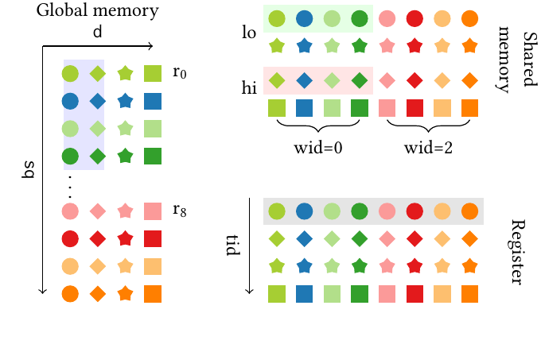
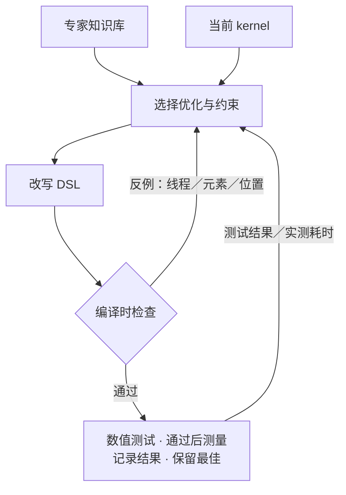
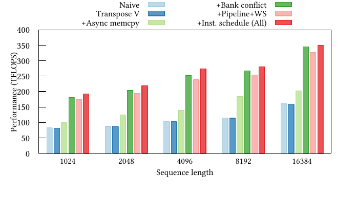

# Argus：用数据流不变量指导 GPU Kernel 优化

GPU kernel 的布局和流水线优化会同时改变线程分工、数据存放位置和使用顺序。一次改动算错后，最终输出测试通常只能告诉 agent 结果不对，很难直接指出哪个线程在什么位置拿错了数据。**Argus 为数据附上编译时的符号标签，在消费位置检查元素之间应满足的关系，再将失败反例返回给 agent。**

这些关系称为**数据流不变量（data-flow invariants）**。例如，矩阵乘法的一次乘加必须配对相同求和坐标的元素；并行搬运数据的线程也不能意外覆盖同一块共享内存。Argus 用一门 tile DSL 表达实现和这些约束，由编译器检查，再结合正确性测试与性能测量推进优化。

本文依据用户提供的 [Argus 论文 PDF](https://mast.stanford.edu/pubs/argus_agentic_gpu_optimization_guided_by_data_flow_invariants/paper.pdf) 编写。原图保留论文图号；简化配对例子用于说明机制，实验数字来自原文。原型和实验面向 AMD MI300X。

## 背景：高性能 Kernel 需要维持哪些数据关系

### Tile、布局与矩阵指令

GPU 通常将大矩阵分成较小的 **tile**，安排一组线程共同处理。输入先从显存进入寄存器或共享内存，再送入计算指令。**布局（layout）**规定一个逻辑坐标对应哪个物理位置，以及哪个线程持有它。

同一组矩阵元素可以有不同布局：显存中相邻的元素，进入共享内存后可能被分散，以减少访存冲突；进入寄存器后，又要按矩阵指令规定的格式交给各线程。值没有改变，持有者与位置却已经改变了。

Argus 面向的 MI300X 使用 **Matrix Core** 执行矩阵运算，对应指令称为 **MFMA**。论文沿用 warp 这一称呼表示 AMD 的 64 线程 wavefront。一个 MFMA 由这些线程共同提供操作数，输入和结果在各线程中的排列需要符合指令要求。

> 本文的共享内存指线程块内协作使用的片上存储，AMD 通常称为 LDS。这里的 warp 大小和 MFMA 布局来自 MI300X，不能直接套用 NVIDIA 的 32 线程 warp 与矩阵指令格式。

### 实现场景：Attention 中的两次矩阵乘法

论文用 FlashAttention 说明问题。先将一个注意力头的输入写为：

- $Q,K,V\in\mathbb{R}^{N\times d}$：查询、键和值；$N$ 为序列长度，$d$ 为每头维度。
- $S$：查询与键的相关性分数。
- $P$：对分数归一化后的注意力权重。
- $O$：最终输出。

先用 $Q$ 与 $K$ 计算分数，再用归一化权重加权 $V$：

$$
S=QK^\mathsf{T},\qquad P=\operatorname{softmax}(S),\qquad O=PV.
$$

FlashAttention 按块推进，并通过在线 softmax 累积结果，避免把完整的 $N\times N$ 分数矩阵写入显存。本文关注已经选择这套算法之后，数据怎样被搬运和排列。

论文的实现例子让各 warp 分担查询行及对应输出，并复用共享内存中的 $K,V$。

两次矩阵乘法对操作数的布局要求不同。尤其在计算 $PV$ 时，$V$ 要在搬入共享内存的过程中重排，再按 MFMA 所需布局读入寄存器。高效的搬运路径涉及向量化读取、位片段重组和不同线程的散写；这些步骤必须共同保持正确的元素对应关系。[论文第 2、4 节](https://mast.stanford.edu/pubs/argus_agentic_gpu_optimization_guided_by_data_flow_invariants/paper.pdf#page=3)

## 动机：结果测试难以定位跨步骤的错误

布局优化会改动多处索引。全局读取可能正确，共享内存写入也在有效地址内，但下一次读取使用了另一种布局假设，最终矩阵指令便拿到了错误的元素。软件流水线还会复用缓冲区：地址相同，里面保存的数据却可能属于不同迭代。

这类错误跨越多个步骤。只看到最终输出不匹配，agent 容易逐处猜测和修补；修好一个索引，也可能破坏其他线程的配对。**Argus 将应保持的关系写在数据消费位置，让编译器沿前面的搬运路径追踪关系是否仍然成立。**

与此同时，原型允许 agent 控制硬件指令、寄存器类别和指令调度。较高层 DSL 可以代办部分实现，但 agent 想进一步优化时，需要有接口表达这些选择。Argus 将低层控制与数据流检查放进同一工具链：前者提供优化空间，后者提供定位错误的反馈。

## 方法：标签如何描述数据流不变量

### 输入、输出与职责边界

Argus 接收计算任务、目标硬件和初始 DSL kernel，以及用于检查结果的测试。初始实现可以由人工准备，也可以由已有 agent 生成。系统反复产生候选，保留通过检查且性能最好的实现。

| 部分 | 接收什么 | 负责什么 |
|---|---|---|
| Tile DSL | 数据布局、线程控制、硬件操作与标签约束 | 表达候选 kernel 及需要检查的关系 |
| 编译器与不变量分析 | DSL 程序和标签断言 | 生成 GPU 程序，检查数据流关系并返回失败反例 |
| 优化框架 | 当前实现、分析结果、测试与 profiler 反馈 | 选择优化，改写实现，安排下一次尝试 |

DSL 将所有内存访问表示为 **tile 与布局函数**：tile 对应一块存储，布局函数将多维逻辑坐标映射为物理偏移。改变 view 可以重新解释这块存储，变换前后的存储大小必须一致。统一的访问表达让编译器能够分析数据搬运，减少任意指针操作带来的追踪负担。

### Tag Function：描述元素需要保留的身份

**Tag function** 为元素产生符号标签。标签可以由逻辑坐标、常量以及坐标表达式组成，挑选当前检查需要的身份信息。复制和搬运数据时，编译器追踪标签一起传播。

下面的论文原图展示 $V$ 从全局内存进入共享内存，再进入寄存器后的排列。相同颜色与形状表示相同标签。可以先追踪蓝色圆点：它在左侧的第 2 行、第 1 列，进入共享内存后位于上方第 1 行、第 2 列，在寄存器图中也位于第 1 行、第 2 列。位置改变了，标签仍然可以识别同一元素。

> **论文图 1 局部。** 左侧按序列坐标与特征维度排列，右侧展示搬运后的布局。$r_0,r_8$ 表示第 0、8 行，wid 表示 warp 编号，tid 表示线程编号；lo、hi 表示拆分的低、高位片段。图中的标签由编译器追踪，运行时没有额外搬运标签。

> 该实现让一个线程块处理 256 行查询，每次消费 64 行 $K,V$，每头维度为 128；512 个线程分成 8 个 warp，每个 warp 负责 32 行查询及对应输出。

标签与物理地址承担不同作用。共享内存地址回答“数据放在哪里”，标签回答“这里的数据来自哪个逻辑位置”。搬运后地址可以改变，检查仍然可以根据标签识别元素。

### Tag Assertion：在使用位置检查配对

用更小的 GEMM 例子说明断言。设 $A$ 为 $[M,K]$，$B$ 为 $[K,N]$，输出 $C$ 为 $[M,N]$。计算一个输出位置时，需要将同一求和坐标 $k$ 上的两个元素相乘，再累加：

$$
C_{ij}=\sum_{k=0}^{K-1}A_{ik}B_{kj}.
$$

为突出配对规则，这个教学例子只将 $k$ 作为标签。若期望处理 $k=2$，就应让两侧都拿到标签为 2 的元素。

| 矩阵指令当前取得的元素 | 两侧的标签 | 配对判断 |
|---|---|---|
| $A_{i2}$ 与 $B_{2j}$ | 2 与 2 | 符合当前求和坐标 |
| $A_{i2}$ 与 $B_{3j}$ | 2 与 3 | 布局或搬运路径导致配对错误 |

这类要求标签匹配的检查，论文称为 **conformity assertion**。无论两侧经过多少次布局变换，断言都可以在消费位置检查被声明的关系。[论文第 4、5 节](https://mast.stanford.edu/pubs/argus_agentic_gpu_optimization_guided_by_data_flow_invariants/paper.pdf#page=5)

继续这个教学例子，假设某线程仍按旧布局读取 $B$，取到了 $B_{3j}$。搬运过程中，这个元素的标签始终是 3；到了乘法位置，它与标签为 2 的 $A_{i2}$ 配对，断言失败。

编译器返回对应线程、操作数和检查位置。Agent 因而可以优先检查这个线程读取 $B$ 的坐标映射，看它为何取得 $k=3$ 的元素，再修正布局或读取索引。下一次编译会重新检查配对关系，通过后才进入数值测试。这样，agent 在运行 kernel 前就能获得具体的错误位置。

> 只检查 $k$ 不能确认输出行列、完整覆盖范围或累加次数。真实 kernel 要根据指令的线程与操作数映射，选择更完整的标签投影和断言。论文 Attention 示例使用了头编号、分块内坐标等信息；不同操作数不需要具有完全相同的原始张量坐标。

### 分离约束：防止并行操作意外覆盖

另一些关系要求不同线程或生产者使用的区域保持分离。Argus 用 **non-conformity assertion** 表达不应相同的标签关系，例如检查并行生产者是否意外覆盖同一段共享内存。

这类约束与配对检查互补：配对检查确认消费到的数据符合声明的关系，分离检查约束并行搬运的数据，防止意外覆盖同一存储区域。共享内存复用时，还需要结合阶段切换和显式同步，确保后续阶段看到预期的数据。

**约束的强度取决于实际写出的标签与断言。** Agent 如果遗漏一条关系，编译器不会自动补出完整算法规范；最终数值正确性仍需测试。

## 方法：编译器如何在运行前检查

### 沿程序推进标签状态

编译器把 DSL 转换为 MLIR 中间表示，再做标签传播分析。它用符号状态模拟数据流，读取某个位置时查看其标签，写入时更新标签，遇到断言时检查相关状态。这类不执行实际数值、只追踪所需属性的方法称为**抽象解释**。

Argus 的分析有两个特征：

- **流敏感**：按照程序位置区分状态，因此能够观察某块存储在不同步骤中保存的数据。
- **路径不敏感**：在分支汇合处合并状态，不逐一证明每条分支条件，再探索所有执行路径。

第二个选择减少分析成本，也会丢失某些路径信息。例如，同一存储位置可能接收不同来源的数据，合并后就无法为它保留一个明确的来源标签。这会限制后续断言能够判断的关系。

### 用 SMT 检查布局关系并产生反例

标签通常含有线程索引、取模、整除和坐标映射，仅比较几组测试数据无法覆盖它们。Argus 将布局表达式和断言转成整数约束，交给 **SMT 求解器 Z3** 检查。

求解器寻找是否存在违反断言的线程和坐标。例如，前文两侧标签为 2、3 的配对就构成一个失败反例。它使编译器能够将错误落实到具体线程、操作数和程序位置，供 agent 检查对应映射。

**标签传播和约束求解都发生在编译时，标签不会进入最终 kernel。** 因而这套检查不增加 GPU 运行时的标签存储、比较或搬运成本。它仍消耗编译和求解时间，论文的零运行时开销不能解释为优化过程没有新增成本。

> 当前原型要求线程块维度在编译时确定，在分析前展开循环；最小追踪粒度为一个字节。它不建模完整堆，也不追踪全局内存写出的标签。这些范围限制与路径合并共同限定了能够检查的属性。[论文第 5 节](https://mast.stanford.edu/pubs/argus_agentic_gpu_optimization_guided_by_data_flow_invariants/paper.pdf#page=6)

> **标签合并与缓冲区复用。** 原型用 $\bot$ 标记常量，用 $\top$ 表示无法合并为明确来源的标签。边界处理可能在有效位置读取输入，在越界位置补 0；常量 0 与输入标签合并后仍保留输入标签。相反，同一共享内存位置收到不同来源标签的写入时，合并状态会变为 $\top$。
>
> 原型还允许将共享内存标签重置为 $\bot$，在复用缓冲区前清除此前的分析状态。标签重置属于编译时操作，实际 kernel 中的同步和覆盖顺序仍需正确安排。

### 数据流检查与完整正确性的关系

检查标签可以发现错误的元素配对、路由和被约束的存储使用。在线 softmax 的公式是否正确、低精度计算是否满足误差要求、所有输出是否完整计算，则还需要相应规范和测试。

因此，Argus 先检查不变量，再运行数值测试，二者都通过后才测量性能。论文将这套分析定位为指导优化的实用检查，没有给出整个 kernel 的完整形式化正确性证明。

## 方法：Agent 如何选择优化并从反馈中学习

### 知识库提供优化方式与约束模板

Argus 使用由领域专家整理的固定知识库。每个条目记录一种优化怎样改写 DSL，以及改写后应保持的数据流关系。内容包括分块、共享内存暂存、软件流水线，也包括 MI300X 的向量化访存、硬件越界保护等技巧。

Planner 将这些通用条目落实到当前 kernel：选择改动位置、生成具体标签与断言，并估计方案价值。Selector 从候选方案中采样，保留探索机会；负责实现的 lowering agent 再改写布局和线程控制。Validator 依次做静态检查、数值测试和性能测量。

> 依据论文图 1 与第 6 节绘制，将方案提出与选择合并显示。编译时反例用于定位数据流错误，测试结果与实测耗时用于判断正确性和性能。每次尝试都记录结果，只有通过检查且更快的候选才替换最佳实现；下一轮继续使用当前最佳 kernel。

DSL 同时开放较低层的控制。Agent 可以选择向量化指令、使用额外的累加寄存器类别，以及设置影响指令安排的编译器调度约束。编译器负责生成对应的硬件实现。

性能结果来自 DSL、编译器扩展、知识库和优化框架共同构成的系统。

> 原型的工具链包括 Python 前端、扩展的 MLIR 方言和 LLVM 20 的 AMDGPU 后端。部分后端扩展用于控制同步指令安排、寄存器类别和值的提前物化。

### ICRL 更新的是 Planner 的提示

Argus 用 **In-Context Reinforcement Learning（ICRL）** 改善跨任务的规划。系统保存优化轨迹，根据不变量失败和实际性能评价方案，再由 LLM 分析这些结果，修改 planner 的提示。[论文第 6 节](https://mast.stanford.edu/pubs/argus_agentic_gpu_optimization_guided_by_data_flow_invariants/paper.pdf#page=7)

这里可学习的策略参数是提示文本，模型权重没有更新，专家知识库也保持固定。学习的重点是怎样将已有优化和约束模板应用到具体 kernel。

不变量失败提供比最终测试通过或失败更具体的过程反馈。但不变量本身仍由 planner 实例化，其质量也决定后续检查能否约束住关键错误。移植到新硬件时，还需要接入相应指令与工具链，并补充经过验证的硬件知识条目。

## 实验与适用范围

### 不变量对改写成功率的贡献

为单独观察不变量的作用，作者选择 KernelBench 中 25 个 Level 1、35 个 Level 2 的 GEMM 与卷积相关问题，分别尝试 MFMA、软件流水线和硬件越界保护加载。对照版本移除不变量并关闭对应编译器反馈。

| 任务集合 | 首次改写通过率 Pass@1 | 表 3 报告的平均 token 用量 |
|---|---:|---:|
| 25 个 Level 1 问题 | 60% → 75% | 18.1M → 15.0M |
| 35 个 Level 2 问题 | 40% → 57% | 14.2M → 13.5M |

不变量与编译器反馈组合提高了首次成功率，同时减少 token。这个消融比完整系统相对其他框架的性能差距，更直接支持“结构化反馈帮助复杂改写”的判断。它衡量的是这组优化的成功率和搜索成本，未单独量化标签检查对三类关键 kernel 最终吞吐的贡献。[论文第 9.4 节与表 3](https://mast.stanford.edu/pubs/argus_agentic_gpu_optimization_guided_by_data_flow_invariants/paper.pdf#page=11)

### 三类关键 Kernel 与手写库的比较

实验使用 MI300X、ROCm 7.1.1 和 GLM-5。对比的 agent 框架也使用 GLM-5，并调整提示以面向 MI300X；迭代框架运行 10 轮，非迭代的 KernelBench 生成流程采样 10 次，分别报告最佳结果。人工库启用自动调优，取每种配置的最佳性能。

测量前至少预热 1 秒，再在至少 100 次或 5 秒的测量窗口中取平均。论文报告所有 kernel 在 graph 捕获执行下计时。指标为完成目标数学计算的**有效吞吐（TFLOPS）**，加速比在每类的五个配置上取几何平均。[论文第 9.1 节与表 2](https://mast.stanford.edu/pubs/argus_agentic_gpu_optimization_guided_by_data_flow_invariants/paper.pdf#page=8)

| 工作负载 | 配置范围 | 相对指定手写库的吞吐 | 相对最强 agent 基线 KernelFalcon |
|---|---|---:|---:|
| BF16 方阵 GEMM | 边长 1024–16384，共五档 | 约 100% 的 HipBlasLt 吞吐 | 约 2× |
| BF16 causal GQA | 序列长度 1024–16384，共五档 | 约 104% 的 AITER 吞吐 | 约 2.4× |
| FP8 融合 MoE | 序列长度 1024–16384，共五档 | 约 99% 的 AITER 吞吐 | 约 59× |

GQA（分组查询注意力）让多个查询头共用 KV 头；实验使用 batch size 16、8 个查询头、1 个 KV 头，每头维度 128。MoE（混合专家）将 token 分派给选中的专家，执行前馈计算后合并结果；实验使用输入维度 7168、中间维度 2048，每 GPU 32 个专家，遵循论文选择的 DeepSeek-V3.2 部署配置。

这些结果说明完整 Argus 系统在所测三类配置上接近手写库。单个形状仍可能落后：例如 GEMM 边长 16384 时，Argus 为 573.70 TFLOPS，HipBlasLt 为 626.55 TFLOPS。几何平均接近并不代表每个配置都达到最佳库性能。

摘要中的最高 1543× 来自融合 MoE 相对 CUDAForge 的比较。论文分析这些基线缺少矩阵计算单元、FP8 中间结果量化和合适的数据映射等关键优化，差距由多个因素组成，不能全部归因于标签检查，也不能理解为相对手写库有这样的收益。

### 为什么多步优化可能先退化，再提高

论文在 FlashAttention 上逐步加入转置 $V$、异步加载、缓解共享内存 bank conflict、流水线与 warp 分工，最后加入细粒度指令调度，观察它们的组合效果。Bank conflict 指同时访问的数据争用同一共享内存 bank，导致请求需要分批服务；调整布局可以减少这种冲突。

> **论文图 2。** 横轴为序列长度，纵轴为有效吞吐 TFLOPS。绿色柱在缓解 bank conflict 后，粉色柱继续加入流水线与 warp 分工，红色柱再加入指令调度。

缓解 bank conflict 单独带来约 30% 吞吐改善。再加入流水线与 warp 分工时，更多指令和分支使性能略有退化；后续指令调度才利用新的重叠机会，使完整组合相对初始实现达到 2.4–2.8× 加速。[论文第 9.2 节](https://mast.stanford.edu/pubs/argus_agentic_gpu_optimization_guided_by_data_flow_invariants/paper.pdf#page=10)

这个例子展示了优化之间的依赖：流水线为调度创造机会，单独加入时却未必获益。它解释了只追逐每一步即时收益可能错过的路径；实验本身没有证明 Argus 已能稳定跨越任意这类平台期。

### 一般任务的正确率与加速率

在全部 200 个 KernelBench Level 1、Level 2 问题上，结果如下。论文的 valid 要求通过功能测试与人工检查；回退调用 PyTorch 的 4 个 Level 2 问题计作失败。

| 集合 | 通过检查的 kernel | 相对 PyTorch 的几何平均加速比 | 快于 PyTorch 的数量 |
|---|---:|---:|---:|
| Level 1 | 100/100 | 0.74× | 49 |
| Level 2 | 90/100 | 0.88× | 42 |

**这组任务正确率较高，几何平均加速比仍低于 1。** 许多实现慢于 PyTorch，三类关键 kernel 的成绩不能外推到全部算子。[论文第 9.3 节与表 3](https://mast.stanford.edu/pubs/argus_agentic_gpu_optimization_guided_by_data_flow_invariants/paper.pdf#page=11)

Argus 适合这样的优化任务：算法和优化技巧已经明确，但改动布局、搬运与流水线时，容易破坏元素对应关系。它可以把部分错误提前变成可定位的反例；最终性能仍取决于优化选择、硬件接口与具体实现，正确性覆盖也受断言和分析范围限制。

## 原文尚未交代清楚的问题

- **同步与并发检查的覆盖范围。** 原文说明不变量可以约束路由和同步后的配对，也介绍了路径合并与共享内存标签重置，但没有完整给出并发交错、barrier 与缓冲复用的形式化语义。仅凭文中的描述，不能认定它能够检测任意数据竞争或缺失同步。
- **分析与学习的成本分解。** 原文报告 token 用量变化和 kernel 运行性能，未系统列出标签传播、Z3 求解、编译，以及跨任务 planner 学习各自占用的时间和成本。零运行时开销不能回答优化总耗时是否更低。
- **人工知识与自动生成的边界。** 知识库由专家整理，初始 kernel 也允许人工准备。原文没有逐项列出三类关键 kernel 的初始实现、最终轨迹与人工投入，因此完整性能结果应归属于整个系统配置。

## 延伸：与 μCUTLASS + SOL 的关系

[μCUTLASS + SOL](./uCUTLASS.md) 用较紧凑的配置接口减少实现负担，再按性能下界判断方向与预算；Argus 允许更深入的线程、布局和指令改写，并将数据流约束变成可操作的编译反馈。

性能下界可以帮助判断一个正确实现是否还有较大空间，数据流反例可以帮助解释一次复杂改写为何失败。两类信息可以服务于同一个优化循环，但 Argus 的静态检查不能替代性能分析，SOL 也不能证明操作数配对正确。
