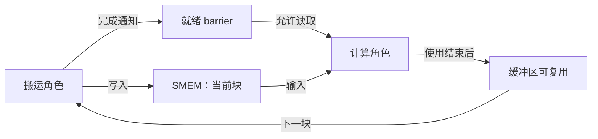
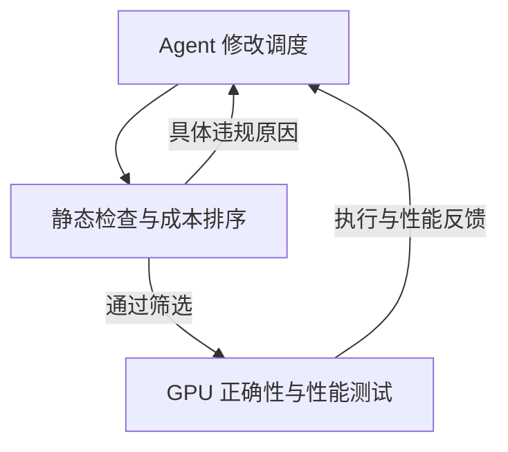
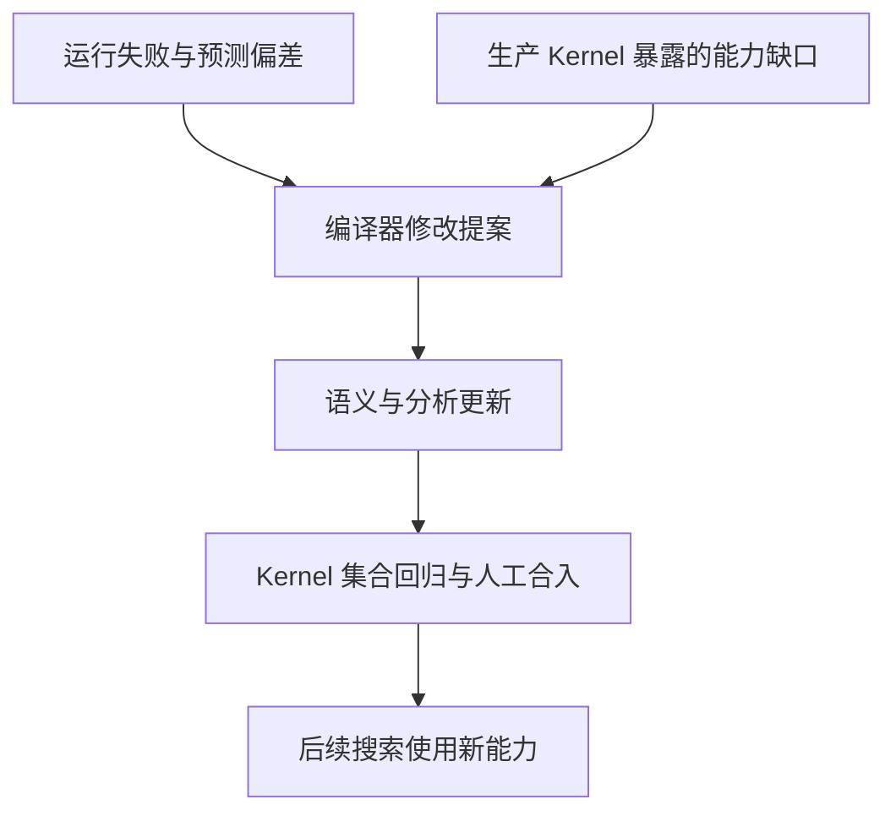

# CAKE：让 Agent 同时改进 GPU Kernel 与编译器

让 Agent 优化 GPU kernel，通常需要反复生成程序、编译、检查正确性和测量性能。结果算错或运行变慢时，Agent 还要找出是哪一次数据搬运、同步或调度选择出了问题。**CAKE 将改进分成两层：Agent 借助编译器反馈优化当前 kernel，再把反复遇到的失败与能力缺口转化为编译器改进，帮助后续 kernel 的搜索。**

连接两层改进的是调度中间表示 **Cake IR**。Agent 在其中指定线程分工、存储位置和流水线，编译器分析这些选择，生成 CUDA/PTX，并将诊断反馈给 Agent。如果现有语言无法表达需要的调度，或检查反复遗漏同类错误，就推动扩展 IR 和分析能力；性能预测持续偏离实测时，则推动校准模型。开发经验由此进入编译器，成为后续搜索可以复用的能力。

本文依据 [CAKE v1](https://arxiv.org/pdf/2608.12629v1) 编写，论文全名为 *Compiler–Agent Co-Design for Frontier Kernel Evolution*。先用矩阵乘法流水线解释表示与反馈，再介绍编译器怎样随 kernel 开发而改进。中文图为机制示意；实验数字来自论文。

## 动机：Agent 为什么需要更具体的编译器反馈

一个矩阵乘法的数学定义，并没有规定 GPU 应怎样执行它。实现者还要决定：每个线程块处理多大的矩阵块，哪些线程搬运数据，哪些线程提交矩阵指令，数据暂存在什么位置，以及计算何时可以读取或复用这些位置。同一项计算可以对应多种执行安排，本文将这些安排称为**调度**。

高层 DSL 能减少实现负担，但部分硬件选择由编译器内部决定。Agent 想改变线程分工、异步同步或片上存储时，语言未必能直接表达。直接写 CUDA/PTX 则可以控制这些选择，同时也要正确处理地址、指令约束和同步细节。一个调度想法可能尚未得到性能验证，就先卡在实现错误上。

这种困难在异步流水线中尤其明显。假设一组线程搬运下一块输入，另一组线程计算当前块：若计算方读取过早，结果可能错误；若搬运方覆盖了仍在使用的缓冲区，也会产生错误；若等待的完成信号永远不会到达，程序可能挂起。只得到“结果不匹配”或一次超时，Agent 需要从较大的程序中反查原因。

**CAKE 的取舍是：让 Agent 保留影响性能的调度选择，同时把这些选择写成编译器能分析的结构。** 编译器知道资源由谁使用、什么时候交接，就能在生成代码前检查一部分错误，并把诊断指向相关资源、角色或流水级。

但检查能力也需要不断扩展。一个新 kernel 可能需要当前 IR 尚未支持的指令形式；一类反复出现的运行时错误，也可能暴露静态检查的缺口。因此，CAKE 同时安排两种改进：在现有环境中搜索更好的 kernel，以及根据开发证据改进这个环境。

## 方法：显式调度怎样变成可分析的程序

### Agent 决定什么，编译器承担什么

CAKE 接收 Cake IR 程序，经过分析与代码生成，输出可以通过 NVIDIA 工具链编译的 CUDA/PTX。生成的 CUDA 可以独立接入下游系统，使用者无需依赖 CAKE。[论文第 2–4 节](https://arxiv.org/html/2608.12629v1#S2)

| 参与者 | 承担的工作 |
|---|---|
| Kernel Agent | 选择分块、线程角色、存储与访问方式、流水级数、指令形式和执行顺序 |
| CAKE 编译器 | 检查已建模的调度与硬件约束，根据声明生成地址、描述符等细节，生成代码并提供性能分析 |
| 外部评测环境 | 固定输入形状、正确性参照、误差容限、目标硬件和参考实现访问权限；测试结果并测量耗时 |

### 用搬运与计算的交接理解 Cake IR

考虑一个分块矩阵乘法。输入矩阵较大，线程块反复搬入当前所需的小块，在片上完成乘加，再推进到下一块。为了让搬运与计算有机会重叠，可以让不同的 warp 承担不同职责，并准备多份共享内存缓冲区。

> 一个 warp 是一组协同执行的 GPU 线程。共享内存 **SMEM** 供同一线程块中的线程交换和暂存数据；Blackwell 的 **TMEM** 可用于保存相应矩阵指令的累加结果。下文只保留与交接有关的部分，省略完整矩阵乘法的其他操作。

Cake IR 把这个执行安排中的对象分别写清楚：

- **资源**：声明共享内存区域及其视图，记录数据形状、类型和生命周期；需要时声明 TMEM 累加区域。
- **角色**：指定哪些 warp 负责搬运，哪些 warp 负责矩阵计算。
- **流水线**：声明缓冲级数，说明各次搬运与计算使用哪个流水级。
- **同步**：用显式 barrier 表达跨角色交接，计算方等待对应的数据就绪后再消费。

下面只追踪其中一份缓冲区的使用。barrier 在这里承载“这份输入已就绪”的通知；复用前还需要满足计算方不再使用它的条件。

> 依据论文第 2 节的资源、角色与交接模型绘制。图示表达数据与同步依赖，不表示实测时间，也省略了具体的完成通知与缓冲区回收实现。

这些声明让编译器能将访问对应到具体资源、角色和流水级。继续沿图中的缓冲区看一次错误：Agent 为了提前搬运下一块输入，让搬运角色在计算尚未用完当前块时覆盖了同一位置。两次访问的地址都可能合法，问题出在**缓冲区复用早于消费完成**。

如果分析已经覆盖这类交接，并能从 IR 确定访问顺序，就可以将冲突定位到下一次写入、尚未结束的读取以及共用的缓冲区。Agent 随后可以调整复用顺序，或让下一块使用另一份空闲缓冲区，再验证正确性和性能。诊断因此能直接帮助修改调度，减少从完整程序中逐处猜测的工作。

> 提前复用的例子用于解释结构化诊断需要什么信息，不对应论文披露的一条具体检查规则。论文按安全、硬件约束和数据一致性等类别说明覆盖范围；未被静态分析发现的错误仍需执行测试，并可能推动后文的编译器改进。

Agent 仍然决定搬运与计算怎样组织。编译器根据声明推导 barrier 地址、阶段切换使用的 phase bit、TMEM 偏移、描述符编码和 warp 身份等细节。这样，修改流水级数或资源安排时，Agent 可以围绕调度修改程序，减少手工维护相关元数据的负担。

### 为什么不要求 Agent 操作一套布局代数

矩阵指令需要特定的数据排列。数据在共享内存中的位置、指令读取的偏移和硬件采用的排列方式必须相互兼容，否则数学上相同的矩阵也可能被错误读取。

CuTe 等系统用布局对象及其代数表达这些映射。CAKE 选择让 Agent 直接写出具体的存储与访问决定，例如共享内存视图偏移、操作数字节偏移、TMEM 列范围和 swizzle 标记，再由编译器沿数据流检查这些决定是否一致、是否满足目标指令的要求。[论文附录 B.4](https://arxiv.org/html/2608.12629v1#A2.SS4)

这降低了 Agent 学习另一套布局语言的负担，也让诊断更容易对应到它刚刚修改的选择。布局设计仍然影响性能，Agent 仍要作出这些选择；编译器承担的是相应的合法性与一致性检查。

> Cake IR 使用固定、带类型的操作词汇表达计算、搬运、同步与控制，默认编辑路径不允许嵌入任意 C/PTX。统一词汇使分析能掌握操作的含义；若允许随意插入未知指令，检查所需的信息就可能丢失。

### 先排除已知错误，再用 GPU 判断收益

一次 kernel 优化中，CAKE 先对候选程序做便宜的检查，再把通过检查的候选交给实际执行。不同反馈承担不同职责：

| 反馈 | 帮助 Agent 判断什么 | 对候选的影响 |
|---|---|---|
| 程序安全与调度检查 | 同步顺序、内存使用和调度结构是否存在已建模的冲突 | 发现违规时阻止进入后续编译 |
| 硬件约束与数据一致性检查 | 资源、指令、架构及生产者—消费者的数据表示是否兼容 | 发现违规时阻止进入后续编译 |
| 数值测试 | 实际输出是否满足外部正确性要求 | 失败的候选不能作为有效结果 |
| 性能模型 | 估计成本与主要瓶颈，帮助排列候选的优先级 | 用于筛选和排序 |
| 优化提示 | 哪些修改方向可能值得尝试 | 提供建议，不阻止编译 |

静态通过与数值正确是两道不同的条件。一个程序可以满足资源和同步约束，却采用了错误的数学计算。因此，CAKE 仍比较不同形状、输入分布下的输出，并在生产案例中通过对应框架的端到端测试。[论文第 3 节、附录 C](https://arxiv.org/html/2608.12629v1#S3)

性能模型根据校准信息估计候选耗时，提示主要瓶颈可能在哪里，帮助优先测试更有希望的候选。实际 GPU 测量和 profiler 决定最终保留哪个实现。

> Kernel 优化的内层循环。静态检查可以提前排除部分错误，执行测试负责验证实际结果。

## 方法：怎样把一次调试变成后续可用的编译器能力

### 反复出现的失败，为什么要进入编译器

继续看前面的缓冲区例子。假设当前编译器无法识别提前复用，候选在 GPU 测试中失败，Agent 根据日志修好了它。这次修复只改变了当前程序；换一个 kernel，或再次调整流水线时，同类错误仍可能出现。

如果这类失败反复发生，就值得检查能否将定位过程转化为静态规则：IR 是否记录了共用的缓冲区、各角色的访问，以及消费完成与下一次写入的顺序？信息足够时，可以据此增加检查；信息不足时，则要先补足资源或操作的描述，再实现分析。新规则通过验证后，后续候选便能在执行前得到相同类别的诊断。

**修复 kernel 解决一次失败；改进编译器让后续搜索少重复这次调试。** 这是外层改进的收益来源。它需要付出新增分析与回归的成本，也只能提前识别规则覆盖的情况。

> 此处沿用教学例子说明演进过程，不表示论文原型已经实现完整的缓冲区生命周期验证。论文实际描述的证据来源包括运行失败、sanitizer 报告、正确性不匹配和调试日志。

另一条路径从可表达性出发。Agent 在移植生产 kernel 或阅读硬件文档时，可能发现当前 IR 缺少需要的指令形式、资源类型或同步方式，需要扩展 IR 及其代码生成支持。性能模型的预测持续偏离实测，则可以成为校准任务。两者分别改进后续搜索的表达能力与候选排序依据。[论文第 3.2 节、附录 A](https://arxiv.org/html/2608.12629v1#S3.SS2)

> 编译器改进的外层流程。两类证据都可以触发提案，修改通过回归与合入要求后才成为后续环境的一部分。

### 新原语为什么必须连同检查一起增加

新增操作不仅需要一段代码生成逻辑，还要说明它读写哪些资源、怎样完成、受哪些硬件条件限制。缺少这些信息，编译器就难以分析它与其他操作的交接。语言能表达更多程序，却可能更难排除错误。

新增检查也可能误拒合法程序。因此，CAKE 用已有 kernel 集合做回归，检查修改是否破坏已有 kernel。论文报告的集合包含 400 多个静态与编译案例、399 个 GPU 正确性案例，覆盖约 28 类 kernel。

编译器维护主要由 Agent 实施，人提供高层分析目标与设计指导，并保留人工合入关口。外部评测仍固定输入形状、正确性参照和误差容限，编译器修改必须满足这份任务约定。论文报告的任务使用固定的模型与 Agent 框架，改进对象是 IR、分析、代码生成及性能校准。

> Cake IR 本身也是从生产 kernel 中逐步提炼出来的：先识别重复的 warp 分工、流水线、barrier 交接和资源生命周期，再形成可复用抽象；继续移植下一类 kernel 时，新缺口推动下一轮扩展。作者将其称为编译器与 Agent 的共同设计（co-design）。

## 实验与应用：搜索效率、生产 Kernel 与算子库

### 相同预算下，CAKE 与直接写 CUDA/PTX 的比较

最直接的对照是 Flash-KMeans 的 assign kernel：给每个输入向量寻找距离最近的聚类中心。它结合 BF16 矩阵乘法与标量归约，测试形状为批次 32、每批 65,536 个向量、1,024 个中心、特征维度 128，使用 FP32 累加。

两组使用相同的模型、Agent 框架、正确性参照、测试环境和单一目标形状，分别进行 3 次运行，每次预算为 8,000 万 provider token。一组编写 Cake IR，另一组直接编写 CUDA/PTX。两组都不能读取目标的低层实现，允许使用任务规格、高层程序和黑盒性能基准。[论文表 2、图 5](https://arxiv.org/html/2608.12629v1#S5)

下面以已调优的 FlashML KMeans Triton 实现为基准，其耗时为 0.938 ms。统计值采用三次运行的**中位数 [最小值，最大值]**；加速比大于 1 表示更快。

| 编写方式 | 预算结束时最佳有效结果的加速比 | Active evolve 时间 |
|---|---|---|
| Cake IR | 1.144× [1.041×，1.205×] | 1.89 h [1.02 h，2.33 h] |
| 直接 CUDA/PTX | 0.928× [0.852×，1.151×] | 3.73 h [3.59 h，4.34 h] |

**在相同任务与预算下，CAKE 获得了更高的中位最佳性能，也使用了更少的 active evolve 时间。** 三次 CAKE 运行都超过基准，直接 CUDA/PTX 的结果范围则跨越基准，其中一次仍达到 1.151×。这个对照支持整套开发环境在该任务中的收益；各部分贡献是否能独立区分，见后文“问题”。

> 论文另报告：在 8,000 万 token 内，CAKE 有 3/3 次运行达到预设 plateau 条件，直接 CUDA/PTX 为 0/3。Plateau 是搜索停止相关的判据；正文没有给出足够细节来独立复现该判据，不能把这个计数直接等同于“达到全局最优”的次数。Active evolve 时间也应沿用论文口径，与完整项目耗时区分。

### 生产案例分别说明什么

CAKE 既测试从数学或高层规格出发生成调度，也测试在已有生产实现上改进。两种任务的起点不同。

**KDA prefill：能否在低层实现不可见时生成有效调度。** Agent 可以获得官方 FlashKDA 的基准耗时，无法读取其低层代码。KDA 需要跨 chunk 保留递推状态，要求 IR 表达持续状态与调度交接。最终实现在 6 个 B200 BF16 形状上达到 **2.05× 几何平均加速**，覆盖固定长度、打包变长和尾部输入，通过验证约定中的逐位正确性测试，并在 SGLang 的 Kimi-K3 服务中完成端到端验证。

**TinyGEMM：能否继续改进已有生产实现。** Agent 从 FlashInfer 中已有的小矩阵 BF16 实现出发，得到适应不同形状的浅、深流水线等变体。在 35 个标准形状上，几何平均 kernel 时间减少 **18–23%**。

> 单独的 SGLang GPT-OSS-120B 实验在张量并行度为 1（TP1）、并发 128 时，输出吞吐最多提高 7.6%；并行度为 4（TP4）时，差异在测量噪声内。Kernel 时间下降能否转化为服务吞吐，取决于该 kernel 在实际执行中占据的比例。

**Alpha-MoE：融合带来的收益发生在哪里。** Agent 从 Hopper 实现出发，重写为 Blackwell 的 W8A8 融合程序，将路由后的数据收集、两次投影、激活、重新量化和加权输出累积放进一个设备程序。相对 FlashInfer 预路由 API，不同测量范围给出了不同加速比：

| 相对 FlashInfer 的预路由 API | N = 256 | N = 512 |
|---|---|---|
| API 层端到端加速 | 6.204× | 4.025× |
| CUPTI GPU span 加速 | 1.215× | 1.170× |

GPU span 是 CUPTI 记录的 GPU 执行跨度，与 API 层耗时采用不同的测量范围。API 收益还包含更少的启动与调度空隙、更简单的 workspace 处理。参考实现启动 5 项 GPU 活动，CAKE 版本使用一次输出重置和一个 megakernel。因此，表中 4–6 倍的 API 收益不能直接用于描述 GPU 执行跨度的提升。[论文第 5.1 节](https://arxiv.org/html/2608.12629v1#S5.SS1)

> 实现入口见论文链接的 FlashInfer [KDA prefill PR](https://github.com/flashinfer-ai/flashinfer/pull/4262)、[TinyGEMM PR](https://github.com/flashinfer-ai/flashinfer/pull/4274) 和 [Alpha-MoE PR](https://github.com/flashinfer-ai/flashinfer/pull/4287)。此外，在允许读取参考实现的 11 项固定比较中，CAKE 有 10 项达到或超过基准，另一项达到基准性能的 96.5%。这些比较限于论文指定的 kernel 与形状。

### 从固定形状扩展到算子库

固定形状允许较强的专门化，但实际调用会遇到不同形状，同一套分块和流水线未必都合适。CAKE 在取得经过测量的候选后，按形状分组，用派发器（dispatcher）选择对应 kernel，并保留备用路径（fallback）。每个分支仍是一份独立的 Cake IR 程序，可以分别分析和测量。

新增分支会增加维护复杂度，因此应尽量复用同一调度，只有新形状确实需要不同调度，或测量证明新增分支有收益时才增加实现。评测包含派发成本，并检查边界、尾部输入、条件重叠或遗漏及备用路径。形状范围在调优前确定，后续用同一来源的未见输入检查泛化；错误或慢的候选返回 kernel 优化阶段。

在 GB200 上，KNN build、KNN search、KMeans 分别覆盖 112、198、124 个形状，得到 **1.418×、2.116×、1.803×** 的几何平均 GPU span 加速。每个形状的加速比由参考实现与 CAKE 实现的 CUPTI span 中位数相除，再对各形状等权计算几何平均。[论文第 6 节](https://arxiv.org/html/2608.12629v1#S6)

这些结果支持所测形状集合中的整体收益。它们与前面的单形状 Flash-KMeans 实验使用不同主机、基准和评测分布，二者差值无法单独解释为泛化的收益或代价。

## 问题：哪些能力还不能由这篇论文确定

静态分析的覆盖范围仍在扩展。论文明确允许假阳性与假阴性，缺少信息或覆盖不足时应报告限制；通过检查不构成整个 GPU 程序正确性的证明。布局验证主要以接口约定和覆盖范围描述，具体判定过程没有展开到足以独立重建的程度。

各部分对最终收益的贡献，也缺少独立的定量对照。Flash-KMeans 实验比较的是表示与编译器反馈组成的环境，没有分别量出 IR、静态诊断和性能模型各自的贡献。若要进一步量出外层演进的价值，还需要在相同任务、预算和参考权限下，比较冻结编译器与允许演进的结果。

架构支持与性能可迁移性也有不同范围。Cake IR 的角色、barrier、流水线结构可用于 Ampere 到 Blackwell，但指令、合法性规则和成本校准依赖目标架构。主要性能证据来自 B200；时间模型仅对 B200 和 H100 校准，其他目标会报告覆盖限制。非 NVIDIA 后端的迁移成本尚未测量。

## 延伸：与 μCUTLASS、Argus 的关系

这三项工作都希望提高 Agent 优化 kernel 的效率，选择的切入点不同：

| 工作 | 主要交给 Agent 的表达与反馈 | 希望减少的困难 |
|---|---|---|
| [μCUTLASS](./uCUTLASS.md) | 简化的算子配置，以及 SOL 理想耗时参照 | 组装实现的负担，以及剩余优化空间不清楚 |
| [Argus](./Argus.md) | 数据流标签与不变量，用于检查候选的数据流变化 | 优化修改破坏计算关系后，难以定位和排除 |
| CAKE | 显式硬件调度，以及围绕资源、角色和阶段的编译器反馈 | 低层调度难表达、错误难定位，重复问题缺少可复用检查 |

CAKE 进一步把反复出现的表达缺口和失败证据用于修改编译器。评价这条路径时，除了最终 kernel 速度，还需要关注新能力能覆盖哪些任务、检查是否误拒合法调度，以及维护这些能力付出了多少成本。
