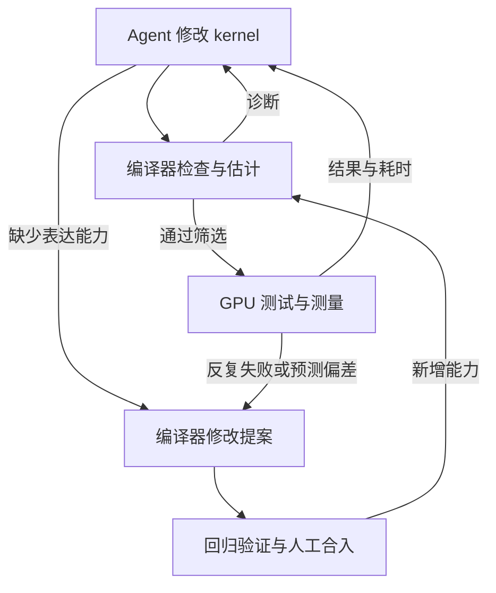

# CAKE：让 Agent 同时改进 GPU Kernel 与编译器

**CAKE 希望 Agent 每次开发 kernel 时，既能把当前程序做得更好，也能把遇到的问题变成编译器的新能力。** 当前 kernel 得到修复和优化，后续 kernel 则可以复用新增的指令支持、错误检查或性能估计。

它为此提供了一种叫 **Cake IR** 的写法。Agent 用它描述 GPU 怎样执行：谁搬数据、谁计算、数据放在哪里、什么时候交接。编译器把这些安排变成 CUDA/PTX，同时返回检查结果和性能分析，帮助 Agent 继续修改。

这篇工作的主线有两层：

- **改 kernel。** 在现有编译器支持的范围内，尝试不同分块、线程分工、存储和流水线，测试哪个更快。
- **改编译器。** 如果需要的执行方式写不出来，同类错误反复漏检，或性能估计总是不准，就补充表达、检查或校准能力，再用于后续开发。

> 本文依据 [CAKE v1](https://arxiv.org/html/2608.12629v1) 编写。论文全名为 *Compiler–Agent Co-Design for Frontier Kernel Evolution*。下文用矩阵乘法的搬运与计算解释机制，教学例子与论文实验分别标明。

## 为什么优化一个 kernel，还要改进编译器

矩阵乘法的数学定义只告诉我们要算什么。GPU 实现还要决定每块算多大、哪些线程搬输入、哪些线程计算，以及数据暂存在哪里。这些执行安排称为**调度**。

例如，将大矩阵切成小块计算时，可以让一组线程准备下一块输入，另一组线程计算当前块。两边有机会同时推进，减少等待。但交接必须正确：数据还没搬完，计算方不能读；当前输入还没用完，搬运方不能覆盖它。

Agent 直接写 CUDA/PTX 时，要自己维护大量地址、同步和硬件细节。一次改动出错后，测试可能只给出结果不匹配或超时，Agent 很难知道应该先检查哪处交接。高层语言可以代办一部分工作，但也可能把 Agent 想修改的线程分工和指令安排藏在编译器内部。

**CAKE 让 Agent 写出影响性能的执行决定，由编译器补齐实现细节，并检查这些决定是否相容。** 因为程序明确记录了谁使用哪份数据、什么时候交接，反馈就更容易对应到 Agent 刚刚做的改动。

编译器也可能缺少能力。遇到一种新指令，语言需要增加写法和代码生成；同类同步错误反复进入 GPU 测试，就需要补充分析；估计与实测反复不符，则需要调整性能模型。CAKE 将这些改进纳入开发流程，使后续任务少重复此前的工作。

kernel 修改的反馈回到当前程序，编译器改进则供后续任务共同使用。编译器修改经过验证和人工合入后，才进入开发环境。

## Cake IR 具体让 Agent 写什么

**IR 是中间表示：一份编译器可以读取和分析的程序。** Cake IR 保留了 GPU 的执行安排，编译器再将其转成 CUDA/PTX。生成的 CUDA 可以独立接入其他系统。[论文第 2–4 节](https://arxiv.org/html/2608.12629v1#S2)

继续看分块矩阵乘法。Agent 要写清楚：

- **每次算多少。** 输出切成多大的块，沿求和维度每次处理多少输入。
- **谁做哪项工作。** 哪些 warp 搬运输入，哪些 warp 执行矩阵计算。
- **数据放在哪里。** 输入使用哪些共享内存缓冲区，累加结果保存在哪里，各部分采用什么布局。
- **何时读取和复用。** 搬运完成后怎样通知计算方，当前数据使用结束后怎样进入下一轮。

> warp 是一组协同执行的 GPU 线程。共享内存 **SMEM** 用于同一线程块内的暂存和交换；Blackwell 的 **TMEM** 可以保存相应矩阵指令的累加结果。这些位置需要在程序中声明，编译器才能分析使用关系。

改变块大小、缓冲数量、线程角色或执行顺序，仍由 Agent 决定。编译器根据声明生成地址、同步状态、指令描述符等细节，再输出实际代码。这样，Agent 修改流水线时，可以集中处理执行安排，减少手工维护相关细节的负担。

### 沿一份缓冲区看数据交接

假设搬运线程把当前输入块写入一份共享内存缓冲区，计算线程随后读取它。下一轮还要使用这份空间，就必须知道当前数据何时不再被使用。

这张图表示同一份缓冲区的使用顺序。程序用 **barrier（同步对象）** 表达相关交接；搬运与计算可以使用多份缓冲区交替推进。

> 图示依据论文的资源、线程角色和同步模型绘制，省略具体指令，不表示实测时间。

现在看一次**教学中的错误改写**：为了更早准备下一块，Agent 提前覆盖这份缓冲区，但计算线程仍在读取当前输入。地址可能完全合法，结果却会算错，因为同一个位置被提前换成了下一块的数据。

要分析这种错误，编译器需要知道这两次访问使用同一份资源，以及读取结束和下一次写入之间的关系。在这个教学例子里，一条有用的反馈应指向共用的缓冲区和相关读写。Agent 可以沿这些信息检查交接，尝试调整顺序，或让下一块使用另一份空闲缓冲区，然后测试正确性与速度。

**关键是让反馈对应到执行过程中的具体对象。** Agent 可以据此检查某份缓冲区、某个线程角色或某次交接。

> 论文描述的诊断会关联到相应 IR 决定和不匹配类别，但未披露完整的缓冲区生命周期判定规则。这个教学例子说明需要什么信息，后文再用它解释怎样增加检查。

### 布局也要写清楚

数据怎样存放，会影响矩阵指令能否读到正确的元素。共享内存中的排列、读取偏移和指令要求必须相互匹配。

CuTe 等系统用布局对象和代数表达这些映射。Cake IR 让 Agent 直接指定存储与访问细节，再由编译器检查生产方写出的表示和消费方要求的表示是否相容。这保留了布局优化的选择，也让错误更容易对应到具体改动。[论文附录 B.4](https://arxiv.org/html/2608.12629v1#Appendix.B.4)

> 具体写法涉及共享内存视图和字节偏移、TMEM 列范围，以及用于改变地址排列的 swizzle 标记。Cake IR 使用固定、带类型的操作词汇；常规编辑路径不允许随意嵌入未知的 C/PTX，便于编译器掌握操作的含义。

## 编译器怎样帮助 Agent 选下一步

一次优化需要回答三类问题：改写有没有明显错误，输出是否正确，以及正确的实现有没有变快。CAKE 用不同反馈回答它们。

| 反馈 | 用途 |
|---|---|
| 静态检查 | 检查已建模的内存、同步、调度、硬件与数据表示约束；违规候选提前被拒绝，并返回原因 |
| 数值测试 | 将实际输出与外部参照比较，确认满足误差要求 |
| 性能模型与优化提示 | 估计候选成本和可能的瓶颈，帮助选择先试什么 |
| GPU 实测与运行分析 | 确认实际速度与等待，决定保留哪个实现，并反馈下一轮 |

**通过静态检查，还要测数值结果；数值正确，还要测完整任务的速度。** 程序满足硬件和同步约束，并不意味着它计算了正确的数学表达式。[论文第 3 节、附录 C](https://arxiv.org/html/2608.12629v1#S3)

性能模型用于减少无效尝试。它根据校准信息估计成本，帮助排列候选优先级；优化提示则给出可以继续检验的改动方向。约束违规会阻止候选继续编译，成本排序与提示用于指导选择。最终仍由 GPU 测量决定哪个有效实现更快。

> 论文描述了性能模型的用途和校准范围，没有展开模型公式或具体资源项。因此，可以理解它在流程中怎样提供反馈，但还不能据此重建一套寄存器、带宽与同步的联合性能模型。[论文第 3.1 节](https://arxiv.org/html/2608.12629v1#S3.1)

**Agent 负责提出执行方案，编译器提供能分析这些方案的表达与反馈。** 开放更多选择以后，还需要判断哪些改动值得做。这也是 CAKE 与我们前面讨论的资源建模、瓶颈分析相关的部分。

## 怎样把修好一次，变成后续少犯同类错误

继续沿用缓冲区的教学例子。假设当前编译器没有识别提前复用，直到 GPU 测试失败，Agent 才修好了它。这个修复让当前 kernel 恢复正确；另一项任务再次修改流水线时，仍可能遇到同类问题。

如果这类失败反复发生，就可以提出编译器改进：检查当前表示是否记录了各次读写和完成条件；信息足够时，增加相应分析；信息不足时，先补充资源或操作的描述。新规则通过验证后，后续候选就能更早收到同类诊断。

**kernel 修复改变当前程序；编译器改进把判断方法留下来，供后续程序复用。** CAKE 的第二层改进希望由此减少重复调试。

> 这里仍是教学推演。论文描述的实际改进证据包括运行失败、sanitizer 报告、正确性不匹配和调试日志，没有将上述例子列为一条已实现的完整规则。

除了错误检查，编译器还可以从两类证据中改进：

- **需要的执行方式写不出来。** 移植生产 kernel 或阅读硬件文档时，发现 IR 缺少某种指令、资源或同步方式，就增加相应表达与代码生成。
- **预测持续偏离实测。** 收集具体偏差，修改或校准性能模型，帮助后续候选排序。

这些修改都需要新增语义、分析和代码生成支持，而不只是增加一个名字。例如，新搬运操作要说明它读取什么、写入哪里、什么时候完成；缺少这些信息，就难以分析它与其他操作的交接。[论文第 3.2 节、附录 A](https://arxiv.org/html/2608.12629v1#S3.2)

新检查也可能误拒原本合法的程序，所以编译器修改需要用已有 kernel 集合做回归。论文报告的集合包含 400 多个静态与编译案例、399 个 GPU 正确性案例，覆盖约 28 类 kernel。

Agent 实施编译器维护，人提供高层目标和设计指导，并保留人工合入关口。评测的输入、参照结果和误差容限保持固定。论文中的模型与 Agent 框架也保持固定，改进对象是 IR、分析、代码生成和性能校准。

> Cake IR 本身也是从生产 kernel 中逐步提炼的：把重复出现的线程分工、流水线、同步和资源使用方式变成可复用表达，再用下一类 kernel 暴露的缺口继续扩展。这是论文所说的编译器与 Agent 共同设计。

## 实验说明了哪些收益

### 从同一任务出发，比较两种开发方式

最直接的对照是 Flash-KMeans 的 assign kernel：给每个输入向量寻找最近的聚类中心。这个任务包含 BF16 矩阵乘法与标量归约，采用 FP32 累加。

两组使用相同模型、Agent 框架、正确性要求和单一目标形状，分别运行 3 次，每次预算为 8,000 万 provider token。一组写 Cake IR，另一组直接写 CUDA/PTX。两组都看不到目标的低层实现，只能使用任务规格、高层程序和黑盒性能基准。[论文表 2、图 5](https://arxiv.org/html/2608.12629v1#S5)

以已调优的 FlashML KMeans Triton 实现为基准，结果如下。加速比越大表示更快；数值为三次运行的中位数，方括号内为最小值和最大值。

| 编写方式 | 最佳有效结果相对基准的加速比 | 论文记录的 active evolve 时间 |
|---|---|---|
| Cake IR | 1.144× [1.041×，1.205×] | 1.89 h [1.02 h，2.33 h] |
| 直接 CUDA/PTX | 0.928× [0.852×，1.151×] | 3.73 h [3.59 h，4.34 h] |

**在这个任务与预算下，CAKE 的中位结果更快，论文记录的优化时间也更短。** 三次 CAKE 运行都超过基准，直接 CUDA/PTX 也有一次达到 1.151×。这支持整套开发环境的收益，但尚未分别量出 IR、静态诊断和性能模型各自的贡献。

> 目标形状为批次 32、每批 65,536 个向量、1,024 个中心、特征维度 128；基准耗时为 0.938 ms。active evolve 沿用论文统计口径，与完整项目耗时区分。论文另报告 CAKE 有 3/3 次达到搜索的 plateau 停止条件，直接 CUDA/PTX 为 0/3；正文未充分展开该判据，这个计数不代表找到全局最优。

### 生产案例：不同起点，验证不同能力

**KDA prefill：从规格生成需要保留状态的调度。** KDA 按块推进计算，后一块要继续使用前一块留下的递推状态。Agent 能看到官方 FlashKDA 的耗时，不能读取其低层实现。CAKE 在 6 个 B200 BF16 形状上达到 2.05× 几何平均加速，覆盖固定长度、打包变长与尾部输入，通过任务约定中的逐位测试，并在 SGLang 的 Kimi-K3 服务中完成端到端验证。

**TinyGEMM：继续优化已有生产实现。** Agent 从 FlashInfer 的小矩阵 BF16 实现出发，生成适合不同形状的浅、深流水线等变体。在 35 个标准形状上，几何平均 kernel 时间减少 18–23%。它说明在已有实现上继续选择调度也有价值。

> 对应的 SGLang GPT-OSS-120B 实验中，TP1、并发 128 时输出吞吐最多提高 7.6%；TP4 的差异在测量噪声内。服务吞吐还取决于该 kernel 在实际运行中占据的比例。

**Alpha-MoE：把一串处理放进一个设备程序。** Agent 从 Hopper 实现出发，改写为 Blackwell 的 W8A8 融合实现，将路由后的数据收集、两次投影、激活、重新量化和加权输出累积合在一起。相对 FlashInfer 预路由 API，论文分别测了调用端和 GPU 执行范围：

| 测量范围 | N = 256 | N = 512 |
|---|---|---|
| API 层端到端加速 | 6.204× | 4.025× |
| CUPTI GPU span 加速 | 1.215× | 1.170× |

API 耗时还包含启动、调度和 workspace 处理，GPU span 则是 CUPTI 记录的设备执行跨度。参考实现有 5 项 GPU 活动，CAKE 版本使用一次输出重置和一个 megakernel。**这里的大幅 API 收益，与设备执行跨度的改善是两项不同结果。** [论文第 5.1 节](https://arxiv.org/html/2608.12629v1#S5.1)

> 论文链接的实现入口包括 FlashInfer 的 [KDA prefill PR](https://github.com/flashinfer-ai/flashinfer/pull/4262)、[TinyGEMM PR](https://github.com/flashinfer-ai/flashinfer/pull/4274) 和 [Alpha-MoE PR](https://github.com/flashinfer-ai/flashinfer/pull/4287)。另外，在允许读取参考实现的 11 项固定比较中，CAKE 有 10 项达到或超过基准，另一项达到基准性能的 96.5%。

### 从一个形状，扩展到一组实际输入

固定形状可以采用专门的分块和流水线。实际算子库会遇到多种形状，因此 CAKE 在测得有效候选后，按形状分组，让派发器选择对应 kernel，并保留备用实现。每个分支仍是一份可单独检查和测量的 Cake IR 程序。

增加分支也会增加维护成本。应先尝试复用已有调度，只有新形状需要不同安排，或测量确认收益时，才增加变体。测试范围包括派发开销、边界与尾部输入，以及分支条件是否重叠、是否遗漏。

在 GB200 上，论文报告了以下形状集合的结果：

| 算子 | 形状数量 | 几何平均 GPU span 加速 |
|---|---:|---:|
| KNN build | 112 | 1.418× |
| KNN search | 198 | 2.116× |
| KMeans | 124 | 1.803× |

形状范围在调优前确定，并用同一来源的未见输入检查泛化。每个形状先用参考与 CAKE 实现的 CUPTI span 中位数计算加速比，再等权计算几何平均。错误或慢的候选返回 kernel 优化阶段。[论文第 6 节](https://arxiv.org/html/2608.12629v1#S6)

> 这组结果与单形状 Flash-KMeans 实验采用不同主机、基准和输入分布，分别说明各自测试范围内的收益。

## 这篇论文还没有回答充分的地方

**静态检查能覆盖多少错误，还需要看具体规则。** 论文允许检查漏掉错误，也允许误报；通过检查不等于整个 GPU 程序已经被证明正确。布局验证主要按接口约定和覆盖范围描述，具体判定过程没有展开到可以独立重建的程度。

**编译器演进能额外省多少开发成本，还缺直接对照。** Flash-KMeans 比较的是整套开发环境。如果要量出第二层改进的价值，需要在相同任务、预算与参考权限下，比较冻结编译器和允许改进编译器的结果。

**迁移到其他硬件，需要重新接入指令、规则与校准。** Cake IR 的线程角色、同步和流水线结构可用于 Ampere 到 Blackwell，但主要性能证据来自 B200，时间模型只对 B200 和 H100 校准。其他目标会报告覆盖限制，非 NVIDIA 后端的迁移成本尚未测量。

## 与 μCUTLASS、Argus 相比，CAKE 补充了什么

| 工作 | Agent 主要使用什么能力 |
|---|---|
| [μCUTLASS](./uCUTLASS.md) | 用紧凑配置选择成熟 CUTLASS 实现，用 SOL 判断粗略性能空间 |
| [Argus](./Argus.md) | 更深入地改写数据流，用不变量反例定位破坏的数据关系 |
| CAKE | 明确写出硬件执行安排，用编译器检查与性能反馈继续修改，并将反复遇到的能力缺口转成编译器改进 |

对我们的 Agent + Compiler 调研，CAKE 提供了两项指导：**给 Agent 开放执行决定时，同时让这些决定能够被分析；一类问题反复出现时，考虑把处理方法变成编译器能力。** 评价时分别看当前 kernel 是否更快，以及后续任务是否少做了无效尝试，并计入新增能力的维护成本。
