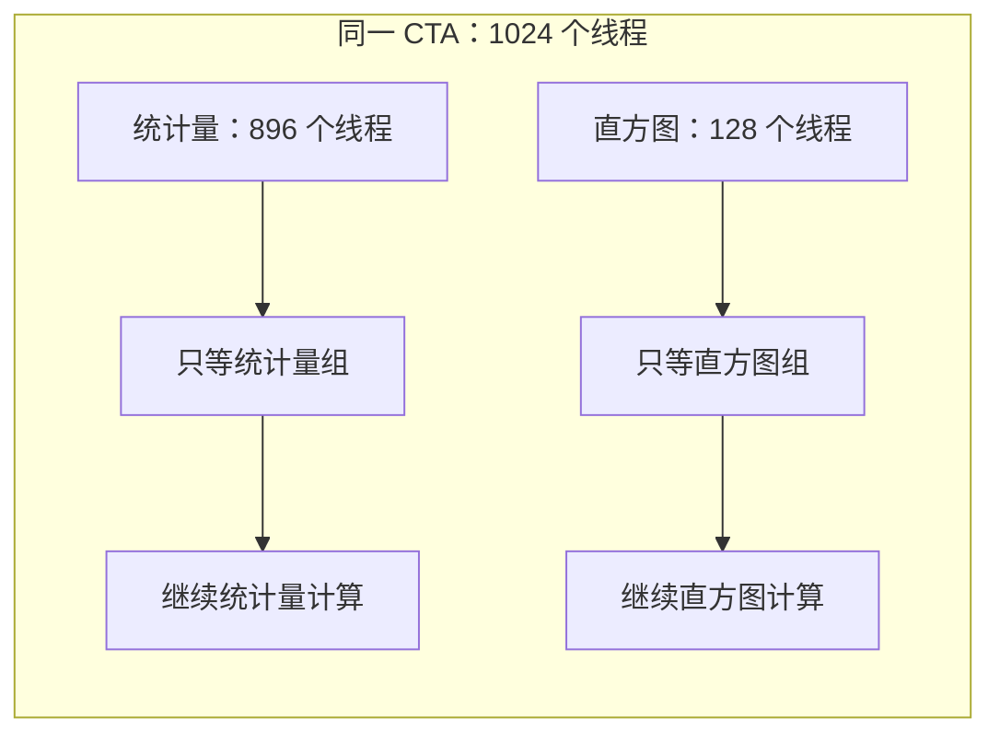

# HFuse：让独立 Kernel 在线程块内共同执行

**HFuse 将两个没有数据依赖的 kernel 合成一个，并在每个线程块内给它们各分一组线程。** 当一组线程等待数据或指令结果时，GPU 有机会执行另一组的工作，减少执行资源的空闲。

这类做法称为**横向融合（horizontal fusion）**。它要解决的核心问题是：怎样让独立工作共同执行得更有效率。关键取舍也在这里：两项工作进入同一个线程块后，可以提供更多可执行的线程，但也会占用更多寄存器和共享内存，可能减少同时驻留的块数。

> 本文依据 2020 年论文 [Automatic Horizontal Fusion for GPU Kernels](https://arxiv.org/html/2007.01277) 编写。HFuse 是 CUDA 源码转换编译器；它提供线程分工和配置搜索机制，可作为我们研究 Agent + Compiler 的执行方案。论文实验使用 Pascal 的 GTX 1080 Ti 和 Volta 的 V100。

## 动机：独立任务也可能从融合中受益

常见的融合发生在前后相接的计算之间，例如矩阵乘法后加 Bias、做激活。前一个操作产生的值直接交给后一个操作，能减少中间结果的显存读写。

HFuse 关注另一种关系：两项计算都可以开始，谁也不需要等对方的输出。例如，同一份输入既要统计均值和方差，又要生成直方图。两个结果分别产生，没有先后依赖。

它们共同执行的机会来自 GPU 的调度方式。一个线程块也叫 **CTA**，其中每 32 个线程组成一个 **warp**。执行线程块的硬件单元称为 **SM**；SM 上的 warp 调度器可以选择已经准备好、所需资源也可用的 warp 执行。

如果某些 warp 在等一次访存，其他 warp 已经有可以执行的运算，调度器就有机会继续推进。把不同特点的工作放在一起，可能增加这种机会。**收益取决于两项工作是否填补了彼此的等待，或者只是争用同一份资源。**[论文第 I、II 节](https://arxiv.org/html/2007.01277#S2)

> 独立任务的输出通常仍需要各自写出。合并入口可以减少启动，线程共同执行可以隐藏部分等待；它们没有自动消除生产者与消费者之间的中间张量。论文的性能对照已经允许原 kernel 在不同 CUDA stream 中并发，后文按这个口径讨论结果。

## 方法：分开线程，也分开各自的同步

给定两个 CUDA kernel 和融合块的目标线程数，HFuse 自动搜索两组的线程份额与寄存器上限。编译器为候选改写线程编号、变量和同步，使每组线程继续完成对应任务，再通过实测选择更快的配置。

下面沿论文的 **Batchnorm 统计量 + Hist 直方图** 例子解释。前者汇集输入的均值和方差，后者统计各个数值区间中出现了多少元素。这里的 Batchnorm 只指统计阶段。

### 每组线程只做自己的任务

在论文的 1080 Ti 示例中，一个融合线程块包含 1024 个线程：前 896 个负责统计量，后 128 个负责直方图。编译器按线程所在的区间选择执行路径。

下面的图展示同一 CTA 内的分工和各自一次同步。两条路径之间没有依赖箭头；图中位置不表示执行时间，方框大小也不表示线程数量比例。

GPU 仍按 warp 调度这些线程。它可以交错执行两组的指令，具体能重叠多少，由等待、资源使用和硬件调度决定。HFuse 在这里规定的是线程块内部的任务分工。[论文第 II-C、III-A 节](https://arxiv.org/html/2007.01277#S3.SS1)

### 为什么要改线程编号

原 kernel 通常根据线程编号决定处理哪份数据，并根据线程数决定循环步长。融合后，全块有 1024 个线程，但直方图只拥有其中的 128 个。

假设全块编号为 896 的线程是直方图组的第一个线程。对直方图的原逻辑，它应该看到自己的编号为 0，所在组的线程数为 128。否则，寻址和循环步长都可能改变，造成数据遗漏或错误分工。

HFuse 因此将实际线程编号转换成任务内部的编号，并让每个任务使用自己的线程维度。它也重命名两份源码中的局部变量，避免同名冲突。**这些改写让每项任务在融合后仍覆盖自己要处理的数据。**[论文第 III-A 节](https://arxiv.org/html/2007.01277#S3.SS1)

> 搜索不同线程份额要求原 kernel 能在对应线程配置下正确工作。线程数影响了循环和归约组织，不能对任意固定配置的实现直接更改。论文的深度学习测试 kernel 支持可调线程块；密码学测试 kernel 使用固定份额。

### 为什么同步也必须改

CUDA 常见的块内同步会等待整个线程块的参与线程。融合后，统计量组内部交换局部结果，只需要等待自己的 896 个线程；直方图组初始化或更新共享计数器，也只需要等待自己的 128 个线程。

如果保留面向全块的同步，等待范围就会包含另一项任务，而另一组线程可能根本不会到达这次同步。这样既改变了原来的依赖，也可能让程序无法继续。

HFuse 将这类同步替换成**只等待对应线程组的屏障**：为两个任务使用不同的屏障编号，并指定各自的参与线程数。线程区间的执行分支保证只有对应任务的线程进入该屏障。两组因此可以分别推进自己的阶段。[论文第 III-A 节](https://arxiv.org/html/2007.01277#S3.SS1)

> 屏障负责等待本组需要的结果。跨任务的数据依赖需要另外设计；HFuse 的独立任务融合不承担这种交接。

## 配置怎么选：线程份额和寄存器一起比较

即使两项任务都能正确执行，平均分线程也未必最快。某项任务可能需要更多线程来处理输入，另一项用较少线程就能提供足够的工作。还要看两项任务的完成时间是否接近；一项很早结束后，后半程便失去了共同执行的机会。

HFuse 给定融合块的总线程数，再以 128 个线程为步长改变第一组的份额，剩下的分给第二组。每种分法生成候选，并测量运行时间。这个粒度用于保留较规则的执行和访存安排。[论文第 III-B 节](https://arxiv.org/html/2007.01277#S3.SS2)

**线程更多，也会消耗更多资源。** 两组共同进入一个块后，共享内存和寄存器需求可能提高。一个 SM 原来能放下多个块，融合后可能只能放下更少的块。块内多了一组可执行线程，却也可能失去其他块提供的并行工作。

HFuse 因此为每种线程份额测试两种版本：

- **不限制寄存器。** 让设备编译器按正常方式分配。
- **限制每线程寄存器数量。** 先按两个原任务的寄存器需求估计驻留块数，再考虑融合块的共享内存和线程容量限制，据此计算寄存器上限。

例如，在只考虑寄存器的**教学估算**中，一个 SM 有 65,536 个寄存器，希望同时容纳两个各含 1024 个线程的块，每线程的预算就是 32 个寄存器。实际还要检查共享内存、线程数量等是否允许两个块同时驻留，再测量这个限制是否值得采用。

限制寄存器的目的，是让更多块有机会同时驻留。但值放不进寄存器后，可能产生 **spill，即寄存器溢出**，转而通过局部内存读写，增加访存。HFuse 将两个版本都实测，比较增加的并行工作能否抵消额外访存。[论文第 III-B、IV-C 节](https://arxiv.org/html/2007.01277#S3.SS2)

**它用资源估计产生候选配置，用测量选择最终配置。** 这是一种线程份额与寄存器限制的联合调优，不能只看占用率是否提高。

## 实验：比较对象已经允许并发

论文使用 5 个深度学习 kernel 和 4 个密码学 kernel，分别形成 10 对和 6 对，共 16 对。它比较了原 kernel 的并行 stream 执行、横向融合、按线程串接两份工作的纵向融合，以及不搜索配置的平均分线程版本。

按论文的计时说明，原 kernel 基线记录从第一个 kernel 启动到第二个 kernel 完成的时间区间。它比较的是一次共同执行的区间，两个独立测得的耗时不能直接相加作为这个基线。[论文第 IV-A 节](https://arxiv.org/html/2007.01277#S4.SS1)

同一组统计量与直方图工作，在两种 GPU 上选出的线程份额不同：

| 设备 | 统计量 / 直方图线程数 | 论文示例报告的 Speedup（%） |
|---|---|---|
| GTX 1080 Ti | 896 / 128；每线程寄存器上限为 32 | 53.4% |
| V100 | 768 / 256 | 15.8% |

这些数字来自论文的指定示例和工作量，按原文的百分比口径列出。它说明同一组合需要针对硬件选择份额；平均分配或者直接沿用另一块 GPU 的配置，都可能错过更好的实现。[论文第 II-C 节](https://arxiv.org/html/2007.01277#S2.SS3)

实验也记录了收益消失的情况：合并后资源需求提高、驻留块减少，或限制寄存器产生额外访存，都可能让融合版本变慢。共同执行是否有效，必须回到完整任务时间判断。[论文第 IV-B、IV-C 节](https://arxiv.org/html/2007.01277#S4.SS2)

> 论文评价的是两两组合，代表性深度学习 kernel 的独立执行时间在毫秒量级。它支持块内分工机制的价值，尚未评价数百个极短任务的分组与管理，也没有给出 H20 上的收益。

## 对大量小算子融合的指导

HFuse 给我们增加了一种具体选择：**对就绪的独立任务，可以在同一线程块内划分线程组，并让各组保留自己的索引和同步。** 相比让不同 CTA 各做一项任务，它把两种工作放到了同一个块内；相比 [MPK](./MPK.md) 的常驻 worker，它采用配置好的线程分工，而不是靠任务队列动态分配工作。

将它用于我们的开发流程时，需要先说明两项工作可能怎样互补，再估计融合后的资源，比较少量线程份额和寄存器配置。测试既要保证数据覆盖和输出正确，也要确认全部任务更早完成。资源估计可参考 [ROLLER](./ROLLER.md) 的思路，运行后的诊断可参考 [KernelPro](./KernelPro.md)。

**从两项扩展到大量任务，还需要回答“哪些任务应该放在一组”。** 任务规模、资源需求和完成时间相近程度都会影响选择；工作量变化较大时，还要与动态取任务比较。论文的网格示意采用相同块数，未展开不同原网格尺寸的通用合并规则，迁移到具体任务时也要核对块级的数据分工。我们的候选与评价方法见 [Agent + Compiler 总览](./agent-compiler-overview.md)。
