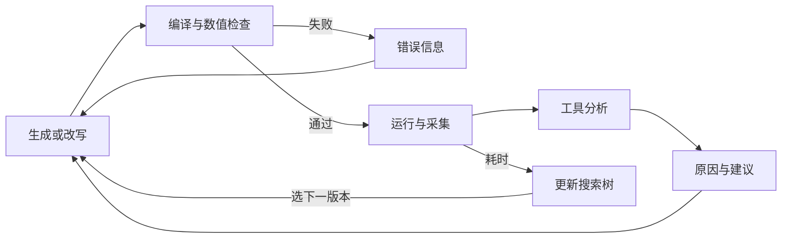
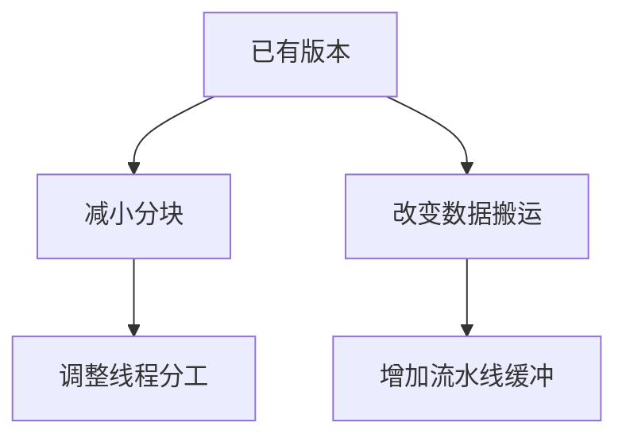

# KernelPro：把性能指标解释成 Agent 可以执行的优化建议

Agent 可以写出结果正确的 kernel，却仍可能不知道下一步怎样变快。运行分析工具能告诉它带宽、利用率和等待情况，但这些数字与代码改动之间还有一段距离。**KernelPro 把专家常用的分析方法做成工具，先解释指标，再把可能原因和优化建议交给 Agent。**

它围绕“生成 → 检查 → 测量 → 分析 → 再改写”组织开发，并用搜索树保留多个优化方向。本文重点看两件事：工具怎样帮助 Agent 选下一步，以及搜索怎样避免一直沿着效果有限的方向修改。

> 本文依据 [KernelPro v2](https://arxiv.org/html/2606.26453v2) 编写，论文全名为 *Optimizing CUDA like a Human: Micro-Profiling Tools as Expert Surrogates for LLM-Based GPU Kernel Optimization*。下文的改写过程用于教学；实验数字来自论文。方法主要面向 NVIDIA GPU，所需指标与指令分析依赖对应平台。

## 动机：测到问题，还不等于知道怎么改

假设一个 kernel 比预期慢，分析结果显示寄存器占用高。至少还有两个问题要回答：这个占用是否真的限制了执行？应该减小分块、减少同时保留的值，还是改变计算组织？

直接按“寄存器高”去改，可能把一个计算高效的实现拆碎。寄存器降低了，却多了访存、同步或重复计算，最终反而更慢。类似地，带宽低可能是缺少并行工作、访问不连续，也可能只是这个程序本来就不需要大量访存。

**KernelPro 希望补上从现象到行动的分析。** 它把常见判断写成可执行的规则，结合运行指标、编译后的指令和时间线，给 Agent 一组有依据的建议，再用下一轮测量检验这些建议是否有效。[论文第 1、4 节](https://arxiv.org/pdf/2606.26453v2#page=2)

## 方法：谁写代码，谁解释性能

系统接收参考实现和目标 GPU。参考实现可以来自 PyTorch、Triton 或 CUDA，用来确定计算、建立速度基线和检查输出。最终产物是通过正确性检查、在已尝试候选中表现最好的 CUDA kernel。

三个 Agent 分别负责不同工作：

- **Benchmarking Agent** 先分析参考计算，测量基线，做一次初始的瓶颈分类。
- **Programmer Agent** 生成候选代码；编译或数值检查失败时修复代码，结果正确后根据性能建议继续优化。
- **Profiling Agent** 收集运行和指令信息，调用分析工具，再整理出原因、严重程度与优先建议。

搜索协调器管理候选、决定继续修改哪个版本。下面的图只画一次候选的处理路径：错误反馈进入修复，性能反馈进入优化，两者最终都回到代码改写。

> 初始瓶颈分类影响工具选择，未在图中重复展开。搜索树保留此前的版本，因此回到“改写”不代表只能修改最后生成的那份代码。[论文第 3.1–3.3 节](https://arxiv.org/pdf/2606.26453v2#page=4)

### 先用 Roofline 选分析方向

初始分析只对参考实现做一次。它先看计算强度：每搬运一定量的数据，要做多少计算。计算多而搬运少，可能主要受计算吞吐限制；搬运多而计算少，可能主要受带宽限制。系统结合硬件参照和实际利用率，得到计算、访存或混合瓶颈等类别，后续候选的工具筛选仍依据这份分类。

这个分类用于选择相关工具。例如，检查计算吞吐时关注矩阵指令和 Tensor Core；检查访存时关注访问合并、流量和等待；启动或系统开销则需要看时间线。**Roofline 在这里提供分析入口，具体改法由后续工具继续判断。**

在论文采用的主动分析方式中，系统确定性地运行分类对应的工具，然后将结果放入提示词。这样不必等待 LLM 随机决定是否调用某个工具，也减少无关指标进入上下文。[论文第 3.2.1、3.2.3 节](https://arxiv.org/pdf/2606.26453v2#page=5)

### 专家知识怎样写进工具

一个工具可以按三个问题理解：**什么时候值得检查，证据可能说明什么，接下来可以改什么。** 例如，先发现一种等待占比很高，再结合访问或指令信息分析原因，最后提出增加复用、调整分块或改变流水线等建议。

工具的判断来自预先写好的阈值和分析逻辑。相关工具先确定性地执行、生成诊断，再由 Profiling Agent 中的 LLM 综合工具结果、指令信息与运行指标，形成带优先级的建议。Programmer Agent 将建议落实成代码。论文提供可注册的新工具形式，便于把新的分析经验加入流程。[论文第 3.2.3、4.1 节、附录 B](https://arxiv.org/pdf/2606.26453v2#page=5)

它使用三类信息来源：

| 信息来源 | 能看到什么 | 为什么需要它 |
|---|---|---|
| Nsight Compute，NCU | 某个 kernel 的吞吐、占用率、访存与 warp 等待 | 看执行资源如何使用、哪些等待值得分析 |
| 编译后的 SASS 指令 | 实际使用的矩阵指令、局部内存读写等 | 确认源码中的意图最终变成了什么指令 |
| Nsight Systems，NSYS | kernel、数据传输和同步的时间线 | 看单个 kernel 之外的启动与交接开销 |

论文共实现 15 个工具，覆盖寄存器溢出、占用率、Tensor Core 使用、访存合并、等待和启动开销等情形。它们各自处理一个较具体的分析问题，组合后形成反馈。[论文第 4 节](https://arxiv.org/pdf/2606.26453v2#page=10)

> **规则给出可检验的原因。** 某种等待占比高，不足以单独证明它就是主要瓶颈。阈值和推荐动作是专家经验的编码，下一轮仍要检查改动是否降低了完整任务的耗时。

### 用寄存器溢出看一次完整推理

寄存器由线程保留当前使用的值。如果同时存活的值太多，编译器可能把一部分放进局部内存，产生额外的读写，这称为 **寄存器溢出（spill）**。局部内存属于线程私有的地址空间，访问通过显存与缓存体系完成。

KernelPro 的相关工具会检查编译指令中的局部内存访问，并结合寄存器、运行指标判断是否存在值得处理的溢出，然后建议降低寄存器压力或考虑拆分 kernel。[论文附录 B.1](https://arxiv.org/pdf/2606.26453v2#page=23)

下面沿这个机制做一个**教学推演**。假设一个融合 kernel 同时保留很多累加值和后处理临时值，工具发现了溢出。Agent 可以提出一个具体假设：减少每个线程同时持有的输出，可能降低额外读写。

改写后需要依次确认：输出仍正确；编译后的溢出是否减少；额外访存是否减少；完整任务是否更快。前三项成立而最后一项不成立时，就要查新增代价，例如更多线程间交接，或更小分块导致的重复加载。

**有用的反馈应让 Agent 知道要验证什么。** “降低寄存器”只是动作；“减少溢出读写，并确认新增交接没有抵消它”才形成完整的优化假设。

### Agent 怎样使用 CUTLASS/CuTe 改实现

Programmer Agent 可以搜索 CUTLASS/CuTe 的源码和组件，组合数据布局、搬运与矩阵计算，生成 CUDA + CuTe 程序。系统还提供目标 GPU 的指令形状等信息，以及相应的编译、运行和分析环境。[论文第 3.2.4 节](https://arxiv.org/pdf/2606.26453v2#page=6)

因此，反馈可以推动更具体的实现变化：换矩阵指令、改变搬运组织、融合后处理，或者调整布局和线程分工。可修改的范围更大，也意味着仍可能出现复杂的编译和数值错误，需要前面的检查与修复路径。

## 搜索：保留不同方向，避免只改眼前最快版本

优化常常需要连续几步。某个版本暂时更慢，但完成后续改动后可能更快；另一个版本眼下较快，却难以继续改善。如果每轮只保留当前最快版本，就容易过早放弃其他做法。

KernelPro 用 **蒙特卡洛树搜索（MCTS）** 管理这种选择。树上的节点对应 kernel 版本，连线对应从父版本出发的一次改写。系统结合已取得的速度和探索情况，决定继续哪条分支；评价依据来自编译、检查和实测。[论文第 3.3 节](https://arxiv.org/pdf/2606.26453v2#page=7)

下面是教学示意。两个方向都来自同一版本，系统保留这种分叉关系，之后可以回到其中任一方向继续尝试。

每个新节点都要付出编译、检查和测量成本，因此系统限制分支扩张，减少无效路径的继续尝试。搜索也可以选择回到树的起点，按扩展规则生成新的初始方案。跨轮次的搜索记忆记录已经尝试的策略和失败信息，帮助后续改写参考此前经验；这发生在提示与搜索过程中，不需要更新模型权重。[论文第 3.3、3.4 节](https://arxiv.org/pdf/2606.26453v2#page=7)

**工具分析决定值得尝试哪些动作，搜索决定把有限预算分给哪些版本。** 两者职责不同：诊断准确，仍可能需要多步才能得到收益；保留许多分支，如果缺少可信的诊断，也会花时间探索错误方向。

## 实验：解释指标，是否真的帮助优化

最贴近本文主线的是 42 个 KernelBench 任务上的反馈消融。三组使用相同的 Sonnet 4.6、A100、贪心搜索与尝试预算，区别在于给 Agent 什么信息。

| 反馈方式 | 相对 PyTorch eager 基线的几何平均加速比 |
|---|---|
| 只给源码与编译、正确性错误 | 3.35× |
| 再给约 50 个未经解释的 NCU 原始指标 | 1.77× |
| 给原始指标、瓶颈分类与工具解释 | 4.00× |

**在这组实验中，增加原始指标反而不如不给性能反馈，解释后的反馈才改善了结果。** 这支持把分析放在代码改写之前：数字更多，并不保证 Agent 更会选择有效动作。[论文第 5.3.1 节、附录 C.1](https://arxiv.org/pdf/2606.26453v2#page=14)

> 每个任务、每组运行 15 个种子，每次搜索 30 轮、每轮生成 2 个候选，结果取各种子中的最好加速比，并按论文方法限制离群值影响。这评价的是固定预算下得到的最好结果，不能当作单次开发成功率或开发耗时。

搜索策略的独立对照采用同样的 42 个任务与候选预算，两组都使用完整性能反馈与搜索记忆，只改变搜索方式。MCTS 相对贪心搜索的几何平均结果提高约 26%，支持在固定预算下保留多个优化方向。[论文第 5.3、附录 E](https://arxiv.org/pdf/2606.26453v2#page=14)

论文还在 H100 上优化 VeOmni 的 MoE 权重梯度 kernel，生成 CUDA + CuTe 实现，相对专家调优的 Triton 基线达到 1.23×。这个结果说明方法也测试了已有优化的实际 kernel；测量对象是该计算内核，不能据此推出整个 MoE 训练加速同样多。[论文第 5.4 节](https://arxiv.org/pdf/2606.26453v2#page=16)

该案例的基线已经使用 Hopper 的矩阵指令。后续收益来自针对具体形状调整数据搬运、共享内存排列和资源占用。各专家参与求和的输入行数不同，空专家和较短输入也需要正确处理；因此，它比固定形状 GEMM 更接近我们关心的不规则计算。

## 对我们当前调研的帮助

KernelPro 回答了一个具体问题：**给 Agent 的性能反馈怎样更有用？** 先告诉它观测到的现象，再给出证据支持的可能原因和候选改动，最后要求重新测量，检查原来的问题是否减少、是否出现新的代价。

这与 [Argus](./Argus.md) 的重点不同。Argus 主要解释改写破坏了哪种数据关系，帮助把程序写对；KernelPro 主要解释正确程序的性能现象，帮助选择下一步。与 [ROLLER](./ROLLER.md) 相比，KernelPro 更依赖运行后的信息；ROLLER 利用计算和硬件模型，在生成前减少候选。

**诊断能力取决于已编码的经验，新的原因需要补充分析方法。** 论文没有给出联合预测寄存器、共享内存、并发驻留与资源争用的完整候选时间模型。初始瓶颈分类还影响工具筛选，优化后瓶颈改变时，需要关注这种筛选是否仍然合适。

对于我们的 Grouped GEMM + Reduce，可以借鉴这种反馈组织，但分析规则还需要贴合共同执行：先确定归约是在等输入、等驻留资源，还是已开始却被拖慢；再结合时间线、编译资源和运行指标提出改动。只有“带宽低”或“占用率低”，仍不足以决定应该改依赖、缩小分块，还是重新分配资源。相关问题见 [Agent + Compiler 总览](./agent-compiler-overview.md)。
