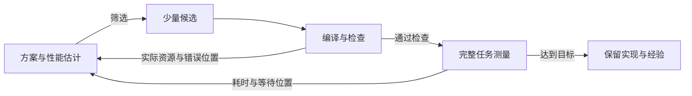

# Agent + Compiler：Kernel 开发范式与优化空间总览

我们希望 Agent 更快地开发出高性能 kernel，也能在缺少现成做法时找到新的优化机会。现在的困难是：**知道做法时，仍要试很久；没有现成做法时，往往不知道下一步该改什么。** 融合和并发又把这个困难放大了：单项工作各自算得快，组合以后未必快。

这份调研围绕四个实际问题展开：

- **成熟方案能实现，但开发过程太长。** 编译、测量和修复反复发生。我们需要减少单次尝试的成本，也减少不值得做的尝试。
- **陌生组合能写对，却不知道怎样继续变快。** 耗时高、利用率低只是现象。我们需要解释原因，再把原因对应到具体改动。
- **Grouped GEMM + Reduce 可以重叠，但收益很小。** 当前 worklog 已解决部分启动等待，最终改善约 0.23–0.26%，低于 1% 门槛。我们还不知道下一步应优先改依赖、数据交接，还是共同执行的配置。
- **独立小任务可以合并，但不知道怎样分工才划算。** 减少启动、填补执行空闲都有机会；资源竞争、统一配置和调度管理也可能增加耗时。我们需要比较具体的共同执行方式。

**我们建议把 kernel 开发组织成有依据的少量尝试：复用成熟实现，先估收益与资源需求，筛选值得实现的方案；再用编译信息确认资源，用测量解释预测偏差，联合调整相关配置。** 这套流程的目标是减少无效尝试，并帮助陌生组合确定下一步改动。

## 用估计筛选方案，用反馈决定下一步

从输入形状、数据类型、计算关系与目标硬件出发，先提出少量分块、存储和线程分工方案。每个方案说明预计省掉什么、增加什么，再按下面的流程推进：

1. **估收益与资源，筛选候选。** 估计能减少的计算、数据移动或等待，以及寄存器、共享内存和并行工作量的变化，排除明确不可行或收益太小的方案。
2. **实现少量候选，取得编译信息。** 复用成熟后端，用实际资源分配更新估计，检查溢出、同步和数据关系，并验证数值结果。
3. **测完整任务，解释与估计的差距。** 同时观察总时间、阶段速度和等待位置，判断预期变化是否发生，以及新增代价是否抵消了收益。
4. **根据原因选择下一轮改动。** 将相互影响的分块、缓冲、线程份额和任务粒度一起比较，记录成功或失败的条件，供后续任务复用。

编译反馈帮助确认方案能否按预期执行；测量反馈帮助解释哪里仍在等待、哪里变慢了。**每轮都要留下“证据支持什么原因，因此准备改什么”，让失败也能缩小下一轮的选择范围。**

ROLLER 支撑候选构造与估计，KernelPro 支撑测量后的分析，HFuse 提供独立任务分工的具体选择。后文先解释收益和资源怎样估计，再说明四个实际问题中怎样应用这些步骤。

> 本文以 NVIDIA 为主。原有五篇工作的详细实现见 [ComFuse](./ComFuse.md)、[MPK](./MPK.md)、[μCUTLASS](./uCUTLASS.md)、[Argus](./Argus.md) 和 [CAKE](./CAKE.md)。上述流程是本文结合调研提出的开发建议，收益需在我们的任务上评价；各论文与 worklog 的结果按各自条件引用。

## 实现前先估收益和资源，再决定一起调什么

同一个算子采用不同分块、存储和线程分工，收益与资源需求会不同。实现前的估计要回答三个问题：最多能省多少，资源能否容纳，省下的时间会被什么抵消。

**先估最多能省多少。** 根据计算量与计算吞吐、数据搬运量与访存带宽，估计主要工作的耗时。融合时说明能省掉哪些中间结果的读写；并发时说明能隐藏哪段等待。显存、缓存与 shared memory 承担的数据搬运不同，需分别估计。芯片峰值给出理想参照；小块或不连续访问未必达到峰值，估计时应采用接近该访问方式的吞吐数据。后文的 SOL 用于判断潜在空间，ROLLER 则进一步估计候选。

**再估资源能否容纳。** SM 是执行线程块的硬件单元。对每个候选，按元素数量与数据类型大小计算 shared memory（共享内存）中每组缓冲的空间，再计入同时存活的组数、布局填充和同步状态。寄存器则先估计每个线程需要保留多少累加值与临时值，再结合线程数，估计每块的需求。用这些需求检查一个 SM 能同时容纳多少块；两项工作希望共同驻留时，要一起检查。

带宽与容量回答不同问题：带宽限制单位时间能搬多少数据，容量限制同时能放下多少工作。容量不足导致可驻留的块减少后，可用 warp（每组 32 个线程）也会减少，等待数据时可能缺少其他工作继续执行。

> Hong 与 Kim 的经典分析模型将可运行 warp 数量、访存延迟与带宽联系起来，帮助理解上述关系。它面向早期 GPU；用于 H20 时，还要考虑现代计算指令、异步搬运和流水线。[GPU 分析模型，ISCA 2009，第 2–3 节](https://hparch.gatech.edu/papers/hong_isca09.pdf#page=2)

**最后估省下的时间会被什么抵消。** 更大的 GEMM 块可能提高输入复用，但增加寄存器与 shared memory 占用；更多流水线缓冲可能覆盖搬运等待，也可能减少驻留块；更细的任务可能提前交接，却降低小块计算效率、增加同步与派发。因此，分块、缓冲数量、线程份额和任务粒度需要联合比较，目标是完整任务更早结束。

下面用教学示例展示增加缓冲的容量代价。同样的 shared memory，原先可以放下两个块；每块增加一组缓冲后，剩余空间放不下另一块。是否值得，要比较减少的搬运等待与减少并行工作带来的损失。

<KernelResourceCapacity />

累加值和缓冲区可以按候选结构估算，最终寄存器分配则需要编译信息确认。驻留块数还受分配粒度、线程与块数量上限、运行时 shared memory 配置影响。ROLLER 为编译器额外分配的寄存器留出保守预算，再测量靠前的候选。[ROLLER 第 4、6 节](https://www.usenix.org/system/files/osdi22-zhu.pdf#page=8)，[CUDA 最佳实践：Occupancy](https://docs.nvidia.com/cuda/cuda-c-best-practices-guide/index.html#occupancy)

**容量检查通过，接下来要比较共同执行的速度。** 两项工作仍可能争用计算、缓存和带宽，这些代价需要校准和测量。前面的流程据此分工：预估减少无效尝试，编译确认资源，测量推动下一轮选择。

## 成熟方案能实现，为什么开发仍然很慢

### 现有工作减少了实现和修复的负担

对于常见 GEMM，成熟实现已经告诉我们怎样分块、复用输入、安排搬运和计算。Agent 的很多工作是在落实这些决定：组装模板、处理索引和尾部、安排同步，再编译和测量。一次错误会触发修复、重新编译和重新测量，成本会反复累积。

μCUTLASS 给出过一个 40 次尝试的运行实例：模型调用约占总时间的 21%，编译、运行和性能分析工具操作约占 79%。这个比例取决于环境，但它说明，**缩短开发时间，还需要减少工具等待和无效尝试。** [μCUTLASS 论文第 1 节](https://arxiv.org/html/2603.29010v1#S1)

现有三篇 Agent 工作分别帮助处理其中一部分：

- **μCUTLASS 复用成熟实现。** Agent 用紧凑的配置语言选择分块、调度和后处理，CUTLASS 后端组装实现，减少重复编写底层细节。
- **Argus 更早指出数据关系错误。** 优化时标记数据，并声明消费位置应该收到怎样的数据；编译器沿数据流检查，反例帮助定位错误的线程、元素和位置。
- **CAKE 明确表达调度。** Agent 描述搬运和计算的角色、缓冲区与同步条件，编译器推导部分细节，并检查其覆盖范围内的资源使用与交接。

这些方法让一个选定的方案更容易完成。但 Agent 仍可能选了很多没有收益的配置，每个都付出编译和测量成本。**下一层问题是：能否在生成和运行之前，把候选收窄一些？** [μCUTLASS 第 3 节](https://arxiv.org/html/2603.29010v1#S3)，[Argus 第 4–6 节](https://mast.stanford.edu/pubs/argus_agentic_gpu_optimization_guided_by_data_flow_invariants/paper.pdf#page=4)，[CAKE 第 2 节](https://arxiv.org/html/2608.12629v1#S2)

> Argus 原型面向 AMD MI300X，本文借鉴反馈方式，不直接迁移其后端能力。Argus 和 CAKE 的静态检查都有覆盖范围，完整数值测试仍然需要保留。

### ROLLER 补充的回答：按硬件特点构造候选，再测少量方案

如果把分块大小、线程数和存储安排全部组合起来，候选会很多，其中一些本来就不适合目标硬件。ROLLER 从硬件特点出发，优先构造对齐访存和执行粒度的分块，并考虑各级存储容量与输入复用。它把这种分块称为 **rTile**。

随后，它估计候选需要搬多少数据、占多少空间，以及计算和搬运的大致成本，用这些估计选择候选。这里的性能模型利用预先标定并缓存的硬件数据，避免为每个配置完整运行一次。最后仍要编译、测量少量靠前的候选，因为实际寄存器分配、指令安排和编译器优化可能改变表现。[ROLLER 第 3.3、4 节](https://www.usenix.org/system/files/osdi22-zhu.pdf#page=7)

**它补上的是“怎样少试一些”。** 论文区分只生成首选候选与编译、测量多个候选的成本；后者仍可能占据主要时间。评价开发效率时，要把硬件标定等准备成本与每个任务的成本分别记录。

> ROLLER 的模型依赖相应的分块、硬件和工作量假设。不均匀或稀疏工作会影响估计；动态路由中的长尾与共同执行的竞争需要补充模型。[ROLLER 第 4–6 节](https://www.usenix.org/system/files/osdi22-zhu.pdf#page=8)

**我们现在得到的指导是：成熟做法尽量复用，用检查排除错误，用成本估计减少候选，再把真实测量留给有希望的方案。** 仍需回答的是，这些手段在我们的开发流程中能省多少总时间，会不会错过有效配置。Token 更少、尝试更少、开发更快，需要分别评价。

## 陌生组合能写对，怎样知道下一步该改哪里

### 已有反馈回答的问题不同

看到一个 kernel 比预期慢，可以先估计理想情况下需要多久。μCUTLASS 的 Speed-of-Light（SOL）分析根据计算量、数据量和硬件吞吐估计耗时下界。它帮助判断还有多少潜在空间，以及是否值得继续投入预算。[μCUTLASS 第 4 节](https://arxiv.org/html/2603.29010v1#S4)

但离这个参照很远，仍可能有多种原因：中间张量读写多，线程块无法同时驻留，同步范围过大，工作分配不均，或者参照模型过于理想。知道差距，并没有确定改动。

其他反馈也有各自用途。Argus 指出数据关系被破坏，主要帮助把改写做对；CAKE 的成本模型帮助估计候选，并不自动证明现有实现的瓶颈；时间线显示工作何时开始和结束，硬件计数器描述资源使用与等待，仍需要解释这些现象。

**陌生情形的核心缺口，是从“测到了什么”走到“可能为什么，再试什么”。** 这一步判断不清，开放再多调度参数，也容易变成反复猜测。

### KernelPro 补充的回答：把专家分析方法做成工具

KernelPro 先做大致的瓶颈分类，再选择相关分析工具。工具查看硬件指标、编译后的指令和系统时间线，将专家常用的判断方法转成分析结果：哪些现象值得关注，可能对应什么原因，以及有哪些改法。Agent 再依据这些建议生成候选、检查结果、重新测量。[KernelPro 第 3–4 节](https://arxiv.org/pdf/2606.26453v2#page=4)

一个具体例子是寄存器溢出：部分值放不进寄存器，被编译器安排到局部内存，产生额外读写。KernelPro 的相关工具结合编译指令中的局部内存访问与运行指标，判断这种现象是否可能拖慢执行，再建议调整寄存器压力或拆分 kernel。这样，反馈包含了可以继续检验的原因和动作。[KernelPro 附录 B.1](https://arxiv.org/pdf/2606.26453v2#page=23)

> **教学推演：** 工具提示寄存器溢出后，可以尝试减少每个线程保留的值。若编译后的溢出减少、额外访存减少且总时间缩短，就支持这个方向；若访存减少但总时间变长，就要检查是否增加了其他工作或降低了计算效率。

论文在 42 个 KernelBench 任务上比较了三种反馈：不给性能反馈、直接给原始指标，以及给经过工具解释的反馈。解释后的反馈得到更好的优化结果，支持在 Agent 修改 kernel 之前增加性能分析。[KernelPro 附录 C.1](https://arxiv.org/pdf/2606.26453v2#page=27)

> 该对照使用相同模型、A100、相同迭代与候选预算，每项任务运行多个随机种子，再取其中最好结果。它评价的是所测条件下的优化结果，没有直接给出我们的单次开发耗时。

KernelPro 的分析依赖已有专家规则、阈值和建议。熟悉的原因可以按规则识别；遇到新的依赖组织或共同执行方式，需要针对具体执行过程补充判断。后面的 Grouped GEMM + Reduce 案例展示怎样沿证据逐步缩小原因范围。

**我们现在得到的指导是：给 Agent 的性能反馈，应连同证据、可能原因和候选动作一起提供。** 剩余问题是，规则没有覆盖时怎样继续分析，多个原因同时出现时怎样排优先级，以及优化改变瓶颈以后怎样更新判断。

## Grouped GEMM + Reduce 能重叠，为什么收益仍然很小

### 归约等待的输入，与 GEMM 的生产方式不同

Grouped GEMM 是一组矩阵乘法。在这个 MoE 案例中，各专家计算自己收到的 token；Local Reduce 则按 token 收集本地专家的输出，乘相应权重，再相加。**GEMM 按专家生产，归约按 token 收集。** 同一 token 的贡献可能由不同线程块产生。

所以，一个 GEMM 块完成，通常还不够让相关 token 的归约开始。它还要等其他贡献。一个值得尝试的调度，必须先说明归约要收集哪些输入，什么时候才算到齐。

> 案例来自仓库中的《Grouped GEMM 与 Local Reduce 融合工作记录》（`fusion-worklog.html`），对应 2026 年 9 月 23–24 日的实现与测量。范围是单卡 H20、约 6.28 万 token、64 个本地专家和 1280 → 2048 投影。这是本地贡献汇总，不涉及多卡 AllReduce；下文只引用已有实验。

第一版沿输出列切分：先完成所有本地专家的一段输出特征，再让归约处理这一段，GEMM 同时继续下一段。这一列段已经包含相关输出元素所需的全部本地贡献；不同列段对应不同元素，段与段之间无需再求和。

它改变了消费时机，但保留完整的显存中间结果 D。GEMM 仍写出 D，归约仍读回 D，两边通过 stream 和 event 交接。**这次尝试希望隐藏归约时间，尚未省掉中间张量的保存与读取。**

> 原始 GEMM 约用 5.58 ms，索引压紧与归约合计约用 0.47 ms。若 GEMM 不变慢、后两项完全被隐藏，按阶段中位数估算，总时间最多下降约 7.8%。这是纯重叠的理想空间，未计入分段、同步和竞争。

### 输入到齐以后，归约还需要有地方执行

第一版回退约 5.5%，时间线中也很少出现重叠。GEMM 的常驻线程块已经占用了大量寄存器，归约即使输入就绪，也可能无法获得驻留资源。

一个线程块称为 CTA，执行它的硬件单元是 SM。SM 同时容纳哪些块，受到寄存器、共享内存等容量限制。把工作提交到另一个 stream，不能绕过这些限制。

减少 GEMM 的块数，可以给归约让出容量，但 GEMM 也失去部分并行能力。缩小分块，没有自动减少编译器保留的寄存器池。后续同时调整实际寄存器预算与共享内存配置，才出现持续重叠。

> 第一版 GEMM 每 CTA 的名义寄存器分配为 64512 个，归约还需 8704 个，合计超过每 SM 的 65536 个寄存器。调整寄存器后，共享内存仍曾阻止驻留。在同一候选的对照中，优先划出共享内存容量，将数据就绪后的归约启动等待从约 1.41 ms 降到 2.9 µs。这些对照支持资源容量的限制，不代表计算单元此前每个周期都已满负荷。

这一步已经有比较明确的回答：**数据到齐与获得执行资源，是两件需要分别判断的事。** Agent 需要看到实际编译分配、运行时容量和开始执行的时间，而不只是分块参数和芯片标称容量。

### 两边开始共同执行后，还要重新比较整体速度

资源调整把回退收窄到约 0.59%，但分段 GEMM 新增的耗时仍抵消了被隐藏的归约时间。两项工作开始执行以后，还可能竞争指令发射、计算资源、缓存和显存带宽。因此，独立运行时的耗时不能直接用于预测并发后的收益。

归约也需要重新选择配置。原配置每块处理四个 token，贡献循环取四者贡献数的最大值，较短 token 在多出的循环位置中不做有效计算。改成每块两个 token、一个 warp（32 个线程）后，整个块的资源需求下降，也缓解了这种不均衡。

归约单独运行最快的配置，并没有稳定成为整体最快的配置。调整后，GEMM 结束后的归约尾段改善较多，与 GEMM 重叠的中段改善较小。记录缺少显存吞吐、缓存和线程等待的相关计数器，尚不能确定剩余损失主要来自哪种竞争。

**最新三轮配对长测改善约 0.23–0.26%，仍低于约定的 1% 门槛。** 已经解决部分启动等待，接下来要找到共同执行后的主要损失。

> 计时包含每轮索引压紧与所有 stream 完成；编译、分配和一次性权重打包在计时外。候选与原始实现的 BF16 输出逐位一致。独立采集的 profile 用于解释执行行为，不能精确拆解无 profiler 时的端到端收益，也不能把重叠的两个 kernel 持续时间相加作为总延迟。

### 怎样根据这些现象选择下一步

**输入到齐，归约却迟迟不能开始：先检查驻留资源。** 在这个案例中，第一版的编译分配已经超过共同驻留的寄存器容量，应优先调整资源预算或常驻块数。验证时同时看归约是否提前开始、GEMM 是否变慢，以及总时间是否下降。若相关输入尚未到齐，则先检查依赖是否等待了无关生产者。

**归约已经提前开始，总时间却没下降：先比较省下的等待与新增耗时。** 检查分段后 GEMM 多花了多少时间、归约还剩多少尾段，以及两者共同执行时的速度变化。如果生产者新增耗时抵消了重叠收益，就联合比较 GEMM 分块与常驻块数、资源预算和归约块的工作量。时间线可以缩小分析范围，具体竞争原因再用相关计数器验证。

**希望进一步减少中间结果读写：检查数据交接与数值顺序。** 当前重叠保留了完整 D。要省掉 D，需另行设计贡献怎样进入最终输出，计算更新冲突、初始化与最终转换的成本，并核对舍入和累加顺序。这个候选针对数据搬运，后文与减少等待的候选分别讨论。

**下一步改动应针对证据支持的原因。** 资源不足先处理资源，重叠后损失过大就调整组合配置；减少中间读写则需要设计新的数据交接。每轮选择一项能验证的判断，比较完整任务时间，再更新方案。

**Weave 提供了资源分配与切分粒度联合选择的参照。** 它研究 MoE 的计算与跨 GPU 通信：同时选择给通信多少 SM，以及把计算切成多少个流水线批次。批次更细，结果可以更早交接，但 GEMM 变小又可能降低吞吐。模型结合路由后的工作量与硬件吞吐数据，比较这些收益和损失，再选择组合配置。[Weave 第 3 节](https://arxiv.org/html/2609.21483v3#S3)

> Weave 在路由完成后、主要执行开始前选择配置，评估面向四卡 H100。这里借鉴资源份额与任务切分的联合建模；用于本案例时，需要补充寄存器、shared memory 与本地归约的代价。[Weave 第 4–5 节](https://arxiv.org/html/2609.21483v3#S4)

### 提前消费与减少中间读写，需要不同的交接设计

**MPK 更贴近“只等相关任务”。** 它将计算与通信组织为任务及依赖，由常驻 kernel 中负责执行任务的线程组（worker）处理。局部结果就绪后，相关后继可以推进，无需总以整个算子为边界。这为按 GEMM 块就绪派发归约提供思路；动态路由下的依赖准备、通知和派发成本还要计算。[MPK 第 3–5 节](https://arxiv.org/html/2512.22219v2#S3)

**ComFuse 更贴近“跨过归约，继续使用片上数据”。** 在 GEMM → LayerNorm 中，它安排有关线程块汇总统计量，再把统计量与保留的原始值交给下一阶段。这提醒我们，同时设计汇总范围与中间值的存放和存活时间，才有机会减少显存交接。[ComFuse 第 III 节](https://arxiv.org/html/2608.03537v1#S3)

> ComFuse 的跨 CTA 路径使用 Hopper、Blackwell 等架构支持的线程块集群、分布式共享内存与同步。任意分散的专家贡献还需设计相应映射，不能直接套用。论文的 Self-Attention 测试也有比 FlashAttention 基线更慢的情况，作者主要归因于矩阵计算与 Softmax 的流水失衡；减少中间读写仍可能被其他代价抵消。[ComFuse 第 VI-B 节](https://arxiv.org/html/2608.03537v1#S6.SS2)

worklog 保留了两个待验证方向：

- **按真正依赖派发归约。** 从路由确定每组 token 真正等待哪些 GEMM 块，输入到齐即可开始。它希望少等无关生产者，但增加依赖准备、通知与调度；还要保证写出和可见性，避免消费者占住资源、阻碍生产者。它仍可通过 D 交接。
- **GEMM 直接推送加权贡献到最终输出。** 省去完整 D 的保存与后续读取，但引入原子更新、初始化和最终转换。贡献到达顺序可能变化，当前位一致要求也必须重新核对。

> 当前数值路径先将 GEMM 结果舍入为 BF16，乘权重后再次舍入为 BF16，再按原有贡献顺序以 FP32 累加，最后转成 BF16。改变交接方式时，舍入位置与累加顺序都是必须考虑的条件。

当前有三类选择：提前消费、减少中间读写、调整共同执行的配置。它们分别针对等待、搬运和共同执行的损失。下一轮要用前面的分析确认哪类代价占主导，再估计候选收益，决定优先尝试哪一类。

## 独立小任务能合并，怎样分工才划算

### 先比较四种执行方式

独立任务之间没有生产者—消费者关系，合并通常没有自动复用中间结果的收益。机会主要来自减少启动，以及利用原本空闲的执行容量。具体可以考虑：

- **多个 kernel 并发。** 各自保留资源和线程配置，实际重叠取决于资源需求与调度。
- **同一 kernel 中，不同 CTA 做不同任务。** 预先分配块的任务份额，合并入口；不同块是否能同时驻留、怎样使用 SM，仍要分析。
- **同一 CTA 中，不同线程组做不同任务。** 两类工作位于同一块内，由不同线程执行，共同承担这个块的资源配置。这是 HFuse 提供的选择。
- **常驻 worker 动态取任务。** 执行任务的线程组做完工作后继续领取任务，适应工作量变化，但队列、通知与派发也进入成本。这是 MPK 提供的机制之一。

“让一半 CTA 做 A”不等于“让 A 独占一半物理 SM”。普通 CUDA 网格的块由硬件分配到可用 SM，不能仅靠块编号推断固定绑定。线程组分工、CTA 分工和物理 SM 分区，也就需要分别说明。[CUDA 编程模型](https://docs.nvidia.com/cuda/cuda-programming-guide/01-introduction/programming-model.html)

### HFuse 补充的回答：给独立任务各自安排线程，并处理各自同步

HFuse 在一个融合 kernel 的 CTA 内将线程分成两组，分别执行原来两个 kernel 的工作，同时转换原有的线程索引。同步也要改成只等待当前任务的参与者，避免一项任务的同步把另一项任务的线程算进去。随后，它测量不同线程份额和寄存器限制，选择配置。[HFuse 第 II-C、III 节](https://arxiv.org/html/2007.01277#S2.SS3)

一组线程等数据时，另一组线程可以继续执行，使 SM 少一些空闲。但如果两边争用同一种资源，或者合并后占用更多寄存器与共享内存，收益可能消失。限制寄存器可以增加可驻留的块，也可能造成溢出，增加额外访存。

**HFuse 给出的指导是：线程份额与寄存器限制需要一起选择，并比较全部任务的完成时间。** 论文比较了融合实现、并行 stream 下的原 kernel 与其他配置，观察到资源互补的收益，也记录了寄存器限制使某些组合更慢的情况。[HFuse 第 IV 节](https://arxiv.org/html/2007.01277#S4)

> HFuse 的实验架构是 Pascal、Volta。H20 上的候选需要重新检查资源需求与共同执行的表现。

MPK 的动态 worker 则更关注工作量变化与就绪顺序。任务切得细可以减少长尾，但派发更多；合在常驻 kernel 中还可能承受统一配置。论文指出，其线程寄存器占用按任务类型中的最高需求固定，共享内存采用任务粒度的分页管理。小任务加入大 kernel 后，未必保留独立运行时的资源成本。[MPK 第 6.5、7 节](https://arxiv.org/html/2512.22219v2#S7)

选择时，先检查两项工作空闲的资源是否有机会互补，再估计不同分工的资源与管理成本，测量全部任务完成的总时间。还要确认输出没有冲突、任务没有遗漏或重复，并检查工作量比例变化后分工是否仍有效。这些条件帮助决定保留多个 kernel，还是采用某种合并方式。

## 常见 kernel 可以收敛成哪些可组合的做法

前面的四个问题涉及不同算子，但很多优化动作会重复出现。这里将“范式”理解为反复出现的数据处理和执行做法，供 Agent 形成候选时复用。

| 常见做法 | 为什么可能更快 | 需要表达的决定 | 什么情况下不划算 |
|---|---|---|---|
| 算出一个值，直接接着处理：Bias、激活等局部融合 | 少读写中间张量，减少启动 | 融合边界、元素分工、访问与类型转换 | 保留值过多、重排昂贵，或原实现已做同样融合 |
| 切成块，边准备边计算：GEMM 等流水线 | 复用输入，重叠搬运和计算 | 块大小、布局、线程角色、缓冲数量 | 占用过多资源、工作量太少，或阶段速度失衡 |
| 汇总多份数据，再继续处理：归约与后继消费 | 减少等待，或省掉中间交接 | 谁汇总、等哪些输入、值放哪里、何时释放 | 同步、通信和保留成本过高，或生产者变慢 |
| 把大小不同的工作安排好：Grouped GEMM 等不规则集合 | 减少部分 worker 空闲、另一些拖到最后 | 任务切分、组合、顺序和派发 | 任务太细，管理成本增大，输入复用被破坏 |
| 让独立工作共同执行：多个小任务 | 减少启动，利用执行空闲 | 并发方式、线程或 CTA 份额、取任务策略 | 资源竞争、统一配置或调度成本抵消收益 |

同一个算子可以组合多种做法。Grouped GEMM + Reduce 包含分块计算、结果汇总和不规则任务安排；Attention 也包含矩阵计算、归约和跨块状态。按名字分成 GEMM、Reduce、Attention，还没有告诉 Agent 应该修改哪项决定。

一个有助于选择的区别是：**归约后还要不要用原始值。** LayerNorm 算出统计量后，仍要处理原来的元素，因此要安排保留路径；专家贡献在汇总完成后可以释放。两者都包含 Reduce，但交接和存活条件不同。

这张表用于构造候选：先指出准备减少哪种工作或等待，再从对应行选择需要改变的决定，按前面的建模与反馈流程比较收益和代价。

## Agent 与编译器各自负责什么

Agent 需要承担方案选择：先提出少量执行方案，估计收益与资源需求，再根据证据决定具体改动。语言需要让它表达真正影响性能的决定，也让这些决定能够用于估计。编译器可以复用实现、推导细节、检查相关条件，并返回实际资源分配与诊断。运行测量则校准估计，确认最终速度，以及预计的变化有没有发生。

从当前问题看，需要开放三类决定：

- **计算与资源。** 分块、缓冲数量、线程角色的预算、每个归约块处理几个 token。
- **依赖与任务。** 哪些生产者释放哪个消费者、交接粒度、静态分配或就绪派发。
- **数据交接。** 中间值存放位置、写出与可见性、消费结束与缓冲复用，以及数值顺序。

已有后端能表达的选择，可以用配置复用。改变任务依赖、线程分工或数据保存方式，需要开放对应结构，并配套检查。

**复用经验时保留输入、硬件和适用条件。** Argus 的学习循环改进规划提示，优化知识库保持固定；CAKE 还让重复的表达缺口与预测偏差推动编译器演进，新增能力要补充分析、检查和代码生成，并经过回归与人工合入。这些方法让当前任务中的经验有机会用于后续任务。[Argus 第 6、8 节](https://mast.stanford.edu/pubs/argus_agentic_gpu_optimization_guided_by_data_flow_invariants/paper.pdf#page=6)，[CAKE 第 3.2 节](https://arxiv.org/html/2608.12629v1#S3.SS2)

## 已有回答与仍缺的答案

下表归纳现有依据，以及我们还需要验证的选择与收益。

| 实际问题 | 现在已经回答了什么 | 仍需回答什么 |
|---|---|---|
| 成熟方案开发太久 | μCUTLASS 复用后端；Argus、CAKE 减少部分修复；ROLLER 按收益和资源估计筛选候选，减少逐项实测 | 哪一步最耗时？减少候选后会漏掉什么？模型与标定的成本能否由减少的尝试抵消？达到同等性能的全部开发时间能省多少？ |
| 陌生组合不知道下一步改哪里 | SOL 提示空间；资源与访存模型帮助提出原因；KernelPro 将测量解释成建议；现有检查帮助落实改写 | 模型怎样覆盖新的执行结构？未知原因与多个原因怎样分析？预测偏差与瓶颈改变后怎样更新判断？ |
| Grouped GEMM + Reduce 重叠收益小 | worklog 区分输入等待、驻留限制与共同执行后的速度；ComFuse、MPK 提供交接和依赖推进思路；Weave 提供资源份额与切分粒度联合建模的参照 | 剩余损失来自哪里？怎样估计让出资源与共同执行的代价？提前消费、减少 D 的读写和联合调参，哪个最值得做？在哪些路由与形状下有效？ |
| 独立小任务不知道怎样分工 | HFuse 补充同一 CTA 内的线程分工；MPK 提供常驻 worker；已经明确四种方式的取舍 | 哪些资源能互补？怎样分配份额？什么时候保留多个 kernel 更合适？工作量变化后如何选择？ |

**开发时间的评价**要固定正确性要求和目标性能，分别记录模型调用、编译、测量与修复耗时，以及性能模型的建立与硬件标定成本。用达到同等性能的总开发时间，判断这套流程是否减少了开发成本。

**陌生情形中的能力**要看 Agent 能否提出有依据的不同方案，验证判断并解释失败。还要注明它能否读取成熟实现，以及任务与已有做法有多接近。照参考改写、组合已有机制、提出新的执行结构，体现不同能力。

**执行收益**要按完整任务范围评价。Grouped GEMM + Reduce 包含依赖准备与全部工作完成；独立任务包含所有任务结束。还要覆盖代表性形状、路由偏斜和边界情况，保持数值与同步标准明确，分别报告设备时间、API 耗时和服务吞吐。后续工作据此判断，究竟减少了开发成本，还是找到了更好的执行方案。
