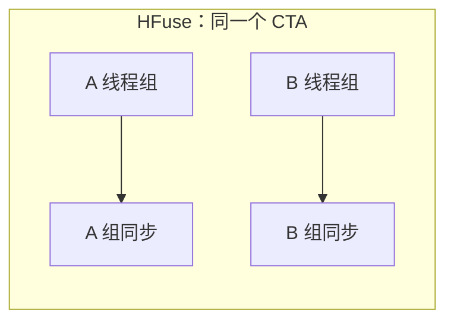
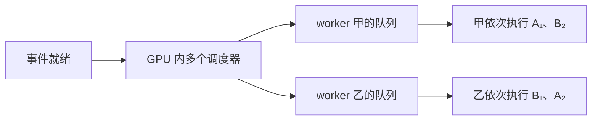

# Agent + Compiler：围绕 Kernel 开发问题的论文导览

我们希望 Agent 更快地开发出高性能 kernel，也能在缺少现成做法时找到优化机会。现在有两种困难：**知道做法，仍要试很久；程序能写对，却不知道下一步怎样变快。**

Grouped GEMM + Reduce 和大量独立小任务，是我们检验这两种能力的具体场景。前者涉及输入何时到齐、归约何时能执行，以及共同执行后的速度变化；后者涉及怎样把很多小工作安排在一起，减少启动、等待和空闲。

这份导览按四个问题组织论文：

| 我们卡在哪里 | 主要阅读入口 | 从论文中寻找什么回答 |
|---|---|---|
| 成熟方案能实现，开发却很慢 | [μCUTLASS](./uCUTLASS.md)、[Argus](./Argus.md)、[ROLLER](./ROLLER.md) | 怎样复用实现、减少错误修复，以及少试无效配置 |
| 正确但慢，不知道下一步改什么 | [KernelPro](./KernelPro.md)、[CAKE](./CAKE.md) | 怎样解释运行证据、表达新的执行安排，并补充工具缺失的能力 |
| Grouped GEMM + Reduce 能重叠，收益却很小 | [MPK](./MPK.md)、[ComFuse](./ComFuse.md) | 怎样更早消费相关结果，以及怎样跨过归约继续使用片上数据 |
| 独立小任务能合并，不知道怎样分工 | [HFuse](./HFuse.md)、[MPK](./MPK.md) | 怎样选择块内线程分工或常驻任务执行，利用原本空闲的能力 |

后文解释各篇论文的办法、对我们的帮助和剩余缺口。八篇论文提供了不同层面的能力；文末再归纳我们可以采用的开发方法。详细实现与实验表由各篇笔记承载。

> 本文以 NVIDIA 为主要讨论对象，架构专属能力在相关位置说明。Weave 与经典 GPU 性能模型作为补充参照。论文结果、本地 worklog 的事实和我们提出的开发建议分别标明。

## 成熟方案能实现，为什么开发仍然很慢

对于常见 GEMM，Agent 往往知道要分块、复用输入、安排搬运与计算。耗时仍可能来自组装实现、编译、数值检查、性能测量，以及失败后的反复修复。μCUTLASS 给出的一个 40 次尝试实例中，模型调用约占总时间的 21%，工具操作约占 79%。这个实例提示：开发效率还取决于每次尝试的成本和尝试数量。[μCUTLASS 第 1 节](https://arxiv.org/html/2603.29010v1#S1)

下面三篇分别处理“少写一些底层细节”“少花时间定位错误”和“少试一些配置”。

### μCUTLASS：用配置复用成熟实现

μCUTLASS 提供紧凑的配置语言。Agent 选择分块、流水线阶段、调度和后处理，由 CUTLASS 后端组装 kernel。例如，GEMM 后加 Bias、做激活，可以选择已有后处理能力，减少重复编写模板与底层实现。

**它最适合已有成熟做法、主要选择能用配置表达的任务。** 这让 Agent 更容易把选定方案做出来。需要全新的线程分工或数据交接时，还要看后端是否开放了对应能力。

论文的 Speed-of-Light（SOL）分析还估计任务的理想耗时，帮助判断剩余空间、分配搜索预算。它采用简单的 Roofline 模型，根据计算量、最少数据搬运量与硬件吞吐估计下界。这个参照能提示“是否还值得试”，具体瓶颈仍需结合运行证据判断。[μCUTLASS 第 3–4 节](https://arxiv.org/html/2603.29010v1#S3)

### Argus：让错误反馈指向具体的数据关系

改变布局、搬运或线程分工后，最终输出错误可能只是一个现象。Agent 还得找到：哪个线程在什么位置拿到了错误元素，或哪次写入破坏了后续计算需要的数据。

Argus 用标签记录元素身份，并在消费位置声明应该收到的数据关系。编译器沿数据流检查这些关系，失败时返回反例，帮助定位到线程、元素和存储位置。**它把一部分运行后的排错，前移成有明确位置的编译反馈。**[Argus 第 4–6 节](https://mast.stanford.edu/pubs/argus_agentic_gpu_optimization_guided_by_data_flow_invariants/paper.pdf#page=4)

> Argus 原型面向 AMD MI300X。这里借鉴的是表达与反馈方式；静态检查有覆盖范围，数值测试仍需保留。优化规划也依赖已有专家模式，检查结果本身不决定哪个改法更快。

### ROLLER：动手之前，先估收益和资源

配置很多时，即使每次都能写对，逐个编译、测量仍会很慢。ROLLER 根据硬件特点构造分块：先对齐执行与访存粒度，再优先沿能提高数据复用的方向扩大，同时检查存储容量和数据供应。它用这些估计产生少量候选，再编译、测量靠前的方案。[ROLLER 第 3–4 节](https://www.usenix.org/system/files/osdi22-zhu.pdf#page=4)

**它展示了怎样让建模进入候选构造，减少需要实测的配置。** ROLLER 是张量编译器；在 Agent 开发中，我们可以借鉴它的候选构造办法，让 Agent 开始实现前先回答：

- **预计省掉什么？** 根据计算量、数据搬运量与对应吞吐，估计主要耗时；显存与片上数据搬运要分别考虑。融合要指出省掉哪些读写，并发要指出可能隐藏哪段等待。
- **需要保留多少数据？** 按分块、数据类型、缓冲数量与填充估计共享内存；按累加值和临时值估计寄存器需求，再检查一个 SM 能同时容纳多少工作。
- **新增代价是什么？** 更大的块提高复用，却可能减少驻留块；更多缓冲覆盖等待，却占用更多空间。分块与缓冲不能各自只按收益选择。

线程块也称 CTA，其中每 32 个线程组成一个 warp；SM 是执行线程块的硬件单元。共享内存供块内线程协作，寄存器保留线程正在使用的值。带宽限制数据送得有多快，容量限制同时能放下多少工作。下面的教学图展示：增加一组缓冲后，同样的容量从能放两个块，变成只能放一个。

<KernelResourceCapacity />

这些估算要由编译信息继续修正。ROLLER 为设备编译器的额外寄存器需求留出保守预算，并保留少量实测，因为实际指令与寄存器分配会改变表现。它的模型更适合相应的分块与硬件假设，动态任务的长尾和共同执行的竞争需要补充估计。[ROLLER 第 4、6 节](https://www.usenix.org/system/files/osdi22-zhu.pdf#page=8)

> Hong 与 Kim 的经典模型进一步联系了可运行 warp 数、访存延迟与带宽，可以帮助理解容量与等待的关系。它面向早期 GPU，用于 H20 时需针对现代指令和流水线重新校准。[GPU 分析模型，ISCA 2009](https://hparch.gatech.edu/papers/hong_isca09.pdf)

**这一问题已有的回答是：复用实现、提前定位错误、用估计减少候选，分别降低不同的开发成本。** 我们还需要评价，把这些办法接入自己的流程后，达到同等性能的总开发时间能省多少，以及筛选会漏掉哪些有效方案。

## 陌生组合能写对，怎样知道下一步该改哪里

一个 kernel 已经通过数值测试，但速度不理想。看到带宽低、寄存器多或同步等待，还需要解释原因：是工作量不足、访问不连续、资源限制，还是当前实现本来就不需要用满这项资源？

SOL 给出潜在空间，Argus 帮助检查数据关系，ROLLER 帮助构造候选。这里继续追问：**运行中暴露的问题，怎样转成有依据的具体改动；现有语言和分析工具不够用时，怎样补上能力？**

### KernelPro：把测到的现象解释成优化建议

KernelPro 将专家常用的分析方法写成工具。先做瓶颈分类，再结合硬件指标、编译后的指令和系统时间线，给出值得关注的现象、可能原因与候选改法。Agent 根据这些建议改代码，再检查和测量。

例如，寄存器溢出会使部分值通过局部内存读写。相关工具检查指令与运行指标，建议降低寄存器压力或考虑拆分 kernel。Agent 可以尝试减少同时保留的值，再确认溢出、额外访存和总耗时是否下降。**这样的反馈不仅指出一个数字偏高，也给出下一轮要验证的原因。**[KernelPro 第 3–4 节、附录 B](https://arxiv.org/html/2606.26453v2#S4)

论文在 42 个任务上比较不给性能反馈、给原始指标和给工具解释的反馈；解释后的反馈得到更好的优化结果，原始指标组甚至低于无反馈组。系统还用搜索树保留不同改写方向，避免一直沿着当前版本修改。[KernelPro 第 5.3 节](https://arxiv.org/html/2606.26453v2#S5.SS3)

> 反馈对照固定模型、A100 与候选预算，并取多个种子中的最好结果。它支持解释反馈的价值；其诊断仍依赖已编码的专家规则，遇到新原因时需要补充分析。

### CAKE：让执行安排可分析，也让编译器可以改进

诊断提出一种改法后，Agent 还需要把它写出来。CAKE 的 Cake IR 明确记录谁搬数据、谁计算、使用哪份缓冲、何时交接。编译器由此生成实现，并将检查和性能反馈对应到具体资源、角色或阶段。

**CAKE 还把编译器的缺口纳入改进对象。** 开发中遇到的问题可以沿三条路径留下来：

- 需要的指令、资源或同步方式写不出来，就增加 IR 表达与代码生成。
- 某类错误反复进入运行测试才暴露，就补充检查与诊断。
- 预测持续偏离实测，就修改或校准性能模型。

新操作要连同含义、合法条件和分析一起增加。Agent 实施修改，人提供设计指导并把关合入，已有 kernel 集合用于回归验证。这样，一次开发中的经验可以变成后续任务复用的工具能力。[CAKE 第 3.2 节、附录 A](https://arxiv.org/html/2608.12629v1#S3.SS2)

> CAKE 披露了演进流程，但没有充分展开具体编译器补丁的前后轨迹，也没有直接隔离“编译器演进”的收益。它的性能模型公式同样未完整公开，不能据此重建一套联合资源模型。

**这一问题已有的回答是：先解释证据，再落实改动；反复遇到的工具缺口可以进入编译器。** 剩下的困难是，在已有规则和模型都未覆盖的执行结构中，怎样区分可能原因、提出新调度，并用少量尝试验证。下面两个场景把这个缺口具体化。

## Grouped GEMM + Reduce 能重叠，为什么收益仍然很小

在我们的 MoE 案例中，Grouped GEMM 按专家计算输出，Local Reduce 按 token 收集各专家贡献、乘权重再相加。**生产按专家组织，消费按 token 组织。** 一个 GEMM 块完成后，相关 token 可能还缺其他贡献。

worklog 沿输出列分段：先完成所有本地专家的一段特征，归约消费这一段，GEMM 继续后面的段。它保留了完整中间张量 D，改变的是消费时机。

已有实验留下三条观察：

- **输入到齐，还要有资源开始执行。** 最初 GEMM 与归约的寄存器需求超过共同驻留容量；调整实际寄存器与共享内存配置后，才出现持续重叠。
- **出现重叠，两边也可能变慢。** 分段与共同执行改变了 GEMM 和归约的速度。资源调整后仍需要重新选择组合配置，不能直接使用两者独立运行的耗时预测收益。
- **提前消费，没有自动省掉中间读写。** 当前 GEMM 仍写 D，归约仍读 D。减少这份数据的保存与读取，需要新的交接方式。

worklog 记录的三轮配对长测改善约 **0.23–0.26%，低于约定的 1% 门槛**。已经解决部分启动等待，剩余损失的主要来源还未确定。

> 事实依据仓库中的 `fusion-worklog.html`，对应 2026 年 9 月 23–24 日、单卡 H20 上的本地归约。计时包含索引压紧与所有 stream 完成，编译、分配和一次性权重打包在外；候选与原实现的 BF16 输出逐位一致。具体竞争原因仍缺少硬件计数器证据。

### MPK 与 ComFuse 分别回答哪一部分

**MPK 回答“怎样只等相关块”。** 它把计算与通信拆成任务，用细粒度事件记录依赖。相关输入到齐后，后继任务就有机会推进，减少等待整个算子的限制。这为按真正依赖派发归约提供参照；路由后的依赖准备、通知和调度仍需要计入成本。[MPK 第 3–5 节](https://arxiv.org/html/2512.22219v2#S3)

**ComFuse 回答“跨过归约后，怎样继续用片上数据”。** 在 GEMM → LayerNorm 中，线程块汇总统计量，再用统计量处理本地保留的原始值。它把归约范围、阶段交接和数据保留一起设计，减少显存中间交接；同时需要支付合作同步与保留数据的资源成本。[ComFuse 第 III 节](https://arxiv.org/html/2608.03537v1#S3)

两篇提供了不同的执行机制：更早消费相关结果，与减少结果的落地和读回。当前案例可以分别考察它们的收益，不必把“能重叠”与“能少搬数据”当成同一个回答。

> ComFuse 的跨 CTA 路径依赖 Hopper、Blackwell 等架构的线程块集群、分布式共享内存与同步。分散的专家贡献需要另外设计映射；LayerNorm 中的保留方式也不能直接作为本地专家归约的实现。

### Weave 补充联合选择资源与切分粒度的参照

共同执行后，各自最快的配置未必组成最快的整体。[Weave](https://arxiv.org/html/2609.21483v3#S3)在 MoE 计算与跨 GPU 通信中，同时选择通信使用多少 SM、计算分成多少个流水线批次。切得更细可以更早交接，却可能降低每批 GEMM 吞吐；给通信更多 SM，也会改变计算的资源份额。

它利用路由后的工作量与已标定的吞吐数据比较组合配置。这提供了联合建模的具体例子。其评价面向四卡 H100；我们需要补充本地归约、寄存器与共享内存的代价。

**当前还缺的是：剩余损失主要在哪里，以及哪一种改动最值得试。** worklog 保留了按真实依赖提前派发归约、GEMM 直接推送加权贡献到最终输出的方向；前者增加依赖管理，后者增加更新冲突、初始化和转换，还要核对原有舍入与累加顺序。论文提供候选机制，当前任务的证据决定优先选择。

## 独立小任务能合并，怎样分工才划算

假设 A 统计均值和方差，B 生成直方图，两者没有输出依赖。共同执行的机会主要是减少启动、隐藏等待和填补空闲。大量任务还会出现另一种浪费：有些执行者已经空闲，另一些仍有很多工作。

HFuse 与 MPK 从不同位置安排工作：**HFuse 在同一个 CTA 内预先分线程；MPK 让常驻 worker 接续执行队列中的任务。**

### HFuse：同一个块内，两组线程分别推进

HFuse 将两个 kernel 合成一个，在每个 CTA 中给 A、B 各划一组线程。它转换原有线程编号，使每组继续处理正确的数据，也将同步改成只等待本组参与者。

A 的一些 warp 等数据时，B 的就绪 warp 有机会继续执行。但融合块的寄存器、共享内存需求也可能增加，减少驻留块。HFuse 因此一起搜索线程份额与寄存器上限，用测量判断增加的并行机会是否抵消资源与溢出成本。[HFuse 第 III 节](https://arxiv.org/html/2007.01277#S3)

**阅读 HFuse，重点看如何划分线程、保留各自同步，以及怎样联合选择线程与寄存器配置。** 它的性能对照已经允许原 kernel 在并行 stream 中执行。

### MPK：worker 常驻 GPU，做完一项再接下一项

MPK 按输出区域划分算子，让每项任务负责一个输出块，例如 GEMM 按输出行、列分出的小块。编译器再按读写区域建立任务依赖。每项任务在单个 SM 上执行；一个常驻 kernel 内，少量 SM 承担 scheduler warp 的调度工作，其余 SM 上的 worker 执行任务。每个 worker 持有自己的队列，调用任务的设备函数。

下面假设 A₁、A₂、B₁、B₂ 都已就绪。调度器派发后，同一个 worker 可以先做 A 的一块，再做 B 的一块，无需逐项启动 kernel。

> 图中是就绪后派发的教学示例，任务名称不表示依赖。MPK 也支持提前分配到队列，worker 等依赖满足后执行：稳定安排可以减少派发交互，变化较大的工作量和就绪顺序可以采用更灵活的分配。[MPK 第 5.1–5.2 节](https://arxiv.org/html/2512.22219v2#S5)

任务接续可以减少启动与部分空闲。MPK 还允许当前任务计算时预加载下一任务输入，减少跨任务流水空隙；同一 worker 的计算体仍逐个执行。代价是调度资源、队列与通知开销，以及受较重任务影响的统一寄存器配置。[MPK 第 5.3、7 节](https://arxiv.org/html/2512.22219v2#S7)

**阅读 MPK，重点看怎样切任务、记录依赖，以及怎样在提前分配与就绪后分配之间选择。** 它提供了持续执行一批任务的机制，任务太细时的管理成本仍要比较。

选择时，还应保留两个更简单的对照：多个 kernel 并发，可以维持各自配置；一个 kernel 中由不同 CTA 做不同任务，可以预先安排份额。前者的重叠受资源限制，后者需要检查统一配置与分配是否划算。

> 普通 CUDA CTA 由硬件安排到可用 SM。给 A 一半 CTA 规定的是工作份额，不能直接推断 A 独占一半物理 SM；MPK 则在常驻运行时中专门组织 worker 角色。[CUDA 编程模型](https://docs.nvidia.com/cuda/cuda-programming-guide/01-introduction/programming-model.html)

**当前还缺的是：大量任务怎样分组、切多细，以及工作量变化后怎样重新分配。** 资源需求接近的任务可以考虑复用实现，资源互补的任务可以尝试共同执行；这些是我们提出的候选办法，需要比较整批完成时间。HFuse 主要评价 Pascal、Volta 上的两两组合，MPK 评价模型推理任务图，两者尚未替我们选出 H20 上的最佳分工。

## 按计算模式选择阅读入口

如果已经知道要开发哪类计算，可以从下面的执行模式寻找论文。同一个算子往往组合多种模式；这里的“范式”指反复出现的数据处理与执行做法。

| 执行模式 | 主要选择与收益 | 阅读入口 | 主要代价 |
|---|---|---|---|
| 算出一个值，直接接着处理 | 融合 Bias、激活等，减少中间读写和启动 | [μCUTLASS](./uCUTLASS.md)；复杂后处理继续看 [ComFuse](./ComFuse.md) | 保留值、重排与资源增加 |
| 切成块，边准备边计算 | 选择分块、布局、线程角色与缓冲，复用输入、覆盖等待 | [ROLLER](./ROLLER.md)、[CAKE](./CAKE.md) | 驻留减少、阶段失衡 |
| 汇总多份数据，再继续处理 | 明确等待哪些输入、谁汇总、原始值如何保留 | [ComFuse](./ComFuse.md)、[MPK](./MPK.md) | 同步、交接与保留数据的成本 |
| 安排大小不同的任务 | 切分与派发，减少空闲和长尾 | [MPK](./MPK.md)；[KernelPro](./KernelPro.md) 的不规则 GEMM 案例 | 管理开销、输入复用损失 |
| 让独立工作共同执行 | 比较并发、CTA 份额、线程分组与常驻执行 | [HFuse](./HFuse.md)、[MPK](./MPK.md) | 竞争、统一配置与调度成本 |

例如，Grouped GEMM + Reduce 同时包含分块计算、不规则任务安排和结果汇总。按算子名字分类，还需要继续问：准备改变的是哪种依赖、分工或数据交接？

## 从这些回答得到的开发指导

这些论文支持我们将一次开发组织成下面的过程。这是跨论文归纳的建议，收益需要在自己的任务上评价。

1. **明确问题与候选。** 写清准备减少哪种计算、搬运、启动或等待。成熟实现可复用；改变依赖、线程分工或交接时，需要对应的语言表达。
2. **实现前先建模。** 估计潜在收益、带宽需求、寄存器与共享内存容量，并考虑同时驻留、同步和管理成本。将相互影响的分块、缓冲与资源份额一起选择，保留少量有希望的方案。
3. **用编译与运行反馈修正。** 编译信息确认资源和已建模的合法条件；测量检验原因。每次尝试留下证据、改动、预期收益、新增成本和实际结果。
4. **复用得到的经验。** 成功或失败都保留形状、硬件与适用条件。重复出现的分析和表达缺口可以参考 CAKE 的办法进入工具，但需要验证新能力对已有任务的影响。

Agent 提出方案并解释证据，语言承载执行决定，编译器推导实现细节、检查条件和返回诊断。运行测量校准模型，确认预计的收益是否发生。

评价时保留两条主线：**达到同等性能的总开发时间**，包含模型调用、编译、测量、修复及建模准备；**完整任务的最终性能**，包含这批工作所需的准备与全部结果完成。对于陌生任务，还要看 Agent 能否提出有依据的不同方案、解释失败，并注明是否可以读取成熟实现。开发更快与 kernel 更快，分别回答不同的问题。
