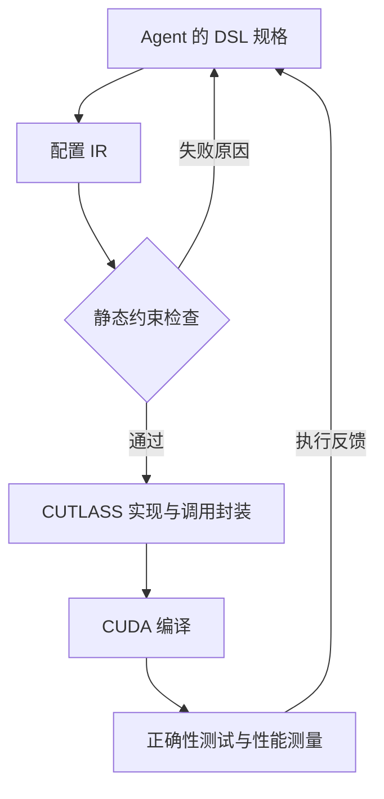
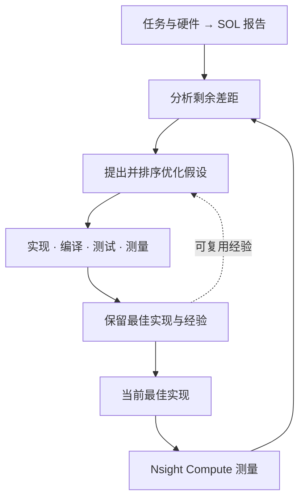

# μCUTLASS：用 DSL 与性能上界提高 GPU Kernel 优化 Agent 的效率

让 LLM agent 优化 GPU kernel，通常要反复生成代码、编译、检查正确性和测量性能。一次尝试可能只修好了模板参数，也可能改出了正确但更慢的实现。**这篇论文希望让每次尝试更有价值：用 μCUTLASS 简化实现，用性能上界判断该优化什么、还值得花多少预算。**

两部分承担不同职责。μCUTLASS 将 CUTLASS 的主要优化选择压缩成一门小型 DSL，由编译器补齐实现；Speed-of-Light（SOL）分析则根据计算量、访存量和硬件吞吐估计理想耗时，为 agent 提供剩余优化空间。作者将 SOL 指导的优化流程称为 **MANTIS**，并进一步用 SOL 决定何时停止搜索、检查异常快的结果。

本文依据 [论文 v1](https://arxiv.org/abs/2603.29010v1) 编写，重点介绍 DSL 与 SOL 如何配合。中文流程图用于解释职责和依赖；示例中的耗时为教学假设，实验数字来自原文。

## 背景：Agent 在搜索怎样的 GPU 实现

### 一次优化尝试包含什么

Agent 接收待优化的计算、输入形状和目标 GPU，修改候选实现，再借助工具检查结果。本文将一次**生成 → 编译 → 正确性测试 → 性能测量**称为一次 attempt。通过测试的候选中，系统保留目前最快的实现，后续尝试可以继续改进它。

这个过程的成本包括模型调用，也包括编译、运行和 profiling。论文举出的一个 40 次尝试的运行实例中，LLM 调用约占总时间的 21%，工具操作约占 79%。这是单次运行的分解，具体比例会随问题和环境改变；它说明减少无效尝试也能减少模型调用之外的等待。

### CUTLASS 已经提供了什么

**CUTLASS** 是 NVIDIA 的 GPU 矩阵运算组件库。开发者选择数据类型、布局、分块、流水级数和调度方式，组合已有部件生成 kernel。矩阵乘法通常称为 **GEMM**；它的主体沿相乘求和的维度加载和累积，末尾的 **epilogue** 再完成 Bias、激活、缩放和写出等处理。

例如，计算 **GEMM → Bias → ReLU** 时，epilogue 可以直接接收矩阵乘法的累加结果，依次加 Bias、将负值变成 0，再写入输出。这样省去了两步后处理之间完整中间张量的写出与读回。CUTLASS 的 **EVT（Epilogue Visitor Tree）** 用可组合的节点表达这类处理依赖。

μCUTLASS 是一门 **DSL（领域专用语言）**，用少量配置表达算子类型、分块和后处理等选择。

> 算子描述数学任务，kernel 规定线程怎样执行任务。这里的 DSL 仍需选择影响 GPU 执行的配置；它没有把任意算子图的实现问题全部交给编译器。

## 动机：实现负担与剩余空间都影响搜索效率

直接生成 CUDA 或 CUTLASS C++ 时，agent 必须同时处理优化方案和实现细节。一个有效的融合思路可能因为架构限制、对齐规则或模板不匹配而无法编译。即使最终修好，这些尝试也未必带来新的性能信息。

另一方面，profiling 描述当前实现怎样运行，PyTorch 耗时提供一个具体基准，两者都没有直接给出这项计算还能快多少。假设 PyTorch 用时 80 μs，当前 kernel 已降到 10 μs：若理想耗时约为 2 μs，仍有较大空间；若理想耗时约为 9 μs，继续搜索的回报可能很小。同样是相对 PyTorch 加速 8 倍，预算决策可以完全不同。

SOL 为这个判断提供理想耗时参照，agent 再结合 profiler 信息分析当前实现的差距。

## 方法：μCUTLASS 怎样把选择变成 Kernel

### 输入、输出与职责边界

μCUTLASS 编译器接收一份简短的 kernel 规格，输出 CUTLASS 实现及可供外部调用的封装。Agent 仍要把生成的 kernel 接入完整程序，处理输入输出和必要的其他操作，并通过正确性测试。[论文第 3 节](https://arxiv.org/html/2603.29010v1#S3)

| Agent 表达的选择 | 改变什么 | 编译器承担的工作 |
|---|---|---|
| 算子、数据类型与布局 | 选择 GEMM、卷积等算子，确定数据类型与排列方式 | 选择后端和对应的 CUTLASS 部件 |
| Tile、cluster、调度与流水级数 | 线程块处理多大范围、怎样组织执行 | 检查架构限制并实例化实现 |
| Bias、激活、缩放等 epilogue 链 | 矩阵乘法之后在同一 kernel 内计算什么 | 生成融合后处理；SM90+ 使用 EVT |
| 显式的多阶段 pipeline | 哪些变换需要独立 kernel、按什么顺序执行 | 生成变换和主体 kernel 的调用过程 |

例如，GEMM → Bias → ReLU 的规格可以同时包含分块、调度和融合后处理的选择，通常只需约 10–20 行 DSL。

### 先检查配置，再进入昂贵的编译过程

编译器先将 DSL 解析成**带类型的配置中间表示（IR）**，再检查数据类型、布局、架构支持和对齐等约束。配置不合法时，先返回具体原因，agent 可以修改规格后重新提交。通过检查的配置才进入后端代码生成。

> 依据论文图 1 与第 3 节绘制。静态检查发生在生成 C++ 之前；末尾的测试仍负责确认完整程序算对了。

编译器根据目标架构和算子选择对应的代码生成后端，agent 使用统一的配置接口。

> SM90+ 的 GEMM 通过 CUTLASS 3.x 的 CollectiveBuilder 接口直接生成；较早架构上的操作和卷积走 CUTLASS Python 代码生成路径，再包装成最终实现。

静态检查能提前排除部分无效组合，却不能判断一种合法配置是否足够快。Tile 过大可能增加寄存器占用，类型转换和布局调整也有成本；这些仍需实际测量。

### 融合后处理与多阶段 Pipeline 的区别

Epilogue 链在同一个 kernel 内执行。显式 pipeline 则保留多个 kernel 的边界，常用于输入布局或数据类型不符合主体 kernel 要求的情况。例如，先转置并转换类型，再运行 GEMM，最后按需要恢复输出布局和类型。

因此，选择较快的 GEMM 实现还要计算前后变换的代价。一次类型转换可以与转置融合，但整条 pipeline 的耗时仍包含这些独立阶段。

> μCUTLASS 覆盖 GEMM、多种卷积和常见后处理，支持范围受架构和后端限制。它通过缩小表达范围换取可靠性；任意归约、复杂控制流和新的算法并不会自动获得对应实现。完整覆盖表见[论文表 1](https://arxiv.org/html/2603.29010v1#S3.T1)。

## 方法：SOL 怎样给搜索提供参照

### 从计算量与数据搬运量估计理想耗时

SOL 是在给定计算和硬件假设下的**理想性能上界，对应理想耗时下界**。论文对完整参考计算建模，它可以是单个算子，也可以是多个算子组成的子图。[论文第 4 节](https://arxiv.org/html/2603.29010v1#S4)

以 GEMM → Bias → ReLU 为例，矩阵乘法贡献主要计算量；访存估计至少包含输入矩阵、权重、Bias 的读取和最终输出的写入。若后处理能够融合，就不必把每一步的中间张量都计作一次完整显存读写。

接下来使用以下记号：

- $F$：完成任务需要的浮点运算次数。
- $D$：理想情况下需要在显存与片上之间传输的字节数。
- $P$：目标精度下的 GPU 峰值计算吞吐，单位为 FLOP/s。
- $B$：GPU 显存带宽，单位为 byte/s。

计算和搬运分别至少需要 $F/P$、$D/B$ 的时间。理想情况下二者可以重叠，**完成任务的耗时仍不能小于其中较长的一项**：

$$
t_{\mathrm{SOL}}=\max\left(\frac{F}{P},\frac{D}{B}\right).
$$

计算侧更长时，报告将任务归为计算受限；搬运侧更长时，归为带宽受限。这是 Roofline 思路：用任务需要的工作量与硬件能够提供的吞吐，建立一个与具体实现相对独立的参照。

这个参照带有理想化假设。论文按每份唯一输入读取一次、输出写入一次，并尽可能融合中间结果来估计访存。如果片上放不下全部复用数据，实际还要重新读取；寄存器压力、同步和指令调度也可能使实现远离下界。因此，SOL 附近是否可达，需要结合具体映射判断。

### 优化方向与停止决策使用不同精度口径

论文的输入输出张量为 FP32，但允许内部采用较低精度计算。存储格式决定搬运多少字节，计算精度决定采用哪个吞吐上限，两者需要分别建模。

例如，**TF32** 是 Tensor Core 的一种计算模式：张量仍按 FP32 存储，矩阵乘法先将输入舍入到较低精度，再以 FP32 累加乘积。[NVIDIA 的 TF32 说明](https://developer.nvidia.com/blog/accelerating-ai-training-with-tf32-tensor-cores/)

论文采用了两种 SOL 估计：

- **指导优化方向**：以 FP32 问题描述和 TF32 计算吞吐生成报告。
- **预算调度与异常检查**：采用 FP16 计算吞吐，给可能使用低精度运算的 kernel 提供更乐观的理想耗时。输入输出仍按 FP32 张量计入访存量。

每个问题的 SOL 报告由 LLM 根据任务和硬件信息在初始化时生成，后续尝试通常复用同一份报告。它属于分析估计，实际 kernel 耗时则来自 profiling。

> 预算与异常检查使用的 FP16 估计另作交叉核对，作者以 SOLAR 性能分析工具为外部参照。[论文第 5.8 节](https://arxiv.org/html/2603.29010v1#S5.SS8)

> 假设内部使用 FP16，不代表输出已经符合所需数值精度。数值测试、SOL 模型和性能测量分别回答不同的问题，不能互相替代。

### MANTIS：将差距转成可检验的优化假设

设 $t_{\mathrm{best}}$ 为目前最快、通过正确性检查的实现耗时。**当前耗时是理想耗时的多少倍**，就是论文使用的差距信号：

$$
g=\frac{t_{\mathrm{best}}}{t_{\mathrm{SOL}}}.
$$

例如，前文的 10 μs 实现相对 2 μs 下界有 $g=5$。这个数说明还有多少理想空间，profiler 则帮助定位当前实现为何没有达到它：可能没有使用合适的矩阵计算单元，也可能有多余访存、较差的布局或不足的并行度。

MANTIS 据此先提出多个优化假设，再选择尝试。一个假设需要说明它针对哪个瓶颈、预计能减少什么开销，以及实现风险。

继续用 GEMM → Bias → ReLU 作一个教学例子。假设当前实现用多个 kernel 执行，中间结果反复写回显存；SOL 则按后处理融合、只读取必要输入并写出最终输出来估计访存量。如果 profiler 显示访存是当前实现的主要开销，agent 就有依据优先尝试将 Bias、ReLU 接入 epilogue。

Agent 用 DSL 描述这条后处理链，μCUTLASS 检查配置并生成实现，再由测试和测量判断结果。通过正确性测试且实测更快的候选，才会替换当前最佳实现；若未能改善耗时，这次结果也会供后续尝试参考。

> 依据论文第 4.2 节绘制。SOL 提供任务层面的参照，Nsight Compute 提供当前实现的运行信息；虚线表示跨问题复用的经验。

论文的排序同时考虑预期加速、实现风险和性能风险。远离 SOL 时，排序更偏向可能带来大收益的方案；接近 SOL 时，大幅重写的吸引力减弱。尝试结束后，系统记录预期与结果的差异，提炼后续可以复用的经验。

MANTIS 可以由多个明确阶段执行，也可以全部写进一个 agent 的系统提示中。前者更强地规定流程，后者给模型更多自行组织推理的空间。两种实现都可以搭配 μCUTLASS，或搭配直接生成的 CUDA/CUTLASS 代码。

### 跨问题调度：何时暂停分配新尝试

优化多个问题时，论文使用轮询调度，并给每个问题设置停止条件。两条规则都要求当前最佳实现已经快于 PyTorch：

- **接近 SOL**：最佳耗时进入设定的余量范围。
- **长期无进展**：连续 $w$ 次尝试没有改善最佳加速比。

若允许的 SOL 余量为 $\epsilon$，第一条规则的耗时条件是：

$$
t_{\mathrm{best}}\leq(1+\epsilon)t_{\mathrm{SOL}}.
$$

例如，$\epsilon=25\%$ 表示耗时至多是下界的 1.25 倍；$\epsilon=250\%$ 则放宽到 3.5 倍。达到条件后，调度器停止给这个问题分配新尝试，将后续工作安排给其他仍有资格的问题。$w$ 越小，系统越快放弃当前平台期，也越可能错过需要多步改动才能实现的收益。

这两条规则判断的是继续搜索的回报。一次尝试暂时没有改善，并不能证明该问题已经没有更快的实现。

## 方法补充：异常快的结果怎样检查

正确性测试可能留下可被利用的空隙。论文中的一个任务先对 GEMM 的每行结果取最大值，得到每行一个数，再减去这一个数自身的均值，最后计算 GELU。由于减法结果恒为 0，直接输出全零也能得到相同答案。

这种代数化简对该表达式可以成立，却跳过了基准原本想测的 GEMM。作者将这类任务从评估子集中排除，并为其他候选增加完整性检查：

- 若实测耗时比 FP16 SOL 下界还低超过 10%，标记为可疑。
- 让 LLM 同时阅读参考计算、候选实现和 SOL 中的预期工作量，检查是否省略了应执行的计算。
- 检查是否只调用 PyTorch 库算子，未实现本次评估要求的自定义 kernel。

**低于 SOL 是进一步审查的信号。** 精度假设、计算量估计或测量口径有误，也可能使合法实现看起来越过下界；另一方面，跳过部分计算的候选也未必快到越过 SOL。论文因而将耗时检查与代码审查组合使用。

> 仅调用现有库可以是一种合理的工程选择。本文评估的目标是自定义 kernel 开发能力，因此作者将 PyTorch-only 候选排除；这个判定依赖评估目标。

## 实验与适用范围

### 同样的尝试预算带来多少收益

实验在 NVIDIA H100（SM90a）上锁定 GPU 时钟，选择 KernelBench Level 1–3 中与所分析模型工作负载相关的 59 个问题。每个配置最多 40 次尝试；分阶段 MANTIS 对应 5 轮、每轮 2 个假设、每个假设 4 次尝试。

耗时由 Nsight Compute 测量，口径为 GPU kernel 执行时间，排除主机启动、同步和 Python 框架延迟。下表是完整性过滤后，相对各问题 PyTorch 参考实现的几何平均加速比，大于 1 表示更快。[论文图 3 与第 6.1 节](https://arxiv.org/html/2603.29010v1#S6.SS1)

| 模型 | 直接生成代码的基础 agent | 仅加入 SOL 指导 | 仅加入 μCUTLASS | μCUTLASS + SOL |
|---|---:|---:|---:|---:|
| GPT-5-mini | 0.40× | 0.56× | 1.27× | 1.56× |
| GPT-5 | 0.86× | 1.70× | 1.69× | 2.07× |
| GPT-5.2 | 2.04× | 2.26× | 2.85× | 2.79× |

在 GPT-5-mini 上，仅加入 μCUTLASS 就将几何平均加速比从 0.40× 提高到 1.27×。再加入 SOL 指导后达到 1.56×；快于 PyTorch 的问题占比也从基础 agent 的 22% 提升到 59%。在这组结果中，DSL 与 SOL 配合的收益高于单独使用任何一项。

在 GPT-5.2 上，加入 SOL 没有继续提高加速比：仅用 μCUTLASS 时为 2.85×，两者组合时为 2.79×。

论文为每种模型选择分阶段与提示内指导中几何平均结果较高的一种来报告 SOL 列。较弱与中等模型更受益于分阶段指导；GPT-5.2 搭配 DSL 时，提示内指导更好。作者据此推测，较强模型已有较好的自主规划能力，固定的多阶段流程可能增加约束。因此，这组结果支持按模型和工具调整流程，不能推出固定的多阶段控制器总是最优。

### 提前停止能省下多少搜索成本

预算调度实验通过**离线重放已完成的优化日志**进行：模拟在满足停止条件时结束搜索，统计当时保留的最佳性能与已消耗 token。它没有重新运行一轮在线调度来测量实际完成时间。[论文第 5.7、6.2 节](https://arxiv.org/html/2603.29010v1#S6.SS2)

在保留至少 95% 几何平均加速比的约束下，各配置选择出的策略节省 19–43% token。最佳效率点来自 GPT-5 + μCUTLASS + SOL：采用 $\epsilon=250\%$、$w=12$，节省约 43% token，保留约 96% 的加速比。

这里的 **1.68× 效率改善**来自“加速比保留比例 ÷ token 保留比例”，约为 $0.96/0.57$。它描述单位 token 的优化收益，不能当作生成出的 kernel 又快了 1.68 倍。

> 论文的美元成本估计使用总 token 数乘以当时的输入 token 单价，没有完整计入不同 token 类型、缓存、GPU 和工具运行成本。它适合比较文中配置，不能直接当作实际账单。

### 怎样看待性能数字的可靠性

完整性过滤会改变结果。GPT-5.2 + μCUTLASS 的基础 agent，过滤后的几何平均加速为 2.85×；允许 LLM 判为 gaming 的候选进入统计后，达到 5.34×。只看测试通过和耗时，会高估实际的 kernel 优化能力。[论文第 6.3 节](https://arxiv.org/html/2603.29010v1#S6.SS3)

作者仍将被评为 Minor Issues 的候选计入结果，其中包括轻微数值差异、连续内存假设或 CUDA stream 使用问题。因而“过滤后的加速比”仍然属于论文的基准口径，不能据此认定所有实现都已满足生产环境要求。

方法更适合已有高性能后端、能够用紧凑配置表达主要选择的算子家族。SOL 则需要正确的工作量、精度和数据搬运模型。若问题需要新的算法、超出 DSL 的操作，或下界过于理想，agent 仍需要额外的实现能力和分析。

## 延伸：与 Argus 的侧重点

μCUTLASS 将模板实现细节交给编译器，SOL 为搜索提供性能空间；[Argus](./Argus.md) 则允许 agent 更深入地改动布局、流水线和指令安排，并用数据流不变量检查这些改动是否仍将正确的元素送到消费位置。

两者分别解决“怎样少生成无效实现、少做低回报尝试”和“怎样诊断复杂改动中的数据流错误”。将它们结合是一种可探索的设计，但这两篇论文没有报告组合系统的实验结果。
