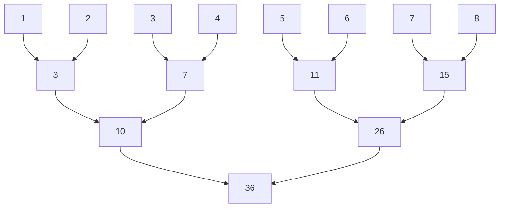
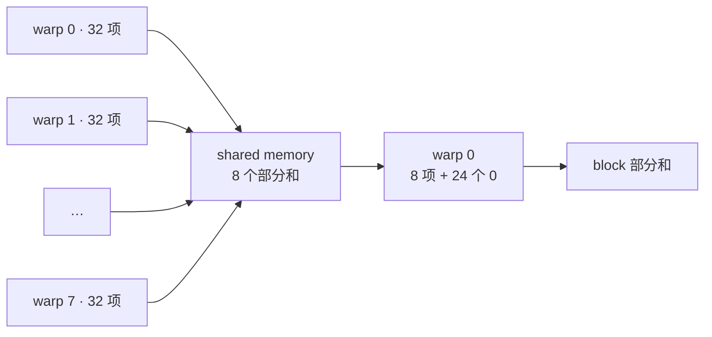

# Reduce Sum

## 任务定义

对一维数组的全部元素求和。例如，输入 `[1, 2, 3, 4, 5, 6, 7, 8]`，输出 `36`。

- 输入：GPU 显存中的连续数组 `x[n]`，类型为 FP32（`float`），`n >= 1`；输入为有限数，求和过程不溢出 FP32。
- 输出：GPU 显存中的一个 FP32 标量 `y[0]`，输入保持不变。
- 精度：累加器、部分和与输出均使用 FP32，允许不同加法顺序产生舍入差异。数值误差以同一份输入的 FP64 参考和为基准，比较绝对误差。

并行实现先让每个 block 产生一个部分和，再将这些部分和合并成 `y[0]`。代码中的 `x`、`partial`、`y` 均为已分配、互不重叠的设备指针。

## 最朴素：一个线程顺序求和

先让一个线程遍历整个输入，在寄存器中累加，直接输出最终结果。

```cpp
__global__ void sum_serial(const float* x, float* y, int n) {
    float sum = 0.0f;
    for (int i = 0; i < n; ++i)
        sum += x[i];
    y[0] = sum;
}

sum_serial<<<1, 1>>>(x, y, n);
```

只有一个线程工作，所有加法串行执行，无法利用 GPU 的线程并行。

## Block reduction：在 shared memory 中做树形归约

将输入分给多个 block，每个 block 用 256 个线程读取最多 256 项。线程先各取一个值，再两两相加，每轮将待合并的值减半；这样，块内的串行加法链变成树形合并。每个 block 输出一个部分和。

以一个 8 元素块为例：



```cpp
__global__ void sum_shared(const float* x, float* partial, int n) {
    constexpr int B = 256;
    __shared__ float s[B];
    int tid = threadIdx.x;
    int i = blockIdx.x * B + tid;

    // 末块越界的线程贡献 0，并继续参与归约和同步。
    s[tid] = i < n ? x[i] : 0.0f;
    __syncthreads();  // 等所有线程写好初始值。

    for (int step = 1; step < B; step *= 2) {
        if (tid % (2 * step) == 0)
            s[tid] += s[tid + step];
        __syncthreads();  // 下一轮会读取本轮写入的部分和。
    }

    if (tid == 0)
        partial[blockIdx.x] = s[0];
}

// partial 至少容纳 blocks 个 float。
int blocks = 1 + (n - 1) / 256;
sum_shared<<<blocks, 256>>>(x, partial, n);
```

第一轮由线程 0、2、4、6 等参与，同一 warp 内的活跃线程间隔分布。同一轮的工作因此分散在多个没有完全参与运算的 warp 中。

## 连续线程归约：将活跃线程集中到前半段

活跃线程间隔分布时，同一轮的加法散在多个 warp 中。让前半段线程读取后半段的值，就能将活跃线程集中到连续区间，减少参与加法的 warp 数。每个 block 处理最多 256 项，输出一个部分和。

```cpp
__global__ void sum_contiguous(const float* x, float* partial, int n) {
    constexpr int B = 256;
    __shared__ float s[B];
    int tid = threadIdx.x;
    int i = blockIdx.x * B + tid;

    s[tid] = i < n ? x[i] : 0.0f;
    __syncthreads();  // 等初始值全部写入。

    for (int stride = B / 2; stride > 0; stride /= 2) {
        if (tid < stride)
            s[tid] += s[tid + stride];
        __syncthreads();  // 等本轮部分和写入，再进入下一轮。
    }

    if (tid == 0)
        partial[blockIdx.x] = s[0];
}

int blocks = 1 + (n - 1) / 256;
sum_contiguous<<<blocks, 256>>>(x, partial, n);
```

活跃线程数依次为 128、64、32、16、8、4、2、1。最后五轮只在 warp 0 内合并，仍使用了整个 block 的同步。

## Warp reduction：最后 32 个值只同步一个 warp

整块同步在最后几轮仍涉及其他 warp。连续归约到剩下 32 个部分和后，它们都位于 warp 0 对应的 shared memory 位置，后续合并可以缩小为 warp 内同步。每个 block 将最多 256 项归约成一个部分和。

```cpp
__global__ void sum_warp_shared(const float* x, float* partial, int n) {
    constexpr int B = 256;
    __shared__ float s[B];
    int tid = threadIdx.x;
    int i = blockIdx.x * B + tid;

    s[tid] = i < n ? x[i] : 0.0f;
    __syncthreads();  // 等初始值全部写入。

    for (int stride = B / 2; stride >= 32; stride /= 2) {
        if (tid < stride)
            s[tid] += s[tid + stride];
        __syncthreads();  // 这些轮次仍需要跨 warp 交换数据。
    }

    if (tid < 32) {
        for (int stride = 16; stride > 0; stride /= 2) {
            if (tid < stride)
                s[tid] += s[tid + stride];
            __syncwarp();  // warp 0 的 32 个线程等本轮读写完成。
        }
    }

    if (tid == 0)
        partial[blockIdx.x] = s[0];
}

int blocks = 1 + (n - 1) / 256;
sum_warp_shared<<<blocks, 256>>>(x, partial, n);
```

最后五轮已缩小为 warp 内同步，但线程之间仍通过 shared memory 写入、读取部分和。

## Warp shuffle：直接交换寄存器中的值

通过 shared memory 合并时，warp 内每轮都要写入、同步，再读取部分和。使用 shuffle 直接传递寄存器中的值，可以省去这套 shared memory 交换过程。

对一个 256 线程 block，8 个 warp 先各自求和，再通过 shared memory 交出 8 个结果，由 warp 0 完成最后一次合并。kernel 输出每个 block 的部分和。



```cpp
__device__ __forceinline__ float warp_sum(float v) {
    for (int offset = 16; offset > 0; offset /= 2) {
        // 32 个 lane 全部参加；从 lane + offset 取得其当前的 v。
        // 超出 warp 范围时返回自身的值，最终只使用 lane 0 的总和。
        v += __shfl_down_sync(0xffffffffu, v, offset);
    }
    return v;
}

__global__ void sum_shuffle(const float* x, float* partial, int n) {
    constexpr int B = 256;
    __shared__ float warp_sums[B / 32];
    int tid = threadIdx.x;
    int lane = tid % 32;
    int warp = tid / 32;
    int i = blockIdx.x * B + tid;

    // 越界线程贡献 0，所有 lane 一起执行 shuffle。
    float v = i < n ? x[i] : 0.0f;
    v = warp_sum(v);
    if (lane == 0)
        warp_sums[warp] = v;
    __syncthreads();  // 等 8 个 warp 都写好各自的部分和。

    if (warp == 0) {
        v = lane < B / 32 ? warp_sums[lane] : 0.0f;
        v = warp_sum(v);
        if (lane == 0)
            partial[blockIdx.x] = v;
    }
}

int blocks = 1 + (n - 1) / 256;
sum_shuffle<<<blocks, 256>>>(x, partial, n);
```

Shared memory 从 256 个 `float` 减少到 8 个，block 同步只剩一次。输出仍是多个 block 的部分和，还需要合并为最终标量。

## 跨 block：线程内多项累加，再合并部分和

每 256 项启动一个 block 时，大数组会产生很多部分和。限制第一轮 block 数，让每个线程先在寄存器中累加多项，就能控制待合并的部分和数量。第二轮将它们作为新输入，用一个 block 得到最终的 `y[0]`。

下面给出完整的两轮实现。第一轮示例上限取 1024 个 block，临时数组 `partial` 至少容纳实际启动的 block 数量。

```cpp
__device__ __forceinline__ float warp_sum_grid(float v) {
    for (int offset = 16; offset > 0; offset /= 2) {
        // 32 个 lane 全部参加，lane 0 最终得到整个 warp 的总和。
        v += __shfl_down_sync(0xffffffffu, v, offset);
    }
    return v;
}

__global__ void sum_grid(const float* x, float* partial, int n) {
    constexpr int B = 256;
    __shared__ float warp_sums[B / 32];
    int tid = threadIdx.x;
    int lane = tid % 32;
    int warp = tid / 32;

    float v = 0.0f;
    // 步长为整个 grid 的线程总数；同一轮相邻线程读取相邻元素。
    size_t step = size_t(gridDim.x) * B;
    for (size_t i = size_t(blockIdx.x) * B + tid; i < n; i += step)
        v += x[i];

    v = warp_sum_grid(v);
    if (lane == 0)
        warp_sums[warp] = v;
    __syncthreads();  // 等所有 warp 写好部分和。

    if (warp == 0) {
        v = lane < B / 32 ? warp_sums[lane] : 0.0f;
        v = warp_sum_grid(v);
        if (lane == 0)
            partial[blockIdx.x] = v;
    }
}

int blocks = 1 + (n - 1) / 256;
if (blocks > 1024) blocks = 1024;

// 两次启动使用同一个 stream，第二轮会等待第一轮完成。
sum_grid<<<blocks, 256, 0, stream>>>(x, partial, n);
sum_grid<<<1, 256, 0, stream>>>(partial, y, blocks);
```

第一轮每个 block 输出一个部分和；第二轮至多读取 1024 项，每个线程先累加自己负责的项，再通过两级 warp 归约写出最终结果。
