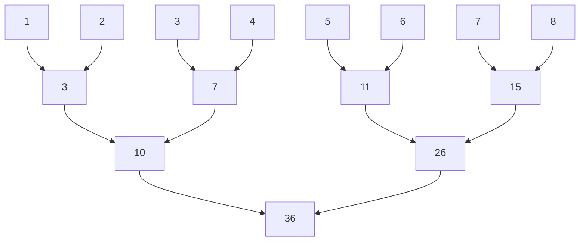
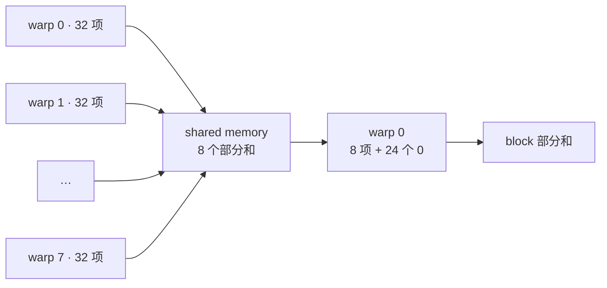

# Reduce Sum：从 shared memory 到 warp shuffle

## 任务定义

将长度为 `n` 的一维 `float` 数组求和，输出一个 `float` 标量。例如，输入 `[1, 2, 3, 4, 5, 6, 7, 8]`，输出 `36`。

下面取 `n >= 1`，输入和输出均位于 GPU 显存，使用 FP32 累加。实现沿着三个层次展开：线程累加自己的数据，block 合并线程的部分和，最后合并各 block 的结果。

## 最朴素：一个线程顺序求和

```cpp
__global__ void sum_serial(const float* x, float* y, int n) {
    float sum = 0.0f;
    for (int i = 0; i < n; ++i)
        sum += x[i];
    y[0] = sum;
}

// 启动一个线程。
sum_serial<<<1, 1>>>(x, y, n);
```

所有加法都依赖前一次结果，只有一个线程工作。下一步将输入分给多个线程，并行合并。

## Block reduction：在 shared memory 中做树形归约

每个 block 读取一段输入，每个线程读一个元素，先放入 shared memory，再两两相加。每轮将待合并的值减半，最终由线程 0 写出该 block 的部分和 `partial[blockIdx.x]`。[树形归约方法](https://developer.download.nvidia.com/assets/cuda/files/reduction.pdf)

以一个 8 元素块为例：



代码固定每个 block 有 `B=256` 个线程。末块越界的线程填入 0，并继续参与同步。

```cpp
constexpr int B = 256;

__global__ void sum_shared(const float* x, float* partial, int n) {
    __shared__ float s[B];
    int tid = threadIdx.x;
    int i = blockIdx.x * B + tid;

    s[tid] = i < n ? x[i] : 0.0f;
    __syncthreads();

    for (int step = 1; step < B; step *= 2) {
        if (tid % (2 * step) == 0)
            s[tid] += s[tid + step];
        __syncthreads();
    }

    if (tid == 0)
        partial[blockIdx.x] = s[0];
}
```

`__syncthreads()` 保证本轮写完后，其他线程才能在下一轮读取。这个 kernel 输出多个部分和，跨 block 的合并方式放在文末。

## 连续线程归约：将活跃线程集中到前半段

上一版第一轮由线程 0、2、4、6 等参与，同一 warp 内的活跃线程间隔分布。改为前半段线程读取后半段的值，活跃线程便集中到连续区间。

将上面的归约循环替换为：

```cpp
for (int stride = B / 2; stride > 0; stride /= 2) {
    if (tid < stride)
        s[tid] += s[tid + stride];
    __syncthreads();
}
```

对 256 个线程，参与计算的范围依次为前 128、64、32、16、8、4、2、1 个线程。前几轮可以让整个 warp 参与运算，避免将同一轮的工作分散到更多 warp 中。

## Warp reduction：最后 32 个值只同步一个 warp

当部分和剩下 32 个时，后续工作都由 warp 0 完成，可以将 block 同步缩小为 warp 同步。继续替换归约循环，加载数据和最终写出部分保持原样：

```cpp
for (int stride = B / 2; stride >= 32; stride /= 2) {
    if (tid < stride)
        s[tid] += s[tid + stride];
    __syncthreads();
}

if (tid < 32) {
    for (int stride = 16; stride > 0; stride /= 2) {
        if (tid < stride)
            s[tid] += s[tid + stride];
        __syncwarp();
    }
}
```

最后五轮仍通过 shared memory 交换数据，`__syncwarp()` 保证 warp 内下一轮读到上一轮的写入；它们不再要求其他 warp 参加同步。[Warp 同步语义](https://docs.nvidia.com/cuda/cuda-programming-guide/05-appendices/cpp-language-extensions.html)

## Warp shuffle：直接交换寄存器中的值

`__shfl_down_sync(mask, v, offset)` 让当前线程取得同一 warp 中 `lane + offset` 的 `v`；超出 warp 范围时返回自身的值。按 16、8、4、2、1 的距离取值并相加，lane 0 最终得到 32 个线程的总和。**Warp 内的数据交换直接使用寄存器，省去 shared memory 的读写。**[Shuffle 归约](https://developer.nvidia.com/blog/using-cuda-warp-level-primitives/)

```cpp
__device__ __forceinline__ float warp_sum(float v) {
    for (int offset = 16; offset > 0; offset /= 2)
        v += __shfl_down_sync(0xffffffffu, v, offset);
    return v;  // lane 0 保存整个 warp 的和。
}
```

这里的 mask 表示 32 个 lane 全部参加。因此各线程先用自己的输入或 0 得到 `v`，再一起调用 `warp_sum`。

一个 256 线程 block 有 8 个 warp：各 warp 先求和，各自的 lane 0 将结果写入 shared memory；同步一次后，warp 0 再合并这 8 个值。



同时让每个线程先在寄存器中累加多个元素，再进入跨线程归约。每次读取的下标增加整个 grid 的线程总数，这称为 grid-stride loop；同一轮相邻线程仍读取相邻元素，保持合并访存。完整 kernel 如下：

```cpp
__global__ void sum_shuffle(const float* x, float* partial, int n) {
    __shared__ float warp_sums[B / 32];
    int tid = threadIdx.x;
    int lane = tid % 32;
    int warp = tid / 32;

    float v = 0.0f;
    size_t step = size_t(gridDim.x) * B;
    for (size_t i = size_t(blockIdx.x) * B + tid; i < n; i += step)
        v += x[i];

    v = warp_sum(v);
    if (lane == 0)
        warp_sums[warp] = v;
    __syncthreads();

    if (warp == 0) {
        v = lane < B / 32 ? warp_sums[lane] : 0.0f;
        v = warp_sum(v);
        if (lane == 0)
            partial[blockIdx.x] = v;
    }
}
```

这一版每个 block 只用 8 个 shared memory 元素和一次 block 同步。线程内累加、warp 内 shuffle、warp 间 shared memory 分别处理各自范围的数据。

## 跨 block：再启动一轮合并部分和

第一轮各 block 写出一个部分和，第二轮将它们当作新输入，再归约成一个标量。两次启动使用同一个 stream，第二轮会在第一轮完成后执行。

下面示例将第一轮限制为最多 1024 个 block；多出的输入由 kernel 中的 grid-stride loop 处理，第二轮最多读取 1024 个部分和。

```cpp
int blocks = 1 + (n - 1) / B;
if (blocks > 1024) blocks = 1024;

// partial 至少容纳 blocks 个 float，y 容纳一个 float。
sum_shuffle<<<blocks, B, 0, stream>>>(x, partial, n);
sum_shuffle<<<1, B, 0, stream>>>(partial, y, blocks);
```

`x`、`partial`、`y` 使用各自的显存区域。第二轮的线程先在寄存器中累加多个部分和，再走相同的 block 归约流程，最终写入 `y[0]`。
