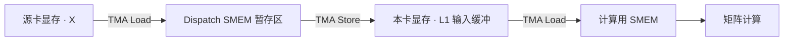

# DeepGEMM MegaMoE：沿四 GPU 跟完一次 MoE 前向

MegaMoE 将一次 MoE 前向的三部分放进常驻 GPU kernel：Dispatch 将 token 输入交给选中的专家，专家计算产生各条路由的输出，Combine 将这些输出送回原卡并求和。**每张卡同时处理自己的源 token 和本卡专家收到的 token；不同线程分别推进搬运、计算与回传，通过数据就绪信号衔接。**

下文以 SM100 上的 FP8 激活路径为例，先沿四张 GPU 跟完 Dispatch、两次投影与 Combine，再展开一项矩阵任务内部的搬运和计算，最后解释多项任务怎样持续推进。

## 初始分布：token 与专家分别在哪张卡

四张 GPU 各有两个源 token、两个专家。路由器已为每个 token 选择两个专家，即 top-k=2；两个选择按顺序记为路由槽 s0、s1。一个源 token 对应一个输入向量，两个专家分支都需要读取这个向量。

<MegaMoEDiagram view="placement" />

专家权重保存在所属 GPU，因此路由决定了输入需要到达哪张卡。例如 a0 的 s0 选择 GPU 0 的 E0，s1 选择 GPU 1 的 E3。两个专家分别产生一份结果，最终都回到 GPU 0 的 a0，沿两个槽逐元素相加。

## Symmem：远端数据放在哪里

每卡独立分配一段可供其他 GPU 访问的显存，称为 symmetric memory，简称 Symmem。各卡使用相同的字段布局：知道目标卡的基址和字段偏移，就能定位目标卡的输入、索引列表或回传槽。各卡的字段位置对应，里面保存的数据由各卡自己的 token 和专家任务决定。

专家计算包含两次线性投影，分别称为 L1、L2。图中的 X 是原始输入，A 是两次投影之间的中间激活；L1 输入缓冲供第一次投影读取，L2 输入缓冲供第二次投影读取。两份缓冲都位于本卡显存中。

输入以 FP8 保存。量化时先用缩放系数 **scale** 调整数值幅度，再转成 FP8；矩阵计算时结合 scale，恢复相应的数值尺度，因此输入与 scale 需要一起搬运。每条路由还有一个由路由器给出的权重 **α**，决定该专家分支对最终输出的贡献。a0 的两个分支读取相同的 X 和输入 scale，α 则分别从 s0、s1 取得。

<MegaMoEDiagram view="symmem" />

| 字段 | 保存什么、供谁使用 |
|---|---|
| 状态与计数 | Dispatch 记录各专家收到的路由数和输入就绪进度；计算线程记录输入何时可读、何时可被覆盖；回传线程记录专家卡是否完成本轮写回 |
| 接收索引列表 | 源卡告诉专家卡需要读取哪些 token、使用哪个路由槽；专家卡据此找到源输入与 α |
| 来源记录 | Dispatch 为整理后的每一行保存源 GPU、源 token 和路由槽；L2 后处理据此将结果送回原位置 |
| 源输入 X + scale | 按本卡原 token 顺序保存输入向量及量化缩放系数，供选中这些 token 的专家读取 |
| 路由编号 + α | 路由编号确定目标专家；α 确定每条专家分支的贡献权重 |
| L1 输入缓冲 | Dispatch 将同一专家的输入整理到一起，保存 X、scale 和 α，供第一次投影及其后处理读取 |
| L2 输入缓冲 | L1 后处理写入中间激活 A 及新的 scale，供第二次投影读取 |
| Combine 回传槽 | 专家卡按源 token、路由槽写入输出向量；源卡读取两个槽并求和 |

源输入与专家输入使用不同排列：GPU 0 的源输入是 a0、a1，而本卡 E0 需要的输入是 a0、c1。Dispatch 根据路由将后者收集到 L1 输入缓冲。

## 一个 CTA 内的 warp 怎样分工

每张 GPU 启动一组常驻线程块，简称 CTA。本文路径每个 CTA 有 512 个线程，即 16 个 warp，每个 warp 有 32 个线程。**Dispatch、L1、L2 与 Combine 由这些 CTA 内的不同 warp 分工执行。** 同卡两个 CTA 组成一对，协作完成矩阵任务；其中负责派发任务和发射矩阵指令的一方称为 leader。

进入主处理循环后，每个 CTA 的 warp 分工如下：

| Warp 编号 | 职责 |
|---|---|
| 0–3 | Dispatch：发布路由索引，拉取源输入，写入本卡显存中的 L1 输入缓冲 |
| 4 | 激活加载：根据当前 L1/L2 任务，将 X 或 A 及其 scale 从本卡显存送入计算用共享内存 |
| 5 | 权重加载：将当前任务需要的专家权重及 scale 送入计算用共享内存 |
| 6 | 矩阵计算：由 leader CTA 的这个 warp 等待输入到齐，再发射 Tensor Core 矩阵指令 |
| 7 | 任务调度：由 leader CTA 的这个 warp 生成并发布 L1/L2 任务 |
| 8–15 | 后处理：读取累加结果；L1 生成并量化中间激活 A，L2 将专家输出写回源卡的回传槽 |

L1、L2 由同一套加载、矩阵计算与后处理 warp 执行，各角色按调度器给出的相同任务顺序推进。计算任务处理结束后，warp 8–15 转入本卡源 token 的 Combine：等待所选专家卡的完成通知，读取回传槽并求和。

## Dispatch：从路由索引到专家输入矩阵

### 发布哪些索引，写到哪里

每张源卡先将路由对应的索引写给专家卡，再由专家卡拉取实际输入。接收方因此能先确定每个专家需要多少输入，以及这些输入分别在哪里。

<MegaMoEDiagram view="dispatch" />

> 图中 `G0 · a0 · s0` 表示 GPU 0 的 token a0 的第 0 条路由。`G2 · c1 · s1` 表示 GPU 2 的 token c1 的第 1 条路由。索引帮助接收方找到源 token 的输入，以及这条路由的 α；图中的三段标签展开了这些含义。

**创建 Symmem 时，就为所有“本地专家、来源 GPU”组合分配索引空间。** 分配大小由 GPU 数、每卡专家数和单卡 token 容量决定。本例中，GPU 0 的 E0、E1 各自都有来自 G0、G1、G2、G3 的四个列表，共八组；其他 GPU 也各有自己的八组。

设每张源卡最多容纳 $T_{\max}$ 个 token，则每组固定预留 $T_{\max}$ 个连续的 32 位整数位置。单卡索引区的布局为：

$$
[\text{本地专家数 }2,\ \text{来源 GPU 数 }4,\ \text{每组容量 }T_{\max}].
$$

因此每卡预先分配 $8T_{\max}$ 个索引位置。每个 token 对同一专家至多贡献一条路由，所以一个来源组的最大条目数是 $T_{\max}$。即使本轮 G1 没有 token 选择 E0，E0/G1 这一组仍占用完整的预留空间。

内存中先连续安排 E0 的四个来源组，再安排 E1 的四个来源组。相邻来源组的起点相差 $T_{\max}$ 个索引位置。例如 E0/G2 的起点比 E0/G0 晚 $2T_{\max}$ 个位置，E0/G1 本轮为空时，这个地址关系也保持不变。

列表中的每一项是一个整数，将源 token 的位置与路由槽编码在一起。设源 token 在本卡的位置为 $t$、路由槽编号为 $s$，本例 top-k=2，则编码为 $2t+s$。a0 位于 GPU 0 的第 0 个 token 位置，s0 的编码是 0；c1 位于 GPU 2 的第 1 个 token 位置，s1 的编码是 3。**来源 GPU 由列表分组确定，目标专家也由列表分组确定。**

下图展示 GPU 0 的完整八组空间。切换前后，各组的位置与容量保持一致；本轮索引只写入其中有路由的组。

<MegaMoEDiagram view="indices" />

**本轮动态变化的是条目和有效计数。** 每组计数单独保存在状态区：例如 E0/G0、E0/G2 各有 1 条，E0/G1、E0/G3 均为 0 条。接收方只读取每组前面计数指定的条目，后面的预留位置不参与本轮读取。索引值 0 是 a0/s0 的合法编码，有效范围由计数决定。

同一源卡可能有多个 CTA 同时发布索引。它们通过原子计数在对应组的预留空间内领取互不重叠的位置，再写入条目。列表地址与容量已经确定，写入索引时只更新其内容和计数。各卡确认发布完成后，接收方开始按列表读取输入。

### 将分散的输入放成同一专家的矩阵行

一个 token 输入向量占矩阵的一行。向量的特征数记为隐藏宽度 $H$，下面取 $H=512$，因此 a0、c1 各有 512 个输入数值。

GPU 0 的 Dispatch warp 从 E0 的来源列表取得索引，再定位对应的 X、scale 和 α。输入 X 通过张量搬运机制 TMA，从源卡显存进入该 CTA 的共享内存 SMEM 暂存区，再由 TMA 写入本卡显存中的 L1 输入缓冲。scale、α 由线程另外读取，写入配套的本地缓冲。G0 的 a0 已在本卡，G2 的 c1 需要经过跨卡互联。

后续计算任务的激活加载 warp 再通过 TMA，将整理好的输入从 L1 输入缓冲搬到计算用 SMEM，供矩阵指令读取：

**负责拉取某个 token 的 CTA，与后续使用它的计算 CTA 没有固定绑定。** Dispatch 按路由收集 token，矩阵任务则由调度器独立派发。本卡显存缓冲让不同 CTA 都能读取整理后的专家输入，并保留数据供多个计算任务复用；Dispatch 的 SMEM 暂存区在搬运完成后就能继续接收其他输入。

输入行按固定容量分块，一个块最多容纳的 token 行数记为 $B_M$；每行包含全部 $H=512$ 个输入特征。下面取 $B_M=64$ 展开缓冲布局，因此专家每收到 64 行就组成一块，最后一块可以不足 64 行。

> 本文用容量 64 统一展示各层缓冲。实际启动时，行块容量按预计每专家输入量选择；每块的有效行数另行记录，决定需要产生和回传多少行结果。

<MegaMoEDiagram view="batch" />

矩阵行的位置在整理过程中重新确定，因此 Dispatch 还为每行保存来源记录。例如第 0 行记录 G0/a0/s0，第 1 行记录 G2/c1/s1。后续计算改变这两行的数值；L2 后处理沿对应记录，将两行结果分别送回 GPU 0 的 a0 槽 s0、GPU 2 的 c1 槽 s1。

> 同一专家有多个来源时，Dispatch 轮流从仍有输入的来源取条目，再将它们放入该专家的输入行。来源记录保留每行的去向，因此输入行重新排列后仍能正确回传。

### 一个输入块何时准备好

E0 本轮只收到 a0、c1，因此只需要一个块：**容量为 64 行，实际有效行数为 2。** 有效行数表示真正参与这次专家计算、需要产生输出的输入数量。其余位置预留存储容量，最终只回传这两行的结果。

Dispatch 等一行的全部输入片段、scale 和 α 写完后，才将该块的就绪计数加 1。为了统一使用 64 行块的就绪目标，末块还将未用位置计入进度。本例两条有效行的到达，加上 62 个未用位置，共计 64；因此 a0、c1 都写完后，L1 就能读取这个块。

## 一个输入块怎样经过两次投影

现在跟踪 E0 的 a0、c1 两行。L1 将每行的 $H$ 个输入特征投影成 gate 与 up 两组特征，每组宽度记为 $F$；本例 $H=512$、$F=256$。SwiGLU 将对应的 gate/up 合成 $F$ 个中间特征，乘入该行的路由权重 α，再由 L2 投影回 $H$ 个特征。

设专家 $e$ 收到 $m_e$ 行输入，其输入矩阵 $X_e$ 的形状是 $[m_e,H]$。L1 权重 $W_{1,e}$ 的形状是 $[2F,H]$，产生的两组特征分别记为 $G_e,U_e$，形状均为 $[m_e,F]$。L2 权重 $W_{2,e}$ 的形状是 $[H,F]$。

路由权重按输入行组成列向量 $\boldsymbol{\alpha}_e\in\mathbb{R}^{m_e\times1}$，沿每行的特征广播。加权后的中间激活记为 $A_e$，专家输出记为 $Z_e$，计算关系为：

$$
\begin{aligned}
A_e&=\boldsymbol{\alpha}_e\odot\bigl(\operatorname{SiLU}(G_e)\odot U_e\bigr),\\
Z_e&=A_eW_{2,e}^{\mathsf T}.
\end{aligned}
$$

这里 $\operatorname{SiLU}(g)=g/(1+e^{-g})$，$\odot$ 表示逐元素相乘。L1 后处理将 $A_e$ 量化为 FP8，并生成新的 scale，写入 L2 输入缓冲。L2 写回的 $Z_e$ 已包含路由权重，源卡最后直接将各槽相加。

### 输出列怎样分成任务

同一输入块要产生很多输出特征，可以将输出列分组，交给不同任务。每项任务固定一个专家、一个输入块和一组输出列，由同卡的一对 CTA 完成：每个 CTA 负责 128 列，两者合计负责 256 列。

本例 L1 产生 $2F=512$ 列，需要两项任务，分别处理输出列 $[0,256)$、$[256,512)$。每项任务都读取 a0、c1 的完整输入，但产生的特征范围不同。L2 同样产生 $H=512$ 列，也分成两项任务。

**L1 的每个 CTA 都要拿到配对的 gate/up，才能独立执行 SwiGLU。** L1 将 gate/up 按小组交错排列，使每 CTA 负责的 128 列包含 64 个 gate 和对应的 64 个 up。这一列块宽度记为 $B_N=128$，经过 SwiGLU 后得到 64 个中间特征；一对 CTA 的一项 L1 任务合计生成 128 个中间特征。

### L1 写完哪些特征，L2 就能继续

**输出列决定任务产生哪部分结果，输入特征块决定这部分结果怎样逐段累加。** 每个输出特征都依赖一整行输入，计算时沿输入特征轴，每次搬入 128 个特征。这段输入称为输入特征块，也称 K-block，宽度记为 $B_K=128$。L1 需要遍历 512 个输入特征，共 4 段；L2 需要遍历 256 个中间特征，共 2 段。

L2 的第一段输入需要 A 的特征 $[0,128)$，正好由两个 CTA 各自产生的 64 个中间特征拼成。下图将 L1 的四个 128 列输出块记为 n0–n3：n0、n1 来自处理 L1 输出列 $[0,256)$ 的任务，n2、n3 来自另一项 L1 任务；每项任务中的两个 CTA 各处理一个列块。

<MegaMoEDiagram view="readiness" />

每个 L1 列块有一个就绪位，初始表示未完成。L1 后处理将该块产生的量化激活和 scale 写入 L2 输入缓冲，等待写入完成后设置对应位。L2 加载线程读取当前特征块前，等待它所需的两位。

设置就绪位使用 release 语义，等待时使用 acquire 语义，保证消费者观察到就绪后，能够读到生产者先前写入的数据。K0 已准备好时，L2 可以先加载它并累加；K1 准备好后继续累加，两段共同产生每行完整的专家输出。

## Combine：写回原 token 的路由槽，再本地求和

L2 后处理沿来源记录找到目标 GPU、token 和路由槽，将 BF16 结果片段写到对应位置。每个槽保存一条 $H$ 维专家输出向量，由不同输出列任务分片写入。a0 的 E0 结果写入 GPU 0 的 a0/s0，E3 结果写入同卡的 a0/s1。

<MegaMoEDiagram view="combine" />

**完成通知按专家卡发布，源卡按 token 的路由等待。** 每张专家卡先确认本卡所有 L2 写回任务完成，再向各源卡发布本轮完成通知。处理 a0 时，GPU 0 等待 E0 所在 GPU 0、E3 所在 GPU 1 的通知，然后读取 a0 的两个槽。通知使用跨 GPU 的 release/acquire，保证观察到通知后，先前回传的数据可读。

设源卡编号为 $r$、token 位置为 $t$、隐藏特征位置为 $h$，$C_r[s,t,h]$ 表示该卡路由槽 $s$ 中的专家贡献。两个槽逐元素相加，得到输出：

$$
Y_r[t,h]=C_r[0,t,h]+C_r[1,t,h].
$$

各卡按原 token 顺序处理这些输出，使用 FP32 累加后写成 BF16。

## 一项矩阵任务在两个 CTA 内怎样执行

前面已跟完输入收集、专家计算与回传。现在展开其中一项矩阵任务：仍跟踪 E0 的 a0、c1 两行，先观察输出列组 $[0,256)$。

调度器将阶段、专家、输入行块、输出列组和有效行数写成一份任务信息，发布到配对两个 CTA 的共享内存中。两边的加载、矩阵计算与后处理线程都从这里取得任务。两个 CTA 再按自己在配对中的编号，分别负责本组的前 128 列、后 128 列。

权重按“输出特征、输入特征”组织。因此，计算 L1 输出的前 256 列，需要读取 $W_{1,e}$ 的前 256 行、全部 512 列，得到 $[256,512]$ 的权重片段。图中权重片段的行数，对应它负责的输出特征数。

激活加载 warp 与权重加载 warp 分别将当前任务的输入、权重及各自的 scale 送入计算用 SMEM。矩阵计算 warp 通过 UMMA 指令驱动 Tensor Core，将 FP32 累加值保存在专用的 Tensor Memory（TMEM）中。

下图展示一项任务的完整数据路径，可切换 L1 与 L2。矩阵形状标出块容量；有效输入仍是 a0、c1 两行。

<MegaMoEDiagram view="compute" />

### 两个 CTA 怎样共同使用输入

每一输出特征都依赖这行的全部输入特征，因此两个 CTA 负责的不同输出列，都需要使用同一批输入。激活的行片段分放在两份 SMEM 中，权重由各 CTA 按自己负责的输出列加载。CTA 0 作为 leader 发射协作 UMMA，指令共同使用两边的输入，在两份 TMEM 中分别累加不同输出列。

<MegaMoEDiagram view="partition" />

### 输入 stage：等旧计算用完，再搬入下一段

一次 TMA 加载与一次 UMMA 发射都是异步操作：线程提交指令时，数据搬运或矩阵计算可能尚未完成。输入共享内存因此需要两类完成通知：**full 表示本轮输入可读，empty 表示旧输入已用完、可以覆盖。** 两类通知通过共享内存中的 mbarrier 传递。

把激活、权重及配套 scale 的一组暂存区称为一个输入 stage。设每个 CTA 有 $S$ 个这样的 stage，配置至少保留两份。激活加载 warp 与权重加载 warp 都先等待当前 stage 的 empty，再各自提交加载。

两个 CTA 各有一条激活加载路径和一条权重加载路径，共四方参与同一轮输入准备。Leader 的 full 通知既等待这四方报到，也等待登记的 TMA 传输字节数完成。数据仍写入各 CTA 自己的 SMEM，完成信息汇合到 leader；leader 的矩阵 warp 观察到 full 后才能使用两边的输入。

<MegaMoEDiagram view="input-stage" />

矩阵 warp 为本 K-block 的 UMMA 登记完成通知。**UMMA 真正完成后**，两个 CTA 的 empty 才允许加载线程覆盖这份输入；如果这是任务的最后一个 K-block，还会通知后处理：TMEM 中的完整结果已经就绪。登记通知本身不会让发射线程停下来等待。

stage 按 $0,1,\ldots,S-1$ 循环使用。一个称为 phase 的轮次位，在 stage 绕回 0 时翻转，用于区分同一通知对象的前后两轮；加载端等待上一轮 empty，矩阵端等待本轮 full。stage 与 phase 跨 L1/L2 任务持续推进。

| 累计处理的输入特征块 | 使用的 stage | 本轮 phase | 覆盖前需要满足的条件 |
|---|---|---|---|
| 0 | 0 | 0 | 首次使用，槽中没有旧输入 |
| 1 | 1 | 0 | 首次使用 |
| $S-1$ | $S-1$ | 0 | 首次使用，随后绕回 0 |
| $S$ | 0 | 1 | 第 0 块的 UMMA 已经完成 |
| $S+1$ | 1 | 1 | 第 1 块的 UMMA 已经完成 |

等待完成后，还需使用相应的内存访问顺序约束：TMA 写出的 SMEM 数据要先于 UMMA 读取，线程写出的输出 SMEM 要对随后 TMA Store 可见。Barrier 负责等待条件，fence 负责建立这些访问之间的顺序。

### 一段 128 宽输入怎样变成四条 UMMA

加载单位 $B_K=128$ 大于一次矩阵指令推进的 K 范围。这里每条 block-scaled UMMA 沿 K 处理 32 个元素，所以一个 K-block 分成四个 K-step：$[0,32)$、$[32,64)$、$[64,96)$、$[96,128)$。四步都更新同一份累加结果。L1 的四个 K-block 共发出 16 条 UMMA，L2 的两个 K-block 共发出 8 条。

指令覆盖的 token 行数按有效行数向上对齐到 16。E0 的两条有效输入因此对应 16 行的指令范围；缓冲仍按前文的 64 行容量展示，最终只回传 a0、c1 两行。

任务的第一条 UMMA 从零开始累加，后续指令接着已有的 FP32 结果累加。最后一个 K-block 完成后，矩阵 warp 才通知后处理线程：TMEM 中的完整结果已经就绪。

量化数据每 32 个 K 元素配一份 scale。加载线程先将激活和权重的 scale 搬到 SMEM，矩阵 warp 再通过 UTCCP 指令将它们复制到 TMEM 的 scale 区域。四条 UMMA 分别选择对应的 scale，使本次 32 元素的乘积按各自的量化尺度参与累加。

> 搬运与计算使用三类描述信息：TMA 的 tensor map 描述显存张量的地址、形状、步长和 SMEM swizzle；UMMA 的 SMEM descriptor 指出当前 stage 中的操作数地址与布局；矩阵指令的 descriptor 描述数据类型、计算形状、累加类型以及本步使用的 scale。swizzle 是共享内存地址的重排方式，TMA 写入和 UMMA 读取遵循相同布局。
>
> SMEM descriptor 的起始地址以 16 bytes 为单位编码。切换 stage 时，地址推进一份操作数暂存区的大小；进入下一 K-step 时，再推进到该段的 32 个输入特征，并选择对应的 scale。

### TMEM：输出特征放在 lane，token 行放在 column

逻辑计算产生“token 行 × 输出特征”的矩阵。发射 UMMA 时，本实现交换两操作数，以“权重 × 输入的转置”的方向累加；结果在 TMEM 中的两个轴也相应交换。每个 CTA 的 128 条 TMEM lane 对应自己负责的 128 个输出特征，TMEM column 对应输入块中的 token 位置。这里的 TMEM lane 是存储行索引，与 warp 内 0–31 的线程编号分属两套编号。

对于容量 $B_M=64$ 的块，每项任务在每个 CTA 占用 $128\times64$ 个 FP32 单元，即 32 KiB。两个累加槽分别占据 column $[0,64)$、$[64,128)$，scale 使用另外的 TMEM 区域。

激活 scale 与权重 scale 各占另外 4 列，合计使用 136 列。TMEM 按规定的容量档位分配，此例向上分配 256 列，剩余列保留在分配中。下图展开实际使用的累加与 scale 区域。

两个累加槽按这对 CTA 领取任务的顺序交替使用。图中任务 0、1 分别使用槽 0、1，任务 2 再次使用槽 0；槽的覆盖许可由后处理线程通知。

<MegaMoEDiagram view="tmem-layout" />

### 后处理：分块读取、转换，再写出

每个 CTA 的 warp 8–15 分成两个 warpgroup，每组四个 warp、128 个线程，分别处理输入行块的前半和后半。在 $B_M=64$ 的容量示例中，每组负责 32 行，再分成每次 16 行的写出块。一个写出块读完便可处理和写出，后续块继续沿相同路径推进。

每个 16 行写出块包含两个 8 行小块。对于一个 $[8,128]$ 的原始结果小块，128 个线程合计读取 1,024 个 FP32 数值，每线程取得 8 个。专用 TMEM Load 将这些值送入寄存器，等待加载完成后，线程才使用它们进行转换与后处理。

<MegaMoEDiagram view="epilogue-path" />

**L1 生成下一次投影的输入。** 开始读取 TMEM 前，后处理先等要写入的 L2 输入缓冲位置允许覆盖；如果旧 L2 任务还在使用该位置，它便需要等待。随后将读出的 gate/up 舍入为 BF16，执行 SwiGLU 并乘入 α。每行的中间激活按 32 个特征一组求最大绝对值，生成 scale 后量化成 FP8。由两个 warp 配合完成一组特征的最大值归约，因此量化前还需要交换局部最大值。

量化结果先写入输出 SMEM，再通过 TMA Store 写入 L2 输入缓冲；新的 scale 写到对应区域。每个 warpgroup 有两份 $[16,64]$ 的 FP8 输出暂存区，交替使用。再次覆盖其中一份前，要确认此前从它读取数据的 Store 已经完成；另一份暂存区的较新 Store 可以仍在进行。普通线程写 SMEM 后，还要执行让写入对 TMA 可见的 proxy fence，并在组内集合后发出 Store。

**L2 将结果送回源 token。** 后处理将读入寄存器的 FP32 结果转换成 BF16，写入一份 $[16,128]$ 的输出 SMEM，组内同步后再按向量读出。来源记录给出目标 GPU、token、路由槽，线程用普通向量 global store 写到目标地址。这里由线程发起结果写回；TMA Store 用在前面的 L1 中间激活写出。

输出 SMEM 采用 swizzle，即按规定重排共享内存中的地址，让矩阵存取与向量存取能使用匹配的布局，并减少 bank 冲突。输入采用 128-byte swizzle；L1 的输出宽度从 128 减半为 64，对应使用 64-byte swizzle；L2 的 BF16 输出暂存采用 128-byte swizzle。这些地址重排保持逻辑特征顺序。

**TMEM 的释放点是最后一次有效读取完成。** 有效行集中在 a0、c1 时，后处理只读取含有效行的写出块；没有有效行的 warpgroup 直接报到。两个 CTA 的全部后处理线程共 512 次报到后，leader 才能复用该累加槽。后续寄存器计算、输出 SMEM 重排和 global store 可以继续执行。

## 多项任务怎样持续推进

### 领取任务，再交给各角色

输入增多时，每个专家会有多个输入行块。调度器根据各专家的接收计数确定行块数，将本卡各专家的行块接成统一编号，用 $q$ 指其中一个行块。每个行块在 L1、L2 都会展开成多项输出列任务；本例每个阶段各有两项。

不同 CTA 对通过任务队列的原子计数领取编号，取得互不重复的矩阵任务；L1 与 L2 分别领取各自阶段的任务。领取后，调度器按前文介绍的任务信息将工作交给配对两个 CTA 的所有角色。

各角色按相同任务顺序工作，但可以处于不同进度：加载线程正在准备后续任务时，矩阵线程可能仍在累加当前任务，后处理线程还在搬出前一个结果。输入 stage、TMEM 累加槽和输出暂存区分别保存这些不同进度的数据。

每个 CTA 有两个任务信息槽。调度器先等一个槽允许覆盖，再发布新任务；消费者等到发布完成，复制任务信息后推进自己的任务序号。后处理线程在对应 UMMA 结果就绪后归还任务信息槽，调度器才能再次覆盖它。后处理继续使用已经复制的任务信息完成转换和写回。

### 先派发生产任务，再交错 L2 与 L1

调度器先派发一批 L1 任务预热，随后在仍有两类工作时交错派发 L2 与 L1。这样，已准备好的中间激活可以进入 L2，后续输入块也能继续产生中间激活；两项 L2 之间的 L1 计算还为已发出的回传请求提供传输时间。

<MegaMoEDiagram view="schedule" />

**派发 L2 前，需要让它等待的 L1 任务先进入流水线。** 加载与计算等线程按任务顺序推进；若前面的 L2 停下来等输入，而产生这些输入的 L1 还排在后面，相关线程便无法越过等待去完成生产。调度器因此先确认所需 L1 任务已经派发，再派发 L2。预热数量随任务规模确定。

任务已派发后，数据可能仍在计算或写入。L2 加载线程继续按当前输入特征块的就绪位等待；前文的 n0/n1、n2/n3 就控制这一层读取。

### 环形缓冲何时可以覆盖

持续处理很多输入块时，为所有块同时保留 X 与 A 会占用大量显存。MegaMoE 为两类输入分别保留有限的物理槽，旧块用完一个槽，后续块便可以覆盖它，这种循环使用的缓冲称为环形缓冲。

设每个输入环有 $R$ 个物理槽。逻辑块 $q$ 使用槽 $q\bmod R$，后续块 $q+R$ 也使用这个槽。就绪信号带有使用轮次，使消费者能区分槽里保存的是哪一轮输入。L1、L2 输入环是两份独立存储；这里的 L1、L2 沿用两次线性投影的名称。

<MegaMoEDiagram view="ring" />

**覆盖许可由使用旧输入块的所有输出列任务共同决定。** 对 L1 输入槽，等这批 L1 任务都发布了对应中间结果，Dispatch 才能搬入新输入。对 L2 输入槽，等这批 L2 任务都完成矩阵累加，L1 后处理才能写入新中间激活。两类消费者推进速度不同，因此两个环分别记录完成进度。

L2 输入用完时，各项任务的累加结果已保存在 TMEM 中，输入槽可以先行释放。来源记录按逻辑块单独保存，因此输入槽装入新数据后，旧结果仍能沿自己的后处理路径，按旧记录回传。

回传积压会拖慢后处理，使 TMEM 迟迟不能释放，后续矩阵计算因而等待。任务交错与缓冲复用需要同时照顾输入生产、计算和回传的进度。

### 各类缓冲分别限制多少在途工作

全局输入环按 token 行块计数，SMEM 输入 stage 按 K-block 计数，TMEM 累加槽按完整输出任务计数。三者保存的数据与完成条件不同，各自决定哪一段流水可以继续向前。

| 缓冲及范围 | 数量或容量 | 允许覆盖的条件 |
|---|---|---|
| 本卡显存中的 L1/L2 输入环 | 每个环 $R$ 个行块槽 | 旧块对应阶段的全部输出列消费者已经完成 |
| 每 CTA 的计算输入 SMEM | $S$ 份激活、权重及 scale | 使用该 stage 的 UMMA 完成 |
| 每 CTA 的 TMEM 累加区 | 两个任务槽 | 旧任务的最后一次有效 TMEM 读取完成 |
| 每 warpgroup 的 L1 输出 SMEM | 两个写出块 | 读取旧块的 TMA Store 完成 |
| 每 warpgroup 的 L2 输出 SMEM | 一个写出块 | 线程已读出旧片段，允许下一块重排 |
| 每 CTA 的任务信息 | 两个槽 | 对应消费者归还元数据槽 |

## 资源预算、初始化与结束

### 共享内存预算怎样决定预取深度

L1、L2 的输出暂存共用一段 SMEM：进入后续任务前，先完成旧任务对这段空间的使用。预算按两种布局中较大的需求计算。输入 stage 和任务信息则有各自的存储，独立等待覆盖许可。

以 $B_M=64$、FP8 权重为例，一份输入 stage 的激活容量为 $[32,128]$，占 4 KiB；权重为 $[128,128]$，占 16 KiB；两类 scale 的暂存合计 1 KiB。每个 stage 的数据约 21 KiB，还需要同步对象。Host 扣除 Dispatch 暂存、输出暂存、任务信息及其他固定区域后，用剩余 SMEM 预算选择 $S$。

这一配置中，leader 的 full 等待两个 CTA 合计 42 KiB 的 TMA 传输完成；输入 stage 的 SMEM 预算按每 CTA 计算，完成通知的字节目标则汇总配对两边。

> FP4 权重在显存中每字节保存两个数值；本路径搬入 SMEM 时展开到每元素一个字节，因此同一逻辑权重块仍需按 16 KiB 预算共享内存。传输完成所登记的字节数则按实际加载的数据类型计算。

增大行块可以让更多 token 共同使用权重，但会增加激活暂存、累加与后处理的工作量；增大 $S$ 可以让加载提前准备更多 K-block，也会占用更多 SMEM。TMEM 保留两个累加槽，用于交错推进矩阵计算与结果搬出。

### 在进入任务循环前准备存储与同步对象

Host 启动的 CTA 数等于 GPU 的 SM 数，两个 CTA 组成一个 cluster，并为每个 CTA 申请所需的动态共享内存。这些 CTA 需能同时驻留，让参与 GPU 内同步的 CTA 都能到达同步点。CTA 通过循环领取多项任务，因此输入缓冲、同步对象和 TMEM 在进入任务循环前准备一次，之后反复使用。

初始化期间，warp 1 建立 Dispatch 的搬运完成通知，warp 2 建立计算流水与任务交接使用的同步对象，warp 3 协作分配 TMEM。两个 CTA 完成 cluster 同步后再进入主处理循环，保证远端通知和协作计算所需的目标已经准备好。

### 最后一项任务结束后转入 Combine

正常循环中，矩阵 warp 在复用 TMEM 累加槽之前，会等待旧任务的后处理读完该槽。调度器派发结束标记后，矩阵 warp 不再领取新任务，退出前仍需确认最后一项任务的 TMEM 读取完成，再结束对同步对象的使用，由配对两个 CTA 协作释放 TMEM。

L1 后处理完成中间激活写出并发布就绪位后，结束相应任务。L2 写回结束后，本卡后处理线程集合，向源卡发布本轮完成通知，随后处理本卡源 token 的 Combine。

求和阶段复用已经退出矩阵计算的共享内存。每个后处理 warp 使用两份加载暂存区和一份输出暂存区：一边用 TMA 预取下一路专家贡献，一边在 FP32 寄存器中累加当前贡献，最后转换成 BF16 写出。较宽的向量按特征再分段，暂存区随段循环使用。

Dispatch 线程与后处理线程通过同步点协调清理时机，重置已经用完的计数和环形信号。跨卡清理完成后，缓冲才能用于下一次调用。
