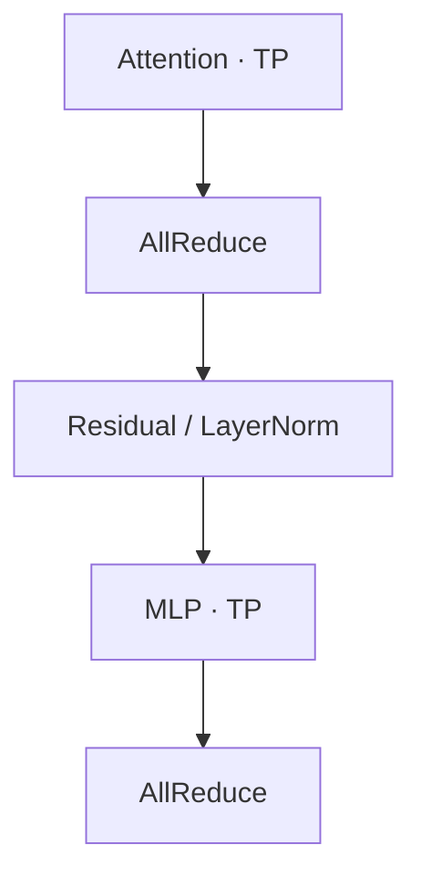

# Tensor Parallelism 与 Sequence Parallelism

**TP 按特征切分线性层的权重与计算；SP 让 LayerNorm、Residual 等操作按 token 分工，减少激活复制和重复计算。**

下文用 MLP 和 Attention 的前向图比较 **TP / TP+SP**。两种模式使用相同的权重分片，SP 改变子层之间的激活分布。[Megatron-LM](https://arxiv.org/abs/1909.08053)、[Sequence Parallelism](https://arxiv.org/html/2205.05198v1#S4.SS2.SSS2)

## Tensor Parallelism：让中间结果保持分片

将 batch 与 sequence 两个维度展平，输入记为 $X\in\mathbb{R}^{T\times H}$。下文使用以下符号：

| 符号 | 含义 |
|---|---|
| $T=B\times S$ | token 总数；$B$ 为 batch size，$S$ 为序列长度 |
| $H$ | 隐藏维度 |
| $I$ | 线性层的输出维度；在两层 MLP 中表示中间维度 |
| $N_h,D_h$ | Attention 的 head 数与每个 head 的维度，$H=N_hD_h$ |
| $p$ | TP 组中的 Rank 数；图中每个 Rank 对应一张 GPU |

下文采用标准多头注意力（MHA），被切分的维度均可被 $p$ 整除。

### Column 与 Row 分别切什么

对于线性层 $Y=XW$，权重 $W$ 的形状为 $[H,I]$。

**Column Parallel 按输出特征切分权重的列。** 每卡读取完整输入，计算自己负责的输出特征：

$$
W=[W_0,\ldots,W_{p-1}],\qquad Y_r=XW_r.
$$

其中，$W_r$ 为 $[H,I/p]$，$Y_r$ 为 $[T,I/p]$。完整输出由这些分片沿特征维拼成 $Y=[Y_0,\ldots,Y_{p-1}]$；能直接处理分片的下一层可以继续使用各卡的 $Y_r$。

**Row Parallel 按输入特征切分权重的行。** 输入也按相同特征切分，每卡算出每个输出元素的一部分和：

$$
X=[X_0,\ldots,X_{p-1}],\qquad
W=\begin{bmatrix}W_0\\\vdots\\W_{p-1}\end{bmatrix},\qquad
Y^{(r)}=X_rW_r.
$$

其中，$X_r$ 为 $[T,H/p]$，$W_r$ 为 $[H/p,I]$。各卡的 $Y^{(r)}$ 都是 $[T,I]$，将相同位置的部分和相加，才得到最终输出：

$$
Y=\sum_{r=0}^{p-1}Y^{(r)}.
$$

普通 TP 用 AllReduce 完成这次求和，让每卡获得完整 $Y$。下标 $Y_r$ 表示不同输出特征的分片，上标 $Y^{(r)}$ 表示由第 $r$ 卡算出的部分和。

### MLP 的完整前向

MLP 先将隐藏维度从 $H$ 扩展到 $I$，经过逐元素激活 $\sigma$，再投影回 $H$。两层权重分别为 $W_1\in\mathbb{R}^{H\times I}$、$W_2\in\mathbb{R}^{I\times H}$：

$$
U=XW_1,\qquad Z=\sigma(U),\qquad Y=ZW_2.
$$

<TensorParallelFlow kind="mlp" />

> 图取 $T=4$、$H=4$、$I=8$、$p=2$，展示从 LayerNorm 输出开始的两层投影与激活。

**第一层输出的特征分片，正好对应第二层需要的输入分片。** 逐元素激活 $\sigma$ 也能独立处理各分片，因此两层投影之间可以一直在本卡计算，将通信集中在子层边界。

### Attention 的完整前向

不同 head 的 Attention 可以独立计算，因此 QKV Projection 按 head 切分输出列；Output Projection 的 $W_O$ 按对应的输入行切分。

<TensorParallelFlow kind="attention" />

> 图取 $T=4$、$H=4$、$N_h=4$、$D_h=1$、$p=2$，输入为 LayerNorm 的输出。QKV 的叠片代表三个同布局张量。

每个 head 内，Query 仍需访问 mask 允许的序列上下文。各 head 的结果通过 $W_O$ 共同参与最终输出，因此**归约发生在 Output Projection 之后**，把各卡所负责 heads 的贡献相加。

Attention 与 MLP 各有一组 Column–Row 配对，因此普通 TP 的每层前向有两次 AllReduce：

> 门控 MLP 的 Gate 与 Up 两路按相同的中间特征切分，逐元素相乘后交给 Down Projection。训练时，上述两组配对的反向过程还各需一次 AllReduce。

## Sequence Parallelism：减少非 TP 区域的激活复制

普通 TP 在 Row Parallel 后执行 AllReduce，每卡都持有完整输出。接下来的 Residual、LayerNorm、Dropout 等操作，会在各卡重复处理这些激活。

这些操作可以按 token 分工。尤其 LayerNorm 虽然要归约特征维度，但**每卡只要保留一个 token 的完整 $H$ 个特征，就能独立完成该 token 的归一化**。Residual 的两路输入采用相同 token 分片时，也可以本地相加。

SP 因而让各卡在这些区域持有 $[T/p,H]$ 的激活，减少这部分激活的保存和重复计算。

**AllGather 放在第一层投影前，因为同一 token 的不同输出特征由不同卡负责。** 在这种 Column–Row 分工下，每卡都要为全部 token 计算自己负责的中间特征或 heads，因此需要先收齐其他卡的 token 输入。

**ReduceScatter 放在第二层投影后，因为此时各卡已经算出最终输出的部分和。** 将相同位置的部分和相加，再把不同 token 的结果分给不同卡，就能交给本地 Residual、LayerNorm 继续处理。[SP 原论文的推导](https://arxiv.org/html/2205.05198v1#S4.SS2.SSS2)

前向图切换到 **TP+SP** 后，可对照以下形状：

| 激活所在位置 | TP 每 Rank | TP+SP 每 Rank |
|---|---|---|
| 子层输入 | $[T,H]$ | $[T/p,H]$ |
| 第一层投影之前 | $[T,H]$ | AllGather 后为 $[T,H]$ |
| MLP 的 U、Z | $[T,I/p]$ | $[T,I/p]$ |
| Attention 的 Q、K、V、O | $[T,N_h/p,D_h]$ | $[T,N_h/p,D_h]$ |
| 行并行投影之后 | $[T,H]$ 部分和 | $[T,H]$ 部分和 |
| 子层输出 | AllReduce 后为 $[T,H]$ | ReduceScatter 后为 $[T/p,H]$ |

## 通信量与收益来源

设每个激活元素占 $b$ 字节，一份完整隐藏状态的大小为 $N=THb=BSHb$。以下采用 Ring 模型，统计一个 TP 组内每 Rank 在前向发往其他 Rank 的激活字节数：

| 一次 collective | 每 Rank 发送量 |
|---|---|
| ReduceScatter | $\frac{p-1}{p}N$ |
| AllGather | $\frac{p-1}{p}N$ |
| AllReduce | $2\frac{p-1}{p}N$ |

> Ring AllReduce 包含 ReduceScatter 与 AllGather 两个阶段，各执行 $p-1$ 轮，每轮发送 $N/p$ 字节。

将 Attention 和 MLP 两个子层相加，TP 与 TP+SP 的每层前向发送量分别为：

$$
V_{\mathrm{TP}}=2\times2\frac{p-1}{p}N,\qquad
V_{\mathrm{TP+SP}}=2\left(\frac{p-1}{p}N+\frac{p-1}{p}N\right).
$$

**两者的前向发送量相同。** SP 将 ReduceScatter 与下一子层的 AllGather 分开，让两者之间的 LayerNorm 等操作只保存和处理本地 token。

两次独立的 collective 各有启动开销，其带宽利用率也会影响通信耗时。SP 原论文观察到，分开的 ReduceScatter 与 AllGather 合计可能比一次 AllReduce 更慢；**SP 的主要收益来自激活显存节省，以及由此减少的激活重计算。** [论文第 6.2 节](https://arxiv.org/html/2205.05198v1#S6.SS2)
