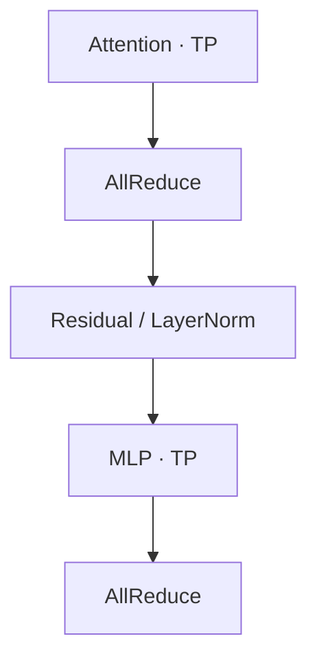

# Tensor Parallelism 与 Sequence Parallelism

**TP 把线性层的计算分给多张 GPU；SP 进一步把 LayerNorm、Residual 等区域的激活按 token 分片，减少复制保存与重复计算。** 两者通过 AllGather 和 ReduceScatter 衔接。

本文用 MLP 和 Attention 两张完整前向图追踪各 Rank 的激活与权重。每张图均可切换 **TP / TP+SP**：权重分片不变，输入收集和输出归约的方式随之改变。通信统计均以前向过程、一个 TP 组为范围。[Megatron-LM](https://arxiv.org/abs/1909.08053)、[Sequence Parallelism](https://arxiv.org/html/2205.05198v1#S4.SS2.SSS2)

## Tensor Parallelism：让中间结果保持分片

将 batch 与 sequence 两个维度展平，输入记为 $X\in\mathbb{R}^{T\times H}$。下文使用以下符号：

| 符号 | 含义 |
|---|---|
| $T=B\times S$ | token 总数；$B$ 为 batch size，$S$ 为序列长度 |
| $H$ | 隐藏维度 |
| $I$ | 线性层的输出维度；在两层 MLP 中表示中间维度 |
| $N_h,D_h$ | Attention 的 head 数与每个 head 的维度，$H=N_hD_h$ |
| $p$ | TP 组中的 Rank 数；图中每个 Rank 对应一张 GPU |

以下假设被切分的维度能被 $p$ 整除。

### Column 与 Row 分别切什么

对于线性层 $Y=XW$，权重 $W$ 的形状为 $[H,I]$。

**Column Parallel 沿权重的输出列切分。** 每卡持有完整输入，以及部分输出列的权重，因此得到不同输出位置的结果：

$$
W=[W_0,\ldots,W_{p-1}],\qquad Y_r=XW_r.
$$

其中，$W_r$ 为 $[H,I/p]$，$Y_r$ 为 $[T,I/p]$。数学上，完整输出为 $Y=[Y_0,\ldots,Y_{p-1}]$；下一层若能直接消费这些分片，就无需实际拼接或 AllGather。

**Row Parallel 沿权重的输入行切分。** 输入也沿特征维度作对应切分，每卡计算相同输出位置的一部分求和贡献：

$$
X=[X_0,\ldots,X_{p-1}],\qquad
W=\begin{bmatrix}W_0\\\vdots\\W_{p-1}\end{bmatrix},\qquad
Y^{(r)}=X_rW_r.
$$

其中，$X_r$ 为 $[T,H/p]$，$W_r$ 为 $[H/p,I]$。各卡的 $Y^{(r)}$ 都是 $[T,I]$，但数值尚不完整，需要逐元素求和：

$$
Y=\sum_{r=0}^{p-1}Y^{(r)}.
$$

普通 TP 用 AllReduce 完成这次求和，并让每卡获得完整 $Y$。下标 $Y_r$ 表示不同位置的分片，上标 $Y^{(r)}$ 表示同一组位置的局部贡献。

### MLP 的完整前向

MLP 先将隐藏维度从 $H$ 扩展到 $I$，经过逐元素激活 $\sigma$，再投影回 $H$。两层权重分别为 $W_1\in\mathbb{R}^{H\times I}$、$W_2\in\mathbb{R}^{I\times H}$：

$$
U=XW_1,\qquad Z=\sigma(U),\qquad Y=ZW_2.
$$

<TensorParallelFlow kind="mlp" />

> 图取 $T=4$、$H=4$、$I=8$、$p=2$。从 LayerNorm 后的输入开始，省略 Bias 和残差支路。权重区的淡框只用于定位全局矩阵，不在本卡保存。

**第一层输出的列分片，正好对应第二层需要的输入分片。** 第 $r$ 卡全程持有 $W_1^{(r)}\in\mathbb{R}^{H\times I/p}$ 与 $W_2^{(r)}\in\mathbb{R}^{I/p\times H}$，计算 $U_r=XW_1^{(r)}$、$Z_r=\sigma(U_r)$，再得到 $P^{(r)}=Z_rW_2^{(r)}$。逐元素激活无需跨卡收集 $Z$。

$P^{(r)}$ 已有 $[T,H]$ 的完整输出形状，但仅包含本卡中间特征的贡献。TP 用 AllReduce 将它们逐元素相加；切到 TP+SP 后，前面增加输入 AllGather，末尾改用 ReduceScatter。**AllGather 收集的是激活，权重始终保持上述分片。**

### Attention 的完整前向

多头注意力的各个 head 可以独立计算。QKV Projection 使用 Column Parallel，分别切分 $W_Q,W_K,W_V$ 的输出列；每卡持有各自 heads 对应的权重。Output Projection 则按对应输入行切分 $W_O$。

<TensorParallelFlow kind="attention" />

> 图取 $T=4$、$H=4$、$N_h=4$、$D_h=1$、$p=2$。QKV 的叠片代表三张同布局的张量；省略 Bias 和残差支路，输入已完成 LayerNorm。

**QKV 投影前，每卡需要全部 token 的完整输入特征。** 普通 TP 已持有这种输入；TP+SP 先 AllGather，再使用分片的 QKV 权重投影。这一步得到全部 token、部分 heads 的 QKV，每卡随后只在自己的 heads 上执行 Attention。

每卡的 $W_Q^{(r)},W_K^{(r)},W_V^{(r)}$ 均为 $[H,H/p]$，$W_O^{(r)}$ 为 $[H/p,H]$。将本地 Attention 输出的 heads 展平后，与本地 $W_O^{(r)}$ 相乘，得到 $[T,H]$ 的局部贡献。**归约发生在 Output Projection 之后**：TP 输出完整副本，TP+SP 输出已求和的 token 分片。

> 此处按普通多头注意力、头数可均分的情形说明。LayerNorm 的 token 独立性与 Attention 的 head 独立性不同：一个 Attention head 仍需要访问相应的序列上下文。

经典 Transformer 层中，Attention 与 MLP 各有一组配对。下面只标通信边界：

采用门控 MLP 时，Gate 与 Up 两路按对应的中间特征切分，逐元素相乘后交给 Down Projection。**经典配对的前向过程每层有两次 AllReduce。** 若统计训练的前向与反向，则通常共四次；这里不包含数据并行的梯度通信。

## Sequence Parallelism：减少非 TP 区域的激活复制

### 为什么按 token 切分

普通 TP 在 Row Parallel 后执行 AllReduce，每卡都持有完整输出。接下来的 Residual、LayerNorm、Dropout 等操作，会在各卡重复处理这些激活。

这些操作可以按 token 分工。尤其 LayerNorm 虽然要归约特征维度，但**每卡只要保留一个 token 的完整 $H$ 个特征，就能独立完成该 token 的归一化**。Residual 的两路输入采用相同 token 分片时，也可以本地相加。

SP 因而让各卡在这些区域持有 $[T/p,H]$ 的激活。前文两张图切换到 **TP+SP** 后，输入与最终输出都按 token 分片，中间计算仍沿特征或 head 分工。

### AllGather 与 ReduceScatter 为什么放在这里

在本文的 Column–Row 实现中，MLP 第一层和 QKV 投影前都先用 **AllGather** 收齐 token，再由各卡用自己的权重分片计算。SP 的 token 分片不会一直保持到中间投影和 Attention 内部。

MLP 第二层或 Attention Output Projection 后，每卡产生 $[T,H]$ 的局部贡献。此时用 **ReduceScatter** 同时完成跨卡求和与按 token 分发，使输出恢复为每卡 $[T/p,H]$，随后可本地执行 Residual、LayerNorm 等操作。[SP 原论文的推导](https://arxiv.org/html/2205.05198v1#S4.SS2.SSS2)

| 激活所在位置 | TP 每 Rank | TP+SP 每 Rank |
|---|---|---|
| 子层输入 | $[T,H]$ | $[T/p,H]$ |
| 第一层投影之前 | $[T,H]$ | AllGather 后为 $[T,H]$ |
| MLP 的 U、Z | $[T,I/p]$ | $[T,I/p]$ |
| Attention 的 Q、K、V、O | $[T,N_h/p,D_h]$ | $[T,N_h/p,D_h]$ |
| 行并行投影之后 | $[T,H]$ 局部贡献 | $[T,H]$ 局部贡献 |
| 子层输出 | AllReduce 后为 $[T,H]$ | ReduceScatter 后为 $[T/p,H]$ |

**SP 节省的是这些区域的激活保存和重复计算。** AllGather 后仍会出现完整输入，不能将任意时刻的激活或整个程序的峰值显存都直接视为原来的 $1/p$。

## 通信量：相同字节数不等于相同耗时

设每个激活元素占 $b$ 字节，一份完整隐藏状态的大小为 $N=THb=BSHb$。采用理想 Ring 模型，统计每个 Rank 的发送字节数：

| 一次 collective | 每 Rank 发送量 |
|---|---|
| ReduceScatter | $\frac{p-1}{p}N$ |
| AllGather | $\frac{p-1}{p}N$ |
| AllReduce | $2\frac{p-1}{p}N$ |

> Ring AllReduce 包含 ReduceScatter 与 AllGather 两个阶段，各执行 $p-1$ 轮；每轮发送 $N/p$ 字节。接收量相同，表中不将发送与接收相加。

普通 TP 在两组配对的末尾各执行一次 AllReduce。TP+SP 则在每组前后使用 AllGather 与 ReduceScatter，让两组之间的激活保持 token 分片。每层前向的发送量分别为：

$$
V_{\mathrm{TP}}=2\times2\frac{p-1}{p}N,\qquad
V_{\mathrm{TP+SP}}=2\left(\frac{p-1}{p}N+\frac{p-1}{p}N\right).
$$

因此，**在这一统计范围与 Ring 字节数模型下，两者发送量相同。** ReduceScatter 与下一子层前的 AllGather 被 LayerNorm 等本地操作隔开，改变了完整激活的保存范围。

通信耗时还受启动开销、带宽利用率与执行依赖影响。拆开后的 collective 能否与计算重叠，需要相应的实现和调度支持。SP 原论文也观察到，分开的 ReduceScatter 与 AllGather 合计可能比一次 AllReduce 更慢；其主要收益来自激活显存节省，以及由此减少的激活重计算需求。[论文第 6.2 节](https://arxiv.org/html/2205.05198v1#S6.SS2)
