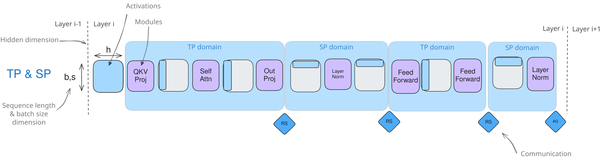
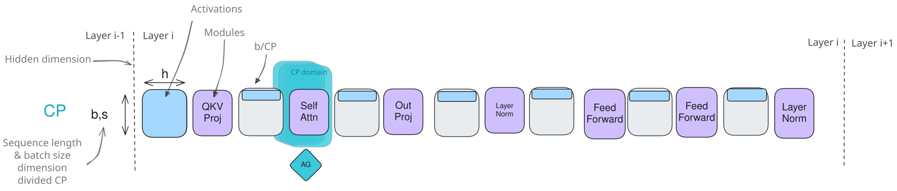
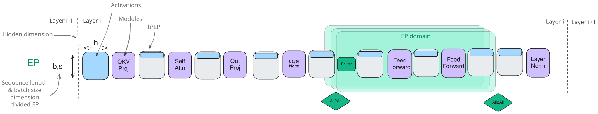
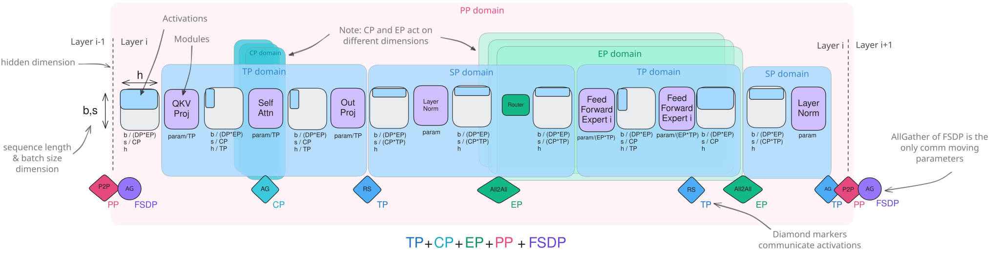
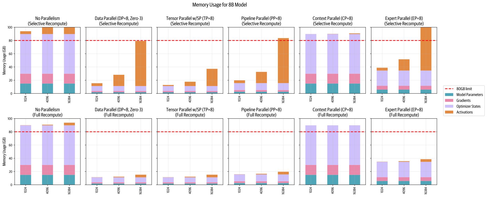

# 5D 并行概览

恭喜你，读者！
现在，你已经了解了可以用来扩展模型训练的全部五种并行策略：

1. 数据并行（DP）：沿批次维度。
2. 张量并行（TP）：沿隐藏维度。
3. 序列并行和上下文并行（SP/CP）：沿序列维度。
4. 流水线并行（PP）：沿模型层。
5. 专家并行（EP）：沿模型专家。

以及可以与数据并行结合、用来减少显存占用的三种 ZeRO 策略：

1. ZeRO-1：在 DP 副本之间对优化器状态分片。
2. ZeRO-2：在 DP 副本之间对优化器状态和梯度分片。
3. ZeRO-3：在 DP 副本之间对优化器状态、梯度和参数分片。

到了这个阶段，你可能会好奇，这些并行和 ZeRO 策略彼此之间如何比较，又如何相互作用。
换句话说，哪些策略可以使用并高效组合，哪些应该分开？

我们来看看它们的相似之处和相互作用。
首先并排比较流水线并行与 ZeRO-3，因为两者既有非常相近之处，也有重要差异。

**流水线并行**和 **ZeRO-3** 都会将模型权重划分到多张 GPU 上，并沿模型深度轴进行通信和计算（例如，在 ZeRO-3 中，我们会在计算时预取下一层）。
这意味着，两种情况下每个设备都会计算完整的一层，而 TP 或 EP 等方法则在层内的子单元上执行计算。

不过，PP 与 ZeRO-3 方法之间存在几项主要差异：

> 这里为了简化而说“一层”，但模型实际的分片单元可以不同；根据具体实现，它可能是多层、单层，甚至是一层的一个子集。

| | ZeRO-3 | 流水线并行 |
|---|---|---|
| 每个计算单元保存…… | 一层的一部分 | 完整的一层 |
| 通信用于传输…… | 权重 | 激活 |
| 编排 | 与模型无关 | 与模型无关 |
| 实现挑战 | 模型划分和通信的处理复杂 | 高效 PP 调度的处理复杂 |
| 扩展方面的考虑 | 倾向于较大的 $mbs$ 和 $seq\_len$，以隐藏通信 | 倾向于较大的 $grad\_acc$，以隐藏气泡 |

可以看到，ZeRO-3 和 PP 解决的是同一项挑战，但采用不同方法，选择哪一种，取决于你决定将通信集中在权重传输还是激活传输上。
虽然两者可以结合，但实践中并不常见，因为这需要显著增大全局批大小来摊薄通信成本，从而在全局批大小、模型大小、网络带宽和训练效率之间产生权衡。
如果决定将它们结合，应该将 ZeRO-3 配置为在一系列 PP 微批次期间将权重保留在显存中，以尽可能减少不必要的通信开销。

另一方面，侧重于优化器状态和梯度的 ZeRO-1 和 ZeRO-2，可以很容易地与流水线并行结合，并与其互补。
这些组合不会带来特别的新挑战。
例如，DeepSeek-v3 的训练就将 PP 与 ZeRO-1 结合使用。

**张量并行**（配合**序列并行**）与流水线并行和 ZeRO-3 都天然互补，并且可以与它们结合，因为它依赖矩阵乘法的分配律，允许对权重和激活进行分片，先独立计算，再合并。

我们不希望只使用 TP 进行并行的主要原因，是实践中 TP 有两个限制（前面几节已经讨论过）。
首先，由于其通信操作位于计算的关键路径上，很难扩展到超过某个规模，在那之后，通信开销会开始占主导地位。
其次，与模型无关的 ZeRO 和 PP 不同，TP 需要谨慎处理激活分片，有时沿隐藏维度（TP 区域），有时沿序列维度（SP 区域），这使正确实现更加繁琐，并且需要特定模型的知识，以确保整个模型都采用正确的分片模式。

因此，组合并行策略时，TP 通常用于高速节点内通信，而 ZeRO-3 或 PP 可用于跨越较低速节点间通信的并行组，因为它们的通信模式需要的带宽更低（PP），或更容易与计算重叠（ZeRO-3）。
组合这些技术时，主要考虑的是，如何在每个并行维度上高效地将 GPU 组织成组，以最大限度提高吞吐量并减少通信开销，同时留意 TP 的扩展限制。
例如，用于 TP 通信的 GPU 组应该保持在节点内部。

**上下文并行**和**专家并行**也有助于对激活进行分片，可以视为 TP 的补充。
CP 处理长序列，EP 则支持分布式混合专家训练，两者可以结合使用，不会有什么特别的问题。

CP 专门针对超长序列训练的挑战，沿序列维度在 GPU 之间对激活分片。
虽然 MLP 和 LayerNorm 等大多数模块能够独立处理这些分片后的序列，但注意力块需要通信，因为每个 token 都需要访问完整序列的 key/value。
正如[CP 一节](./context-parallelism.md)中看到的，这可以通过让计算与通信重叠的 Ring Attention 模式高效处理。
扩展到极长序列（128k 以上 token）时，CP 尤其有价值，因为即使使用完全激活重计算，注意力的显存需求也会高到无法在单张 GPU 上承受。

**专家并行**专门针对 MoE 模型训练的挑战，将专门的“专家”分片到各张 GPU 上，并在计算期间将 token 动态路由到相关专家。
EP 中的关键通信操作，是将 token 路由到指定专家、再收集结果的“all-to-all”操作。
虽然这会引入一些通信开销，但它使模型容量能够大幅扩展，因为在推理（和训练）期间，每个 token 都只由全部参数中小得多的一部分处理。
从分布式训练和推理的角度看，当模型扩展到大量专家时，将专家划分到各张 GPU 上就有了意义。

> 例如，DeepSeek-V3 使用 256 个专家。

> 📝 注记
>
> EP 与 DP 在输入处理方面的这种相似性，使一些实现将专家并行视为数据并行的一个子集；关键区别在于，EP 使用专门的专家路由，而不是让所有 GPU 都通过相同的模型副本处理输入。

## 作用范围与重点

我们再快速总结一下，这些不同并行策略对模型哪些子部分的影响最大：

- 张量并行（以及序列并行）通过同时对权重和激活分片，影响整个模型的计算。
- 上下文并行主要影响注意力层，因为这些层需要跨序列通信，而其他层可以独立处理分片后的序列。
- 专家并行主要影响 MoE 层（它们替代标准 MLP 块），注意力层和其他组件保持不变。
- 流水线并行和 ZeRO 并不特别针对某个子模块或组件；例外是，流水线并行中需要平衡模块和层（因此，由于额外的嵌入层，第一层和最后一层通常会区别处理）。

| 张量并行 + 序列并行 | 上下文并行 | 专家并行 |
|---|---|---|
| 沿隐藏/序列维度对权重和激活分片 | 沿序列维度对激活分片 | 对专门的专家权重和激活分片 |
| 为矩阵乘法操作（column/row linear）通信 | 为注意力的 key/value 通信 | 为将 token 路由到专家而通信 |
| 需要针对特定模型实现 | 除注意力外，与模型无关 | 除 MoE 层外，与模型无关 |
| 倾向于高带宽节点内通信 | 倾向于较长序列 | 需要 MoE 层 |

## 汇总

那么，将我们看到的全部技术汇集到一张组合图中，如何？
没问题，我们愿意接受这个挑战！

这张汇总图展示了 MoE 变体中单个 Transformer 层的激活和模块。
我们也展示了前面几节讨论的各种并行方向和通信操作。

我们还可以**完整概览**每种策略的显存节省情况。
我们会按不同序列长度，以及选择性（上方）和完全（下方）重计算绘图，让你看到它们分别如何影响激活：

最后，我们从整体上看看所有这些技术、它们的主要基本思路，以及主要瓶颈，以结束本节：

| 方法 | 显存节省具体作用于…… | 并行/分片维度 | 缺点 |
|---|---|---|---|
| DP | 激活（减小本地批大小） | 批次 | 受最大批大小限制 |
| PP | 模型参数 | 模型层 | 空闲气泡与复杂调度 |
| TP+SP | 模型参数和激活 | 隐藏维度/序列长度 | 需要高带宽通信 |
| CP | 激活 | 序列长度 | 在注意力模块中增加通信开销 |
| EP | 专家参数 | 专家维度 | 需要 MoE 层，增加路由通信开销 |
| ZeRO-1 | 优化器状态 | 在 DP 副本之间分片 | 参数通信开销 |
| ZeRO-2 | 优化器状态和梯度 | 在 DP 副本之间分片 | 参数通信开销 |
| ZeRO-3 | 优化器状态、梯度和模型参数 | 在 DP 副本之间分片 | 参数通信开销 |

显然，这些技术中没有哪一种是能够神奇扩展训练的万能解法，我们往往需要以某种方式将它们组合起来。
我们能否提出几条规则，帮助我们找到选择和组合这些技术的良好起点？
这将是下一节的主题。
