# 附录

## A0：并行编程速成课

在本书中，我们将 LLM 训练从一张 GPU 扩展到了数百张 GPU。
这需要在所有机器之间通信和同步权重、梯度与数据。
有一组专门用于实现这一目标的分布式模式，称为**集合操作（collective operations）**。
本节将简要介绍这些操作，包括 *Broadcast*、*AllReduce*、*Scatter* 等。
我们开始吧！

总体配置是，有若干独立节点，它们可以是 CPU 核心、GPU 或计算节点。
每个节点执行一些计算，然后我们希望将结果或部分结果传给其他节点，以进行下一步计算（$t+1$）。

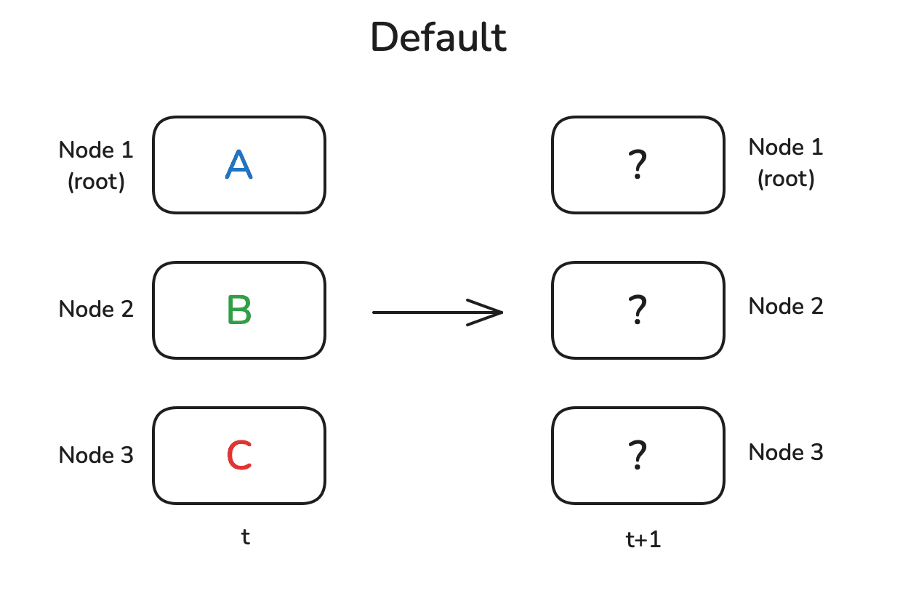

可能需要将一个节点的结果发送到其他所有节点，或者将每个节点的中间结果相加，报告总体结果。
通常，会有一个地位较高、发挥中心作用的节点，这里记为 *root*，它是某些操作的目标或来源。
先从最简单的原语之一开始：Broadcast 操作。

### Broadcast

一种很常见的模式是，节点 1 上有一些数据，你想与其他所有节点共享，让它们用这些数据计算。
Broadcast 操作正是这样做的：

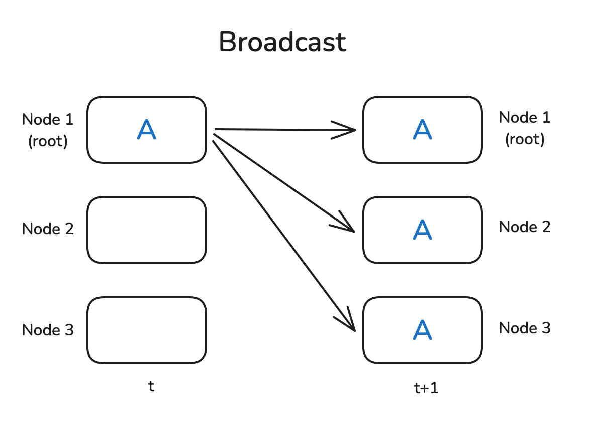

PyTorch 原生提供集合操作，因此很容易写一个小例子来展示广播的工作方式。
首先需要用 `dist.initi_process_group` 初始化进程组，设置通信后端（后面会介绍 NCCL）。
它确定工作进程（也称节点）的数量，并为每个进程分配一个 rank（可以通过 `dist.get_rank` 获取）。
最后，它建立工作进程之间的连接。

为了展示 `dist.broadcast` 操作，我们在 `rank=0` 上创建一个非零值张量，在其他工作进程上创建全零张量。
然后，用 `dist.broadcast(tensor, src=0)` 将 `rank=0` 的张量分发到所有其他 rank：

```python
import torch
import torch.distributed as dist

def init_process():
    dist.init_process_group(backend='nccl')
    torch.cuda.set_device(dist.get_rank())

def example_broadcast():
    if dist.get_rank() == 0:
        tensor = torch.tensor([1, 2, 3, 4, 5], dtype=torch.float32).cuda()
    else:
        tensor = torch.zeros(5, dtype=torch.float32).cuda()
    print(f"Before broadcast on rank {dist.get_rank()}: {tensor}")
    dist.broadcast(tensor, src=0)
    print(f"After broadcast on rank {dist.get_rank()}: {tensor}")

init_process()
example_broadcats()
```

可以使用 `torchrun --nproc_per_node=3 dist_op.py` 运行上述脚本（这需要三张 GPU，或者相应调整 `nproc_per_node`），应该会看到以下输出：

```python
Before broadcast on rank 0: tensor([1., 2., 3., 4., 5.], device='cuda:0')
Before broadcast on rank 1: tensor([0., 0., 0., 0., 0.], device='cuda:1')
Before broadcast on rank 2: tensor([0., 0., 0., 0., 0.], device='cuda:2')

After broadcast on rank 0: tensor([1., 2., 3., 4., 5.], device='cuda:0')
After broadcast on rank 1: tensor([1., 2., 3., 4., 5.], device='cuda:1')
After broadcast on rank 2: tensor([1., 2., 3., 4., 5.], device='cuda:2')
```

很好，看来符合预期。
rank 消息的打印顺序可能不同，因为我们无法控制哪条打印语句先执行（这里为了可读性进行了排序）。
现在来看 Reduce 和 AllReduce 模式！

### Reduce 与 AllReduce

Reduce 模式是分布式数据处理中最基本的模式之一。
思路是，通过一个函数 `f()` 合并每个节点上的数据，例如求和或求平均。
Reduce 模式只将结果发送到 root 节点，而 AllReduce 则将结果广播到全部节点：

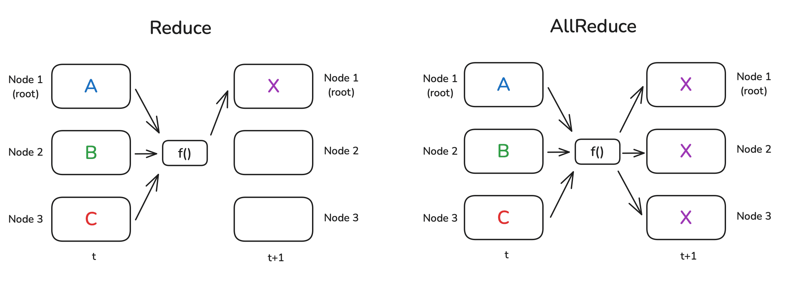

当然，并不存在一个神奇的“悬空”节点，能够独自完成这个操作；通常，每个节点执行一部分计算，节点组织成环形或树形结构。
举一个简单例子：假设需要对各节点上的数值求和，节点按环形连接。
第一个节点将自己的数值发送给邻居，邻居将自己的数值加到收到的值上，再转发给下一个邻居。
绕节点环一周之后，第一个节点就会收到总和。

下面的代码执行一个简单的 Reduce，对张量求和。
通过 `op=dist.ReduceOp.SUM` 指定操作（支持的操作详见 [PyTorch 文档](https://pytorch.org/docs/stable/distributed.html#torch.distributed.ReduceOp)）：

```python
def example_reduce():
    tensor = torch.tensor([dist.get_rank() + 1] * 5, dtype=torch.float32).cuda()
    print(f"Before reduce on rank {dist.get_rank()}: {tensor}")
    dist.reduce(tensor, dst=0, op=dist.ReduceOp.SUM)
    print(f"After reduce on rank {rank}: {tensor}")

init_process()
example_reduce()
```

在 Reduce 操作中，只有 `dst` 节点上的张量会更新：

```python
Before reduce on rank 0: tensor([1., 1., 1., 1., 1.], device='cuda:0')
Before reduce on rank 1: tensor([2., 2., 2., 2., 2.], device='cuda:1')
Before reduce on rank 2: tensor([3., 3., 3., 3., 3.], device='cuda:2')

After reduce on rank 0: tensor([6., 6., 6., 6., 6.], device='cuda:0')
After reduce on rank 1: tensor([2., 2., 2., 2., 2.], device='cuda:1')
After reduce on rank 2: tensor([3., 3., 3., 3., 3.], device='cuda:2')
```

类似地，可以按如下方式执行 AllReduce（这时无需指定目标）：

```python
def example_all_reduce():
    tensor = torch.tensor([dist.get_rank() + 1] * 5, dtype=torch.float32).cuda()
    print(f"Before all_reduce on rank {dist.get_rank()}: {tensor}")
    dist.all_reduce(tensor, op=dist.ReduceOp.SUM)
    print(f"After all_reduce on rank {dist.get_rank()}: {tensor}")

init_process()
example_all_reduce()
```

这时，所有节点上都能获得结果：

```python
Before all_reduce on rank 0: tensor([1., 1., 1., 1., 1.], device='cuda:0')
Before all_reduce on rank 1: tensor([2., 2., 2., 2., 2.], device='cuda:1')
Before all_reduce on rank 2: tensor([3., 3., 3., 3., 3.], device='cuda:2')

After all_reduce on rank 0: tensor([6., 6., 6., 6., 6.], device='cuda:0')
After all_reduce on rank 1: tensor([6., 6., 6., 6., 6.], device='cuda:1')
After all_reduce on rank 2: tensor([6., 6., 6., 6., 6.], device='cuda:2')
```

现在转向下一种分布式通信操作。
在许多真实场景中，每个节点独立完成大量复杂计算，需要在所有节点之间共享最终结果。
这时就需要 Gather 和 AllGather。
我们来看看！

### Gather 与 AllGather

Gather 和 AllGather 与 Broadcast 很相似，都能在节点之间分发数据而不修改数据。
与 Broadcast 的主要区别是，不再是将某个节点上的一个值共享给其他所有节点；而是每个节点各有一块数据，我们希望将全部数据收集到一个节点（Gather），或全部节点（AllGather）。
一图胜千言，我们来看看：

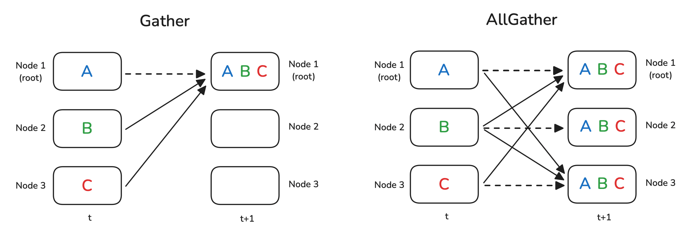

虚线表示部分数据实际上并不移动（因为它已经在节点上）。

对于 Gather，需要准备一个容器对象来保存收集到的张量，在这个例子中就是 `gather_list` 对象：

```python
def example_gather():
    tensor = torch.tensor([dist.get_rank() + 1] * 5, dtype=torch.float32).cuda()
    if dist.get_rank() == 0:
        gather_list = [
            torch.zeros(5, dtype=torch.float32).cuda()
            for _ in range(dist.get_world_size())
            ]
    else:
        gather_list = None
    print(f"Before gather on rank {dist.get_rank()}: {tensor}")
    dist.gather(tensor, gather_list, dst=0)
    if dist.get_rank() == 0:
        print(f"After gather on rank 0: {gather_list}")

init_process()
example_gather()
```

可以看到，`gather_list` 确实包含了全部 rank 的张量：

```python
Before gather on rank 0: tensor([1., 1., 1., 1., 1.], device='cuda:0')
Before gather on rank 1: tensor([2., 2., 2., 2., 2.], device='cuda:1')
Before gather on rank 2: tensor([3., 3., 3., 3., 3.], device='cuda:2')

After gather on rank 0: [tensor([1., 1., 1., 1., 1.], device='cuda:0'),
                         tensor([2., 2., 2., 2., 2.], device='cuda:0'),
                         tensor([3., 3., 3., 3., 3.], device='cuda:0')]
```

AllGather 示例中唯一需要改变的是，每个节点都需要为结果准备占位容器：

```python
def example_all_gather():
    tensor = torch.tensor([dist.get_rank() + 1] * 5, dtype=torch.float32).cuda()
    gather_list = [
        torch.zeros(5, dtype=torch.float32).cuda()
        for _ in range(dist.get_world_size())
        ]
    print(f"Before all_gather on rank {dist.get_rank()}: {tensor}")
    dist.all_gather(gather_list, tensor)
    print(f"After all_gather on rank {dist.get_rank()}: {gather_list}")

init_process()
example_all_gather()
```

可以看到，现在每个节点都有全部数据：

```python
Before all_gather on rank 0: tensor([1., 1., 1., 1., 1.], device='cuda:0')
Before all_gather on rank 1: tensor([2., 2., 2., 2., 2.], device='cuda:1')
Before all_gather on rank 2: tensor([3., 3., 3., 3., 3.], device='cuda:2')

After all_gather on rank 0: [tensor([1., 1., 1., 1., 1.], device='cuda:0'),
                             tensor([2., 2., 2., 2., 2.], device='cuda:0'),
                             tensor([3., 3., 3., 3., 3.], device='cuda:0')]
After all_gather on rank 1: [tensor([1., 1., 1., 1., 1.], device='cuda:1'),
                             tensor([2., 2., 2., 2., 2.], device='cuda:0'),
                             tensor([3., 3., 3., 3., 3.], device='cuda:0')]
After all_gather on rank 2: [tensor([1., 1., 1., 1., 1.], device='cuda:2'),
                             tensor([2., 2., 2., 2., 2.], device='cuda:2'),
                             tensor([3., 3., 3., 3., 3.], device='cuda:2')]
```

那么，Gather 的逆操作是什么？
这种情况下，全部数据在一个节点上，需要将其分发或切分到各个节点，中间可能还要进行一些处理。
可以使用 Scatter；如果在分发前还要对数据执行某种操作，则使用 ReduceScatter 模式。

### Scatter 与 ReduceScatter

顾名思义，Scatter 的目标是将一个节点上的数据分散到所有节点，具体做法是向每个节点分发一片数据。
因此，它不同于向每个节点发送完整副本、不切分数据的 Broadcast，也是 Gather 的逻辑逆操作。

ReduceScatter 模式稍微复杂一些。
和 AllReduce 一样，它对所有节点的数据应用一个操作。
但 AllReduce 让每个节点收到完整输出张量，而 ReduceScatter 中，每个节点只收到输出张量的一片。
下图展示了这些操作的区别：

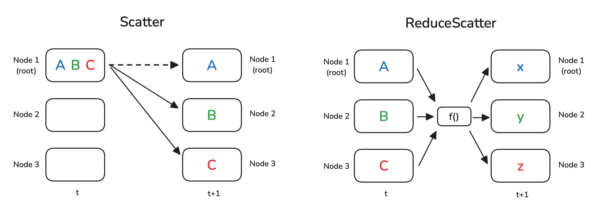

Scatter 在代码中写成 Gather 的逆操作：不是准备一个张量列表作为目标，而是将要分发的源数据准备成张量列表。
还需要指定 `src`：

```python
def example_scatter():
    if dist.get_rank() == 0:
        scatter_list = [
            torch.tensor([i + 1] * 5, dtype=torch.float32).cuda()
            for i in range(dist.get_world_size())
            ]
        print(f"Rank 0: Tensor to scatter: {scatter_list}")
    else:
        scatter_list = None
    tensor = torch.zeros(5, dtype=torch.float32).cuda()
    print(f"Before scatter on rank {dist.get_rank()}: {tensor}")
    dist.scatter(tensor, scatter_list, src=0)
    print(f"After scatter on rank {dist.get_rank()}: {tensor}")

init_process()
example_scatter()
```

结果，空张量被填入 `scatter_list` 中的内容。

```python
Rank 0: Tensor to scatter: [tensor([1., 1., 1., 1., 1.], device='cuda:0'),
                            tensor([2., 2., 2., 2., 2.], device='cuda:0'),
                            tensor([3., 3., 3., 3., 3.], device='cuda:0')]
Before scatter on rank 0: tensor([0., 0., 0., 0., 0.], device='cuda:0')
Before scatter on rank 1: tensor([0., 0., 0., 0., 0.], device='cuda:1')
Before scatter on rank 2: tensor([0., 0., 0., 0., 0.], device='cuda:2')

After scatter on rank 0: tensor([1., 1., 1., 1., 1.], device='cuda:0')
After scatter on rank 1: tensor([2., 2., 2., 2., 2.], device='cuda:1')
After scatter on rank 2: tensor([3., 3., 3., 3., 3.], device='cuda:2')
```

我们创建一些更有趣的数据，展示 ReduceScatter 的逻辑。
在每个节点上，创建一个由二元素向量组成的列表，幂指数和偏移量是节点 rank 的函数：

```python
def example_reduce_scatter():
    rank = dist.get_rank()
    world_size = dist.get_world_size()
    input_tensor = [
        torch.tensor([(rank + 1) * i for i in range(1, 3)], dtype=torch.float32).cuda()**(j+1) 
        for j in range(world_size)
        ]
    output_tensor = torch.zeros(2, dtype=torch.float32).cuda()
    print(f"Before ReduceScatter on rank {rank}: {input_tensor}")
    dist.reduce_scatter(output_tensor, input_tensor, op=dist.ReduceOp.SUM)
    print(f"After ReduceScatter on rank {rank}: {output_tensor}")    

init_process()
example_reduce_scatter()
```

打印语句展示了所创建数据的模式。
同时，也能立即看到 ReduceScatter 的效果：第一个 rank 收到各节点第一个张量的和，第二个 rank 收到各节点第二个张量的和，依此类推：

```python
Before ReduceScatter on rank 0: [tensor([1., 2.], device='cuda:0'),
											                       tensor([1., 4.], device='cuda:0'),
											                       tensor([1., 8.], device='cuda:0')]
            Before ReduceScatter on rank 1: [tensor([2., 4.], device='cuda:1'),
                                             tensor([4., 16.], device='cuda:1'),
                                             tensor([8., 64.], device='cuda:1')]
            Before ReduceScatter on rank 2: [tensor([3., 6.], device='cuda:2'),
                                             tensor([9., 36.], device='cuda:2'),
                                             tensor([27., 216.], device='cuda:2')]

            After ReduceScatter on rank 0: tensor([6., 12.], device='cuda:0')
            After ReduceScatter on rank 1: tensor([14., 56.], device='cuda:1')
            After ReduceScatter on rank 2: tensor([36., 288.], device='cuda:2')
```

接下来，快速看看一种使用 ReduceScatter 和 AllGather 的常见 AllReduce 实现：Ring AllReduce。

### Ring AllReduce

**Ring AllReduce** 是针对可扩展性优化的一种 AllReduce 实现。
它不让全部设备彼此直接通信，避免产生通信瓶颈，而是将操作分为两个关键步骤：ReduceScatter 和 AllGather。
工作方式如下：

1. **ReduceScatter**
   - 每个设备将数据（例如梯度）拆成 N 块（N 是 GPU 数量），并向邻居发送一块。
     同时，每个设备从另一个邻居接收一块。
   - 每个设备收到一块数据后，将自己对应的数据块加到收到的数据块上（归约）。
   - 这个过程沿环持续进行，直到每个设备都持有一个完全归约的数据块，表示所有设备上该块梯度的总和。
2. **AllGather**
   - 现在，每个设备需要从其他设备收集完全归约的数据块。
   - 每个设备将归约后的数据块发送给邻居，并从另一个邻居接收归约后的数据块。
   - 各设备持续转发收到的数据块，直到每个设备都有全部归约后的数据块，从而获得完整的梯度总和。

用下面的 GIF 来说明：这里有 5 张 GPU，每张 GPU 上有一个长度为 5 的张量。
第一段动画展示 ReduceScatter 步骤，结束时，每张 GPU 都收到特定数据块的归约结果（橙色矩形）。

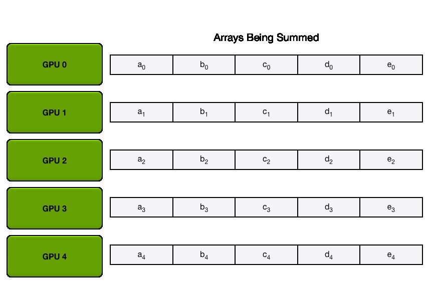

下一段动画展示 AllGather 步骤，结束时，每张 GPU 都获得完整的 AllReduce 结果：

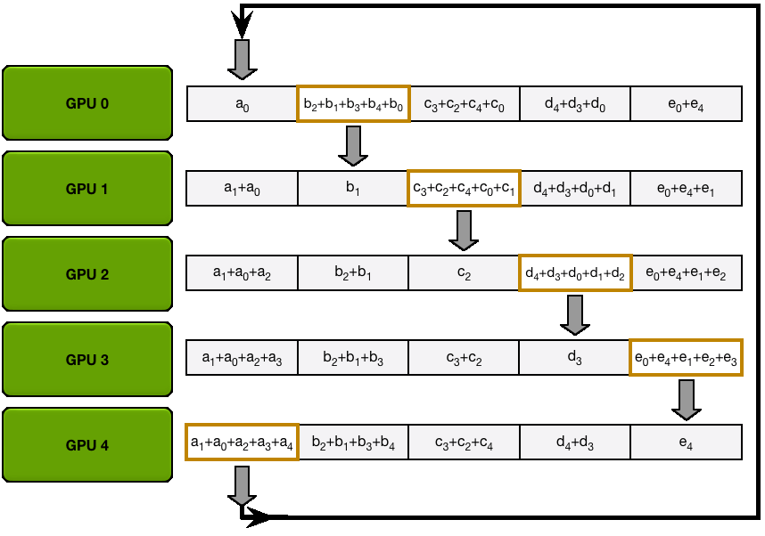

你可能已经注意到，在 ReduceScatter 和 AllGather 两个步骤中，$N$ 张 GPU 中的每一张都发送和接收 $N-1$ 次数据。
每张 GPU 每次传输发送 $\frac{K}{N}$ 个值，其中 $K$ 是跨 GPU 求和的数组中的值的总数。
因此，每张 GPU 发送和接收的数据总量为 $2 \times (N-1) \times \frac{K}{N}$。
当 $N$（GPU 数量）很大时，每张 GPU 发送和接收的数据总量约为 $2 \times K$，其中 $K$ 是参数总数。

**关于 AllReduce，需要记住两点：**

1. 当 $N$（GPU 数量）很大时，AllReduce 的通信成本约为 $2 \times K$。
2. AllReduce 可以分解为先 ReduceScatter、再 AllGather。
   这两项操作的通信成本分别为 AllReduce 的一半，即约 $K$。

可以看到，这种实现甚至能高效利用节点之间有限的带宽。

现在，你已经了解分布式操作的主要构件；在看它们实际工作之前，先看看一个用于同步的特殊操作：Barrier。

### Barrier

**Barrier** 是一种同步所有节点的简单操作。
只有所有节点都到达屏障后，屏障才会解除。
只有这时，节点才被允许继续后续计算：

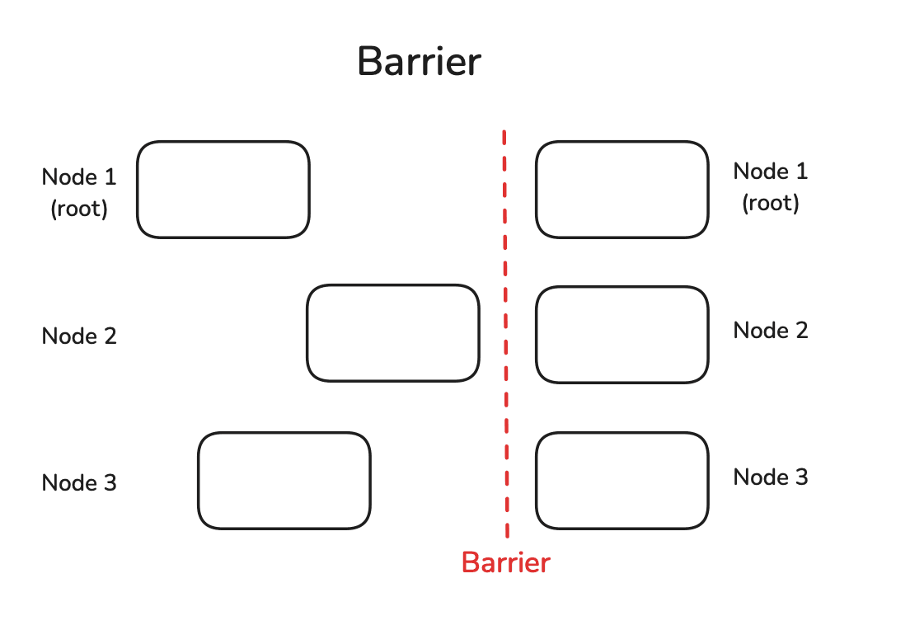

可以为每个节点设置不同的休眠时间，轻松模拟延迟节点，看看所有节点通过屏障需要多久：

```python
def example_barrier():
    rank = dist.get_rank()
    t_start = time.time()
    print(f"Rank {rank} sleeps {rank} seconds.")
    time.sleep(rank)  # Simulate different processing times
    dist.barrier()
    print(f"Rank {rank} after barrier time delta: {time.time()-t_start:.4f}")

init_process()
example_barrier()
```

可以看到，虽然第一个 rank 完全没有休眠，但它通过屏障也花了 2 秒：

```python
Rank 0 sleeps 0 seconds.
Rank 1 sleeps 1 seconds.
Rank 2 sleeps 2 seconds.

Rank 0 after barrier time delta: 2.0025
Rank 1 after barrier time delta: 2.0025
Rank 2 after barrier time delta: 2.0024
```

需要谨慎使用这种同步所有节点的方法，因为它违背了独立并行操作的目的，可能使总体处理变慢。
在许多情况下，让较快节点先于其他节点开始下一个任务完全可以，因为它在下一次迭代可能较慢，从而让整个过程中的延迟相互抵消。

在转向实际分布式训练实现之前，先解开一个谜：NCCL 究竟是什么？

### NCCL

在许多 GPU 上训练大模型时，我们有时可能淘到金，但总会遇到镍（nickel，或 NCCL 🥁）！
这是什么？

有几种实现集合通信、且受 PyTorch 支持的库：经典的 **MPI**（Message Passing Interface，消息传递接口）、Meta 的 **Gloo**，最后还有 NCCL（NVIDIA Collective Communications Library，NVIDIA 集合通信库）。
它们提供的集合通信模式功能相似，但针对不同硬件配置进行了优化：NCCL 为高效 GPU–GPU 通信设计，而 MPI 和 Gloo 面向 CPU–CPU 或 CPU–GPU 通信。
PyTorch 提供了很好的[选择指南](https://pytorch.org/docs/stable/distributed.html#which-backend-to-use)，概括如下：

- GPU 训练：使用 NCCL。
- CPU 训练：使用 Gloo。

决策树中还有一些更细的区别，留给读者在上述 PyTorch 指南中探索。

## A1：分布式训练性能剖析

### Kernel

先假设 kernel 已经集成在 PyTorch 中。
以 PyTorch 中实现为 `torch.nn.functional.layer_norm` 的层归一化函数为简单例子。
剖析这个函数底层 kernel 的方法有几种。
最直接的方法可能是使用 Python 的 `time` 模块。
不过，由于 CUDA 操作异步执行，这种测时方法只能捕获 Python 中启动 kernel 的开销，而非 kernel 本身的实际执行时间。

为此，可以用 `torch.cuda.Event` 精确计时，并使用 `torch.cuda.synchronize()` 指令，确保等待 kernel 执行完成。
下面的代码片段展示了这一方法：

```python
def profile_pytorch(func, input):
    # Create CUDA events to track time. CUDA operations are asynchronous.
    start = torch.cuda.Event(enable_timing=True)  # Event to mark the start time
    end = torch.cuda.Event(enable_timing=True)    # Event to mark the end time
    # Warm up to eliminate any overhead from the first run, which might not reflect 
    # the actual performance
    for _ in range(10):
        func(input)
    # Record the start time before executing the function
    start.record()  
    func(input)  # Call the function we want to profile
    # Record the end time after the function has completed
    end.record()  
    # Synchronize the CUDA operations to ensure all operations are completed
    # before measuring the elapsed time
    torch.cuda.synchronize()  
    # Calculate and return the elapsed time in milliseconds
    return start.elapsed_time(end)
```

更高效的剖析方式是使用 PyTorch profiler，如[前文](./first-steps.md#剖析-gpu-计算与通信)所述。
例如，考虑以下代码：

```python
import torch
import torch.nn.functional as F

def pytorch_layer_norm(input):
    return F.layer_norm(input, input.size()[1:])

a = torch.randn(10000, 10000).cuda()

with torch.profiler.profile(
    activities=[
        torch.profiler.ProfilerActivity.CPU,  # Profile CPU activities
        torch.profiler.ProfilerActivity.CUDA,  # Profile CUDA activities
    ],
    # Define a schedule for the profiler
    schedule=torch.profiler.schedule(
        wait=1,      # Wait for 1 iteration before starting to profile
        warmup=3,    # Warm up for 3 iterations to stabilize performance
        active=2,    # Profile for 2 active iterations
        repeat=1,    # Repeat the profiling schedule once
    ),
    on_trace_ready=torch.profiler.tensorboard_trace_handler('.'),

) as p:
    for iter in range(10):
        pytorch_layer_norm(a)
        p.step()

# Print a table of the profiling results, sorted by total CUDA time, limited to the top 10 entries
print(p.key_averages().table(sort_by="cuda_time_total", row_limit=8))
```

这会打印按 CUDA 总时间排序的聚合剖析结果，输出如下：

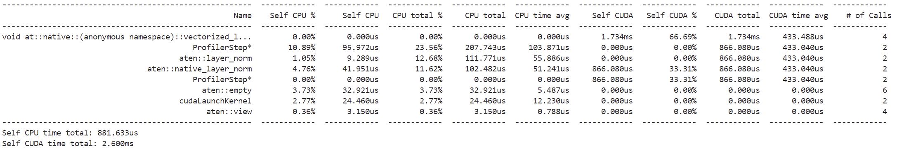

也可以像前面提到的那样，在 *chrome://tracing/* 中查看 trace。

> 💡 提示
>
> 如果刚开始使用这个工具，可以用左右方向键在 trace 中移动。
> 此外，按住 Alt 键并用鼠标向左或向右滚动，可以放大和缩小。

放大后，可以从 trace 中观察调用 `layer_norm` 时的操作流程：

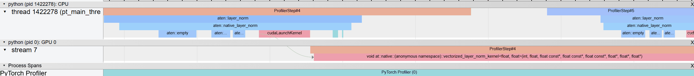

流程从 CPU（上半部分）中的 `aten::layer_norm` 开始，进入 `aten::native_layer_norm`，再转到 `cudaLaunchKernel`。
然后转到 GPU，调用 `vectorized_layer_norm_kernel`。

> 📝 注记
>
> 将 profiler 的 `profile_memory` 设为 `True`，即可启用内存剖析。
> 不过，这会使 trace 更复杂。

PyTorch profiler 能快速给出性能概览，而 NVIDIA Nsight Compute CLI（`ncu`）能够更深入地分析 GPU 性能，包括每个 kernel 的详细执行时间和内存使用情况。
运行 profiler 很简单：

```bash
ncu --set full python layer_norm.py
```

其中，*layer_norm.py* 是一个执行层归一化函数的简单文件。
这个命令会生成日志输出，但更有效的结果可视化方式是设置输出标志：

```bash
ncu --set full -o output python layer_norm.py
```

然后用 Nsight Compute 打开 *output.ncu-rep*，就能看到下面这样的视图，其中有明确的计算和内存利用率警告，以及关于如何更好地平衡计算与内存、实现最大占用率的建议：

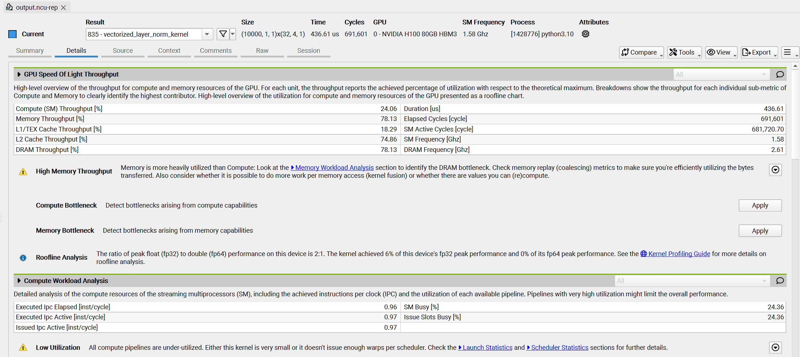

### CPP 扩展

如果要剖析的 kernel 尚未集成到 PyTorch，可以用 PyTorch 的 `cpp_extension` 模块轻松编译并运行自定义 CUDA 代码。
过程很直接：在 *.cu* 文件中创建 CUDA kernel，再用 `cpp_extension` 模块的 `load` 函数将其加载到 Python 中。

对于简单的 `add` kernel，*.cu* 文件如下：

```clike
#include <torch/extension.h>
#include <cuda.h>
#include <cuda_runtime.h>

__global__ void add_kernel(float* x, float* y, float* output, int size) {
    int index = blockIdx.x * blockDim.x + threadIdx.x;
    if (index < size) {
        output[index] = x[index] + y[index];
    }
}

void add_cuda(torch::Tensor x, torch::Tensor y, torch::Tensor output) {
    int threads = 1024;
    int blocks = (x.size(0) + threads - 1) / threads;

    add_kernel<<<blocks, threads>>>(x.data_ptr<float>(), y.data_ptr<float>(), output.data_ptr<float>(), x.size(0));
}
PYBIND11_MODULE(TORCH_EXTENSION_NAME, m) {
    m.def("add_cuda", &add_cuda, "Vector addition (CUDA)");
}
```

下面是加载 kernel 的 Python 文件：

```python
import torch
from torch.utils.cpp_extension import load

# Load and compile the CUDA extension
vector_add = load(
    name="vector_add",
    sources=["add_kernel.cu"],
    verbose=True
)

# Define input tensors
size = 10000
x = torch.randn(size, device='cuda')
y = torch.randn(size, device='cuda')
output = torch.empty(size, device='cuda')

# Run the CUDA kernel
vector_add.add_cuda(x, y, output)
```

通过这种方法，就可以像前面展示的那样，用 PyTorch profiler 或 NVIDIA 工具剖析自定义 CUDA kernel。

## A2：LLM 训练中的典型规模

我们来感受一下 LLM 训练中各项内容的典型大小。
讨论存储或计算时，经常统计“元素”，可以将其理解为张量中的数值。
要得到以字节计的实际内存，需要乘以每个数值的大小（例如 BF16 为 2 字节，FP32 为 4 字节）。

下面给出一些粗略数值：

- **输入 token：**每个批次处理 $seq \cdot mbs$ 个 token，其中 $mbs$ 是微批次大小，$seq$ 是序列长度。
- **激活（隐藏状态）：**对于单层，隐藏状态张量有 $seq \cdot mbs \cdot h$ 个元素。
- **模型权重和梯度：**模型中的每个权重矩阵（例如线性层）大约包含 $h^2$ 个元素。
  梯度与权重大小相同。
- **优化器状态：**对于每个权重矩阵（$h^2$ 个元素），使用混合精度训练的 Adam 等优化器会用 FP32 保存动量和方差状态（$2 \times 2 h^2$），以及 FP32 主权重（$2  h^2$）。
  因此，每个权重矩阵的优化器状态总量约为（$6 h^2$）。
- **模型总参数量：**每个 Transformer 块保存：
  - 注意力参数：
    - QKV 投影：$3h^2$ 个参数。
    - 输出投影：$h^2$ 个参数。
  - 使用门控线性单元（GLU）的 MLP 参数：
    - Gate 和 up 投影：$8h^2$ 个参数（2 个大小为 $h \times 4h$ 的矩阵）。
    - Down 投影：$4h^2$ 个参数（1 个大小为 $4h \times h$ 的矩阵）。
  - 每个块合计：使用 GLU MLP 时为 $16h^2$，不使用 GLU 时为 $12h^2$。
  - 完整模型：$16h^2 \cdot num\_layers$（使用 GLU）。
  - 额外参数：
    - 输入嵌入：$vocab\_size \cdot h$。
    - LM head：$vocab\_size \cdot h$（如果不与输入嵌入共享权重）。
    - 位置嵌入（如果使用）：$max\_seq\_len \cdot h$。
- **前向和反向传播计算量（FLOPS）：**前向传播 FLOPS 的一种非常粗略的估计是 $2 \cdot num\_tokens \cdot num\_params$。
  反向传播计算量是它的两倍：$4 \cdot num\_tokens \cdot num\_params$。

> 📝 注记
>
> 更精确的前向加反向传播 FLOPs 公式是 $6 \cdot seq\_len \cdot num\_params + 12 \cdot num\_layers \cdot h \cdot seq\_len^2$，它计入了注意力操作在整个序列上带来的二次增长；但为了简化数学推导，这里假设 $seq\_len^2 << h$。

## A3：计算与通信重叠的数学分析

使用上一节的公式，可以估算分布式训练中计算与通信何时能够有效重叠。
以数据并行（ZeRO-0）为例。

### 数据并行通信分析

需要通信的梯度总大小为：

- 梯度 = 参数 ≈ $num\_layers \cdot 16h^2$。

反向传播期间，这些梯度以桶的形式通信（默认大小 25 MB）。
对每个桶执行 all-reduce 的通信时间为：

$$
t_{comm} = t_{comm\_bucket} = \frac{bucket\_size \cdot 2(DP-1)}{DP \cdot peak\_bw}
$$

> 📝 注记
>
> 带宽计算采用 [NCCL 文档](https://github.com/NVIDIA/nccl-tests/blob/master/doc/PERFORMANCE.md#summary)中的总线带宽公式。
> 这些公式在计算 GPU 间有效带宽时，考虑了具体通信模式。

反向传播的计算时间为：

$$
t_{compute} = \frac{4 \cdot num\_tokens \cdot num\_params}{peak\_flops}
$$

要有效重叠，需要：

$$
\frac{t_{comm}}{t_{compute}} = \frac{num\_params}{2 \cdot num\_tokens} \cdot \frac{DP-1}{DP} \cdot \frac{peak\_flops}{peak\_bw} \leq 1
$$

这个比值有助于判断通信是否会成为训练瓶颈。
比值小于 1 时，通信可以完全与计算重叠。

### ZeRO-3（FSDP）通信分析

对于 ZeRO-3，参数和梯度在 GPU 之间分片。
我们分析一个每个 Transformer 块有 $16h^2$ 个参数的模型的通信模式：

- 前向传播中的每个 Transformer 块：
  - All-gather 参数：每个 rank 为 $16h^2/DP$ 字节。
- 反向传播中的每个 Transformer 块：
  - All-gather 参数：每个 rank 为 $16h^2/DP$ 字节。
  - Reduce-scatter 梯度：每个 rank 为 $16h^2/DP$ 字节。
- 每个块的总通信量：$3 \cdot 16h^2/DP$ 字节。
- 完整模型的总通信量：$3 \cdot num\_layers \cdot 16h^2/DP$ 字节。

all-gather 操作的通信时间为：

$$
t_{comm} = 16h^2 \cdot \frac{DP-1}{DP \cdot peak\_bw}
$$

一个解码器层前向传播的计算时间为：

$$
t_{compute} = \frac{2 \cdot seq\_len \cdot mbs \cdot (16 \cdot h^2)}{peak\_flops} = \frac{32 \cdot seq\_len \cdot mbs \cdot h^2}{peak\_flops}
$$

要让计算与通信有效重叠，需要：

$$
\frac{t_{comm}}{t_{compute}} = \frac{1}{2 \cdot seq\_len \cdot mbs} \cdot \frac{DP-1}{DP} \cdot \frac{peak\_flops}{peak\_bw} \leq 1
$$

这个比值小于 1 时，下一层参数的通信可以被当前层计算隐藏。

### TP 通信分析

张量并行中，激活在 [TP 区域](./tensor-parallelism.md#序列并行)（例如 MLP 块）跨 GPU 分片。
我们来分析通信模式：

- 前向传播中的每个 column-linear 操作：
  - All-gather 激活：每个 rank 为 $seq \cdot mbs \cdot h/TP$ 字节。
- 反向传播中的每个 column-linear 操作：
  - Reduce-scatter 梯度：每个 rank 为 $seq \cdot mbs \cdot h/TP$ 字节。
- row-linear 操作则相反。
  每个 Transformer 块有 2 个 column-linear 和 2 个 row-linear 操作。
- 每个块的总通信量：$8 \cdot seq \cdot mbs \cdot h/TP$ 字节。
- 完整模型的总通信量：$8 \cdot num\_layers \cdot seq \cdot mbs \cdot h/TP$ 字节。

我们取一层中的一个 TP 区域，分析能否将 all-gather 通信与下一个线性层的计算重叠。
all-gather 操作的通信时间为：

$$
t_{comm} = \frac{seq \cdot mbs \cdot h \cdot (TP-1)}{TP \cdot peak\_bw}
$$

下一个线性层（参数量为 $h^2$）的计算时间则为：

$$
t_{compute} = \frac{2 \cdot seq \cdot mbs \cdot h^2}{TP \cdot peak\_flops}
$$

要有效重叠，我们希望通信时间小于计算时间：

$$
\frac{t_{comm}}{t_{compute}} = \frac{TP-1}{2 \cdot h} \cdot \frac{peak\_flops}{peak\_bw} \leq 1
$$

这个比值告诉我们，能否成功用下一个线性层的计算隐藏 all-gather 通信。
有意思的是，它只依赖隐藏维度 $h$ 和张量并行度 $tp$，不依赖序列长度或批大小。

### PP 通信分析

流水线并行中，激活和梯度在流水线阶段之间通信。
我们来分析通信模式：

- 前向传播中的每个微批次：
  - 接收和发送激活：$2 \cdot seq \cdot mbs \cdot h$ 字节。
- 反向传播中的每个微批次：
  - 接收和发送梯度：$2 \cdot seq \cdot mbs \cdot h$ 字节。
- 每个微批次的总通信量：$4 \cdot seq \cdot mbs \cdot h$ 字节。
- 对于梯度累积步数（$gas$），总通信量为 $4 \cdot gas \cdot seq \cdot mbs \cdot h$ 字节。

我们来分析能否让激活/梯度通信与下一个 Transformer 块的计算重叠。
下一个流水线阶段中 Transformer 块的计算时间为：

$$
t_{compute} = \frac{32 \cdot seq \cdot mbs \cdot h^2 \cdot num\_layers\_in\_next\_pp}{peak\_flops}
$$

P2P 传输的通信时间则为：

$$
t_{comm} = \frac{seq \cdot mbs \cdot h}{peak\_bw}
$$

要有效重叠，我们希望：

$$
\frac{t_{comm}}{t_{compute}} = \frac{peak\_flops}{32 \cdot h \cdot num\_layers\_in\_next\_pp \cdot peak\_bw} \leq 1
$$

与 TP 一样，这个比值不依赖序列长度和批大小。
它依赖隐藏维度 $h$、下一个流水线阶段的层数，以及硬件计算能力与 P2P 带宽能力之比。

## 引用本书

在学术场景中注明来源时，请按以下方式引用本书：

```
Tazi et al., "The Ultra-Scale Playbook: Training LLMs on GPU Clusters", 2025.
```

BibTeX 引用：

```bibtex
@misc{ultrascale_playbook,
      title={The Ultra-Scale Playbook: Training LLMs on GPU Clusters},
      author={Nouamane Tazi, Ferdinand Mom, Haojun Zhao, Phuc Nguyen, Mohamed Mekkouri, Leandro Werra, Thomas Wolf},
      year={2025},
}
```
