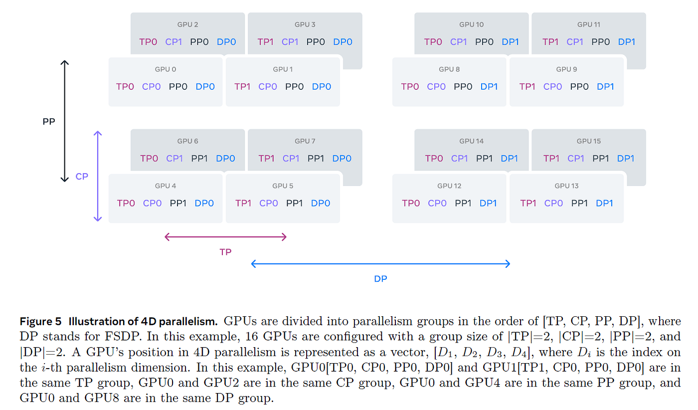

# 结语

恭喜你，亲爱的读者，你读到了最后！
我们完成了一段相当长的旅程：从探索如何在单张 GPU 上训练简单模型开始，一直到掌握在数千张 GPU 上高效训练 Llama-405B 和 DeepSeek-V3 等超大语言模型所用的各种复杂技术。
到现在，你已经可以（相对）轻松地读懂 Llama-3 的 4D 并行配置图：

协调大规模 GPU 集群高效训练 LLM 并不容易，但你已经学会如何优化计算以及 GPU 之间的通信，使它们始终以最高利用率运行。
正如你看到的，这包括为给定模型和集群规模选择正确的并行策略，尽可能重叠通信与计算，以及编写考虑硬件布局的自定义 kernel，让 GPU 尽可能快地执行操作。

你可能仍然觉得，这些知识有些小众，只与少数预训练 LLM 的人有关。
过去可能确实如此，但随着 [AI 构建者社区](https://huggingface.co)和模型规模迅速增长，使用分布式技术进行推理、微调和训练的人群也在指数增长，使分布式训练配置越来越常见。
因此，深入了解分布式的方方面面，可能正当其时。

这是一段漫长的学习旅程，而且不只是对你而言！
在 GPU 集群上运行数千次基准测试，比我们预期的更具挑战，因此我们也想分享一些自身学习经历中的重点。

## 接下来呢？

现在，你已经对主要分布式训练概念有了良好认识，但对于其中若干工具和技术，我们才刚刚触及表面。
深入特定主题有很多途径，下面是我们推荐的一些步骤：

- 仔细阅读一些里程碑式或很新的论文。
  在[参考资料](./references.md)中，可以找到我们所知最具影响力的论文、博客和书籍的广泛列表。
- 从零开始，自己实现一个算法。
  往往只有亲自实现之后，一种方法才会真正“想通”。
- 深入一个广泛使用的框架，并开始贡献：修复 bug、回答 issue，或实现新功能。
  这是进入任何机器学习领域的最佳方式！

希望本书能帮助你开始分布式训练，并让你伴随着 GPU 集群的嗡鸣，训练出下一代出色模型！
愿开源与开放科学的力量始终与你同在。

## 致谢

感谢 [Elie](https://huggingface.co/eliebak) 进行了全面审阅，并用 NotebookLM 制作音频组件。
特别感谢 [Hynek](https://huggingface.co/hynky) 优化前端性能。
也感谢 [Simon](https://huggingface.co/sbrandeis) 解决了 Hub 上的一些问题。

## 讨论页面

如果想讨论本书内容、提问、提出修改建议，或者只是打个招呼，请在[讨论页面](https://huggingface.co/spaces/nanotron/ultrascale-playbook/discussions)发起一个话题。
