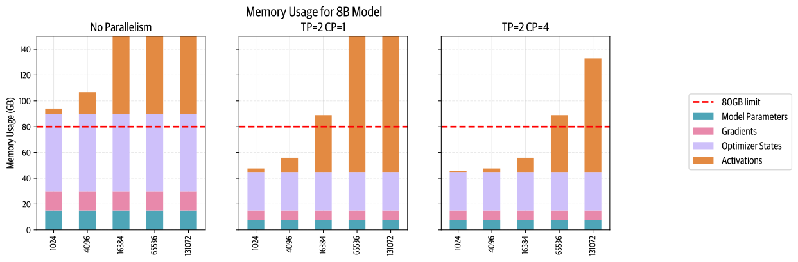
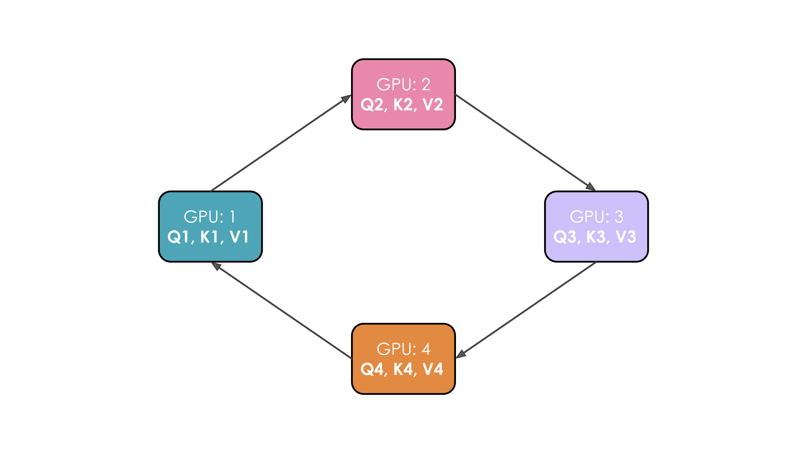
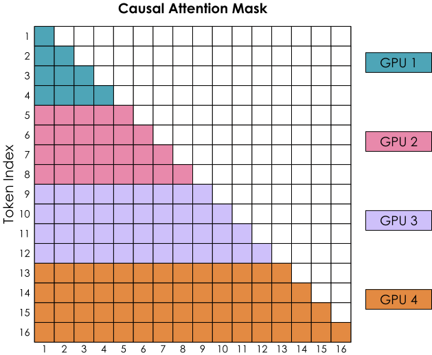
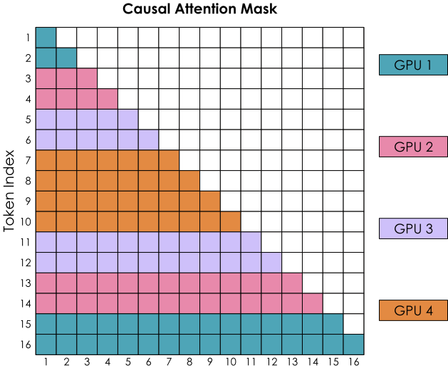
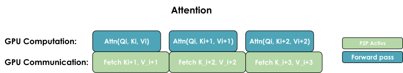

# 上下文并行

使用张量并行与序列并行后，由于模型权重和激活都被分布到各张 GPU 上，我们可以大幅降低每张 GPU 的显存需求。
不过，当我们使用越来越长的序列训练模型时（例如将每条序列扩展到 128k 或更多 token），仍然可能超出单个节点的可用显存，因为在 TP 区域内，我们仍然必须处理完整序列。

此外，即使完全重计算激活（这会带来约 30% 的高额计算开销），我们仍需要在显存中保留一些层边界处的激活，而这些激活会随序列长度线性增长。
我们来看看上下文并行（context parallelism，CP）能如何帮助我们：

上下文并行的核心思想与序列并行类似（即沿序列长度拆分），但这种方法应用于那些已经采用张量并行的模块。
因此，我们会沿两个维度拆分这些模块，从而也减小序列长度带来的影响。
在看过前面的内容之后，你应该会觉得这种方法相当直观，不过其中还有一个窍门，所以请保持注意力！

和序列并行一样，上下文并行也沿序列维度拆分输入，不过现在我们将这种拆分应用于整个模型，而不像先前的 TP+SP 那样，只应用于模型中的序列并行区域。

拆分序列不会影响 MLP 和 LayerNorm 等大多数模块，因为这些模块独立处理每个 token。
它也不需要像 TP 那样进行昂贵的通信，因为拆分的只是输入，而不是权重矩阵。
和数据并行一样，计算完梯度后，会启动一次 all-reduce 操作，在 CP 组内同步梯度。

不过，有一个重要的例外：我们需要格外“注意”注意力块（哈哈……这个双关是故意的 :D）。
在注意力模块中，每个 token 都需要访问序列中**所有**其他 token 的 key/value 对（或者，对于因果注意力，至少要关注此前的每个 token）。

由于上下文并行将输入沿序列维度拆分到各张 GPU 上，注意力模块就需要在 GPU 之间充分通信，以交换所需的 key/value 数据。

如果直接用朴素方法来做，听起来代价会很高。
有没有成本更低、速度更快的方法？
幸运的是，有一项核心技术可以让我们高效地处理 key/value 对的通信：**Ring Attention**。

> 📝 注记
>
> 上下文并行在概念上与本书稍后介绍的 FlashAttention 有一些相似之处：这两项技术都依靠在线 softmax 计算来减少显存占用。
> 不过，FlashAttention 侧重于优化单张 GPU 上的注意力计算本身，而上下文并行通过将序列分布到多张 GPU 上来减少显存占用。

## Ring Attention

在这种注意力机制实现中，每张 GPU 首先发起异步通信操作，将自己的 key/value 对发送给其他 GPU。
在等待其他 GPU 数据的同时，它会对显存中已有的那部分数据计算注意力分数。
理想情况下，来自另一张 GPU 的下一组 key/value 对会在这次计算结束前到达，使 GPU 在完成第一轮计算后，能够立即开始下一轮计算。

我们用一个例子来说明。
假设有四张 GPU，输入包含四个 token。
最初，输入序列沿序列维度均匀拆分，因此每张 GPU 只有一个 token 及其对应的 Q/K/V 值。
我们用 Q1、K1 和 V1 表示第一个 token 的 query、key 和 value，它们位于第一张 GPU 上。
注意力计算需要四个时间步才能完成。
在每个时间步，每张 GPU 依次执行以下三个操作：

1. 以非阻塞方式将当前的 key 和 value 发送到下一台机器（最后一个时间步除外），这样我们就可以在该操作完成前开始下一个操作。
2. 在本地使用当前的 key 和 value 计算注意力分数，通常涉及计算 $Softmax(\frac{QK^T}{\sqrt{d}}) * V$。
3. 等待接收前一张 GPU 的 key 和 value，然后回到步骤 1，此时当前的 key 和 value 就变成了刚刚接收到的 key/value。

我们将这三个步骤执行四次，完成注意力计算。

下面的动画展示了四张 GPU 上的整个过程：

从这个动画中，你大概已经明白作者为什么将这种方法称为 [Ring Attention](https://arxiv.org/abs/2310.01889) 了！

不过，这里有一个大问题：由于因果注意力矩阵的形状，朴素的 Ring Attention 实现会导致各张 GPU 之间严重不均衡。
我们结合带有因果注意力掩码的注意力分数矩阵，来看看 softmax 计算：

softmax 按行计算，这意味着每当某张 GPU 收到一行中的所有 token 后，就可以计算这一行。
我们可以看到，GPU 1 立刻就能计算，因为它最初就持有 token 1–4，不需要从其他 GPU 接收任何信息。
不过，GPU 2 必须等到第二轮收到 token 1–4，才拥有 token 1–8 的全部值。
GPU 1 的工作量看起来也比其他 GPU 少得多。

我们来看看能否更好地平衡计算。

## Zig-Zag Ring Attention——计算均衡的实现

我们需要一种更好的输入序列分配方式。
要做到这一点，可以不再严格按顺序将 token 分配给 GPU，而是稍微打乱顺序，让每张 GPU 上都混合有靠前和靠后的 token。
这种方法称为 Zig-Zag Attention。
在这种新安排中，注意力掩码会呈现均匀的计算分布；如果数一数着色方块的数量，就会发现现在所有 GPU 的计算都已均衡。

> 这里展示的是 Zig-Zag Attention，它与 [Striped Attention](https://arxiv.org/abs/2311.09431) 略有不同。
> 关于两者差异的详细说明，请参阅[这段 GitHub 讨论](https://github.com/zhuzilin/ring-flash-attention/issues/2#issuecomment-2236746166)。

你还会看到，为了完成所有行的计算，每张 GPU 都需要来自其他所有 GPU 的信息。

我们有两种让计算与通信重叠的通用方式：一种是执行一次通用的 all-gather，同时在每张 GPU 上汇集所有 key 和 value（类似 ZeRO-3 的方式）；另一种是按需在每张 GPU 上收集来自各张 GPU 的 key 和 value。

这两种实现的关键差异在于通信模式和显存占用：

**All-gather 实现：**

- 所有 GPU 同时从其他所有 GPU 收集完整的 key/value 对。
- 需要更多临时显存，因为每张 GPU 都需要一次性保存所有 K/V 对。
- 通信在一个步骤中完成，但显存开销更大。

**All-to-all（环形）实现：**

- GPU 以环形模式交换 K/V 对，每次交换一个块。
- 显存效率更高，因为每张 GPU 只需要临时多保存一个块。
- 通信被分散到多个步骤并与计算重叠，不过多次通信步骤也会带来一些额外的基础延迟开销。

all-to-all 方法通常以稍复杂的通信模式为代价，获得更高的显存效率；而 all-gather 方法更简单，但在注意力计算期间需要更多临时显存。

我们现在已经看到，可以使用 TP 在一个节点内拆分模型，以应对大模型，也可以使用 CP 应对长序列带来的激活显存急剧增长。

不过，我们仍然知道，TP 的跨节点扩展效果不好，那么如果一个节点无法轻松容纳模型权重，该怎么办？
我们的第四种并行方式——流水线并行——就要来救场了！
