# 数据并行

为了让阅读更有听播客的感觉，你可以边读边听 NotebookLM 主持人讨论本书接下来的几个章节。

数据并行（data parallelism，DP）的思路是，在多张 GPU 上复制模型（我们将这些副本称为“模型实例”），并在每张 GPU 上用不同的数据微批次并行执行前向和反向传播，因此得名*数据并行*。
你可能已经在简单的训练示例中见过数据并行，但本节会介绍得深入得多，因此即使你了解这种方法的大致思路，也请继续读下去。

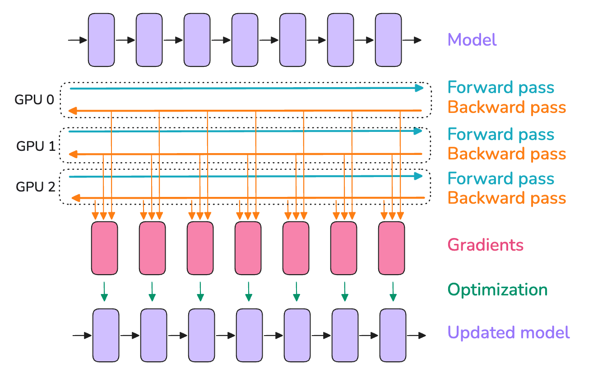

> 如果你不熟悉 broadcast、gather 和 all-reduce 等分布式通信模式，我们在 [“A0：并行编程速成课”](https://huggingface.co/spaces/nanotron/ultrascale-playbook?section=a0%3A_parallel_programming_crash_course)中准备了一份简短教程。

每张 GPU 使用不同的微批次，意味着每张 GPU 上的梯度不同，因此，为了让不同 GPU 上的模型实例保持同步，我们会使用一种称为“all-reduce”的操作，对各个模型实例的梯度取平均。
这一操作发生在反向传播期间、优化器更新之前。

这里涉及我们的第一个“分布式通信”原语——**all-reduce**，它负责 GPU 实例和节点之间的同步与通信。

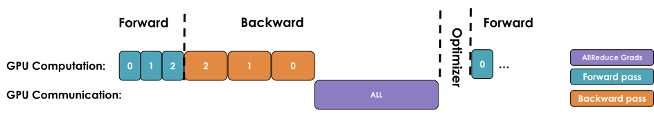

朴素的 DP 实现会等待反向传播完成、得到所有梯度之后，再触发覆盖所有 DP rank 的 all-reduce 来同步梯度。
但是，这种先计算再通信的串行步骤是**绝对不可取的**，因为我们不希望 GPU 在通信期间闲置，就像上图那样。

我们应该尽可能让通信与计算重叠，使两者同时进行。

我们来看看三种优化，它们能让我们比最初的朴素实现做得好得多。

## 第一项优化：让梯度同步与反向传播重叠

刚才介绍的朴素 DP 方法的主要缺点是，在反向传播（*计算*）之后，我们必须等待梯度同步（*通信*）完成，才能更新参数。
我们能让这部分通信与计算重叠吗？
答案是可以！

如上图所示，在更早层的梯度（左侧的粉色方框）尚未计算出来之前，就可以收集并求和某一层的梯度（粉色方框）。
例如，一旦最后一层的反向传播完成（最右侧的最后一个方框），就可以开始收集并求和这些梯度，同时反向计算继续向左进行，处理更早的层。

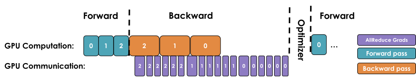

在 PyTorch 中，可以通过为每个参数附加一个 *all-reduce 钩子函数*来实现这一点。
这样，一旦某个参数的梯度准备好，就会触发一次 all-reduce 操作，而其他参数的梯度仍在计算。
这种方法让大部分 all-reduce 操作与梯度计算重叠，从而提高效率。
下面是一个用于附加钩子的简单函数：

```python
def register_backward_hook(self, hook):
    """
    Registers a backward hook for all parameters of the model that 
    require gradients.
    """
    for p in self.module.parameters():
        if p.requires_grad is True:
            p.register_post_accumulate_grad_hook(hook)
```

让计算与通信重叠，可以减少整个模型等待梯度同步的时间。
梯度同步可以在同一个训练步内与反向传播并行进行（至少部分如此），从而显著加快数据并行。
下面是一个带有同步重叠的朴素 DP 完整实现：

<details>
<summary>👉 Picotron 中带重叠的朴素 DP 实现（点击展开）</summary>

```python
class DataParallelNaive(nn.Module):
    """
    Naive Data Parallelism. Not used in practice. But it is a good starting point to understand how data parallelism works.
    It implements a simple all-reduce operation to synchronize gradients across multiple processes.
    And `no_sync` context manager to disable gradient synchronization.
    """
    def __init__(self, module):
        """
        Initializes the DataParallel wrapper for a given module.

        Args:
            module (nn.Module): The model to be wrapped for data parallelism.
            process_group (torch.distributed.ProcessGroup): The process group used for gradient synchronization. 
                                                            It could be a data parallel or context parallel group.
        """
        super().__init__()
        self.module = module
        self.require_backward_grad_sync = True # whether to synchronize gradients during backward pass. Set to False when using gradient accumulation
        self.register_backward_hook(self._allreduce_grads)
    
    def forward(self, *inputs, **kwargs):
        return self.module(*inputs, **kwargs)
    
    def register_backward_hook(self, hook):
        """
        Registers a backward hook for all parameters of the model that require gradients.    
        """
        for p in self.module.parameters():
            if p.requires_grad is True:
                p.register_hook(hook)
                
    def _allreduce_grads(self, grad):
        """
        Performs an all-reduce operation to synchronize gradients across multiple processes.    
        """
        # No synchronization needed during gradient accumulation, except at the final accumulation step.
        if self.require_backward_grad_sync:
            dist.all_reduce(grad, op=dist.ReduceOp.SUM, group=pgm.process_group_manager.cp_dp_group)
            grad /= pgm.process_group_manager.cp_dp_world_size
        return grad 
    
    @contextlib.contextmanager
    def no_sync(self):
        """
        A context manager to temporarily disable gradient synchronization. 
        This is useful for performing multiple backward passes during gradient accumulation without synchronizing 
        gradients in between.
        """
        self.require_backward_grad_sync = False
        yield
        self.require_backward_grad_sync = True
```

</details>

这是我们第一次看到计算与通信重叠这一概念，它是最大限度提高扩展效率的一项关键技术，本书还会多次讨论。
不过，我们还可以进一步提高效率！

## 第二项优化：梯度分桶

与对许多小张量执行大量操作相比，对大张量执行操作时，GPU 通常更高效。
通信操作也是如此。
因此，我们可以将梯度分组放入“桶”中，对同一个桶中的所有梯度启动一次 all-reduce，而不是为每个梯度分别执行独立的 all-reduce 操作，从中获得收益。
整体上看起来如下：

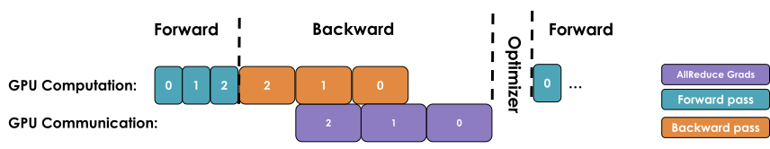

可以把它想象成发货前先将物品装箱。
发送几个大箱子比发送许多小箱子更高效。
通过对每个桶只执行一次 all-reduce 操作，我们可以显著降低通信开销，并加快通信操作。

下面是使用分桶的代码实现：

<details>
<summary>👉 Picotron 中的分桶 DP 实现（点击展开）</summary>

```python
class DataParallelBucket(nn.Module):
    """
    Data Parallelism with gradient grouped into buckets to reduce the communication overhead.
    """
    def __init__(self, module, bucket_cap_mb=25, grad_type = torch.float32):
        """
        Initialize the DataParallelBucket module.
        
        Args:
            module (nn.Module): The model to be parallelized.
            process_group: The process group for gradient synchronization, which can be either 
                           a data parallel group or a context parallel group.
            bucket_cap_mb (int, optional): The maximum size of each gradient synchronization bucket in megabytes. 
                                           Defaults to 25 MB.
            grad_type (torch.dtype, optional): The data type of gradients, defaulting to float32.
        """
        super().__init__()
        self.module = module
        self.require_backward_grad_sync = True # whether to synchronize gradients during backward pass. Set to False when using gradient accumulation
        grad_size = 2 if grad_type == torch.bfloat16 else 4 # float32 gradient: 4 bytes
        bucket_size = bucket_cap_mb * 1024 * 1024 // grad_size # number of gradients in one bucket
        self.bucket_manager = BucketManager(module.parameters(), pgm.process_group_manager.cp_dp_group, bucket_size, grad_type)
        self.register_backward_hook()
        self._post_backward_callback_set = False # whether the callback for wait gradient synchronization is set
        
    def forward(self, *inputs, **kwargs):
        return self.module(*inputs, **kwargs)

    def backward(self, input_tensor, output_tensor, output_tensor_grad):
        return self.module.backward(input_tensor, output_tensor, output_tensor_grad)
    
    def register_backward_hook(self):
        """
        Registers a backward hook to manually accumulate and synchronize gradients.
        
        This hook serves two main purposes:
        1. PyTorch does not natively support gradient accumulation with mixed precision.
        2. After gradient accumulation, it flags parameters as ready for synchronization.
        
        The gradient accumulation functions are stored to prevent them from going out of scope.
        
        References:
        - https://github.com/NVIDIA/Megatron-LM/issues/690
        - https://pytorch.org/docs/stable/generated/torch.autograd.graph.Node.register_hook.html
        - https://arxiv.org/abs/2006.15704 (page 5)
        """
        self.grad_accs = []
        for param in self.module.parameters():
            if param.requires_grad:
                # Expand so we get access to grad_fn.
                param_tmp = param.expand_as(param)
                # Get the gradient accumulator function.
                grad_acc_fn = param_tmp.grad_fn.next_functions[0][0]
                grad_acc_fn.register_hook(self._make_param_hook(param, self.bucket_manager))
                self.grad_accs.append(grad_acc_fn)
                
    def _make_param_hook(self, param: torch.nn.Parameter,bucket_manager: BucketManager):
        """
        Creates the a hook for each parameter to handle gradient accumulation and synchronization.
        """
        def param_hook(*unused):
            """
            The hook called after the gradient is ready. It performs the following:
            1. Accumulates the gradient into the main gradient.
            2. Adds a post-backward callback to wait for gradient synchronization completion.
            3. Marks the parameter as ready for synchronization.
            """
            if param.requires_grad:
                assert param.grad is not None
                param.main_grad.add_(param.grad.data) # accumulate the gradients
                param.grad = None
                
                # skip the gradient synchronization (gradient accumulation/PP micro batches)
                if self.require_backward_grad_sync:
                    # Add a callback to wait for gradient synchronization. Ensures the callback is added only once.
                    # Callback is executed after the backward pass. It should be added per backward pass.
                    if not self._post_backward_callback_set:
                        Variable._execution_engine.queue_callback(self._post_backward)
                        self._post_backward_callback_set = True
                        
                    # mark the parameter as ready for gradient synchronization. 
                    bucket_manager.mark_param_as_ready(param) 
        return param_hook
    
    @contextlib.contextmanager
    def no_sync(self):
        """A context manager to disable gradient synchronization."""
        self.require_backward_grad_sync = False
        yield
        self.require_backward_grad_sync = True
        
    def _post_backward(self):
        """
        A post-backward callback that waits for gradient synchronization to finish, then copies 
        the synchronized gradients back to the parameters' grad attribute.
        
        This method is called after the backward pass and before the optimizer step.
        """
        self.bucket_manager.wait()
        self._post_backward_callback_set = False
        # copy to params.grad so we can use the optimizer to update the parameters
        for p in self.module.parameters():
            if p.requires_grad:
                p.grad = p.main_grad.to(p.dtype) # In PyTorch, you cannot assign a gradient with one data type to a tensor of another data type.

    def reset(self):
        """
        Reset the bucket manager and zero out gradients in the model
        """
        self.bucket_manager.reset() 
```

</details>

## 第三项优化：与梯度累积的配合

最后，正如我们已经看到的，梯度累积是在用 `optimizer.step()` 更新参数之前，执行多次前向和反向传播。
将梯度累积与数据并行结合时，我们应该谨慎选择同步梯度的时机。

在朴素版本中，累积期间的每次反向传播之后，都会自动触发一次 all-reduce 操作。
这不是最优做法，因为只在最后一步之后进行一次归约，就能达到相同效果，同时降低开销。

在 PyTorch 中，通常通过为不需要归约的反向传播添加一个禁用梯度同步的 [`model.no_sync()`](https://github.com/pytorch/pytorch/blob/5ea67778619c31b13644914deef709199052ee55/torch/nn/parallel/distributed.py#L1408-L1435) 装饰器来解决这个问题。

> 📝 注记
>
> 执行通信操作时，张量必须在内存中连续存放，以避免多余的内存复制。
> 为了以最优方式做到这一点，我们通常会专门为通信预先分配连续缓冲区，其大小与激活或模型参数相同。
> 虽然这能加快通信，但它也构成了训练期间峰值显存占用的一部分。

现在，我们来看看这对全局批大小意味着什么。

## 重新审视全局批大小

我们可以用新加入的数据并行和梯度累积参数，更新批大小等式：

$$
bs = gbs = mbs \times grad\_acc  \times dp
$$

这里，$grad\_acc$ 是梯度累积步数，$dp$ 是用于数据并行的并行实例数量。

因此，在给定目标全局批大小的情况下，我们可以用数据并行进程替代梯度累积步骤，以加快训练。

实践中，人们倾向于尽可能增加数据并行规模（$dp$），而不是梯度累积步数（$grad\_acc$），因为数据并行本身就是并行的，而梯度累积具有串行性质。
当仅扩大数据并行仍不足以在用完 GPU 之前达到目标全局批大小时，再在数据并行之上加入梯度累积。

> 关于数据并行的进一步阅读，可以参考[这篇文章](https://siboehm.com/articles/22/data-parallel-training)。

能够将不同样本的训练分布开来，为我们提供了第一个并行维度，因此这是 1D 并行（我们还会逐步介绍另外四个维度）。

## 到目前为止的探索

我们用一份最优数据并行配置的初步方案，快速回顾如何搭建第一个 1D 并行训练：

1. 首先，通过查阅文献或运行测量模型收敛情况的实验，确定以 token 数计的最佳（全局）批大小。
2. 然后，同样通过查阅文献或运行实验，选择训练时的序列长度。
   通常，对于当前的评估基准，2–8k token 的效果稳定且良好（这里不深入讨论训练方案，但团队通常会在训练末期增加序列长度，混入一些更长上下文的数据样本，以达到如今的长上下文规模）。
3. 现在，我们已经知道批大小（$gbs$）。
   我们可以不断增大本地批大小，直到显存不足，从而找到单张 GPU 上的最大本地批大小（$mbs$）。
4. 最后，确定用于目标 $dp$ 的可用 GPU 数量。
   $gbs$ 与 $dp$ 的比值给出了达到目标 $gbs$ 还需要的梯度累积步数。

> 例如，DeepSeek 和 Llama 模型在主要预训练阶段使用 4k token 的序列长度。
>
> 2–8k token 适合预训练，是因为网上更长的文档非常少见。
> 详细分析可参阅 [Harm de Vries 的博客文章](https://www.harmdevries.com/post/context-length/)。

如果梯度累积比率小于 1，也就是说，我们的 GPU 太多、是 GPU 富豪了 🤑（！），那么可以选择不使用所有 GPU、尝试更大的 $gbs$，或者测试更小的 $mbs$ 是否能加快训练。
在后一种情况下，我们会优先考虑吞吐量，而不是单张 GPU 的计算效率，为了加快训练而使用小于可容纳上限的 $mbs$。

是时候看一个具体例子了。
假设我们想训练一个较新的模型，$gbs$ 为 4M token，序列长度为 4k。
那么，批大小就是 1,024 个样本（我们选择最接近的 2 的幂）。
假设我们观察到单张 GPU 的显存只能容纳 $mbs$=2，并且有 128 张 GPU 可用于训练。
这意味着，进行 4 次梯度累积，就能达到每个训练步处理 1,024 个样本或 4M token 的目标。
那么，如果我们突然有了 512 张可用 GPU 呢？
我们可以保持 $mbs$=2，将梯度累积步数设为 1，从而达到相同的 $gbs$，而且训练会更快！

> 📝 注记
>
> 请记住，在 512 张以上 GPU 的规模下，通信操作会开始受到*环形延迟*（信号绕环传播一周所需的时间）的限制，具体取决于所使用的网络，这意味着我们无法再完全重叠 DP 通信。
> 这会降低计算效率，并影响吞吐量。
> 在这种情况下，我们应该开始探索其他并行维度。

虽然数据并行很好地通过让 all-reduce 梯度同步与反向计算重叠来节省时间，但这种收益在大规模时会开始减弱。
为什么？
随着我们加入越来越多的 GPU（数百张或数千张），它们之间的协调开销会显著增加，而网络需求也开始相对于收益变得过高。
因此，每向系统中加入一张 GPU，配置的效率就会进一步降低。

我们可以通过一些基准测试，看到实践中的这一现象：

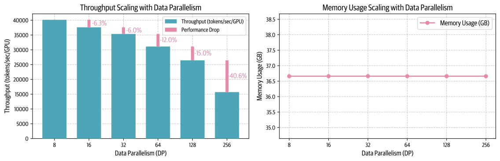

如图所示，超过某个限制后，吞吐量开始明显下降，而每张 GPU 的显存占用保持不变，不受新增 DP rank 的影响。

数据并行是我们将训练扩展到更多 GPU 的第一个（简单）策略。
这种技术的工作方式类似梯度累积，但将微批次上的前向和反向传播并行化，从而提高吞吐量。

不过，细心的读者可能已经注意到，这里假设 GPU 显存至少能够容纳一个输入样本的前向传播（$mbs$=1）。
情况并非总是如此！
正如我们看到的，更大的模型往往无法放入单张 GPU，即使启用激活重计算也不行：

> 提示：将参数量乘以 2，就能快速粗略估算模型参数所需的最小显存，例如 70B → 140 GB（= 133 GiB）。

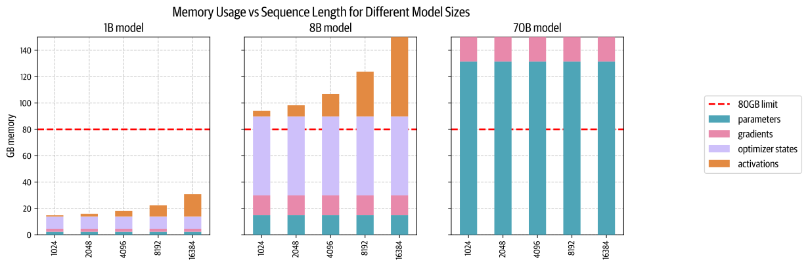

我们还看到，数据并行在超过一定扩展规模后，会出现一些限制其扩展的通信开销。
对于这些更大的模型或较大的批大小，我们还有其他选择吗？
幸运的是，我们确实有一些解决方案：将某些张量移到 CPU，或者将权重、梯度和优化器状态张量拆分到多张 GPU 上。

拆分主要有两种方式：并行（张量并行、上下文并行或流水线并行）和分片（DeepSpeed ZeRO 或 PyTorch FSDP）。
这两种方式在一定程度上相互正交，实际上可以结合使用！

分片范式与 DP 密切相关，因此我们先通过研究 ZeRO 方法来了解它。

## 零冗余优化器（ZeRO）

本节将介绍 DeepSpeed ZeRO，这是一项旨在减少 LLM 训练中显存冗余的显存优化技术。

虽然数据并行是扩展训练的一种高效方式，但在每个 DP rank 上朴素地复制优化器状态、梯度和参数，会引入大量显存冗余。
ZeRO 通过沿数据并行维度划分优化器状态、梯度和参数来消除这些冗余，同时仍允许使用完整参数集进行计算。
这有时需要在 DP rank 之间进行更多通信，而这些通信可能能够完全重叠，也可能不能，接下来我们会看到！

> 本书将重点介绍 ZeRO-1 到 ZeRO-3，因为这应该能让我们全面了解这项技术如何减少显存占用，同时展示需要考虑的权衡。
> 关于更多 ZeRO 变体的详细信息，可以参阅 [DeepSpeed 文档](https://www.deepspeed.ai/tutorials/zero/)。

这种方法分为三个可选的优化阶段：

- ZeRO-1：优化器状态划分。
- ZeRO-2：优化器状态与梯度划分。
- ZeRO-3：优化器状态、梯度与参数划分。

> 这里所说的“划分”是沿 DP 轴进行的，因为 ZeRO 是一种数据并行方法。
> 后面我们会看到，也可以沿其他轴进行划分。

你可能已经注意到，可以分片的对象列表中没有激活。
由于模型的每个 DP 副本接收不同的微批次，各个 DP rank 上的激活也不同，所以它们并非重复数据，因此无法分片！

我们进一步看看，每个 ZeRO 阶段的划分能节省多少显存。

### 重新审视显存占用

[前文](https://huggingface.co/spaces/nanotron/ultrascale-playbook?section=memory_usage_in_transformers)讨论了标准训练中优化器状态、梯度和参数的显存占用。
我们将模型的参数量记为 $\Psi$（之前记为 $N$，但这里使用 [ZeRO 原论文](https://arxiv.org/abs/1910.02054)的符号）。
在使用 Adam 优化器的混合精度训练中（本书[后文](https://huggingface.co/spaces/nanotron/ultrascale-playbook?section=mixed_precision_training)会进一步讨论），需要保存的各项内容的显存占用为：

- 模型参数（半精度，即 BF16/FP16）：$2\Psi$。
- 模型梯度（半精度，即 BF16/FP16）：$2\Psi$。
- FP32 模型参数与优化器状态：$4\Psi + (4\Psi + 4\Psi)$。
- FP32 模型梯度：$4\Psi$（可选，仅在我们希望用 FP32 累积梯度时计入）。

如果不使用 FP32 累积梯度，总显存占用就是 $2\Psi + 2\Psi + 12\Psi$；如果使用，则是 $2\Psi + 6\Psi + 12\Psi$。
为简单起见，我们暂时重点讨论不使用 FP32 梯度累积的情况。

ZeRO 的思路是将这些对象分片到各个 DP rank 上，每个节点只保存其中的一部分。
然后，在需要时重建这些分片，从而将显存占用除以数据并行度 $N_d$：

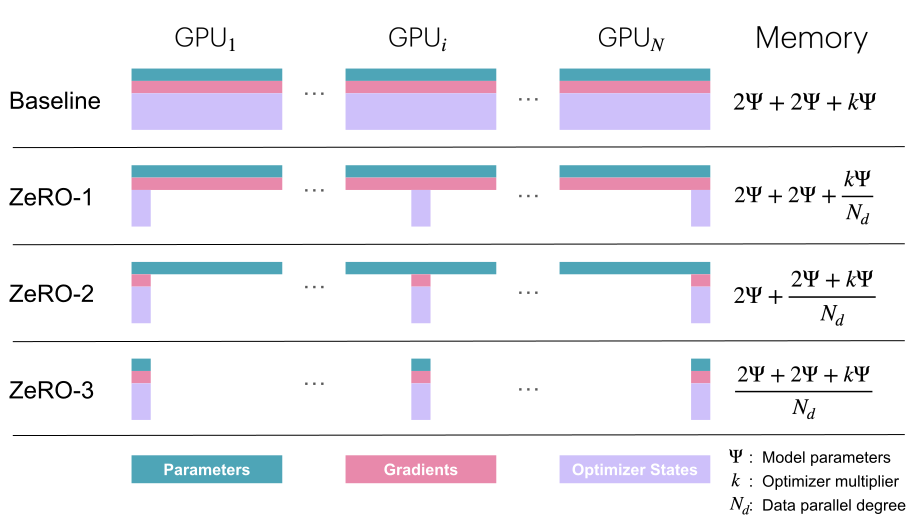

这里，$\Psi$ 表示参数量，$k$ 表示优化器状态的显存倍数（正如刚才看到的，Adam 对应 $k=12$），$N_d$ 表示 DP 度。

> 如果在 ZeRO-2 或 ZeRO-3 中使用 FP32 梯度累积，就需要在梯度项上额外加上 $\frac{4\Psi}{N_d}$。

我们通过探究每个 ZeRO 阶段的工作原理，来解释这一点。
先从 ZeRO-1 开始。

### ZeRO-1：划分优化器状态

在原始 DP 中，反向传播后所有 rank 都会收集到相同的梯度，并同时执行相同的优化器更新。
这看起来有很多重复工作。
我们能否在避免这些重复工作的同时，减少显存占用？

在 ZeRO-1 中，优化器状态被划分为 $N_d$ 个大小相等的部分，其中 $N_d$ 是 DP 度。
这意味着，分布在各个 DP rank 上的模型副本各自只跟踪 $\frac{1}{N_d}$ 的优化器状态，并且在优化步骤中，只更新 $\frac{1}{N_d}$ 的 FP32 权重。

不过，在前向传播期间，每个副本都需要全部参数。
因此，我们需要在优化器更新之后额外加入一次 **all-gather**（我们遇到的第二种集合通信原语！），让每个模型副本都拥有更新后的完整权重集。

这就解释了前图中 $2\Psi + 2\Psi + \frac{k\Psi}{N_d}$ 这一显存公式！
下面概述单个训练步的操作顺序：

1. 每个副本使用相同的完整 BF16 参数集执行前向传播，但各个副本使用不同的微批次。
2. 每个副本使用相同的完整梯度集执行反向传播，但各个副本使用不同的微批次。
3. 对梯度执行 **reduce-scatter**（又一种原语，我们很快会解释）。
4. 每个副本对本地优化器状态（仅占全部优化器状态的 $\frac{1}{N_d}$）执行一次优化器更新，得到更新后的 $\frac{1}{N_d}$ 的 FP32 参数，再将它们转换为完整 BF16 参数集的 $\frac{1}{N_d}$。
5. 对 BF16 参数执行一次 all-gather，将缺失的分片传回每个副本。
   这是 ZeRO 中的新操作，原始 DP 中并不使用。

> 注：reduce-scatter 的速度是 all-reduce 的两倍！
> *太好了，第三种通信原语！*

你可能想知道“reduce-scatter”操作是什么，以及整个过程是什么样子，所以我们试着用下图更直观地展示它。
我们会遍历一轮前向/反向传播周期的全部步骤：

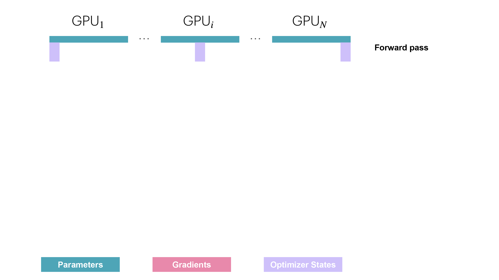

从实际通信来看，与原始 DP 相比，ZeRO-1 将梯度通信从 all-reduce 改为 reduce-scatter，并在优化器更新后加入一次覆盖所有参数的 all-gather。
具体如下：

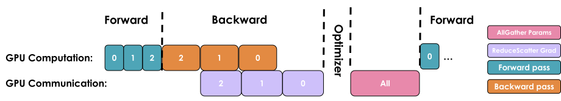

如果你一直跟着读，就会记得，在讨论原始 DP 时，我们提到可以让 all-reduce 梯度通信与反向传播计算重叠。
在 ZeRO-1 中，我们也可以研究如何高效地重叠新加入的 BF16 参数 all-gather。
主要有两种策略：

- **在优化器更新期间：**优化器更新完第一片参数后，就立即启动 all-gather。
  这样，通信就有可能与其他参数的更新重叠。
- **在前向传播期间：**让每一层参数的 all-gather 与前向传播重叠。

> 📝 注记
>
> 遗憾的是，这些技术实现起来并不简单，需要复杂地运用钩子和分桶。
> 实践中，我们可以直接使用 PyTorch 原生的 ZeRO-3/FSDP 实现，并将 `FSDPUnit` 设为整个模型（后面会详细介绍）。

在 ZeRO-1 中，优化器状态已经划分，因此每个副本只更新 $\frac{1}{N_d}$ 的状态。
细心的读者可能已经注意到，实际上没有必要让所有 DP rank 都拥有全部梯度，因为优化步骤只需要其中的一个子集。
ZeRO-2 登场！

### ZeRO-2：加入梯度划分

由于每个副本只需要与其优化器状态分片对应的梯度分片，像优化器状态一样对梯度也进行分片是合理的。
这样，在反向传播期间，我们就只需执行一次 reduce-scatter 操作，而不是对梯度执行 all-reduce！
这里，我们只在显存中保存所需的 $\frac{1}{N_d}$ 的梯度，因此比 ZeRO-1 更节省显存。

> 使用 FP32 梯度累积时，我们只需要保留 $\frac{1}{N_d}$ 的 FP32 梯度，用于累积 reduce-scatter 得到的 BF16 梯度。
> 在优化器更新中，这些 $\frac{1}{N_d}$ 的 FP32 梯度用于更新优化器状态的本地分片。


现在很容易看出，对梯度分片会得到 $2\Psi + \frac{2\Psi+k\Psi}{N_d}$，而随着 $N_d$ 增大，我们的显存用量最多可以降到基线的八分之一。
从通信来看，过程与 ZeRO-1 相同，唯一的区别是我们在通信过程中即时释放显存：两者都需要对梯度执行 reduce-scatter，并对全部参数执行 all-gather。
因此，在通信方面，ZeRO-2 也与原始 DP 训练等价。


> 注：你可能会发现，除了实现复杂度之外，使用 ZeRO-2 相比 ZeRO-1 并没有真正的额外开销，事实上，ZeRO-2 通常是更好的选择。

现在我们也对梯度进行了分片，就到此为止了吗，还是可以继续改进？
ZeRO-3 来了！

### ZeRO-3：加入参数划分（FSDP）

在阶段 3 中，我们将上述在 DP 副本之间对优化器状态和梯度分片的方法，扩展到模型参数的分片。

> 📝 注记
>
> PyTorch 对这一阶段的原生实现称为 FSDP（Fully Sharded Data Parallelism，全分片数据并行）。
> 本书中我们统一称它为 ZeRO-3，但你看到这个名字时，也可以将其理解为 FSDP。

那么，如果模型参数是分布存放的，实际该如何执行前向或反向传播？
很简单，需要时按需收集即可。
前向传播如下：

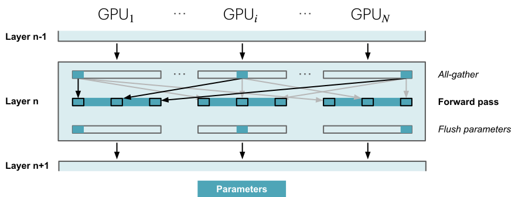

在执行前向传播、依次经过各层时，我们按需获取必要参数，并在不再需要时立即将它们从显存中清除。
反向传播也以相同方式工作，只是流程方向相反。
这里，我们生成梯度分片：

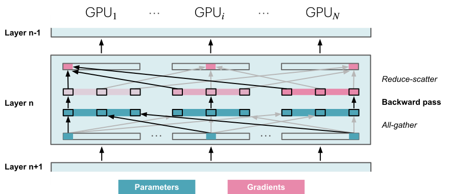

另一个问题是，在一个训练步的整个前向和反向传播期间，我们都需要持续执行这些 all-gather；与 ZeRO-2 相比，这相当于每个训练步额外执行 $2\cdot \text{num\_layers} -1$ 次 all-gather。
每次都会带来少量*基础延迟*开销，如下图所示：

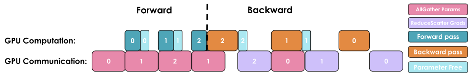

在前向传播期间，我们在需要参数时对其执行 all-gather，因此有 $\Psi$ 的通信代价。
由于前向传播中使用参数后就立即丢弃它们，反向传播期间还需要再次 all-gather，因此又产生 $\Psi$ 的通信代价。
最后，我们需要像 ZeRO-2 一样对梯度执行 reduce-scatter，这也需要 $\Psi$ 的通信量。
因此，总通信成本为 $3\Psi$，而 ZeRO-2 为 $2\Psi$。

这听起来可能有很多通信开销，但实际上问题不大，因为我们可以让下一层参数的通信与当前层的前向传播重叠，这称为**预取（prefetching）**。
使用预取时，我们在执行*第 n 层*的前向传播时，对*第 n+1 层*的权重进行 all-gather；类似地，在执行*第 n 层*的反向传播时，对*第 n-1 层*的权重进行 all-gather。
当然，只有 DP 规模没有扩大得过多时，这种重叠才有效（经验上，DP 不应超过 512）。

> 注：我们用“DP”同时指数据并行技术，以及用于数据并行的 GPU 数量（*DP = DP 规模 = DP 度*）。

从显存来看，等式现在已经达到最终形式 $\frac{2\Psi +2\Psi+k\Psi}{N_d}$，这意味着只要能增加 DP 规模，理论上就能无限降低显存占用，至少对于与模型相关的参数是如此。
不过，它对中间激活没有帮助；对于中间激活，我们可以使用前面介绍的激活检查点和梯度累积。

我们来总结一下目前对 DP 和 ZeRO 的探索。
我们已经看到，只需增加模型副本，就可以利用 DP 扩展训练，大幅提高训练吞吐量。
借助 ZeRO，我们可以将参数、梯度和优化器状态分片到各个 DP 副本上，以少量通信成本为代价，训练通常无法放入单张 GPU 的模型。

> 如果你想进一步了解 FSDP1、FSDP2 及其实现中的一些复杂之处，可以看看[这篇不错的博客](https://christianjmills.com/posts/mastering-llms-course-notes/conference-talk-012/)。

不过，这里还有一些限制：只有当模型的一层能放入单张 GPU 时，DP 才能工作，而且 ZeRO 只能划分参数、梯度和优化器状态，不能划分激活显存！
回顾[关于激活显存的讨论](https://huggingface.co/spaces/nanotron/ultrascale-playbook?section=memory_usage_in_transformers)，这部分显存会随序列长度和批大小增长。
我们可以直接限制两者，但实践中，我们不希望因为硬件限制而只能使用较短的序列长度训练。

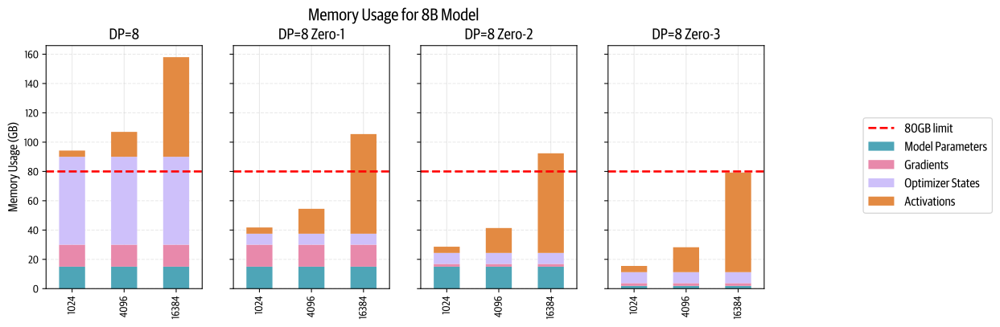

为了克服这一问题，是时候研究一个新的、正交的并行轴——**张量并行（TP）**了。
与依赖大量参数通信的 ZeRO-3 不同，TP 提议跨设备对参数、梯度、优化器状态**以及激活**进行分片，而且 GPU 之间不需要进行任何模型参数通信。

什么？
这怎么可能？！
我们一起探索这种看似神奇的方法吧。🙂
