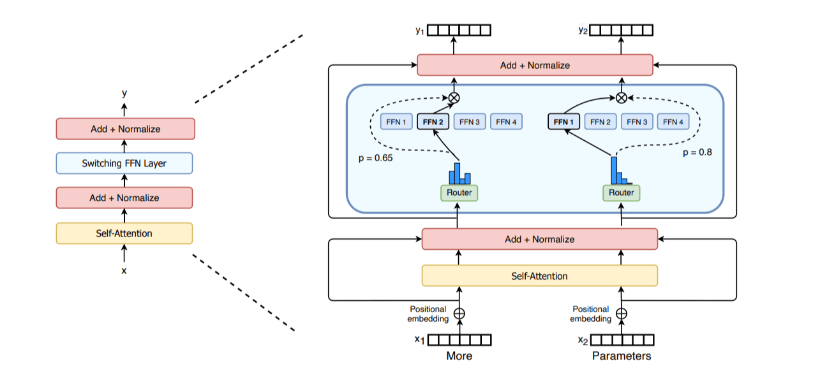
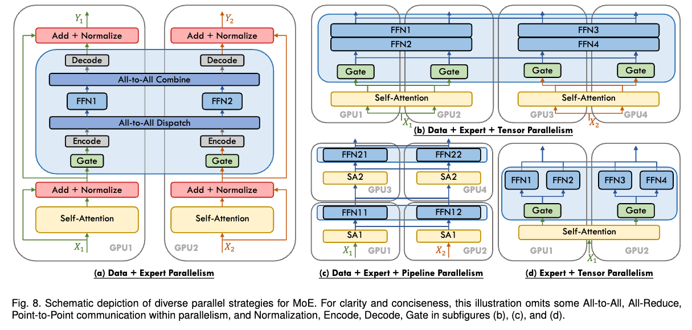

# 专家并行

这是我们将讨论的最后一种并行方法。
在介绍之前，如果你从未接触过混合专家（Mixture of Experts，MoE）模型，可以先花些时间阅读我们之前发布的[这篇短得多的博客文章](https://huggingface.co/blog/moe)，它应该能帮助你更好地理解 MoE 架构的总体思路。

最近，随着 GPT-4、[Mixtral](https://arxiv.org/abs/2401.04088) 和 DeepSeek-V3/R1 等模型的出现，混合专家范式获得了更多关注和知名度。
其基本思路是，每层不再只有一个前馈模块，而是可以有多个并行模块，并将 token 路由到这些模块中，以不同方式处理。

MoE 层示意图，取自 [Switch Transformers 论文](https://arxiv.org/abs/2101.03961)。

MoE 层的设计使沿专家维度实现并行变得容易，我们将其称为*专家并行（expert parallelism，EP）*。
由于前馈层完全独立，我们可以直接将每个专家的前馈层放在不同的工作进程上。
与 TP 相比，这种方法轻量得多，因为不需要拆分矩阵乘法，只需将 token 的隐藏状态路由到正确的专家。

实践中，EP 通常与其他并行形式（例如数据并行）配合使用。
这是因为，EP 只影响 MoE 层，并不对输入 token 分片（而上下文并行会沿序列长度维度对 token 分片）。
这意味着，如果只使用 EP，GPU 就会对所有非 MoE 块执行冗余计算。
将 EP 与 DP 结合后，就能高效地在 GPU 之间同时对专家和输入批次进行分片，如下面的简化示意图所示：

来源：[“A Survey on Mixture of Experts”](https://arxiv.org/abs/2407.06204)。

不过，我们先别讲得太超前，下一节会讨论不同并行策略之间的全部相互作用，因此，如果你还没理解最后这张图，也不必担心。

实践中，要让 EP 高效工作，还有一些技巧，它们与模型设计密切相关。
例如，DeepSeek-V3 在路由器中施加约束，确保每个 token 最多发送到 $M$ 个节点（在他们的情况下为 4），以将 token 保留在单个节点上，并减少通信开销。
虽然专家并行[已经存在一段时间](https://arxiv.org/abs/2006.16668)，但随着 MoE 架构变得流行，它最近才重新受到关注。

我们计划很快在 Picotron/Nanotron 中加入更完整的 EP 示例，敬请期待！
