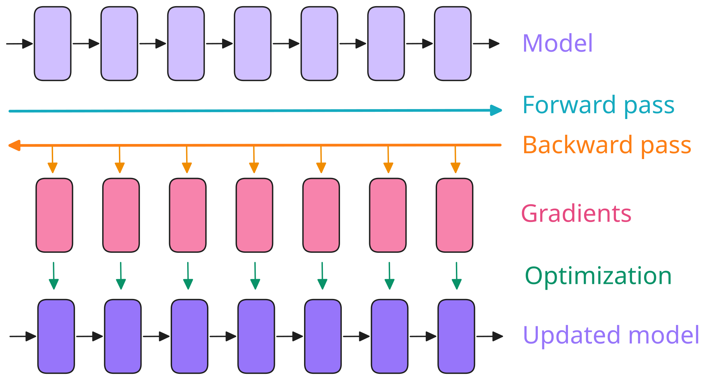
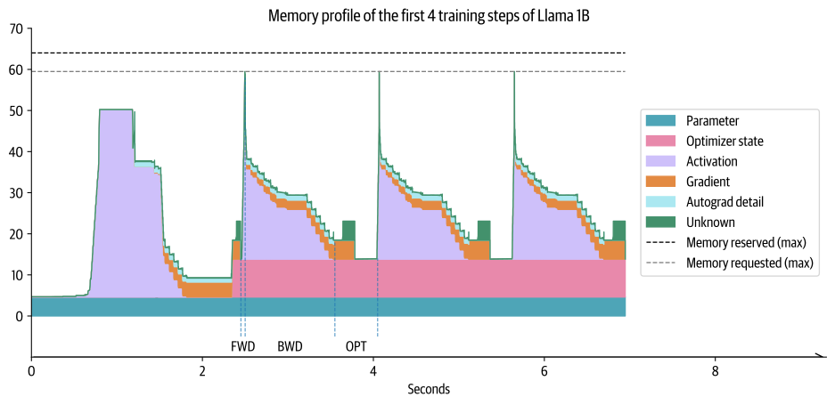
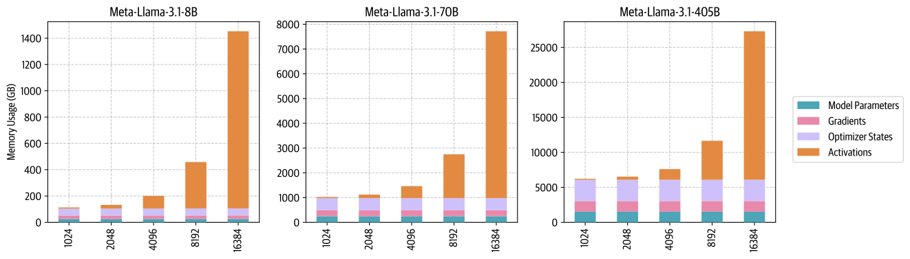
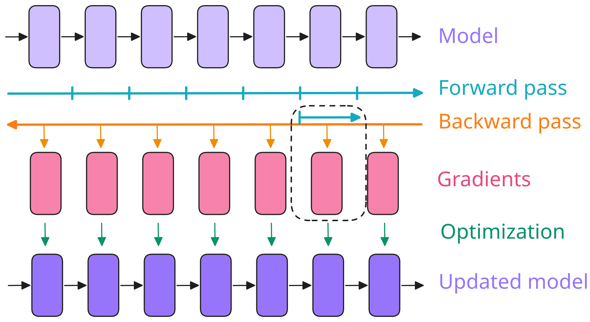
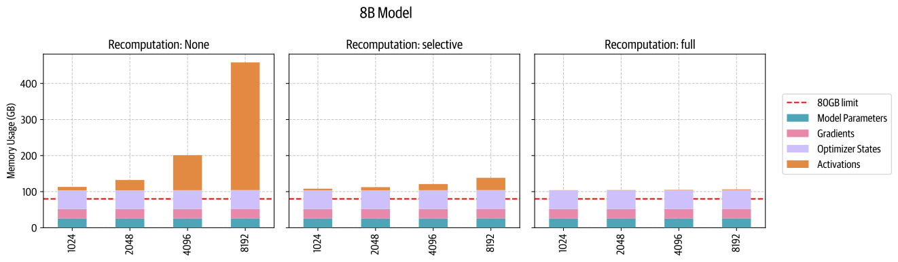
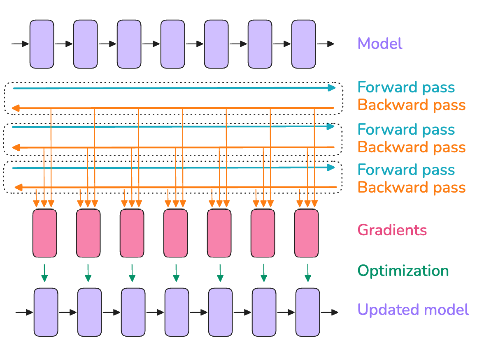
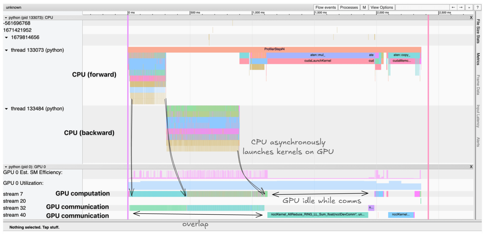

# 起步：在单张 GPU 上训练

如果你想让阅读更有听播客的感觉，可以边读边听 NotebookLM 主持人讨论本书最前面的几个章节。

在开始扩展到多张 GPU 之前，我们先快速回顾模型训练最基础的内容。
在单张 GPU 上训练模型时，训练通常包括三个步骤：

1. 前向传播：将输入送入模型，得到输出。
2. 反向传播：计算梯度。
3. 优化步骤：使用梯度更新参数。

> 正如后面会看到的，这些步骤可能会重复或交错进行，但现在我们先从简单情况开始。

整体上看起来如下：



[将指针悬停在网络元素上，查看详细信息。](https://huggingface.co/spaces/nanotron/ultrascale-playbook?section=svg-first_steps_simple_training)

在这张图中，最上面一行的方框可以看作模型内部连续的各层（最后一行也一样）。
粉色方框是这些层对应的梯度，在反向传播期间计算。

**批大小（batch size）**（$bs$）是模型训练的重要超参数之一；它同时影响模型收敛和吞吐量。

训练初期，较小的批大小有助于快速穿过训练地形，到达最佳学习点。
不过，在模型训练的后期，较小的批大小会让梯度持续带有噪声，模型可能无法收敛到最优的最终性能。
另一个极端是，较大的批大小虽然能够提供非常准确的梯度估计，但往往无法充分利用每个训练 token，使收敛变慢，并可能浪费计算资源。
关于这个问题的早期讨论，可以参阅 OpenAI 关于大批次训练的[论文](https://arxiv.org/abs/1812.06162)，或 MiniMax-01 [技术报告](https://filecdn.minimax.chat/_Arxiv_MiniMax_01_Report.pdf)的 4.2 节。

> 例如，在 DeepSeek-V3/R1 的[训练](https://arxiv.org/abs/2412.19437)中，批大小在前 469B token 的训练期间从 3,072 条输入序列逐步增加到 15,360 条，随后在剩余训练中保持为 15,360 个输入样本。

批大小还会影响在给定文本数据集上训练所需的时间：训练相同数量的样本时，较小的批大小需要更多次优化器更新。
优化器更新的计算时间成本较高，因此，与使用更大的批大小相比，总训练时间会增加。
不过，批大小通常可以在最优值附近进行相当大幅度的调整，而不会对模型性能产生重大影响；也就是说，在最优批大小附近，模型最终性能对批大小精确取值的敏感性通常较低。

在 LLM 预训练领域，批大小通常用 token 数而不是样本数来报告（$bst$ = 以 token 数计的批大小）。
这使训练的数值通常不依赖训练时使用的具体输入序列长度。

在最简单的单机训练情况下，可以根据模型输入序列长度（$seq$），按下面的方式计算 $bs$（以样本数计）和 $bst$：

$$
bst=bs *seq
$$

从这里开始，我们将用样本数表示批大小公式，但只要乘以序列长度，就总能得到对应的 token 数单位。

近期 LLM 训练的合适批大小通常在每批 400 万至 6,000 万 token 的数量级。
这些年来，批大小和训练语料规模一直在增长：Llama 1 以约 4M token 的批大小训练了 1.4 万亿 token，而 DeepSeek 以约 60M token 的批大小训练了 14 万亿 token。

当我们将模型训练扩展到这些大批大小时，就会遇到第一个挑战：**显存不足（out-of-memory，OOM）问题**。
当 GPU 没有足够显存容纳目标批大小的完整批次时，我们该怎么办？

我们先来探究，究竟是什么导致了 OOM 问题。
这将帮助我们对模型训练的显存需求建立一些有用的直觉。

## Transformer 中的显存占用

训练神经网络模型时，我们会在显存中保存以下几项内容：

- 模型权重。
- 模型梯度。
- 优化器状态。
- 计算梯度所需的激活。

> 📝 注记
>
> 你可能以为可以精确计算模型的显存需求，但还有一些额外占用，使精确计算变得困难：
>
> - CUDA kernel 通常需要 1–2 GB GPU 显存，你可以运行 `import torch; torch.ones((1, 1)).to("cuda")`，然后用 `nvidia-smi` 查看 GPU 显存，快速验证这一点。
> - 部分显存用于缓冲区和中间结果，还有一些显存因为碎片化而无法使用。
>
> 我们将忽略最后这两项，因为它们通常是较小的常数因素。

这些内容以张量形式保存，张量有不同的形状和精度。
*形状*由批大小、序列长度、模型隐藏维度、注意力头数、词表大小，以及可能采用的模型分片等超参数决定，后面我们会看到。
*精度*指 FP32、BF16 或 FP8 等格式，保存张量中的每个数值分别需要 4、2 或 1 字节。
我们将在[“混合精度训练”](./gpu-optimization.md#混合精度训练)一节完整讨论不同精度及其权衡；现在，只需记住不同格式的显存需求不同，这会影响我们需要保存的各项内容的显存占用。

那么，怎样才能根据这些变量快速确定显存占用？
一种简单的方法是通过实验，直接测量。

### 剖析显存占用

使用 PyTorch profiler，我们可以了解训练过程中显存如何分配。
我们可以看到，显存利用情况并非静态，而是在训练期间、以及一个训练步内部都有很大变化：

> 关于如何剖析模型，可以参阅 [“A1：分布式训练性能剖析”](./appendix.md#a1-分布式训练性能剖析)。



第一个训练步显然与后续训练步很不一样，但在解释之前，我们先看看一个训练步的总体组成。
首先，随着前向传播进行，激活迅速增加；接着，在反向传播期间，梯度逐步积累，而随着反向传播推进，之前保存的、用于计算梯度的激活被逐步清除。
最后，我们执行优化，此时需要全部梯度，然后更新优化器状态，再开始下一次前向传播。

如前所述，第一个训练步看起来不同：激活迅速增加，然后会保持一段时间的平台。
为什么？
在第一个训练步中，PyTorch 缓存分配器会做大量准备工作，预先准备显存分配，使后续训练步无需搜索空闲显存块，从而加快执行（见 [Zach 的博客](https://zdevito.github.io/2022/08/04/cuda-caching-allocator.html)）。
在第一个训练步之后，我们还会看到优化器状态出现，这通常会整体抬高后续训练步的显存占用。

> 你有没有注意到，有时第一个训练步成功了，但后续训练步却发生 OOM？
> 这可以用第一个训练步之后优化器状态的建立来解释。

现在，我们已经对显存有了初步认识，接下来看看，扩展训练通常就是在 GPU 显存约束内控制激活、参数、梯度和优化器状态等各项内容的显存需求，同时最大限度提高计算效率。

### 权重、梯度和优化器状态的显存占用

我们先从列表中的前三项开始：模型权重、梯度和优化器状态。
实际上，我们可以很容易地估算它们所需的显存。

对于一个简单的 Transformer LLM，参数量由[下面的公式](https://michaelwornow.net/2024/01/18/counting-params-in-transformer)给出：

$$
N = h * v + L * (12 * h^2 + 13 * h) + 2*h
$$

> 我们没有计入位置嵌入，因为我们不使用固定位置嵌入。

在这个等式中，$h$ 是隐藏维度，$v$ 是词表大小，$L$ 是模型层数。
从等式可以看出，当隐藏维度很大时，占主导的是 $h^2$ 项，因为在扩大参数规模时，只有这一项呈二次增长。

参数和梯度的显存需求，只需将参数量乘以每个参数的字节数即可确定。
在传统的全精度（FP32）训练中，参数和梯度都需要 4 字节；如果使用 Adam，优化器还需要保存动量和方差，每个参数额外增加 8 字节（各 4 字节）。
汇总如下：

$$
\begin{aligned}
& m_{params} = 4 * N \\
& m_{grad} = 4 * N \\
& m_{opt} = (4+4) * N
\end{aligned}
$$

现在，我们来看看使用更低精度时，情况会怎样变化。
出于稳定性考虑（见本书后文的[混合精度训练](./gpu-optimization.md#混合精度训练)一节），我们通常不会完全使用低精度训练，而是混合使用较高和较低的精度，称为[“混合精度”](https://arxiv.org/abs/1710.03740)。
如今，混合精度训练一般默认使用 BF16 进行大部分计算，每个参数和梯度各需 2 字节，同时额外保存一份 FP32 模型权重和梯度副本，使每个参数总共需要 12 字节。
除了参数和梯度，我们还需要保存优化器状态；对于 Adam 优化器，这包括动量和方差，通常为了数值稳定性而用 FP32 保存，各占 4 字节。

> 后面介绍 ZeRO 方法时，你会看到更多细节。

汇总如下：

$$
\begin{aligned}
& m_{params} = 2 * N \\
& m_{grad} = 2 * N \\
& m_{params\_fp32} = 4 * N \\
& m_{opt} = (4+4) * N
\end{aligned}
$$

> 📝 注记
>
> 一些库用 FP32 保存梯度，这需要额外 $m_{params\_fp32} = 4 * N$ 的显存。
> 例如，Nanotron 就这样做，因为 BF16 对较小的数值会损失精度，而我们始终优先考虑稳定性。
> 更多信息可参阅[这个 DeepSpeed issue](https://github.com/microsoft/DeepSpeed/issues/1773)。

> 📝 注记
>
> 参数的 FP32 副本（$m_{params\_fp32}$）在文献和代码库中有时称为“主权重”（master weights）。

有意思的是，混合精度训练本身并不节省显存，只是将显存以不同方式分配到三个组成部分中；实际上，如果用 FP32 累积梯度，相比全精度训练还会额外增加 4 字节。
不过，它仍然有优势，因为用半精度进行前向和反向传播，既能使用 GPU 上更快的优化低精度运算，也能减少前向传播期间的激活显存需求，而正如前图所示，激活占据了很大一部分显存。

我们来大致了解，一个模型需要多少显存（全精度与混合精度的总体数值相同）：

| 模型参数量 | FP32，或不使用 FP32 梯度累积的 BF16 | 使用 FP32 梯度累积的 BF16 |
|---|---|---|
| 1B | 16 GB | 20 GB |
| 7B | 112 GB | 140 GB |
| 70B | 1120 GB | 1400 GB |
| 405B | 6480 GB | 8100 GB |

> 用 FP8 训练代替 BF16 可以进一步减少显存占用，但稳定性较差。
> 这是一个非常活跃的研究主题（见[这条推文](https://x.com/xariusrke/status/1826669126955278401)），后面我们会更详细地介绍。

可以看到，只要达到 **7B**（！），权重、梯度和优化器状态的显存需求就已经相当可观，并超过典型 GPU 的显存容量（例如 H100 GPU 为 80 GB）。

不过，现在我们先继续考虑能够放入单张 GPU 的模型，看看显存预算中的最后一项主要来源：激活。

### 激活的显存占用

激活的显存需求比权重、梯度和优化器状态更难计算，部分原因是它依赖模型输入。
如果你不确定为什么反向传播还需要保存激活，[这篇博客文章](https://www.determined.ai/blog/act-mem-2)可以帮助你快速回顾。
仔细检查反向传播的计算方式后，我们就能估算混合精度下激活所需的总显存。
得到如下等式：

$$
m_{act} = L \cdot seq \cdot bs \cdot h \cdot (34 + \frac{5 \cdot n_{heads} \cdot seq}{h})
$$

这里，$L$ 是层数，$seq$ 是序列长度，$bs$ 是以样本数计的批大小，$h$ 是模型隐藏维度，$n_{heads}$ 是头数。

关于这些数值的精确推导，可以参阅 NVIDIA 关于重计算的原始[论文](https://arxiv.org/abs/2205.05198)；本质上，它需要统计 Transformer 层中每次操作之间所有中间激活的大小。

这里有一个有意思的现象：对于给定模型，显存占用并非静态，而是随批大小线性增长、随序列长度二次增长。
这意味着，激活显存是在增加批大小或使用更长序列训练时会急剧增长的部分。
我们可以用这个等式观察不同序列长度下的显存占用变化，例如 Llama 模型（`bs=1`）：



这些图展示了一个鲜明的现象：对于较短的序列（或较小的批大小），激活显存占用几乎可以忽略，但从大约 2–4k token 开始，它就会占用大量显存；而参数、梯度和优化器状态的占用（后面会讨论）大致不依赖序列长度和批大小。

当输入 token 很多时（即批大小大或序列长），激活会成为遥遥领先的最大显存负担。

有没有办法控制这种“激活爆炸”？
读者，问得好！

是时候介绍我们的第一项技术了，它叫作**激活重计算**，能够帮助我们限制激活的显存占用；它是如今大模型训练工具箱中的一项关键工具。

## 激活重计算

激活重计算，也称为*梯度检查点（gradient checkpointing）*或*重新物化（rematerialization）*，其总体思路是在前向传播期间丢弃部分激活来节省显存，并在反向传播期间花费额外计算来即时重算它们。
不使用重计算时，我们会保存两个可学习操作（例如前馈层、LayerNorm 等）之间的每个隐藏状态，以便在反向传播期间用它们计算梯度。
使用重计算时，我们通常只保存模型架构中少数关键位置的激活，丢弃其他激活，并在反向传播期间根据最近保存的激活即时重算它们。
本质上，我们重新执行一小部分前向传播，用计算换显存。
整体上看起来如下：



[将指针悬停在网络元素上，查看详细信息。](https://huggingface.co/spaces/nanotron/ultrascale-playbook?section=svg-activation_recomputation)

选择要保存的关键激活，有以下几种策略：

- **完全：**在 Transformer 模型各层之间的交界处，对激活设置检查点。
  这通常称为“完全”策略，因为它要求对每一层执行前向传播，本质上是在反向传播期间额外执行一次完整的前向传播。
  这种策略节省的显存最多，但计算成本也最高。
  它通常会使计算成本和时间增加最多 30–40%，这是很明显的。
- **选择性：**通常，我们可以比完全重计算做得更好。
  重计算[论文](https://arxiv.org/abs/2205.05198)的作者进行了详细分析，研究哪些激活增长得最大，同时按每秒浮点运算次数（FLOPS）衡量的重计算成本最低。
  结果发现，注意力计算属于这一类，因此我们通常可以丢弃它们，重点为计算成本高的前馈计算设置检查点。
  对于 GPT-3（175B）模型，这意味着**以 2.7% 的计算成本，减少 70% 的激活显存**。

> 在 DeepSeek-V3 等近期模型中，人们使用选择性检查点，通过所谓的“多头潜在注意力”（Multi-Head Latent Attention，MLA）保存更小的注意力激活，从而优化激活显存占用。

我们来看看，实践中重计算策略能多大幅度地减少显存占用，以及选择性重计算如何在显存节省与重计算成本之间取得良好平衡：



这里还能清楚地看到另一个趋势：对于较小的模型，长序列的激活所起的作用更大，因此重计算的效果也更加明显。

> 📝 注记
>
> 衡量训练配置使用 GPU、TPU 或加速器的效率时，通常需要将重计算计入总 FLOPs（浮点运算次数），并将其与 GPU、TPU 或加速器的理论最大 FLOPS（每秒浮点运算次数）比较。
> 在计算一个训练步的 FLOPs 时计入重计算，得到的值称为“硬件 FLOPs”，也就是加速器实际执行的运算次数。
> 将硬件 FLOPs 除以训练步持续时间（秒），就得到实际达到的 FLOPS。
> 再将实际达到的 FLOPS 除以加速器的最大 FLOPS，就得到**硬件 FLOPS 利用率（HFU）**。
>
> 不过，最终真正重要的是，在给定数据集上训练模型所需的总时间。
> 因此，例如在比较各种 GPU、TPU 或加速器时，如果某种设备提供了足够显存，可以跳过重计算，从而总运算次数更少（硬件 FLOPs 更低），但训练仍然更快，那么它应该得到奖励，而不是惩罚。
> 因此，另一种方法是计算所谓的**模型 FLOPS 利用率（MFU）**：与 HFU 不同，它只计入模型前向和反向传播所必需的运算，不将重计算包含在测量的 FLOPs 中。
> 因此，这个值更取决于模型，而不是训练实现。

如今，大多数训练框架都使用 FlashAttention（本书[后文](./gpu-optimization.md#flashattention)会进一步介绍），它的优化策略原生包含激活重计算：在反向传播中重新计算注意力分数和矩阵，而不保存它们。
因此，大多数使用 FlashAttention 的人已经在使用选择性重计算。

正如你现在已经理解的，激活重计算会因为重算而略微增加 FLOPS 的数量，同时显著减少显存访问开销。

这种权衡对 GPU 等高速显存有限的硬件尤其有利，因为访问显存通常比执行计算更慢。
因此，尽管增加了运算，总体效果除了显存占用大幅降低之外，往往还有更快的计算。

现在，我们了解了重计算，就能控制前面图中看到的激活显存占用！

不过，激活仍然与批大小线性相关，而前面的柱状图剖析结果都使用 `bs=1`，因此当我们转向更大的批大小时，这可能再次成为问题。
幸运的是，我们的工具箱里还有第二件工具——**梯度累积**来救场！

## 梯度累积

梯度累积是一种非常直接的避免显存爆炸的方法，它将一个批次拆成多个微批次。
然后，我们依次对每个微批次执行前向和反向传播，计算梯度，并且正如名称所示，在执行优化之前，将所有微批次的梯度相加。
实践中，优化步骤使用的不是梯度之和，而是梯度的平均值，使结果不依赖梯度累积步数。

我们将每次前向传播的批大小称为*微批次大小*（$mbs$）。
我们将每两次优化器更新之间的总体批大小称为*全局批大小*（$gbs$）。
如果每执行八次前向/反向传播才进行一次优化器更新，全局批大小就是微批次大小的八倍。

因此，现在所说的全局批大小，就是前面为简单起见直接称为批大小的量（我们现在让术语更精确，以避免歧义）。

使用梯度累积时，全局批大小可以按以下方式计算：

$$
bs = gbs = mbs \times grad\_acc
$$

梯度累积让我们可以在显存占用保持不变的情况下，将批大小有效增大到无穷大（甚至更大！）。
梯度累积还可以与激活重计算配合使用，进一步减少显存占用。



> 使用梯度累积意味着，我们需要保留用于累积梯度的缓冲区，它们贯穿整个训练步；而不使用梯度累积时，反向传播在计算梯度的同时释放激活显存，因此峰值显存占用更低。

梯度累积通过串行处理较小的微批次，减少随批大小线性增长的激活显存。
这减少了保存的激活和梯度，因为任何时刻都只需要在显存中保留一个微批次的激活，从而有助于降低总体激活显存占用。

不过，一个缺点是，梯度累积要求每次优化器更新都执行多次连续的前向/反向传播，从而增加计算开销并减慢训练。
天下没有免费的午餐！

不过，如果你一直仔细阅读，可能已经注意到，每个微批次的前向和反向传播实际上可以并行运行。
各次前向和反向传播彼此独立，唯一的区别是使用了独立的输入样本。
看来，是时候开始将训练扩展到一张 GPU 之外了！

在此之前，我们先简短介绍分布式训练工具箱中最有用的工具之一——**profiler**，快速看看如何将计算与通信可视化。
这个工具对于理解和验证 GPU 之间的通信与计算如何进行、瓶颈在哪里，会非常有用。

### 剖析 GPU 计算与通信

PyTorch 的 [profiler](https://pytorch.org/tutorials/recipes/recipes/profiler_recipe.html) 可以跟踪并可视化训练期间 CPU 和 GPU 上具体发生的事情。
它原生集成在 PyTorch 中。
我们来看看如何使用：

```python
with torch.profiler.profile(
    activities=[
        torch.profiler.ProfilerActivity.CPU,
        torch.profiler.ProfilerActivity.CUDA,
    ],
    schedule=torch.profiler.schedule(wait=1, warmup=1, active=3),
    on_trace_ready=torch.profiler.tensorboard_trace_handler('./log/profile'),
    with_stack=True
) as prof:
    for step in range(steps):
        train_step() 
        prof.step()
```

这会生成一份 trace，我们可以在 TensorBoard 或 Chrome 的 trace 查看器中将其可视化。
trace 展示以下内容：

- CPU 线程在 GPU 上异步启动 kernel。
- 多条 CUDA stream 并行处理计算与通信。
- kernel 执行时间和显存分配。



示例 trace 展示了 CPU 线程在 GPU 上异步启动 kernel，而计算 kernel 和通信在不同 CUDA stream 上并行进行。

trace 有助于识别以下瓶颈：

- 原本可以重叠、却串行执行的计算与通信。
- GPU 等待数据传输时的空闲时间。
- CUDA 同步，以及 CPU 和 GPU 之间的数据移动。
- GPU 上的 kernel 启动开销。

理解这些模式，对优化分布式训练性能至关重要。
例如，正如后面将讨论的，trace 会清楚地展示梯度同步是否与反向计算正确重叠。

现在，我们换一台配有几张 GPU 的更大工作站，开始研究第一项扩展技术——**数据并行**；正如我们将看到的，它就是梯度累积的并行版本。
