# 深入 GPU：融合、线程与混合精度

为了让阅读更有听播客的感觉，你可以边读边听 NotebookLM 主持人讨论本书接下来的几个章节。

到目前为止，我们的讨论集中在模型操作的高层组织方式上。
我们在各种加速器之间移动计算，考虑总体显存约束和计算单元的高层调度。

但这忽略了更底层的优化：仔细理解模型操作如何在每张 GPU 上调度和执行后，我们还能做很多优化。

本节将深入 GPU 架构的细节。
我们将特别关注 NVIDIA GPU 架构，但通常情况下，总体思路也能复用于类似的加速器单元。

我们先简要介绍 GPU 的组织方式，再介绍 FlashAttention 带来的变革、如何高效调度 GPU 工作负载，以及如何在 GPU 上高效使用各种精度。

## GPU 入门

总体而言，GPU 的组织具有很强的层次性。
从计算侧看，GPU 由一组称为**流式多处理器（streaming multiprocessors，SM）**的计算单元组成。
每个 SM 包含并控制一组流式处理器，也称为*核心*。
例如，NVIDIA H100 GPU 有 132 个 SM，每个 SM 有 128 个核心，共计 16,896 个核心（详见 [Tensor Core 文档](https://resources.nvidia.com/en-us-tensor-core)），每个核心都能够同时处理多个线程。

> 在这份入门介绍中，我们只讨论后续内容所需的概念。

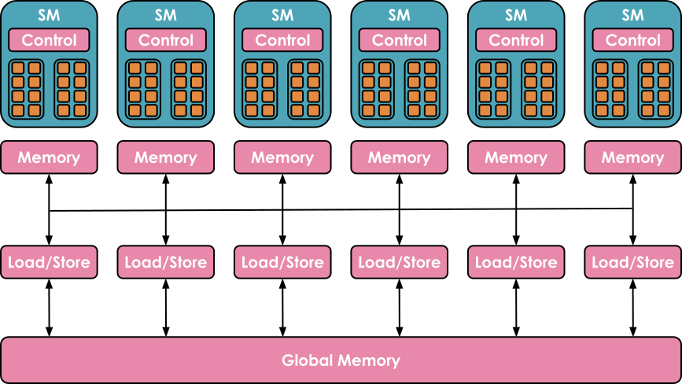

来源：[GPU computing](https://blog.codingconfessions.com/p/gpu-computing)。

存储侧同样具有很强的层次性，包含多级缓存和存储器。
*寄存器*是最小的单元，执行期间由线程私有。
*共享内存*和 *L1 缓存*由同一个 SM 上运行的线程共享。
再上一级是所有 SM 共享的 *L2 缓存*，最后是*全局内存*，它是 GPU 上最大的存储器（例如 H100 宣传的 80 GB），但访问和查询速度也最慢。

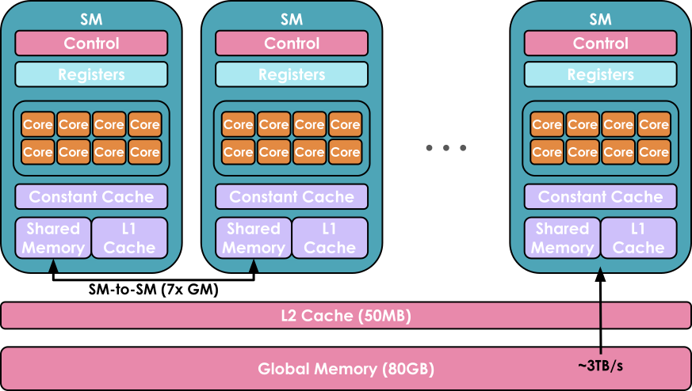

来源：[视频](https://www.youtube.com/watch?v=ZQKMZIP3Fzg)。

使用 GPU 的目标，是利用这种计算与存储资源的层次组织方式，在可用核心上尽可能并行执行更多工作负载。

在 GPU 核心上运行的一段代码称为 **kernel**。
它可以用 CUDA 或 Triton 等较高层语言编写，然后编译为 Parallel Thread Execution（PTX），即 NVIDIA GPU 使用的低层汇编。

要运行 kernel，还需要一些**主机代码（host code）**，它在 CPU/主机上执行，负责准备数据分配，以及加载数据和代码：

```python
// Host code                
void vecAdd(float* h_A, float *h_B, float *h_c, int n) {
    // Allocate vectors in device memory
    int size = n * sizeof(float);
    float *d_A, *d_B, *d_C;
    cudaMalloc(&d_A, size);
    cudaMalloc(&d_B, size);
    cudaMalloc(&d_C, size);

    // Copy vectors from host memory to device memory
    cudaMemcpy(d_A, h_A, size, cudaMemcpyHostToDevice);
    cudaMemcpy(d_B, h_B, size, cudaMemcpyHostToDevice);

    // Invoke kernel
    int threadsPerBlock = 256;
    int blocksPerGrid =
            (N + threadsPerBlock - 1) / threadsPerBlock;
    VecAdd<<<blocksPerGrid, threadsPerBlock>>>(d_A, d_B, d_C, N);

    // Copy result from device memory to host memory
    // h_C contains the result in host memory
    cudaMemcpy(h_C, d_C, size, cudaMemcpyDeviceToHost);

    // Free device memory
    cudaFree(d_A);
    cudaFree(d_B);
    cudaFree(d_C);
}
```

用于两个向量相加的 CUDA kernel 的主机代码，改编自 [CUDA C 编程指南](https://docs.nvidia.com/cuda/cuda-c-programming-guide/)和 [GPU computing](https://blog.codingconfessions.com/p/gpu-computing)。

```python
// Device code
__global__ void VecAdd(float* A, float* B, float* C, int N)
{
    int i = blockDim.x * blockIdx.x + threadIdx.x;
    if (i < N)
        C[i] = A[i] + B[i];
}
```

包含向量加法 kernel 定义的设备代码，改编自 [CUDA C 编程指南](https://docs.nvidia.com/cuda/cuda-c-programming-guide/)和 [GPU computing](https://blog.codingconfessions.com/p/gpu-computing)。

kernel 通常按以下方式调度：

- 线程组成 *warp*，每个 warp 包含 32 个线程。
  一个 warp 内的所有线程同步执行相同指令，但处理数据的不同部分。
- warp 进一步组成大小更灵活的*线程块（block）*（例如，一个线程块可以有 512 或 1,024 个线程），每个线程块分配给一个 SM。
  一个 SM 可以并行运行多个线程块。
  不过，根据可用资源，并非所有线程块都能立即分配执行；有些可能需要等待更多资源可用。

这里最需要记住的是，要最高效地利用 GPU 架构，必须考虑各种大小和分配约束，例如各类存储器大小、并发线程块数量，以及 warp 中的线程数量。

大多数时候，你不需要深入到这一层精度，可以复用社区其他成员准备好的 kernel 和代码，但我们仍会提供一些 kernel 入门建议！

## 用 kernel 改善性能

如果想加入一个缺少优化 kernel 的新操作，或者加快已有 PyTorch 函数，从头编写 kernel 可能看起来是最直接的途径。
不过，从零创建高性能 CUDA kernel 需要丰富经验，学习曲线也很陡峭。
通常，更好的入门方式是利用 `torch.compile`：它捕获你的操作，生成更底层的高性能 Triton kernel，从而动态优化 PyTorch 代码。

假设你想为指数线性单元（Exponential Linear Unit，ELU）激活函数编写一个 kernel：

$$
\text{ELU}(x) = \begin{cases}
e^x - 1 & \text{if } x < 0 \\
x & \text{if } x \geq 0
\end{cases}
$$

可以先写一个简单的 PyTorch 实现，再在上方加入 `@torch.compile` 装饰器：

```python
@torch.compile
def elu(x, alpha=1.0):
    return torch.where(x < 0, alpha * (torch.exp(x) - 1), x)
```

从下图可以看到，编译版本和未编译版本之间存在明显的性能差异，尤其考虑到我们只添加了一个装饰器（这里的 $N$ 是列数）：

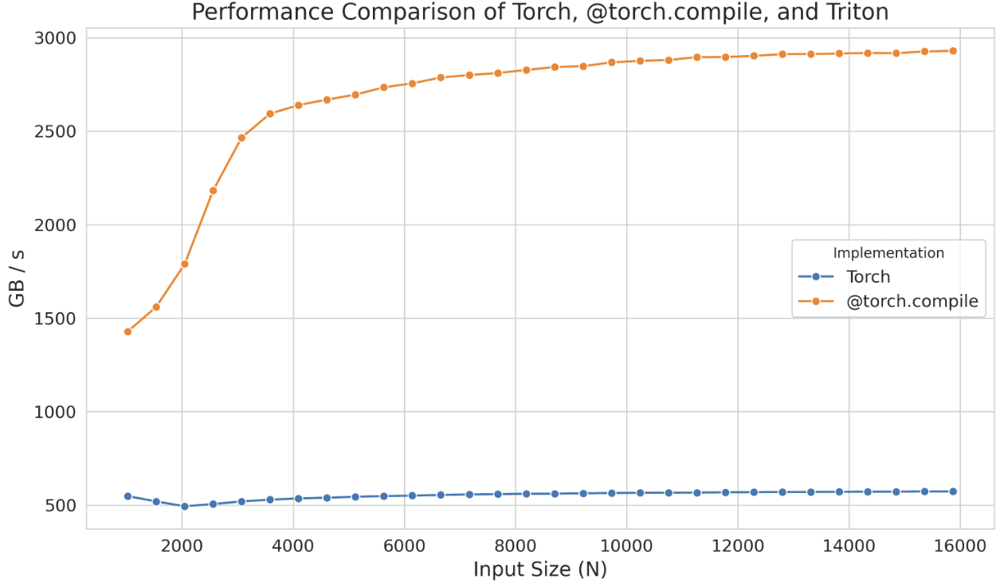

不过，如果这种性能提升还不够，可以考虑实现 Triton kernel。
作为起点，可以查看 `@torch.compile` 生成的 Triton kernel。
只需将环境变量 `TORCH_LOGS` 设为 `"output_code"`：

```bash
export TORCH_LOGS="output_code"
```

运行带有 `@torch.compile` 装饰器的 Python 脚本后，它就会生成并输出对应的 Triton kernel，在这个例子中如下：

```python
@triton.jit
def triton_(in_ptr0, out_ptr0, xnumel, XBLOCK : tl.constexpr):
    xnumel = 100000000
    xoffset = tl.program_id(0) * XBLOCK
    xindex = xoffset + tl.arange(0, XBLOCK)[:]
    xmask = xindex < xnumel
    x0 = xindex
    tmp0 = tl.load(in_ptr0 + (x0), xmask)
    tmp1 = 0.0
    tmp2 = tmp0 < tmp1
    tmp3 = tl_math.exp(tmp0)
    tmp4 = 1.0
    tmp5 = tmp3 - tmp4
    tmp6 = tl.where(tmp2, tmp5, tmp0)
    tl.store(out_ptr0 + (x0), tmp6, xmask)
```

为了提高可读性，可以修改变量名、添加注释，并稍作调整（或让 LLM 帮我们完成），如下所示：

```python
@triton.jit
def elu_kernel(input_ptr, output_ptr, num_elements, BLOCK_SIZE: tl.constexpr):
    # Calculate the starting index for this block
    block_start = tl.program_id(0) * BLOCK_SIZE
    # Create an array of indices for this block
    block_indices = block_start + tl.arange(0, BLOCK_SIZE)[:]
    # Create a mask to ensure only valid indices are processed
    valid_mask = block_indices < num_elements
    # Load input values from the input pointer based on valid indices
    input_values = tl.load(input_ptr + block_indices, valid_mask)
    # Define the ELU parameters
    zero_value = 0.0  # Threshold for ELU activation
    negative_mask = input_values < zero_value
    exp_values = tl.math.exp(input_values)
    # Define the ELU output shift
    one_value = 1.0
    shifted_exp_values = exp_values - one_value

    output_values = tl.where(negative_mask, shifted_exp_values, input_values)

    # Store the computed output values back to the output pointer
    tl.store(output_ptr + block_indices, output_values, valid_mask)
```

这里，`tl.program_id(0)` 提供唯一的线程块编号，我们用它确定该线程块处理哪一段数据。
根据这个线程块编号，`block_start` 计算每个线程块所负责数据段的起始索引，而 `block_indices` 指定该段内的索引范围。
`valid_mask` 确保只处理 `num_elements` 范围内的索引，通过 `tl.load` 安全加载数据。
随后应用 ELU 函数，根据数值是否为负进行修改，并通过 `tl.store` 将结果写回内存。

使用 `triton.testing.Benchmark` 对生成的 kernel 进行基准测试，得到以下性能：

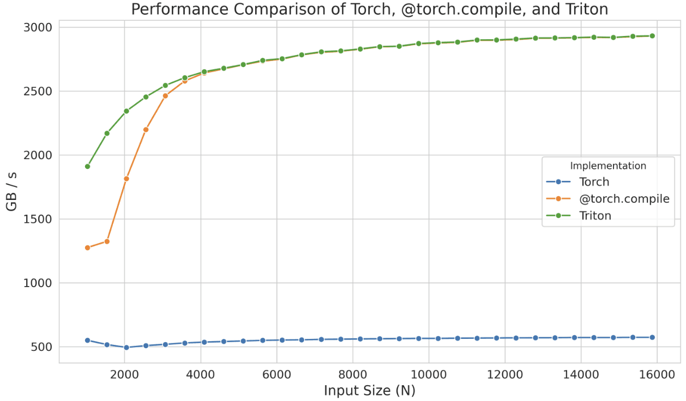

与 `@torch.compile` 相比，这个独立 kernel 在较小规模下甚至表现更好，但这很可能只是 `torch.compile` 编译时间造成的现象。
无论如何，请记住，可以从这类生成的 kernel 开始，集中精力优化性能，而不必从头编写，这能节省大量时间。

即使使用 Triton，有时也无法完全达到设备的峰值性能，因为这种语言在处理共享内存、流式多处理器内部调度等底层细节时存在限制。
Triton 的能力局限于线程块，以及跨 SM 对线程块进行调度。
要获得更深层的控制，就需要直接用 CUDA 实现 kernel，这样才能访问所有底层细节。

使用 CUDA 时，可以采用多种技术提高 kernel 效率。
这里仅介绍几项：优化内存访问模式以减少延迟、用共享内存保存频繁访问的数据，以及管理线程工作负载以尽量减少空闲时间。

在深入 CUDA 示例之前，我们先总结已见过的、可编写 kernel 代码以在 GPU 上执行指令的工具：

1. PyTorch：容易，但慢。
2. `@torch.compile`：容易、快，但不灵活。
3. Triton：更难、更快，但更灵活。
4. CUDA：最难、最快，也最灵活（前提是你实现正确）。

我们先来看 CUDA 最常见的用途之一：优化内存访问。
与缓存相比，GPU 的全局内存（前面看到的最大存储区域）延迟较高、带宽较低，成为许多应用的主要瓶颈。
高效访问全局内存中的数据，可以大幅改善性能。

### 内存合并访问

要有效利用全局内存带宽，必须了解其架构。
在 CUDA 设备上，全局内存由 DRAM 实现。

**内存合并访问（memory coalescing）**利用了 DRAM 在访问某个内存地址时以突发方式传送数据的特性。
每次访问一个 DRAM 位置时，DRAM 芯片中的多个感测器会并行读取一段连续位置（包含请求的位置）。
读出之后，这些数据就能以突发方式快速传输到处理器。
在 CUDA 中，合并访问利用这种突发行为，确保一个 warp（以锁步方式执行相同指令的 32 个线程）内的线程访问连续内存位置，从而最大限度提高内存访问效率。
例如，线程 0 访问位置 $M$，线程 1 访问 $M + 1$，线程 2 访问 $M + 2$，依此类推，GPU 硬件就会将这些请求合并为一个大而高效的 DRAM 突发访问请求，而不是分别处理每次访问。

以矩阵乘法为例。
一种简单直接的实现，会让每个线程计算输出矩阵中的一个元素，如下所示：

```clike
__global__ void matmul_naive(int M, int N, int K, const float *A, const float *B, float *C) {
    const uint x = blockIdx.x * blockDim.x + threadIdx.x;
    const uint y = blockIdx.y * blockDim.y + threadIdx.y;

    if (x < M && y < N) {
        float tmp = 0.0;
        for (int i = 0; i < K; ++i) {
            tmp += A[x * K + i] * B[i * N + y];
        }
        C[x * N + y] = tmp;
    }
}
```

下面是 Simon Boehm 的精彩[博客文章](https://siboehm.com/articles/22/CUDA-MMM)中对这个 kernel 的出色可视化：

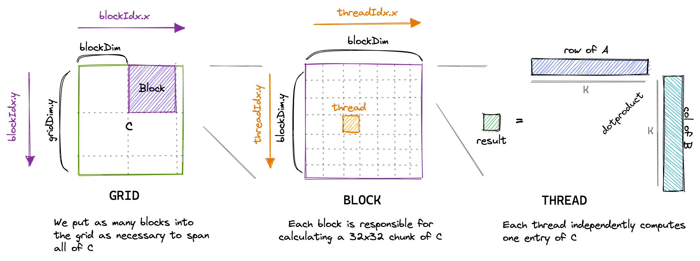

不过，使用 `ncu` 等工具剖析这个 kernel 时，可以看到一些问题，包括较低的内存吞吐量和未合并的内存访问：

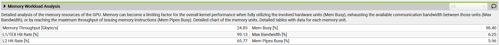

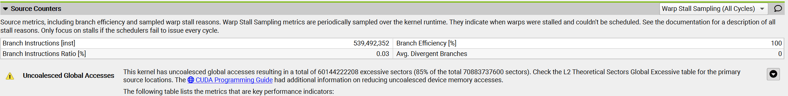

原因在于，这个 kernel 中同一线程块内编号为 `(0, 0)` 和 `(1, 0)` 的两个线程（最终会落入同一个 warp），都会加载矩阵 **B** 的同一列，却加载矩阵 **A** 的不同行。
由于矩阵元素按行优先顺序存储（即一行中的元素位于连续内存地址，如下图所示），在第一次迭代 $i = 0$ 时，线程 `(0, 0)` 加载 $A_{0,0}$，线程 `(1, 0)` 加载 $A_{1,0}$。
这些元素在内存中并不相邻，而且这种错位在每次迭代中都会存在，因此无法合并内存访问。

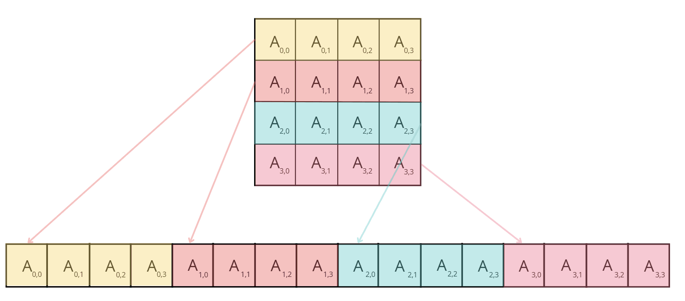

为了改善 kernel 性能，可以将坐标 `x` 和 `y` 的计算方式改为：

```clike
const int x = blockIdx.x * BLOCKSIZE + (threadIdx.x / BLOCKSIZE);
const int y = blockIdx.y * BLOCKSIZE + (threadIdx.x % BLOCKSIZE);

if (x < M && y < N) {
float tmp = 0.0;
for (int i = 0; i < K; ++i) {
    tmp += A[x * K + i] * B[i * N + y];
}
C[x * N + y] = tmp;
}
```

我们从二维线程块改为一维线程块，并重新定义确定 `x` 和 `y` 值的方式。
在新方法中，同一个 warp 内的线程（`threadIdx.x` 值接近）具有相同的 `x` 值，但 `y` 值不同。
这意味着，它们加载矩阵 **A** 的同一行，但加载矩阵 **B** 的不同列。
因此，对于行优先矩阵，内存访问可以合并。

剖析新 kernel 时，我们发现，关于未合并内存访问的警告已经消失，而且 **GPU 的内存吞吐量增加到了原来的约 10 倍**。

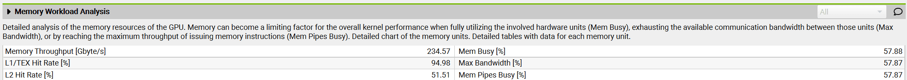

我们还发现，**kernel 执行时间缩短到了原来的十分之一**。
太棒了！

现在来介绍另一项文献中经常提到的技术：**分块（tiling）**。

### 分块

分块利用共享内存来优化内存访问模式。
如前所述，GPU 上的共享内存是一块小而快速的存储区域，同一个线程块内的所有线程都能访问。
它使多个线程能够复用数据，减少从较慢的全局内存中反复加载数据的需要。

例如，在矩阵乘法中，一个线程块中的每个线程可能都需要两个矩阵 **A** 和 **B** 的元素。
如果每个线程独立从全局内存加载所需的行和列，就会产生大量冗余加载，因为同一个线程块中的多个线程会访问重叠数据。
我们可以使用分块，将 **A** 和 **B** 的一个块（tile）只加载一次到共享内存，让该线程块中的所有线程复用相同的共享数据。

使用分块时，每次迭代都由线程块内的全部线程合作，将两个 tile——一个来自矩阵 **A**，另一个来自矩阵 **B**——加载到共享内存。
具体来说，线程加载矩阵 **A** 中大小为 `BLOCK_SIZE_M` × `BLOCK_SIZE_K` 的 tile，以及矩阵 **B** 中大小为 `BLOCK_SIZE_K` × `BLOCK_SIZE_N` 的 tile。
这些 tile 进入共享内存后，线程就在其上执行矩阵乘法，由于所需数据都能快速访问，计算得以高效进行。
每次 tile 乘法的结果保存在一个用于存放中间结果的累加矩阵中。
每次迭代之后，将当前 tile 乘法的结果加入累加矩阵，持续到两个矩阵的所有 tile 都处理完毕。

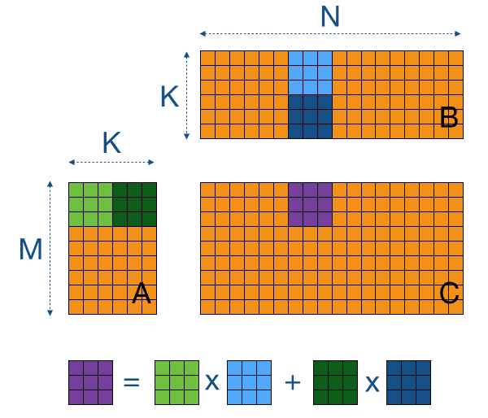

来自[这篇教程](https://cnugteren.github.io/tutorial/pages/page4.html)。

我们来看看实现中需要理解的重要部分：

```clike
// Set pointers to the starting elements
A += blockRow * TILE_SIZE * K; // Start at row = blockRow, column = 0
B += blockCol * TILE_SIZE; // Start at row = 0, column = blockCol
C += blockRow * TILE_SIZE * N + blockCol * TILE_SIZE; // Start at row = blockRow, column = blockCol
float sum = 0.0;
// The outer loop moves through tiles of A (across columns) and B (down rows)
for (int tileIdx = 0; tileIdx < K; tileIdx += TILE_SIZE) {
sharedA[localRow * TILE_SIZE + localCol] = A[localRow * K + localCol];
sharedB[localRow * TILE_SIZE + localCol] = B[localRow * N + localCol];

// Ensure all threads in the block have completed data loading
__syncthreads();

// Shift pointers to the next tile
A += TILE_SIZE;
B += TILE_SIZE * N;

// Compute the partial dot product for this tile
for (int i = 0; i < TILE_SIZE; ++i) {
    sum += sharedA[localRow * TILE_SIZE + i] * sharedB[i * TILE_SIZE + localCol];
}
// Synchronize again to prevent any thread from loading new data
// into shared memory before others have completed their calculations
__syncthreads();
}
C[localRow * N + localCol] = sum;
```

> 为简单起见，这里考虑方形 tile。

每个线程首先从矩阵 **A** 和 **B** 中各加载一个元素到共享内存。
在这种情况下，实现合并访问很直接：将 `threadIdx.x` 指定为*局部列索引*（`localCol`），就能确保同一个 warp 内的线程访问两个矩阵的相邻元素。
在线程块的每个线程都将元素加载到共享内存后（通过调用 `__syncthreads()` 确保），它们开始计算两个 tile 的点积。
当线程遍历完所有 tile（**A** 沿水平方向、**B** 沿垂直方向）后，将所得总和保存到矩阵 **C** 的对应位置。

使用 `ncu` 对这个 kernel 进行基准测试时，我们发现内存吞吐量提高到 410 Gb/s，kernel 执行时间减少约 43%，性能达到约 6.6 TFLOPS。

### 线程粗化

分块技术显著改善了 kernel 性能。
不过，在分析 warp 状态（量化每种状态所耗周期数）时，我们观察到以下情况：

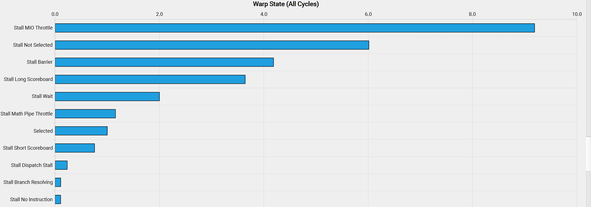

这些晦涩状态名称的含义，可以在 [NVIDIA Kernel 性能剖析指南](https://docs.nvidia.com/nsight-compute/ProfilingGuide/index.html#metrics-reference)的“Warp Stall Reasons”一节找到。
其中，`smsp__pcsamp_warps_issue_stalled_mio_throttle` 表示：“warp 因等待 MIO（内存输入/输出）指令队列不再满而停顿。
当 MIO 流水线使用率极高时，会经常出现这种停顿，MIO 流水线包括特殊数学指令、动态分支以及共享内存指令。
如果由共享内存访问引起，尝试减少加载次数、增大每次加载宽度，可以降低流水线压力。”

看来，warp 正因等待共享内存访问返回而停顿！
为解决这一问题，可以应用**线程粗化（thread coarsening）**技术，将多个线程合并为一个粗化线程。
由于每个粗化线程可以处理多个输出元素，这会显著减少共享内存访问。

接下来，简要介绍编写或改进自定义 kernel 时的最后一项重要考虑：**尽量减少控制分歧**。

### 尽量减少控制分歧

流式多处理器按照*单指令、多数据（SIMD）*模型执行一个 warp 中的所有线程。
这意味着，在任何时刻，都会取出一条指令，由 warp 内的所有线程同时执行。
执行 warp 时，线程处理数据的不同部分，但遵循相同指令（因此称为单指令、多数据）。
SIMD 的主要优势是效率：负责指令获取和分发的控制硬件由多个执行单元共享。
这种设计最大限度减少了控制功能的硬件开销，使更多硬件能够专注于提高算术吞吐量。

当同一个 warp 内的线程走上不同执行路径时，就会出现*控制分歧*。
例如，如果条件语句（如 `if`）导致一些线程执行一段代码，另一些线程执行另一段代码，warp 就必须串行执行这些路径，使空闲线程等待其他线程完成。
要尽量减少控制分歧，需要设计 kernel，使同一个 warp 内的线程遵循相同执行路径。
可以通过重组代码减少分支、使用能确保所有线程遵循类似执行路径的数据结构，或采用谓词执行等技术来实现。

我们已经介绍了编写自定义 kernel、改善 GPU 操作性能和显存占用的一些主要考虑。
不过，在进入真实示例之前，还有一个重要概念需要考虑：**kernel 融合**。

## 融合 kernel

前面多次提到，GPU 和 CPU 操作可以异步进行。
特别是，CPU 上的主机代码可以用非阻塞方式调度 GPU 工作负载。

这有助于让通信和计算重叠，正如前面多次看到的，但还可以扩展为更一般的思路：尽一切可能避免在主机和 GPU kernel 命令之间来回往返。

[Horace He](https://upload.wikimedia.org/wikipedia/commons/b/b2/Hausziege_04.jpg) 用[这些图](https://horace.io/brrr_intro.html)生动展示了这一思路：

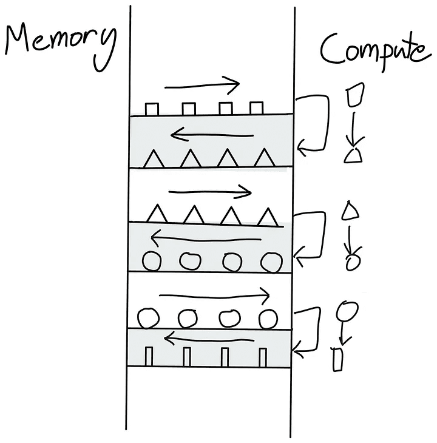

一系列 kernel，需要在全局内存和计算单元之间来回往返。

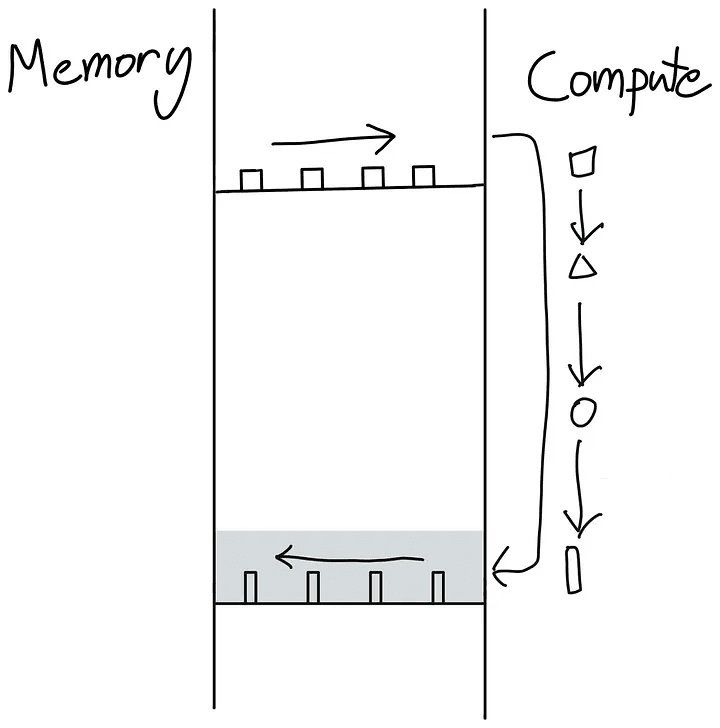

我们一次性完成全部操作，而不是将三角形写回全局内存后又重新读出。

如何避免左图中的来回往返？
最好的办法，是让 GPU 尽可能自主。
做法是将尽可能多的连续计算操作打包到一个 kernel 中交给 GPU 运行，称为“融合 kernel”，如右图所示。

对于连续的逐点操作，如果每个输入 token 上的操作彼此独立，融合 kernel 就尤其高效，也容易编写。
在这种情况下，没必要先将计算值写回全局内存，再搬入 SM 内存并启动新的 kernel。
将所有值保留在局部，直到完成全部计算，要高效得多。

在 Transformer 模型中，每当存在一系列逐点操作（例如 LayerNorm 层中的计算）时，都可以应用这种“融合”方法。

现在，我们已经具备欣赏 kernel 工程真正杰作所需的全部知识：**FlashAttention**。

## FlashAttention

FlashAttention 由 [Tri Dao](https://tridao.me) 提出，通过编写自定义 CUDA kernel 来优化注意力计算，使它更快、*也*更节省显存。
FlashAttention 的思路，是高效利用 GPU 的各类存储器，避免过度依赖最慢的全局内存。

现代 GPU 的全局内存通常采用[高带宽内存（HBM）](https://semianalysis.com/2024/09/03/the-memory-wall/#hbm-roadmap)技术，尽管名字叫高带宽，但在 GPU 存储层次中，它仍比 SRAM 慢。
讨论 FlashAttention 实现细节时，HBM 这一术语会很重要。

注意力机制的基础实现，需要在内存和工作单元之间进行大量传输。
它需要在 HBM 中物化 **S** 矩阵（S = QK^T，即注意力分数）和 **P** 矩阵（P = softmax(S)，即归一化后的注意力权重），这意味着结果需要写入 HBM，再传回 SRAM 进行后续计算：

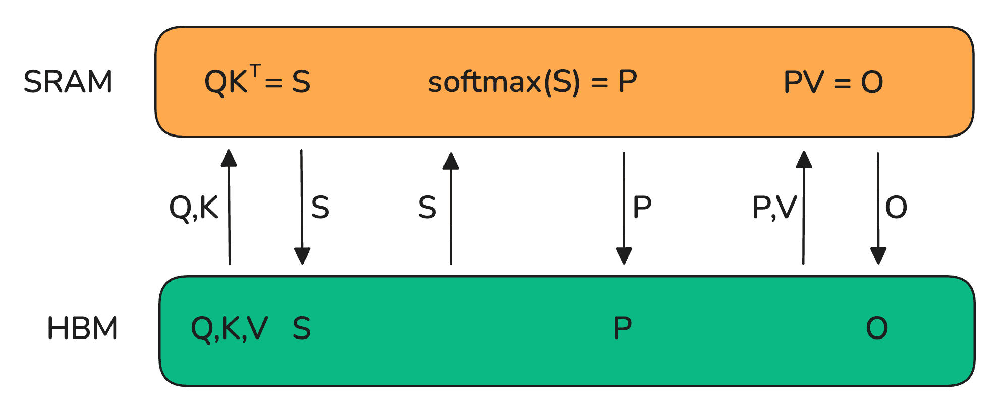

由于 HBM 带宽低得多，这会成为注意力计算的严重瓶颈。
我们能做得更好吗？
[Tri Dao](https://upload.wikimedia.org/wikipedia/commons/b/b2/Hausziege_04.jpg) 说可以！

关键是将 **S** 矩阵分成能放入 SM 较小共享内存的小块来计算。
但还可以做得更好：完全避免物化巨大的 **S** 矩阵，只保留计算 softmax 归一化因子所需的统计量。
因此，我们可以直接在 SRAM 中一次计算得到一部分 $O$，而无需来回搬运中间结果。
这样，不仅利用了共享内存，还消除了物化模型中最大激活矩阵之一（长上下文时）的显存瓶颈：注意力矩阵。

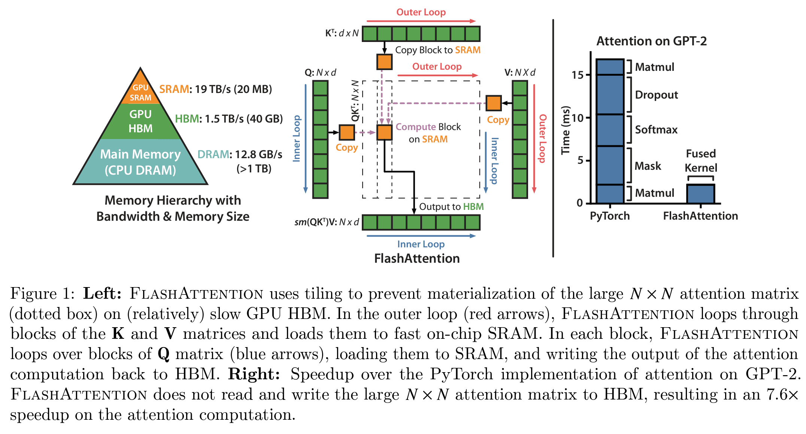

来源：[FlashAttention 论文](https://arxiv.org/abs/2205.14135)。

FlashAttention 的思路解决了模型训练中的许多瓶颈，因此很快成为所有 Transformer 执行注意力的默认方式。
具体而言：

- 避免物化 **S** 矩阵，能够**减轻注意力的显存负担**。
- 我们还**消除了注意力 $O(S^2)$ 成本在朴素实现中的很大一部分影响**。

Transformer 架构发明后不久出现的各种线性注意力变体、次二次复杂度的近似注意力方法，大多被搁置，转而采用这种精确而快速的 FlashAttention 实现和机制。

FlashAttention-1 之后，同一个实验室又发布了两个改进版本：FlashAttention-2 和 -3。
与 FlashAttention-1 相比，FlashAttention-2 和 -3 的改进更多是针对 GPU 定制底层实现，而不是改变总体注意力机制，包括：（1）尽可能减少非矩阵乘法操作，（2）谨慎划分 warp 和线程块之间的工作负载（FlashAttention-2），以及（3）在 FlashAttention-3 中针对最新 Hopper（H100）架构的 FP8 和 Tensor Core 支持进行细致优化。

> FlashAttention 对能够加速的注意力模式有一些限制。
> 可以看看 [FlexAttention](https://pytorch.org/blog/flexattention/)，它是一个快速而灵活的变体。

FlashAttention 精彩展示了：考虑当前 GPU 加速器内部的存储与计算设计，能够带来突破性改进。

本节到目前为止介绍的技术，都需要修改模型代码，并为特定操作编写自定义 kernel，才能加快训练。

在深入计算操作本身的最后一部分，我们将介绍一类与模型代码无关的方法。
它们适用于任何模型，使用之广泛，已经成为行业标准：接下来介绍**混合精度训练**！

## 混合精度训练

本书多个章节都讨论过低精度格式及其对保存激活、参数和优化器状态所需显存的影响。
现在，是时候深入这些格式的细节，更好地理解其权衡、优势和局限。

顾名思义，混合精度训练就是在训练中混合使用不同精度。
PyTorch 张量默认采用*单精度浮点格式*，也称为 *FP32* 或 *float32*，即每个数值占 32 位，或 4 字节。
表示数值的可用位数分为三部分：

- 符号：第一位决定数值是正还是负。
- 指数：控制数值的数量级。
- 尾数：决定数值的有效数字。

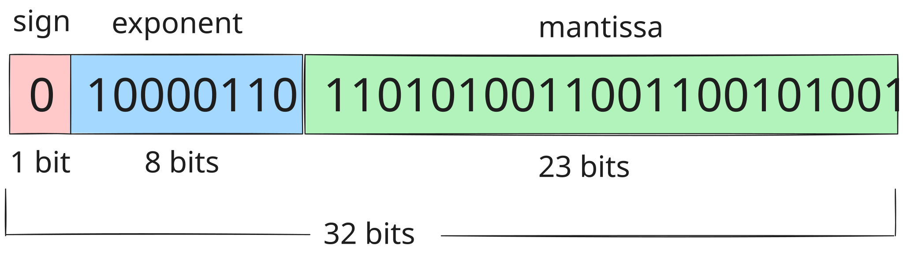

回想科学记数法，例如 $- 5.734 \times 10^{7}$，就能轻松说明浮点数原理：先是符号，然后是尾数和指数。
这样，我们可以用自适应精度表示跨越很大数量级范围的数值。
虽然 float32 是默认格式，但 PyTorch 中还有多种浮点格式：

| 格式 | 总位数 | 符号 | 指数 | 尾数 |
|---|---|---|---|---|
| float32 | 32 | 1 | 8 | 23 |
| float16 | 16 | 1 | 5 | 10 |
| bfloat16 | 16 | 1 | 8 | 7 |
| float8 (e4m3) | 8 | 1 | 4 | 3 |
| float8 (e5m2) | 8 | 1 | 5 | 2 |

> 注：你可能好奇 bfloat16 中的“b”从何而来。
> 这种格式由 Google Brain 开发，因此“b”代表“brain”。

减少总位数需要付出代价（这里也没有免费的午餐），但我们能在一定程度上选择如何付出：可以牺牲尾数位，也可以牺牲指数位。
因此，也存在两种按指数和尾数命名的 float8（FP8）格式，使我们能灵活选择最合适的格式。
我们来看看每种格式能够表示的数值范围：

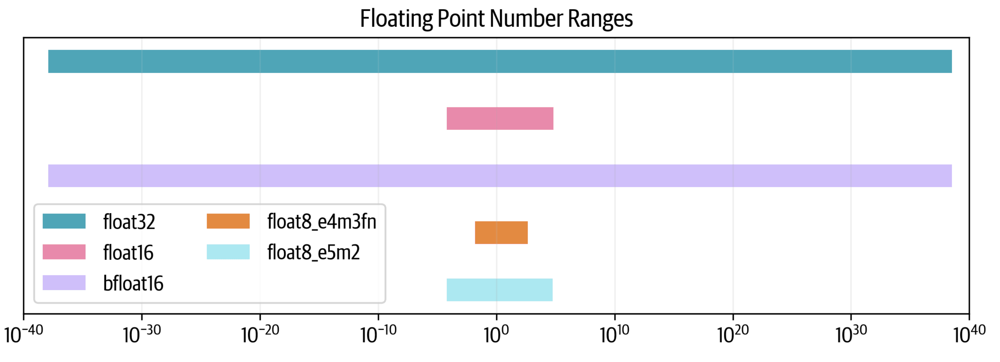

可以看到，float32 跨越 80 个数量级；float16 牺牲了大量范围，而 bfloat16 保留完整范围。
两种 float8 格式进一步缩小了范围：e5m2 能保持 float16 的范围，e4m3 的范围则更小。

为什么某些格式能够保留完整范围，而另一些不能？
我们绘制 1 到 2 之间的 10,000 个点，研究它们的分辨率。
每个点都会舍入到每种格式中最近的可表示数：

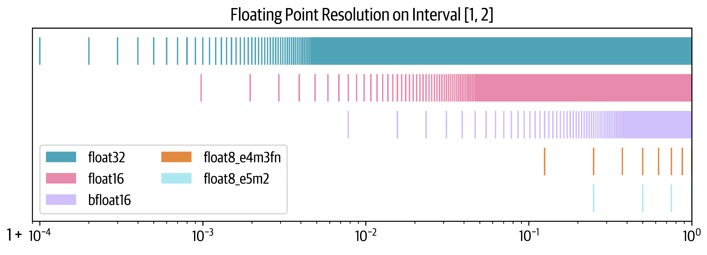

可以看到，虽然 bfloat16 保留了 float32 的范围（不同于 float16），但代价是牺牲更多精度。
float8 的情况更加严峻：在区间 [1,2] 内，e4m3 只能表示 7 个数，e5m2 只能表示 3 个数。

衡量格式分辨率的一项常用指标是 *epsilon*：$1.00$ 之后的第一个可表示数。
可以看到，对于 float32，$10^{-4}$ 是一个上界（实际上为 $1.19^{-7}$）。
float16 大约为 $10^{-3}$，bfloat 则还要高 10 倍。

混合精度训练的思路，是在某些计算中使用这些较低精度格式，同时保持全精度训练的性能。
事实证明，我们**不能**完全放弃 float32，通常仍需要用全精度执行一部分计算。

现在，先看看用 16 位训练模型，再看看能否进一步降到 8 位。

### FP16 和 BF16 训练

遗憾的是，简单地将所有张量和操作切换到 float16 并不可行，通常会导致损失发散。
不过，最初的混合精度训练[论文](https://arxiv.org/abs/1710.03740)提出了三项技巧，来匹配 float32 训练：

1. **权重的 FP32 副本：**FP16 权重有两个潜在问题。
   训练中，某些权重可能变得很小，并舍入为 0。
   不过，即使权重本身并不接近 0，如果更新量很小，数量级差异也可能导致它们在相加时下溢。
   一旦权重变成 0，由于不再有梯度信号传过来，它们在剩余训练中就会保持为 0。
2. **损失缩放：**梯度也有类似问题，因为梯度往往远小于 1，因此存在下溢风险。
   一种简单而有效的方法，是在反向传播前放大损失，并在反向传播后将梯度缩放回去。
   这确保反向传播中不会下溢；由于我们在进一步处理梯度（例如裁剪）和优化器更新之前恢复缩放，因此缩放不会影响训练。
3. **累加：**最后，用 16 位精度执行某些算术操作（例如平均或求和）时，也可能出现下溢或上溢。
   一种解决方法是在操作期间用 FP32 累加中间结果，只将最终结果转换回 16 位精度。

使用这些技术，我们既能获得稳定训练，也能受益于更快的低精度算术操作带来的更高吞吐量。

作为好奇的读者，而且到现在已经有点沉迷于最大化吞吐量，你自然可能会问：我们能否比 16 位精度更进一步、更快？

也许可以！

### FP8 预训练

即使完美重叠通信和计算，最终仍然会碰到硬件本身底层的理论 FLOPS 上限，也就是硬件上每个独立操作的效率。
这时，数值精度就至关重要。
例如，NVIDIA H100 GPU 上 FP8 矩阵乘法（GEMM 操作）的理论 FLOPS 是 BF16 的两倍，使低精度训练成为进一步优化的一条有吸引力的路径。

近期研究，包括 [FP8-LM](https://arxiv.org/abs/2310.18313)、[torchao](https://github.com/pytorch/ao) 和 [DeepSeek-V3](https://arxiv.org/abs/2412.19437)，已经展示了大规模模型 FP8 训练的潜力。
不过，FP8 预训练引入了一项重大挑战：**稳定性**。
较低精度下，数值不稳定往往会导致损失发散，很难达到较高精度训练的准确性。

我们知道，在模型规模固定时，随着学习率提高，[不稳定性会增加](https://arxiv.org/abs/2309.14322)，使 FP8 预训练尤其棘手。

下面是 FP8 训练中典型的发散损失曲线示例：

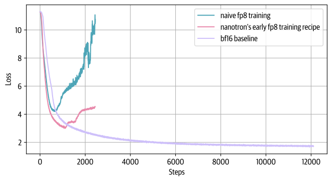

首次公开报告成功的超大规模 FP8 混合精度训练，出现在 [DeepSeek-V3 技术报告](https://arxiv.org/abs/2412.19437)中。
作者仔细分析了前向传播（*Fprop*）、激活反向传播（*Dgrad*）和权重反向传播（*Wgrad*）的每个操作。
与 BF16 混合精度训练类似，一些聚合和主权重保留较高精度，而操作本身以 FP8 执行。

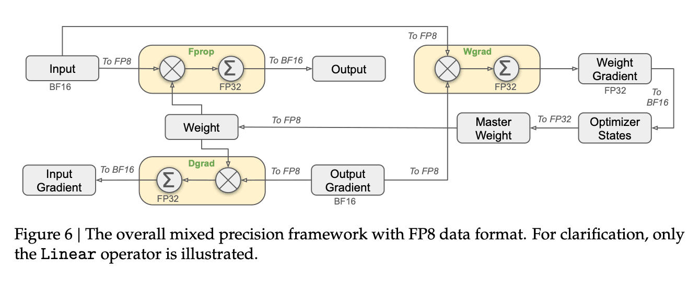

为了从高精度（例如 FP32 或 BF16）切换到范围较小的低精度（例如 FP16 或 FP8），需要将激活值的范围归一化，例如计算其绝对值最大值。
DeepSeek-V3 进一步引入一种特定量化方案，按 tile 归一化范围：输入/激活为 1×128，权重和缩放元素为 128×128。
这样，归一化受到激活异常值的影响更小。
作者还提出了其他一些技巧，进一步减少显存和通信占用，详见[技术报告](https://arxiv.org/abs/2412.19437)的 3.3 节。

下面汇总了几种已知的 FP8 训练方法：

| | GEMM 精度 | 模型主权重 | 累积梯度 | 模型权重 | 梯度 | 优化器状态 | 总显存 |
|---|---|---|---|---|---|---|---|
| BF16 与 FP32 混合精度基线 | BF16 | FP32 | FP32 | BF16 | BF16 | FP32 + FP32 | 4 + 4 + 2 + 2 + 4 + 4 = 20 字节 |
| 上述方法不使用 FP32 梯度累积 | BF16 | FP32 | 不适用 | BF16 | BF16 | FP32 + FP32 | 4 + 2 + 2 + 4 + 4 = 16 字节（减少 20%） |
| Transformer engine | FP8 | 不适用 | 不适用 | FP32 | FP32 | FP32 + FP32 | 4 + 4 + 4 + 4 = 16 字节（减少 20%） |
| FP8-LM 的 O3 级别 | FP8 | FP16 | FP16 | FP8 | FP8 | FP8 + FP16 | 2 + 2 + 1 + 1 + 1 + 2 = 9 字节（减少 55%） |
| DeepSeek-V3 | FP8 | FP32 | FP32 | FP8 | BF16 | BF16 + BF16 | 4 + 4 + 1 + 2 + 2 + 2 = 15（减少 25%） |
| Nanotron 的 FP8 | FP8 | BF16 | FP32 | FP8 | FP8 | FP8 + FP8 | 2 + 4 + 1 + 1 + 1 + 1 = 10 字节（减少 50%） |

总体而言，FP8（在 2025 年初）仍是一项实验性技术，方法还在演进。
考虑到其明显优势，它很可能成为标准，并很快替代 BF16 混合精度。
要查看 FP8 训练技术的开源实现，可以参阅[这个 Nanotron PR](https://github.com/huggingface/nanotron/pull/70)。

展望更远的未来，NVIDIA 下一代芯片 Blackwell [已宣布](https://www.nvidia.com/en-us/data-center/technologies/blackwell-architecture/)支持 FP4 训练，这将进一步加快训练，但无疑也会带来新的训练稳定性挑战。

最后这一节，结束了我们在数十张到数千张 GPU 上快速训练大模型的漫长旅程。
是时候让 GPU 集群慢慢休息，退后一步，回顾沿途学到的一切！
