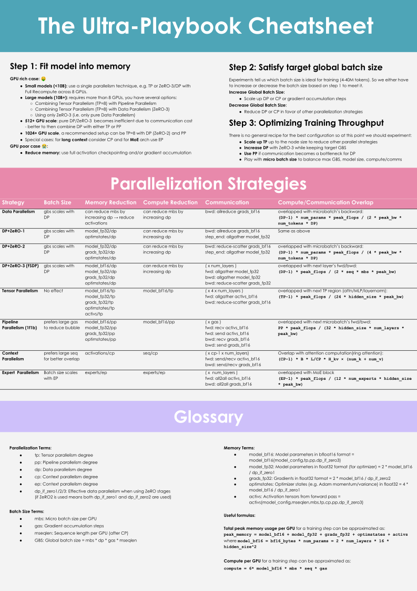

# 总体概览

本书介绍的所有技术，都是为了解决以下三个关键挑战中的一个或多个，而我们会反复遇到这些挑战：

1. **显存占用：**这是一项硬性限制，如果一个训练步无法放入显存，训练就无法继续。
2. **计算效率：**我们希望硬件将大部分时间用于计算，因此需要减少数据传输或等待其他 GPU 工作所花费的时间。
3. **通信开销：**我们希望尽可能减少通信开销，因为它会让 GPU 闲置。
   为此，我们将尽量充分利用节点内（较快）和节点间（较慢）的带宽，并尽可能让通信与计算重叠。

在许多地方，我们会看到，计算、通信和显存这三者可以相互交换（例如，通过重计算或张量并行）。
找到恰当的平衡，是扩展训练的关键。

由于本书涉及的内容很多，我们制作了一份[速查表](./images/ultra-cheatsheet.svg)，帮助你浏览全书并掌握总体要点。
在这片风浪中航行时，请将它放在手边！

