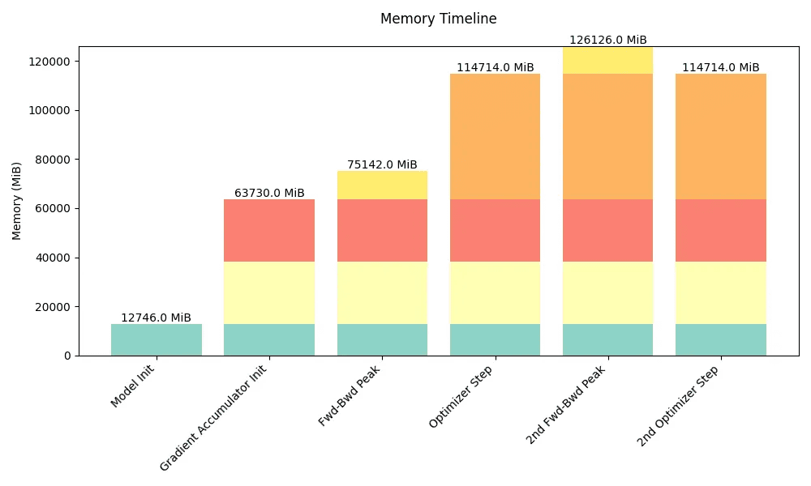

# 超大规模训练手册：在 GPU 集群上训练大语言模型

[原文交互图](https://huggingface.co/spaces/nanotron/ultrascale-playbook)

我们在最多 512 张 GPU 上进行了 4,000 多次扩展实验，并测量了吞吐量（标记的大小）和 GPU 利用率（标记的颜色）。
在这一可视化中，两者都按模型规模进行了归一化。

数千张 GPU 完美协调地运转。
这就是训练当今最强大 AI 模型所需要的：一场算力的交响乐，而直到不久前，这还只是顶尖研究实验室的专属领域。
开源改变了这一格局，但并未彻底改变。
是的，你可以下载最新的 [Llama](https://huggingface.co/meta-llama) 或 [DeepSeek](https://huggingface.co/deepseek-ai) 模型。
是的，你可以阅读它们的[技术](https://ai.meta.com/research/publications/the-llama-3-herd-of-models/)和[实验](https://github.com/deepseek-ai/DeepSeek-R1/blob/main/DeepSeek_R1.pdf)报告。
但最具挑战性的部分——训练代码，以及协调 GPU 来训练这些庞大系统所需的知识和技术——仍然十分复杂，散落在一系列彼此割裂的论文和往往不公开的代码库中。

> 阅读时间：2–4 天。
> 为了获得最佳阅读体验，我们建议不要使用手机。

这本开源书正是为了改变这一点。
我们将从基础开始，带你了解将大语言模型（LLM）训练从一张 GPU 扩展到数十张、数百张乃至数千张 GPU 所需的知识，并用实用的代码示例和可复现的基准测试来说明理论。

随着训练这些模型所用的集群规模不断扩大，人们发明了数据并行、张量并行、流水线并行、上下文并行，以及 ZeRO 和 kernel 融合等多种技术，以确保 GPU 始终保持较高利用率。
这显著缩短了训练时间，并让这些昂贵硬件得到最高效的利用。
这些分布式训练技术不仅对构建初始模型很重要，也已经成为在专门数据上微调大模型的必要技术，而这种微调往往能取得最佳效果。
本书将逐步介绍所有这些技术，从最简单的到最精细的，同时保持一条连贯的叙事主线，帮助你理解每种方法的由来。

> 如果你有问题或意见，请在[社区选项卡](https://huggingface.co/spaces/nanotron/ultrascale-playbook/discussions?status=open&type=discussion)中发起讨论！

我们假设你对当前的 LLM 架构有一些基本了解，并且大致熟悉深度学习模型的训练方式，但你完全可以是分布式训练的新手。
如果需要，你可以从 [DeepLearning.ai](https://www.deeplearning.ai) 上的优秀课程或 [PyTorch 教程](https://pytorch.org/tutorials/beginner/basics/intro.html)中了解模型训练的基础知识。
本书可以视为三部曲的第二部分，接续我们之前关于预训练数据处理的博客文章（也就是所谓的“[FineWeb 博客文章](https://huggingface.co/spaces/HuggingFaceFW/blogpost-fineweb-v1)”）。
读完这两篇内容后，你应该已经掌握了充分理解当今高性能 LLM 如何构建所需的几乎全部核心知识，只差数据混合与架构选择方面的秘方，就能补齐整套方案（敬请期待第三部分……）。

> 我们非常感谢整个 [distill.pub](https://distill.pub/) 团队，感谢他们创建了本篇博客所使用的模板。

本书建立在以下**三个基本支柱**之上：

**1. 理论与概念的简要介绍：**在进入代码和实验之前，我们希望你先从整体上理解每种方法的工作原理、优势和局限。
例如，你将了解语言模型的哪些部分会消耗显存，以及这种消耗在训练的什么阶段发生。
你还将了解如何通过并行化模型来应对显存限制，以及如何通过增加 GPU 数量来提高吞吐量。
这样，你就能理解下面这个计算 Transformer 模型显存占用分解的小组件是如何工作的：

> 这个小组件目前还缺少流水线并行。
> 我们将其留作读者的练习。

[显存占用分解](https://huggingface.co/spaces/nanotron/ultrascale-playbook?section=graph-container)

| 原文组件选项 | 中文 |
|---|---|
| Attention Heads (a) | 注意力头数（a） |
| Mixed Precision | 混合精度 |
| Micro-Batch Size (b) | 微批次大小（b） |
| Sequence Parallelism | 序列并行 |
| Hidden Dimension (h) | 隐藏维度（h） |
| Recomputation | 重计算 |
| None / Selective / Full | 无 / 选择性 / 完全 |
| Feedforward Dimension (h_ff) | 前馈维度（h_ff） |
| ZeRO | ZeRO |
| Number of Layers (L) | 层数（L） |
| FF Activation | 前馈激活函数 |
| ReLU / GELU / SwiGLU | ReLU / GELU / SwiGLU |
| Sequence Length (s) | 序列长度（s） |
| Vocabulary Size (v) | 词表大小（v） |
| Tensor Parallelism (t) | 张量并行（t） |
| Optimizer Parameters (k) | 优化器参数（k） |
| Data Parallelism (d) | 数据并行（d） |
| Presets | 预设 |
| Llama 3 Tiny / Llama 3 8B / Llama 3 70B / Llama 3 405B | Llama 3 Tiny / Llama 3 8B / Llama 3 70B / Llama 3 405B |

（如果你完全不明白这个小组件里发生了什么，别担心。
我们正是为此而来！）

这个小组件给出了理论上的占用分解，而我们还制作了[下面这个工具](https://huggingface.co/spaces/nanotron/predict_memory)，可以用来预测训练过程中的显存占用：

**2. 清晰的代码实现：**理论是一回事，但在实现某个东西时，我们会发现各种边界情况和重要细节。
这就是我们尽可能链接到参考实现的原因。
根据具体情况，我们会使用两个代码参考：

- [Picotron](https://github.com/huggingface/picotron) 仓库为教学而构建，因此通常会在单个、短小且自成一体的文件中实现概念。
- 另一方面，为了查看可用于生产环境的代码，我们会参考 [Nanotron](https://github.com/huggingface/nanotron) 的实现。
  这是 Hugging Face 使用的生产训练代码库。

> 3. 如果你想观看分布式训练的视频，而不是阅读博客或 Picotron 代码，可以看看 [Ferdinand 的 YouTube 频道](https://www.youtube.com/watch?v=u2VSwDDpaBM&list=PL-_armZiJvAnhcRr6yTJ0__f3Oi-LLi9S)。

**3. 真实训练效率基准测试：**如何*实际*扩展 LLM 训练，取决于你的基础设施，例如使用的芯片类型、互连等，因此我们无法给出一套统一的方案。
我们会提供一种对多种配置进行基准测试的方法。
我们在自己的集群上就是这样做的。
我们使用最多 512 张 GPU 运行了 4,100 多次分布式实验（包括测试运行则超过 16,000 次），扫描了许多可能的分布式训练布局和模型规模。

[原文实验浏览器](https://huggingface.co/spaces/nanotron/ultrascale-playbook?section=fragment-benchmarks_interactive)

正如你所见，需要介绍的内容很多。
在深入分布式训练之前，我们先从整体上快速看看本书将讨论的挑战。
