# 流水线并行

为了让阅读更有听播客的感觉，你可以边读边听 NotebookLM 主持人讨论本书接下来的几个章节。

在[“张量并行”](./tensor-parallelism.md)一节中，我们看到，尝试将张量并行扩展到超过单个节点的 GPU 数量（通常为 4 或 8）时，就不得不使用带宽较低的网络通信，这可能严重影响性能。
在我们的集群上跨多个节点对 all-reduce 操作进行基准测试时，可以清楚地看到这种节点间通信的影响（这里每个节点有 8 张 GPU）：

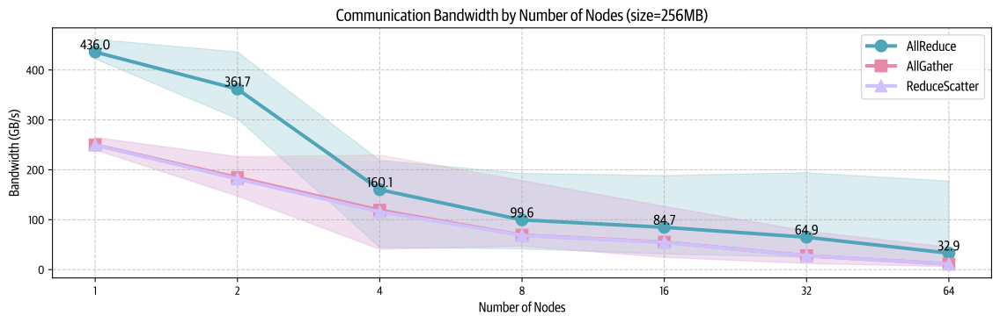

不同节点数量下的节点间通信带宽测量，展示了 all-reduce、all-gather 和 reduce-scatter 操作的中位数（曲线）及第 5–95 百分位范围（阴影区域）。

序列并行和上下文并行可以帮助处理长序列，但如果显存问题的根源是模型本身的大小，而不是序列长度，它们的帮助就不大。
对于大型模型（70B 以上参数），仅权重大小就可能超出单个节点上 4–8 张 GPU 的容量限制。
我们可以通过引入另一个并行维度来解决这一问题：*流水线并行*（PP）。

流水线并行是一项简单而强大的技术：将模型的各层拆分到多张 GPU 上！
例如，如果有 8 张 GPU，可以将第 1–4 层放在 GPU 1 上，第 5–8 层放在 GPU 2 上，依此类推。
这样，每张 GPU 只需要保存和处理模型的一部分层，从而显著降低每张 GPU 的显存需求。
我们来看看流水线并行如何影响一个 8B 参数模型的显存占用：

> 这项技术可能会让你想起前面讨论的 [ZeRO-3](./data-parallelism.md#zero-3-加入参数划分-fsdp)，其中我们也将模型参数拆分到各张 GPU 上。
> 后面的[“5D 并行概览”](./5d-parallelism.md)一节将详细比较这两项技术。

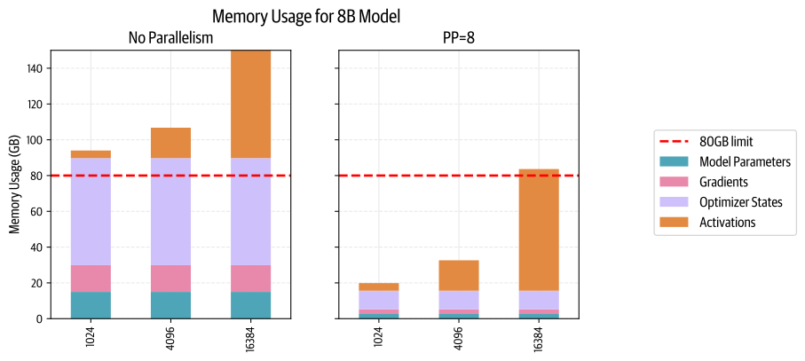

观察上图，我们会发现一个有意思的现象：虽然模型参数很好地拆分到了各张 GPU 上，但每张 GPU 的激活显存仍然保持不变！
这意味着，这种方法并不能节省激活显存。

> 📝 注记
>
> 这是因为，每张 GPU 在开始第一次反向传播之前，需要执行 PP 次前向传播。
> 由于每张 GPU 处理 1/PP 的层，但在第一次反向传播之前需要处理 PP 个微批次，最终保存的激活为 $PP \times (activs / PP) \approx activs$，这意味着激活显存需求与不使用流水线并行时大致相同。

这引入了一种新的通信模式：我们现在在 GPU 之间以“流水线”方式依次传递激活张量，而不像数据并行中的 ZeRO-3 那样传递参数。
虽然概念简单，但高效实现这项技术相当棘手。
我们直接来看细节！

## 将层拆分到不同节点：全部前向，再全部反向

首先，假设我们只是将各层分散到多个设备上，例如第一张 GPU 负责最前面的几层，第二张 GPU 负责模型的第二部分，依此类推。
现在，模型的前向传播只需沿模型依次传递一批数据，从而逐个使用各个计算设备。

这直接带来了第一个优势：所需的互连带宽保持在较低水平，因为我们只在模型深度方向上的少数位置发送大小适中的激活。
与 TP 等方法相比，这可能带来巨大差异，因为 TP 在每层内部都会发生多次通信。

不过，你可能已经开始察觉接下来的问题了：“依次”和“逐个”？！
在并行计算的世界里，这听起来并不高效，尤其是在我们刚刚讨论过计算与通信重叠之后。

确实如此，读者！
流水线并行的主要挑战，是如何高效地绕过 PP 的串行性质，让 GPU 始终保持忙碌，避免一张 GPU 计算、其他 GPU 等待的情况。
对模型执行朴素而简单的前向和反向传播时，GPU 利用情况如下（这里的数字表示模型层）：

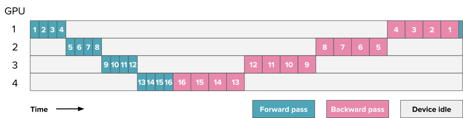

一个流水线并行示例：将 16 层模型分布到 4 张 GPU 上。
数字对应层编号。

其余空闲时间用灰色表示，通常称为“气泡”（bubble）。
在我们花了这么多时间优化吞吐量之后，看到这个场景，你可能会心碎。

我们可以根据气泡造成的时间损失，量化流水线配置的效率。
设 $t_f$ 和 $t_b$ 分别表示流水线一个阶段处理一个微批次时，测得的前向和反向传播时间（通常可以简单假设 $t_b \approx 2 \times t_f$，如上图所示）。
如果能够完美并行，理想总时间就是 $t_{id}=t_f + t_b$。
不过，在这个例子中，流水线气泡带来了 $t_{pb}=(p-1)*(t_f+t_b)$ 的额外时间（其中 $p$ 是流水线并行度，即 GPU 数量）。
这是其他 GPU 计算时，每张 GPU 等待的时间。

额外气泡时间与理想时间的比值可以按如下方式计算：

$$
r_{bubble} = \frac{(p-1)*(t_f+t_b)}{t_f+t_b} = p-1
$$

因此，随着阶段数量增加，气泡时间会增加，利用率会下降。
可以看到，朴素实现中的气泡可能非常大！

幸运的是，人们已经设计了多种流水线并行方案来减小气泡。

我们先从工具箱中拿出一件工具，考虑像前面的 DP 方法那样，将批次拆成可以并行（或近似并行）处理的小块。
这样，当第二张 GPU 忙于处理微批次 1 时，第一张 GPU 就已经可以开始处理微批次 2。
下面是使用八个微批次的调度：

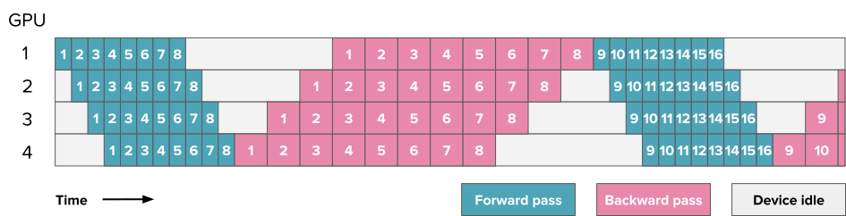

> 前面的图中，数字表示层，但从这里开始，所有流水线并行图中的数字都表示微批次。
> 你可以将这里的每个方块理解为包含前图中的多个层。

上面的调度称为**全部前向、全部反向（all forward, all backward，AFAB）**调度，因为我们先执行所有前向传播，再执行所有反向传播。
它的优势在于，前向和反向步骤总体上仍然是串行的，因此保留了模型训练代码的总体组织方式。
这是最容易实现的 PP 方案之一。

你可以在 Picotron 中找到 AFAB 流水线的完整实现：

<details>
<summary>👉 Picotron 中的 AFAB PP 实现（点击展开）</summary>

```python
def train_step_pipeline_afab(model, data_loader, tensor_shapes, device, dtype):
    logging_loss: torch.float32 = 0.0
    input_tensors, output_tensors = [], []
    requires_grad_sync = pgm.process_group_manager.cp_dp_world_size > 1

    for _ in range(data_loader.grad_acc_steps): # All forward passes
        input_tensor = pipeline_communicate(operation='recv_forward', shapes=tensor_shapes, device=device, dtype=dtype)
        batch = next(data_loader)
        batch["hidden_states"] = input_tensor.to(device) if input_tensor is not None else input_tensor
        output_tensor = model.forward(input_ids=batch["input_ids"].to(device), position_ids=batch["position_ids"].to(device), hidden_states=batch["hidden_states"])
        pipeline_communicate(operation='send_forward', tensor=output_tensor, device=device, dtype=dtype)
        
        # calculate loss on the last stage
        if pgm.process_group_manager.pp_is_last_stage:
            output_tensor = F.cross_entropy(output_tensor.transpose(1, 2), batch["target_ids"].to(device), reduction='mean')
            logging_loss += output_tensor.item() / data_loader.grad_acc_steps

        input_tensors.append(input_tensor)
        output_tensors.append(output_tensor)

    for ith_microbatch in range(data_loader.grad_acc_steps): # All backward passes
        if requires_grad_sync:
            is_last_iteration = (ith_microbatch == data_loader.grad_acc_steps - 1)
            model.require_backward_grad_sync = is_last_iteration
        output_tensor_grad = pipeline_communicate(operation='recv_backward', shapes=tensor_shapes, device=device, dtype=dtype)
        input_tensor, output_tensor = input_tensors.pop(0), output_tensors.pop(0)
        input_tensor_grad = model.backward(input_tensor, output_tensor, output_tensor_grad)
        pipeline_communicate(operation='send_backward', tensor=input_tensor_grad, device=device, dtype=dtype)

    return logging_loss
```

</details>

我们来估算这个例子中的气泡。
与第一个例子的区别是，现在处理 $m$ 个微批次的理想时间为 $t_{id} = m*(t_f+t_b)$：

$$
r_{bubble} = \frac{(p-1)*(t_f+t_b)}{m*(t_f+t_b)} = \frac{p-1}{m}
$$

可以看到，通过增加微批次数量，我们可以抵消一部分流水线阶段的低效，将气泡大小缩小 $m$ 倍。

不过，保存所有激活所需的显存和气泡一样令人头疼。
在到达反向阶段之前，我们需要将所有激活保留在显存中，这很快就会导致这些 PP 实现出现显存爆炸。
我们能否做得更好，避免这个问题？

既然显存爆炸是由为反向传播保存的激活引起的，我们就来看看，能否在仍执行前向计算时就开始反向传播。
这样，我们就可以尽早丢弃一部分反向传播所需的激活。

## 一次前向、一次反向与 Llama 3.1 方案

这种调度称为**一次前向、一次反向（one forward, one backward，1F1B）**，因为在中间的稳态阶段，会交替执行一次前向传播和一次反向传播。
总体思路是尽早开始反向传播。
调度如下：

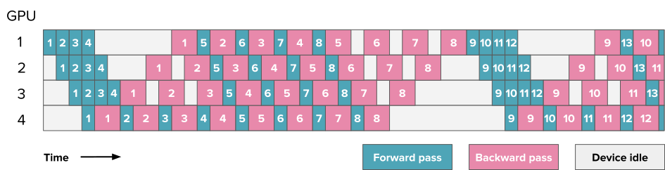

如果仔细数一数，就会发现气泡大小仍然相同，因此训练效率并未显著提高。
不过，我们只需保存 $p$ 个微批次的激活（其中 $p$ 是流水线并行度），而不是 $m$ 个（其中 $m$ 是微批次数量），从而减轻 AFAB 调度中的激活显存爆炸问题。
因此，我们可以加入更多微批次，而这才会真正减小气泡。

从上图可以看到，这种配置的一项主要复杂性在于，前向和反向传播不再清楚地串行进行，而是在不同设备上并行执行并相互交错。
这意味着，我们必须在每个设备上独立调度从前向到反向传播的切换，而不能像往常那样使用一个简单、统一的中央训练循环。

这也是实现流水线并行通常需要对训练代码和模型代码进行大量修改的原因之一。

你也可以在 Picotron 中找到 1F1B 的完整实现：

<details>
<summary>👉 Picotron 中的 1F1B PP 实现（点击展开）</summary>

```python
def train_step_pipeline_1f1b(model, data_loader, tensor_shapes, device, dtype):    
    num_warmup_microbatches = min(pgm.process_group_manager.pp_world_size - pgm.process_group_manager.pp_rank - 1, data_loader.grad_acc_steps)
    num_microbatches_remaining = data_loader.grad_acc_steps - num_warmup_microbatches
    logging_loss, input_tensors, output_tensors  = 0.0, [], []
    requires_grad_sync = pgm.process_group_manager.cp_dp_world_size > 1
    
    def _forward_step(input_tensor):
        batch = next(data_loader)
        batch["hidden_states"] = input_tensor.to(device) if input_tensor is not None else input_tensor
        output_tensor = model.forward(input_ids=batch["input_ids"].to(device), position_ids=batch["position_ids"].to(device), hidden_states=batch["hidden_states"])
        
        # calculate loss on the last stage
        if pgm.process_group_manager.pp_is_last_stage:
            output_tensor = F.cross_entropy(output_tensor.transpose(1, 2), batch["target_ids"].to(device), reduction='mean')
            nonlocal logging_loss
            logging_loss += output_tensor.item() / data_loader.grad_acc_steps
        return output_tensor

    for _ in range(num_warmup_microbatches): # Warmup forward passes
        input_tensor = pipeline_communicate(operation='recv_forward', shapes=tensor_shapes, device=device, dtype=dtype)
        output_tensor = _forward_step(input_tensor)
        pipeline_communicate(operation='send_forward', tensor=output_tensor, device=device, dtype=dtype)
        input_tensors.append(input_tensor)
        output_tensors.append(output_tensor)

    if num_microbatches_remaining > 0:
        input_tensor = pipeline_communicate(operation='recv_forward', shapes=tensor_shapes, device=device, dtype=dtype)
    
    if requires_grad_sync:
        model.require_backward_grad_sync = False

    for ith_microbatch in range(num_microbatches_remaining):  # 1F1B steady state
        is_last_iteration = (ith_microbatch == num_microbatches_remaining - 1)
        output_tensor = _forward_step(input_tensor)
        output_tensor_grad = bidirectional_pipeline_communicate(operation='send_fwd_recv_bwd', send_tensor=output_tensor, recv_shapes=tensor_shapes, device=device, dtype=dtype)
        input_tensors.append(input_tensor)
        output_tensors.append(output_tensor)
        input_tensor, output_tensor = input_tensors.pop(0), output_tensors.pop(0)
        
        # Trigger gradient sync on the last microbatch but only when last rank (the one that has num_warmup_microbatches = 0) has finished computing its backward pass.
        if num_warmup_microbatches == 0 and is_last_iteration:
            model.require_backward_grad_sync = True

        input_tensor_grad = model.backward(input_tensor, output_tensor, output_tensor_grad)
        
        if is_last_iteration:
            input_tensor = None
            pipeline_communicate(operation='send_backward', tensor=input_tensor_grad, device=device, dtype=dtype)
        else:
            input_tensor = bidirectional_pipeline_communicate(operation='send_bwd_recv_fwd', send_tensor=input_tensor_grad, recv_shapes=tensor_shapes, device=device, dtype=dtype)

    for ith_warmup_microbatches in range(num_warmup_microbatches): # Cooldown backward passes
        if requires_grad_sync:
            is_last_iteration = (ith_warmup_microbatches == num_warmup_microbatches - 1)
            model.require_backward_grad_sync = (ith_warmup_microbatches == num_warmup_microbatches - 1)
        input_tensor, output_tensor = input_tensors.pop(0), output_tensors.pop(0)
        output_tensor_grad = pipeline_communicate(operation='recv_backward', shapes=tensor_shapes, device=device, dtype=dtype)
        input_tensor_grad = model.backward(input_tensor, output_tensor, output_tensor_grad)
        pipeline_communicate(operation='send_backward', tensor=input_tensor_grad, device=device, dtype=dtype)

    return logging_loss
```

</details>

我们通过集群上的一些基准测试，看看 1F1B 流水线并行调度在实践中如何扩展：

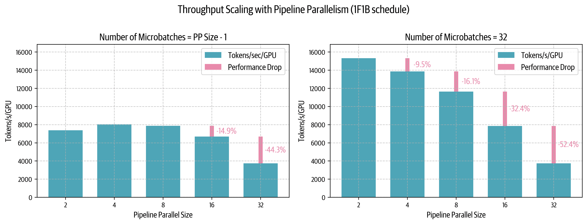

左图中，微批次数量不超过 PP 度减一（$m = p - 1$），可以看到流水线气泡的危害：性能很低，甚至随着 PP 规模扩大而下降。
右图表明，使用远多于 PP 度的微批次（$m = 32 \gg p - 1$）有助于改善较低 PP 度下的性能，但在很高的 PP 度下仍受到限制。
实践中，由于最终受目标全局批大小约束，我们不可能任意增加微批次数量，以保持 $m \gg p - 1$ 的关系。
微批次数量达到最大可能值之后，继续增加 PP 度，最终就不得不按照 $r_{bubble} = \frac{p - 1}{m}$ 增大气泡。

有意思的是，在微批次数量较少时，从一个节点（$p = 8$）扩展到两个节点（$p = 16$），性能只下降 14%；这比张量并行的扩展表现好得多，后者在类似的跨节点场景中，性能通常下降约 43%。
当遇到带宽较低的节点间网络时，这种表现使流水线并行对跨多个节点的分布式训练尤其有吸引力。

虽然 1F1B 显著减少了激活显存占用，但从最后这张图中可以看到，流水线气泡仍然是主要的效率瓶颈。
气泡大小仍与流水线阶段数量成正比，因此我们让宝贵的 GPU 算力闲置了。
我们能否设计更聪明的调度，将这种浪费的计算时间降到最低？

## 阶段交错

1F1B 调度改善了显存占用，但对空闲气泡的大小没有太大影响。
有没有办法进一步推进？

事实证明，只要愿意引入一些额外通信操作，就可以做到。
是时候讨论**交错阶段**了！

到目前为止，我们沿模型深度维度朴素地切分模型，例如在第一张 GPU 上放第 1–4 层，在第二张 GPU 上放第 5–8 层。
但还可以考虑其他切分方式，例如将奇数层（1、3、5、7）放在第一张 GPU 上，将偶数层（2、4、6、8）放在第二张 GPU 上。

总体上，这可以看作一种“循环流水线”：微批次在模型中执行前向传播时，会从一张 GPU 到下一张 GPU，循环流转。
我们来看看它如何工作：

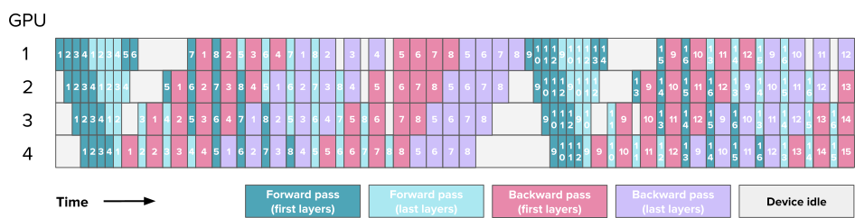

一个交错流水线并行示例，模型的各层分布在 4 张 GPU 上。
数字仍对应微批次编号，但为了清楚展示各层如何分布到 GPU 上，我们为模型的第一层和最后一层使用了不同颜色。

这里需要额外通信，因为此前只需经过一遍各张 GPU 的同一次计算，现在需要多次经过每张 GPU。
不过，由于能够更好地交错前向和反向传播，每次前向和反向传播都被拆分为 $v$ 份，其中 $v$ 是每张 GPU 上的阶段数或模型块数：

$$
\begin{aligned}
&t_{pb} = \frac{(p-1)*(t_f+t_b)}{v} \\
&r_{bubble} = \frac{1}{v}\frac{(p-1)*(t_f+t_b)}{m*(t_f+t_b)} = \frac{p-1}{v*m}
\end{aligned}
$$

因此，现在可以通过增加微批次和交错阶段来减小气泡，但从数量上说，通信量也会增加为原来的 $v$ 倍，因此这是一项权衡。
下图展示了 $p=8$ 的 PP 配置中的几种设置，其中 $m=1, v=1$ 的特殊情况对应朴素流水线并行，$v=1$ 的配置是 AFAB 或 1F1B，而 $v \neq 1$ 的情况是交错配置。

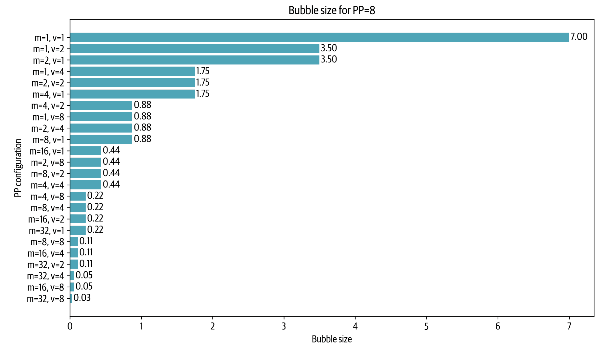

调度也变得更加复杂，因为对于某张 GPU 的某个时刻，我们必须决定，是优先让较早的微批次通过较后的层，从而尽快闭合前向和反向循环（即“深度优先”方法，优先让批次尽快离开模型），还是优先让较后的微批次通过较早的层（即“广度优先”方法，优先尽可能填满流水线）。
[“Breadth-Fist Pipeline Parallelism”论文](https://arxiv.org/abs/2211.05953)详细解释了这一选择。

现在，你已经具备理解 Llama 3.1 流水线并行方法所需的全部要素：它采用带交错阶段的 1F1B 配置，并且可以在深度优先和广度优先之间调整优先级：

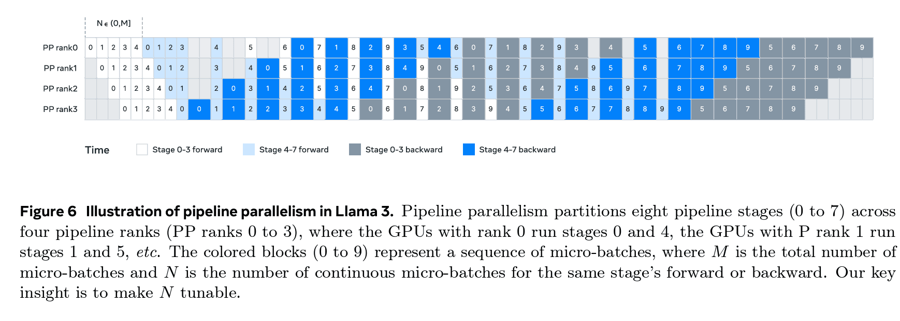

不过，可能的流水线调度还不止这些，最近提出的一些方法甚至能够**将气泡减小到几乎为零**！
例如，这些技术就用于 DeepSeek-V3/R1 的[实现](https://arxiv.org/abs/2412.19437)。
勾起你的好奇心了吗？
在离开流水线并行的世界之前，我们最后快速看看这些神奇的调度！

## 零气泡与 DualPipe

最近，人们提出了更加复杂的减小气泡的方法，可以接近“零气泡”状态，例如 DeepSeek-V3/R1 中称为 DualPipe 的流水线实现方法。
这里的秘诀，是以更细的粒度拆分相关操作，以便用最高效的方式交错执行。

> 在 [DeepSeek-V3 技术报告](https://arxiv.org/abs/2412.19437)中，作者表示，他们的配置实现了“接近零的 all-to-all 通信开销”。

我们通过概述 Sea AI Lab 的[零气泡工作](https://arxiv.org/abs/2401.10241)，简要看看这如何实现；这项工作是 DualPipe 的前身。
这里的基本观察是，矩阵乘法的反向传播实际上涉及两个独立操作：输入的反向操作（$B$）和权重的反向操作（$W$）。

输入反向传播 $B$ 的输出，是执行更低层反向传播所必需的；而权重的反向传播 $W$ 并不是，通常只需要在优化器更新之前完成。
我们可以在下图（来自 Zero Bubble 论文）中看到这一点：

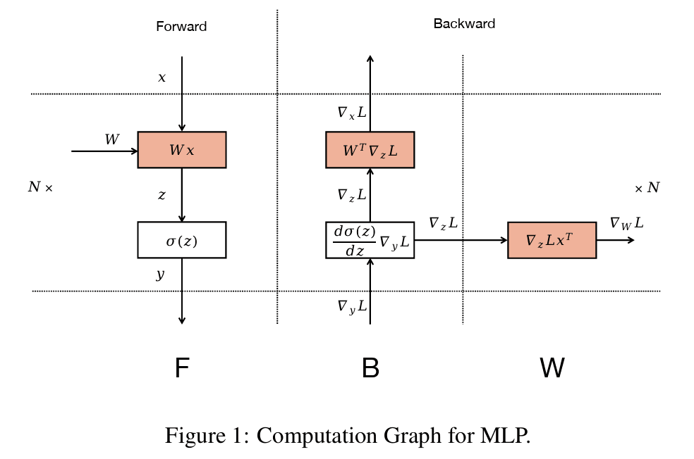

这意味着，可以将 $W$ 灵活地安排在同一阶段对应的 $B$ 之后的任何位置。
这样就可以有策略地安排 $W$，填补流水线气泡。
右上角的 ZB-H2 调度，就是利用这种细粒度分解实现零气泡的一个（理论）调度示例。

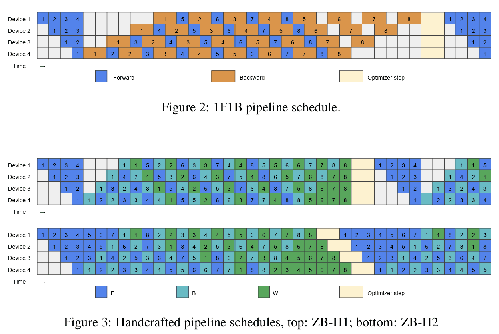

上方（Zero Bubble 论文中的图 2）：经典 1F1B 调度，交错执行前向和反向传播，但反向传播仍保持粗粒度。
下方（Zero Bubble 论文中的图 3）：两种手工设计的调度，将反向传播拆分为更细粒度的 $B$ 和 $W$ 操作。
最下面的调度，是利用这种细粒度分解实现（理论上）零气泡的一个示例。

DeepSeek 随 [V3 技术报告](https://arxiv.org/abs/2412.19437)提出的 DualPipe，将这种分解方法扩展到另一种情况：两条流从 PP 维度的两端传播，并交错执行，以进一步减少 GPU 空闲时间。
下方调度图展示了这种调度，可以看到，它比之前的调度更加复杂：

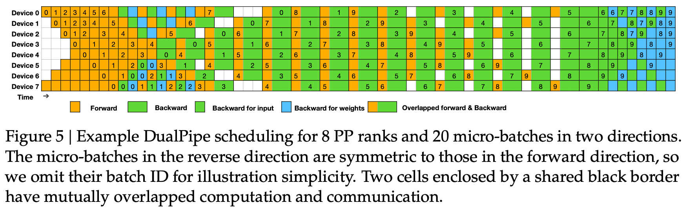

总体而言，要充分优化如此复杂的调度，需要仔细测量各种细粒度操作的持续时间，并求解整数线性规划（ILP）问题，以尽可能减少最终的气泡时间。
（例如，可以参阅 [Zero Bubble 论文](https://arxiv.org/abs/2401.10241)中关于这类调度所用启发式方法和算法的讨论。）
因此，零气泡和 DualPipe 调度过于复杂，我们无法在这里给出代码片段，但你应该已经大致了解相关概念。

我们对流水线调度与气泡世界的探索到此结束。
希望你喜欢这段旅程！

现在，是时候转向我们将详细介绍的最后一种并行方法了，它能够用来高效训练大模型：**专家并行**。
