# 张量并行

为了让阅读更有听播客的感觉，你可以边读边听 NotebookLM 主持人讨论本书接下来的几个章节。

我们已经用 ZeRO 对模型的参数、梯度和优化器状态进行了分片，但当激活所需的显存超出预算时，我们还是会遇到限制。
这时就轮到张量并行（tensor parallelism，TP）登场了：它对权重、梯度、优化器状态以及激活进行分片，而且在计算之前不需要将它们全部收集起来。
听起来像做梦一样！
我们先来看看 TP 如何用于简单的矩阵乘法（matmul）运算。

张量并行利用了矩阵乘法 $A \times B$ 的数学性质。
要理解它的工作原理，我们先来看使这种并行化成为可能的两个基本等式：

$$
\begin{aligned}
&\text{1.} \quad A\cdot B = A \cdot \begin{bmatrix} B_1 & B_2 & \cdots \end{bmatrix} = \begin{bmatrix} AB_1 & AB_2 & \cdots \end{bmatrix} \\
&\text{2.} \quad A\cdot B =\begin{bmatrix} A_1 & A_2 & \cdots \end{bmatrix} \begin{bmatrix} B_1 \\ B_2 \\ \vdots \end{bmatrix} = \sum_{i=1}^n A_i B_i
\end{aligned}
$$

这意味着，我们可以分别与 $B$ 的每一列相乘，也可以分别与每一行相乘再合并结果，从而计算矩阵乘积。
在神经网络中，矩阵乘法更常写成 $X \times W$ 的形式，其中：

- $X$ 表示输入或激活值。
- $W$ 表示线性层的权重。

下面是这一运算的一个小例子：

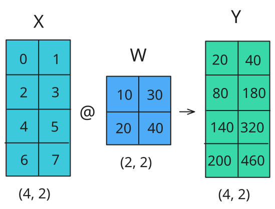

我们来看看如何并行化这一运算！
在张量并行中，张量沿某个维度被拆成 $N$ 个分片，并分配到 $N$ 张 GPU 上。
矩阵可以按列或按行拆分，从而形成列并行或行并行。
正如接下来会看到的，按行和按列分片需要不同的通信原语。

第一种选择是**按列（column-wise）**分片，也称为 *column-linear*：我们将完整的输入矩阵复制到每个工作进程，这需要一种称为**广播（broadcast）**的操作，并将权重矩阵按列拆分。
然后，将输入与部分权重矩阵相乘，最后通过 all-gather 操作合并结果。

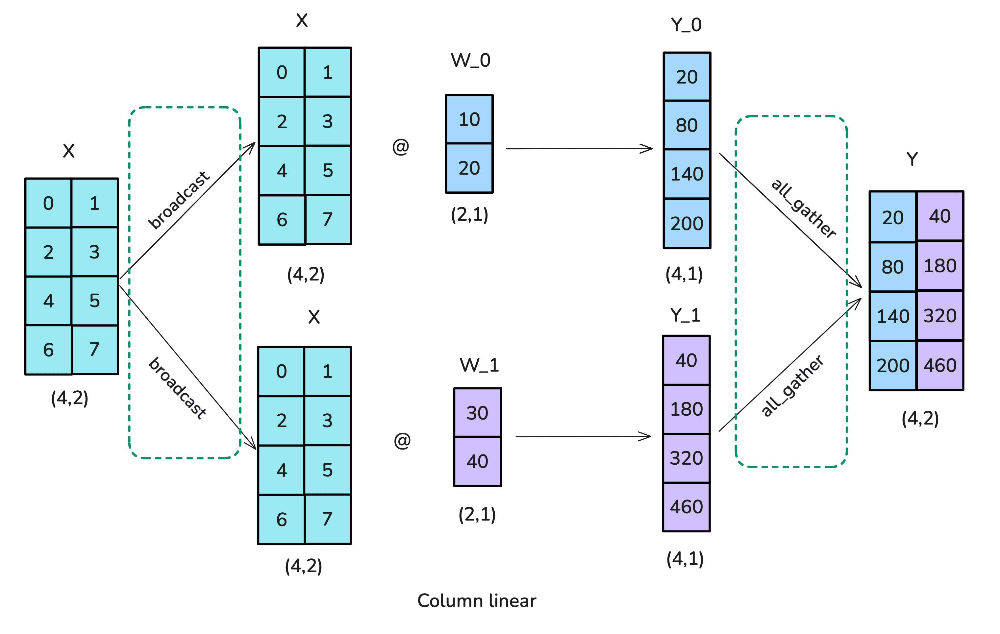

下面是按列进行张量并行的代码实现：

<details>
<summary>👉 Picotron 中的列并行 TP 实现（点击展开）</summary>

```python
class ColumnParallelLinear(torch.nn.Module):
    """Column Parallel Linear layer
    Y = XW + b, where weight matrix W is parallelized along its second dimension. W = [W_1, ..., W_p]
    This module returns the results of Y_i = XW_i + b_i in the forward method, Y_i is parallelized in the second dimension.
    Arguments:
        in_features: first dimension of weight matrix W.
        out_features: second dimension of weight matrix W.
        bias: If true, add bias
        init_method: method to initialize weights
        gather_output: If true, gather the output from all the partitions. This is used for the last linear layer
    """

    def __init__(
        self,
        in_features: int,
        out_features: int,
        bias: bool = False,
        gather_output: bool = False,
        async_all_reduce: bool = False,
    ) -> None:
        super(ColumnParallelLinear, self).__init__()

        self.tp_world_size = pgm.process_group_manager.tp_world_size
        self.tp_rank = pgm.process_group_manager.tp_rank 

        self.in_features = in_features
        self.out_features = out_features
        assert out_features % self.tp_world_size == 0, "Hidden dimension must be divisible by the tensor parallel world size"
        self.output_size_per_partition = out_features // self.tp_world_size
        self.gather_output = gather_output
        self.async_all_reduce = async_all_reduce
        # Allocate space for the weight and bias
        # Note: torch.nn.functional.linear performs XW^T + b so we exchange the order of dimensions
        self.weight = nn.Parameter(torch.Tensor(self.output_size_per_partition, self.in_features)) # W_i
        if bias:
            self.bias = nn.Parameter(torch.Tensor(self.output_size_per_partition))
            with torch.no_grad():
                self.bias.zero_()
        else:
            self.register_parameter("bias", None)

        self.reset_parameters()

    def reset_parameters(self):
        # Initialize weight tensor with the default initialization method used for nn.Linear in PyTorch
        master_weight = torch.empty(
            self.out_features, 
            self.in_features, 
            dtype=self.weight.dtype,
            device=self.weight.device,
            requires_grad=False
        )
        
        # Calculate bound based on master weight's input dimension
        k = 1 / master_weight.size(1)
        bound = math.sqrt(k)
        torch.nn.init.uniform_(master_weight, -bound, bound)
        
        # Split the model into size of self.output_size_per_partition
        weight_list = torch.split(master_weight, self.output_size_per_partition, dim=0)
        self.weight.data = weight_list[self.tp_rank].contiguous()
    
    def forward(self, x: torch.Tensor) -> torch.Tensor:  
        if self.async_all_reduce:
            output = linear_with_async_all_reduce(x, self.weight, self.bias) 
        else:
            output = linear_with_all_reduce(x, self.weight, self.bias) 
        if self.gather_output:
            output = GatherFromModelParallelRegion.apply(output)
        return output
```

</details>

第二种选择称为**按行（row-wise）**分片，也称为 *row-linear*。
细心的读者可能已经猜到，row-linear 意味着将权重矩阵拆成若干行块。
不过，这也要求我们拆分输入，因此需要使用 **scatter** 操作（我们介绍的第四种分布式通信原语！），而不是 column-linear 分片中使用的 broadcast 操作。
每个工作进程上的结果已经具有正确的形状，但还需要求和，因此这种情况也需要 all-reduce 操作：

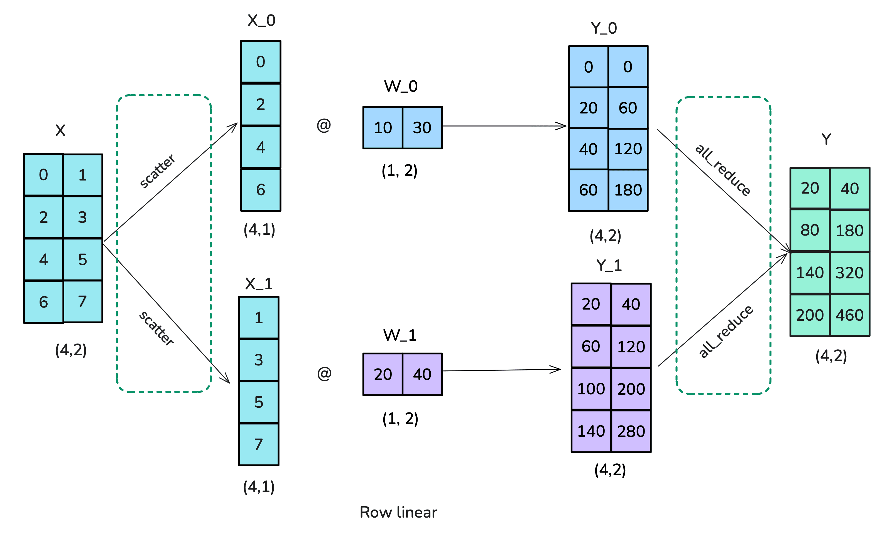

下面是按行进行张量并行的实现：

<details>
<summary>👉 Picotron 中的行并行 TP 实现（点击展开）</summary>

```python
class RowParallelLinear(nn.Module):
    """Linear layer with row parallelism.
    Y = XW + b. W is parallelized along its first dimension and X along its second dimension as:
               -   -
              | W_1 |
              | .   |
          W = | .   |        X = [X_1, ..., X_p]
              | .   |
              | W_p |
               -   -
    We assume that X is already parallelized. This is the case after ColumnParallelLinear.
    This module returns the results of Y = sum(X_i * W_i + b_i) in the forward method.
    Arguments:
        in_features: first dimension of matrix W.
        out_features: second dimension of matrix W.
        bias: If true, add bias
        init_method: method to initialize weights.
    """
    def __init__(self, in_features: int, out_features: int, bias: bool):
        super(RowParallelLinear, self).__init__()

        self.tp_world_size = pgm.process_group_manager.tp_world_size
        self.tp_rank = pgm.process_group_manager.tp_rank 

        self.in_features = in_features
        self.out_features = out_features
        assert in_features % self.tp_world_size == 0, "Hidden dimension must be divisible by the tensor parallel world size"
        self.input_size_per_partition = in_features // self.tp_world_size

        self.weight = nn.Parameter(torch.Tensor(self.out_features, self.input_size_per_partition))
        if bias:
            self.bias = nn.Parameter(torch.Tensor(self.out_features))
            # Always initialize bias to zero.
            with torch.no_grad():
                self.bias.zero_()
        else:
            self.register_parameter("bias", None)

        self.reset_parameters()

    def reset_parameters(self):
        # Initialize weight tensor with same dtype and device as self.weight
        master_weight = torch.empty(
            self.out_features, 
            self.in_features, 
            dtype=self.weight.dtype,
            device=self.weight.device,
            requires_grad=False
        )
        
        # Calculate bound based on master weight's input dimension
        k = 1 / master_weight.size(1)
        bound = math.sqrt(k)    
        torch.nn.init.uniform_(master_weight, -bound, bound)
        
        # Split the model into size of self.input_size_per_partition
        weight_list = torch.split(master_weight, self.input_size_per_partition, dim=1)
        self.weight.data = weight_list[self.tp_rank].contiguous()

    def forward(self, x):
        # X_i * W_i^T + b
        output_parallel = F.linear(x, self.weight)
        # All-reduce across all the partitions.
        output = ReduceFromModelParallelRegion.apply(output_parallel)
        return output if self.bias is None else output + self.bias
```

</details>

现在，我们已经了解了 TP 的基本构件，接下来看看如何在 Transformer 层内部有效地组合它们！

## Transformer 块中的张量并行

为了找到一种可行的策略，我们从玩具示例转向真实模型的构件。
Transformer 模型由两个主要构件组成：前馈多层感知机（MLP）块和多头注意力（MHA）块。
我们可以对两者都应用张量并行。

前馈部分可以通过先进行 column-linear 分片、再进行 row-linear 分片来并行化，这相当于在前向传播中用一次 broadcast 复制输入，再进行一次 all-reduce。
实际训练中不需要这次 broadcast，因为我们可以确保输入在各个 TP rank 之间已经同步。
这种安排比先进行 row-linear 分片、再进行 column-linear 分片更高效，因为我们可以省去两次分片操作之间的 all-reduce。

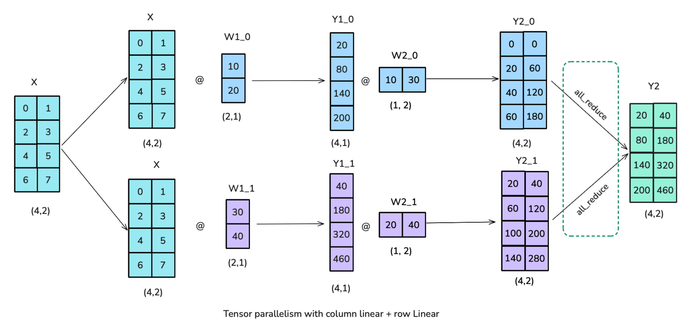

现在，我们已经为 Transformer 的前馈部分找到了一种高效方案，接下来看看多头注意力块。

这里通常也可以采用类似的方法：对 Query（Q）、Key（K）和 Value（V）矩阵按列并行拆分，并将输出投影视为 row-linear。
对于多头注意力，列并行有一个很自然的解释：每张 GPU 为一个注意力头或一组注意力头计算注意力。
同样的方法也适用于 [**多查询注意力（MQA）**](https://arxiv.org/abs/1911.02150)或[**分组查询注意力（GQA）**](https://arxiv.org/abs/2305.13245)，其中多个 query 共享 key 和 value。

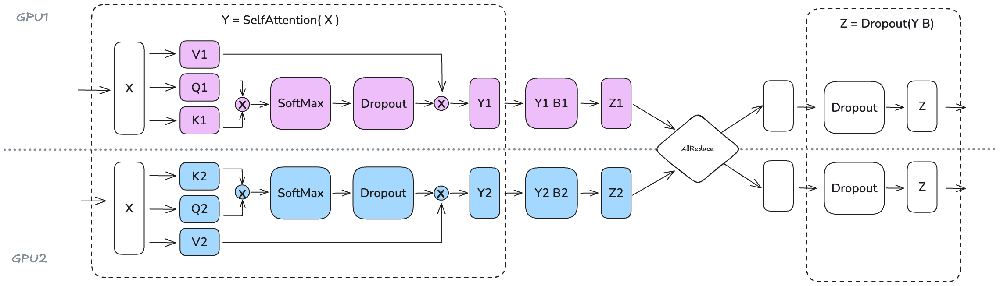

我们能够如此有效地对 Attention 和 MLP 块应用张量并行，是因为它们存在天然独立的维度。
Attention 块可以沿 `num_attention_heads` 维度并行化，因为每个注意力头都是独立工作的。
类似地，MLP 块可以沿 `hidden_dim` 维度并行化，因为前馈网络中的运算在这一维度上是独立的。

不过，张量并行度不应超过注意力头的数量，因为我们沿 `num_attention_heads` 维度对 QKV 投影进行分片。
使用分组查询注意力（GQA）时，我们有 $num\_attention\_heads$ 个 query 头，但只有 $num\_kv\_heads$ 个 key/value 头（其中 $num\_attention\_heads >= num\_kv\_heads$）。
在这种情况下，我们仍然可以设置 $TP = num\_attention\_heads$，但需要确保 K/V 头在各张 GPU 之间保持正确同步。
例如，Llama-3 8B 有 32 个 query 头，但只有 8 个 key/value 头，因此虽然 TP 度理论上可以达到 32，我们仍需要仔细实现，以保持各个张量并行工作进程之间的 K/V 头同步。

还要注意，张量并行并不是训练的万能解法。
我们在模型的计算路径上直接加入了若干分布式通信原语，因此很难像在 ZeRO 中那样，用计算完全隐藏这些通信或使两者完全重叠，所以最终性能取决于计算和显存收益与新增通信开销之间的权衡。
我们用图来说明：


> 可以将分块矩阵乘法与异步通信/计算结合起来，部分隐藏这些通信。

观察张量并行 MLP 的操作时间线（MHA 也同样如此），我们可以更好地理解其中的权衡。
在每个解码器层的前向传播中，我们都会在 all-reduce 操作处遇到一个无法与计算重叠的同步点。
在应用最后的 LayerNorm 之前，需要合并各个张量并行 rank 的部分结果，因此这种*暴露出来的通信开销*是必要的。

> 例如，Megatron-LM 和 Nanotron 实现了 all-gather 与全连接层（FC1）计算的部分重叠：在矩阵乘法的剩余部分仍在计算时，一部分结果已经开始发送到另一张 GPU。

张量并行确实有助于减少矩阵乘法的激活显存，因为中间激活被分片到各张 GPU 上。
不过，对于 LayerNorm 等操作，我们仍需要收集完整的激活，因此还没有获得全部可能的显存收益。
此外，TP 引入了大量通信需求，而这些通信高度依赖网络基础设施。
由于无法用计算完全隐藏这次特定的 all-reduce，它会直接增加前向传播的关键路径长度；这里的关键路径指决定完成前向传播所需最短时间的一系列操作。

> 这是一个仍在积极研究的领域，近期的 [Domino](https://arxiv.org/abs/2409.15241) 等工作正在探索新的技术，以最大限度地增加这种重叠。

我们进一步看看，随着 TP 度提高，这种权衡会如何变化：

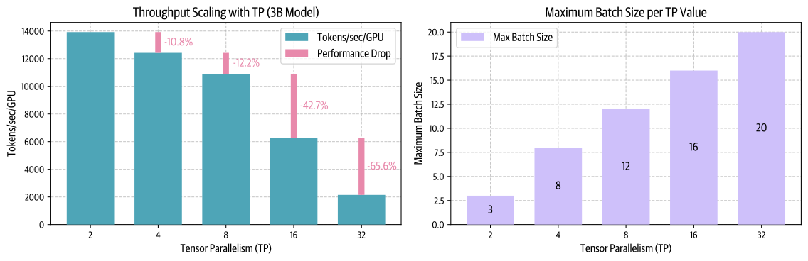

虽然提高 TP 会降低单张 GPU 的吞吐量（左图），但它使模型能够处理更大的批大小（右图），这体现了分布式训练中计算效率与可用显存之间的权衡。

在实践中，正如上面的左图所示，当规模超过 8 张 GPU 时，张量并行的通信开销会变得尤其明显。
单节点内的张量并行可以利用高速 NVLink 互连，但跨节点时就需要使用更慢的网络连接。
我们观察到，从 TP=8 增加到 TP=16 时性能明显下降，而从 TP=16 增加到 TP=32 时下降得更加剧烈。
当并行度较高时，通信开销会变得很大，很快就会主导计算时间。

尽管如此，张量并行通过将模型参数、梯度、优化器状态以及一定程度上的激活分布到各张 GPU 上，仍然能带来重要的显存收益。
我们用一个 70B 参数模型来看看这种效果：

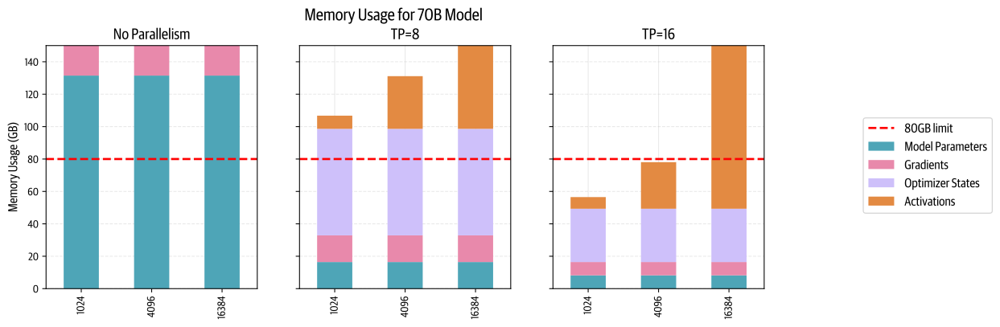

提高张量并行度会减少每张 GPU 上模型参数、梯度和优化器状态所需的显存，直到我们开始能够在一个包含 8 张 GPU 的节点上放下更大的模型。

我们能否从这项技术中获得更多收益？
层归一化和 dropout 仍然要求在每张 GPU 上收集完整的激活，抵消了一部分显存节省。
我们可以进一步寻找办法，将这些剩余操作也并行化。

> 📝 注记
>
> 张量并行训练中的层归一化有一个有意思的特点：由于 all-gather 之后每个 TP rank 看到的激活相同，LayerNorm 权重实际上不需要在反向传播后通过 all-reduce 同步梯度。
> 它们会自然地在各个 rank 之间保持同步。
> 不过，对于 dropout 操作，我们必须确保各个 TP rank 的随机种子同步，以保持确定性行为。

接下来，我们将介绍张量并行的一种简单、自然的扩展，称为**序列并行（sequence parallelism）**，它正是用来实现这一点的。

## 序列并行

序列并行（SP）会对模型中未由张量并行处理的部分（例如 dropout 和 LayerNorm）的激活与计算进行拆分，不过拆分沿着输入序列维度进行，而不是隐藏维度。

> 📝 注记
>
> “序列并行”这个术语有些一词多义。
> 本节讨论的序列并行与张量并行紧密耦合，应用于 dropout 和层归一化操作。
> 不过，当序列变长时，注意力计算会成为瓶颈，这时就需要 Ring Attention 等技术。
> 这些技术有时也被称为序列并行方法，但为了区分这两类方法，我们将它们称为*上下文并行*。
> 因此，在本书中看到“序列并行”时，请记住它与张量并行配合使用（而上下文并行可以独立使用）。

之所以需要这样做，是因为这些操作需要访问完整的隐藏维度，才能正确计算。
例如，LayerNorm 需要完整的隐藏维度来计算均值和方差：

$$
\text{LayerNorm}(x) = \gamma \cdot \frac{x - \mu}{\sqrt{\sigma^2 + \epsilon}} + \beta
$$

其中，$\mu = \text{mean}(x)$ 和 $\sigma^2 = \text{var}(x)$ 沿隐藏维度 $h$ 计算。

因此，尽管这些操作的计算成本很低，它们仍需要大量的激活显存。
序列并行改为沿序列维度拆分，从而将这部分显存负担分摊到各张 GPU 上。

下图展示了我们如何使用不同的集合通信操作（标记为 *f* 和 *g*），在张量并行区域和序列并行区域之间切换。
实际执行时，我们从左向右进行：

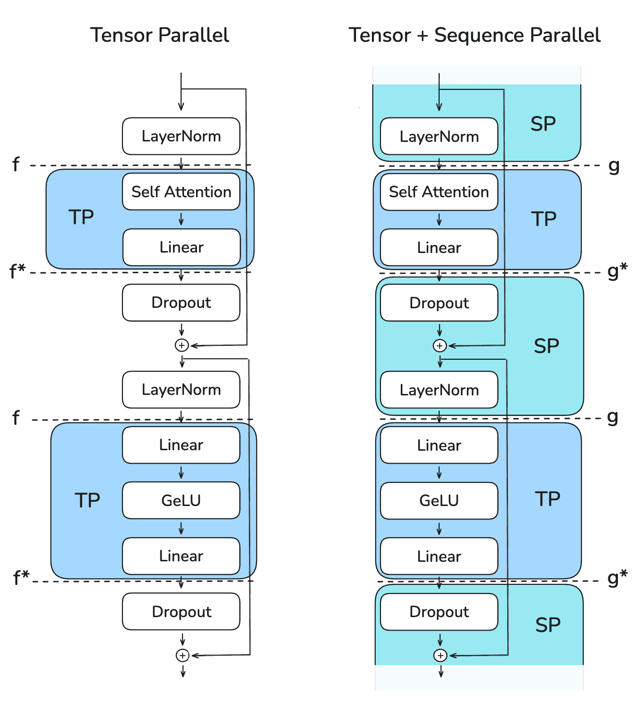

关键挑战在于，高效地管理这些切换，同时保持较低的显存占用并确保正确性。

在张量并行的前向传播中：

- *f* 是空操作（no-op），因为激活已经在各个 rank 上复制。
- *f\** 是 all-reduce，用于同步激活并确保正确性。

在反向传播中：

- *f\** 是空操作，因为梯度已经在各个 rank 上复制。
- *f* 是 all-reduce，用于同步梯度。

这些 *f* 和 *f\** 操作被称为**共轭对（conjugate pairs）**，因为它们相互补充：在一次传播中，当一个是空操作时，另一个就是 all-reduce，而在另一次传播中情况相反。

对于序列并行，我们使用标记为 *g* 和 *g\** 的不同操作。
具体来说，我们避免在 SP 区域使用 all-reduce，因为那会要求收集完整的激活并增加峰值显存占用，从而违背 SP 的目的。

那么，这里究竟发生了什么？
用某个著名大语言模型的话来说，我们一步一步来看：

**起始 LayerNorm 层（SP 区域）**

- 输入张量 *X1\** 和 *X2\** 的形状为 $(b,s/2,h)$，进入时已经沿序列维度拆分。
- 每张 GPU 独立对自己的序列块计算 LayerNorm，得到 *Y1\** 和 *Y2\**。

**第一次切换（SP → TP）**

- *g* 操作（all-gather）将 *Y1* 和 *Y2* 合并，恢复完整序列长度。
- 将 *Y* 恢复为 $(b,s,h)$，因为 column-linear 层需要完整的隐藏维度 $h$。

**第一个线性层（TP 区域）**

- *A1* 和 *A2* 是 column-linear 层，因此它们沿隐藏维度拆分 *Y*。
- 每张 GPU 独立应用 GELU。
- *Z1\** 和 *Z2\** 的形状为 $(b,s,h/2)$。

**第二个线性层（TP 区域）**

- *B1* 和 *B2* 是 row-linear 层，因此它们恢复隐藏维度。
- *W1* 和 *W2* 的形状为 $(b,s,h)$，需要相加。

**最后一次切换（TP → SP）**

- *g\** 操作（reduce-scatter）进行归约，以确保前面的 row-linear 计算正确，同时沿序列维度进行分散。
- *W1\** 和 *W2\** 的形状为 $(b,s/2,h)$。

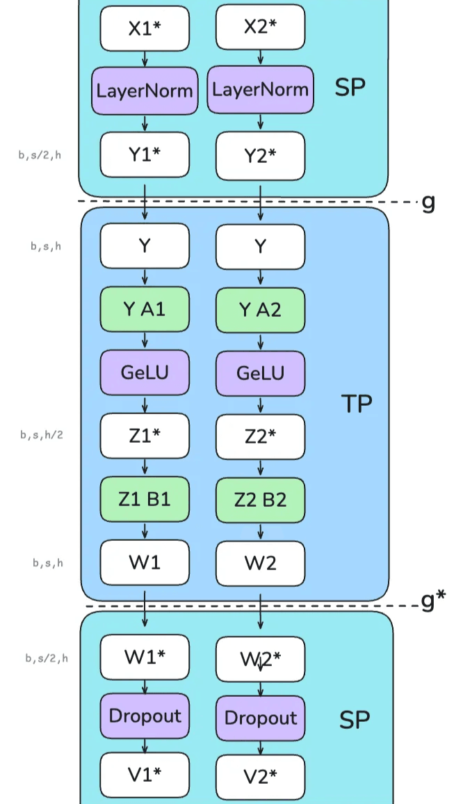

序列并行的一个关键优势是，它减少了我们需要保存的最大激活大小。
只使用张量并行时，我们必须在多个位置保存形状为 $(b,s,h)$ 的激活。
但使用序列并行后，由于我们始终沿序列维度或隐藏维度拆分，最大激活大小会减少到 $\frac{b \cdot s \cdot h}{tp}$。

要跟踪 TP 和 TP+SP 中各部分不同的分片方式有些困难——相信我们，我们自己梳理时也觉得很难，所以我们制作了下面这个小表格，总结前向传播过程中激活（也称为 `hidden_states`）在隐藏维度 $h$ 和序列维度 $s$ 上的形状变化：

| 区域 | 仅 TP | TP 与 SP 配合 |
|---|---|---|
| 进入 TP（column-linear） | $h$：分片（`weight_out` 被分片）；$s$：完整 | $h$：分片（`weight_out` 被分片）；$s$：通过 **all-gather** 恢复完整 |
| TP 区域 | $h$：分片；$s$：完整 | $h$：分片；$s$：完整 |
| 离开 TP（row-linear） | $h$：完整（`weight_out` 完整，并通过 **all-reduce** 确保正确性）；$s$：完整 | $h$：完整（`weight_out` 完整，并通过 **reduce-scatter** 确保正确性）；$s$：通过 **reduce-scatter** 分片 |
| SP 区域 | $h$：完整；$s$：完整 | $h$：完整；$s$：分片 |

对于嵌入层：

| 区域 | 原始 TP | TP 与 SP 配合 |
|---|---|---|
| 嵌入层（row-linear，沿词表分片） | $h$：完整（`weight_out` 完整，并通过 **all-reduce** 确保正确性）；$s$：完整 | $h$：完整（`weight_out` 完整，并通过 **reduce-scatter** 确保正确性）；$s$：通过 **reduce-scatter** 分片 |

使用序列并行后，我们可以进一步节省激活显存，从而使用比单独使用张量并行时更大的批大小和更长的序列。
我们来看看，这对前面的 70B 模型示例意味着什么：

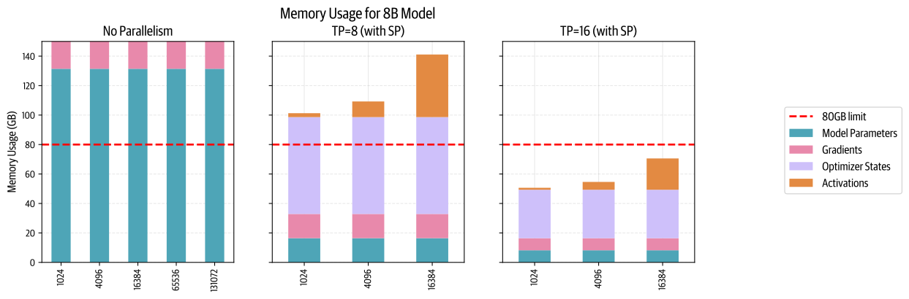

我们再次大幅降低了每张 GPU 的最大显存占用，使我们能够在 TP+SP=16 时容纳 16k token 的序列——这比原始 TP 的情况有所改善！
（正如上一节看到的，TP=16 仍然有点大，但下一节会介绍如何进一步改进。）

你可能会问，使用 TP+SP 是否比原始 TP 带来更多通信开销。
答案是，既是也不是。
在原始 TP 的前向传播中，每个 Transformer 块有两次 all-reduce 操作；而在 SP 中，每个 Transformer 块有两次 all-gather 和两次 reduce-scatter 操作。
因此，SP 的通信操作次数是 TP 的两倍。
但由于一次 all-reduce 操作可以分解为一次 all-gather 和一次 reduce-scatter（见附录中的 [“Ring AllReduce”](https://huggingface.co/spaces/nanotron/ultrascale-playbook?section=a_quick_focus_on_ring_allreduce) 一节），两者在通信成本上实际上是等价的。
同样的推理也适用于反向传播，因为我们只需使用每个操作的共轭操作（no-op ↔ allreduce，allgather ↔ reducescatter）。

如果你一直仔细阅读，就会发现我们说的是每层四次通信操作（注意力两次，MLP 两次）。
下面是使用 TP+SP 时 MLP 的性能剖析结果：


和原始 TP 一样，TP+SP 也很难与计算重叠，因此吞吐量高度依赖通信带宽。
同样，和原始 TP 一样，TP+SP 通常也只在节点内部使用（将 TP 度控制在每个节点的 GPU 数量以内，例如 TP≤8）。

我们可以通过基准测试，观察随着张量并行规模扩大，这种通信开销如何变得越来越成问题。
对于一个序列长度为 4,096 的 3B 参数模型，我们在启用 SP 的同时提高 TP 度，测量吞吐量和显存利用情况：

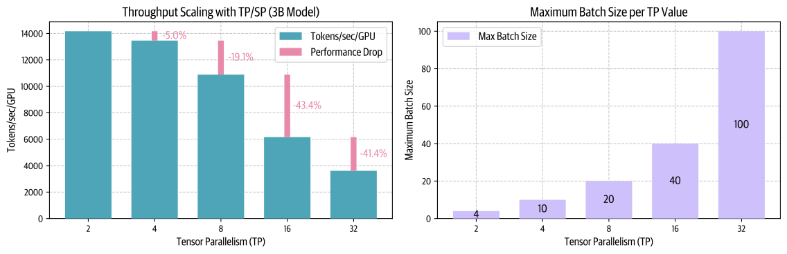

这里同样存在计算效率（左图）与显存容量（右图）之间的权衡。
虽然更高的并行度通过减少激活显存，使模型能够处理大得多的批大小，但它也会降低单张 GPU 的吞吐量，尤其是在超过每个节点 GPU 数量所对应的阈值之后。

我们来总结一下观察结果：

- 对于这两种方法，从 TP=8 增加到 TP=16 时，性能下降幅度最大，因为此时通信从仅在单个节点内进行（NVLink）变为跨节点进行（EFA）。
- TP 与 SP 配合使用时节省的激活显存，使我们能够容纳比单独使用 TP 大得多的批次。

我们已经看到，TP 通过沿隐藏维度拆分注意力和前馈运算，帮助我们将激活分片到多张 GPU 上，而 SP 则沿序列维度拆分剩余操作，构成自然的补充。

> 📝 注记
>
> 由于 SP 区域中的 LayerNorm 层处理序列的不同部分，它们的梯度在各个 TP rank 之间会有所不同。
> 为了确保权重保持同步，我们需要在反向传播期间对这些梯度执行 all-reduce，这与 DP 保持权重同步的方式类似。
> 不过，由于 LayerNorm 的参数相对较少，这只会带来很小的通信开销。

不过，TP+SP 仍然有两个限制：如果增加序列长度，TP 区域中的激活显存仍会急剧增长；如果模型大到无法在 TP=8 时放下，节点间连接就会导致严重的性能下降。

我们可以用**上下文并行**解决第一个问题，用**流水线并行**解决第二个问题。
我们先来看上下文并行！
