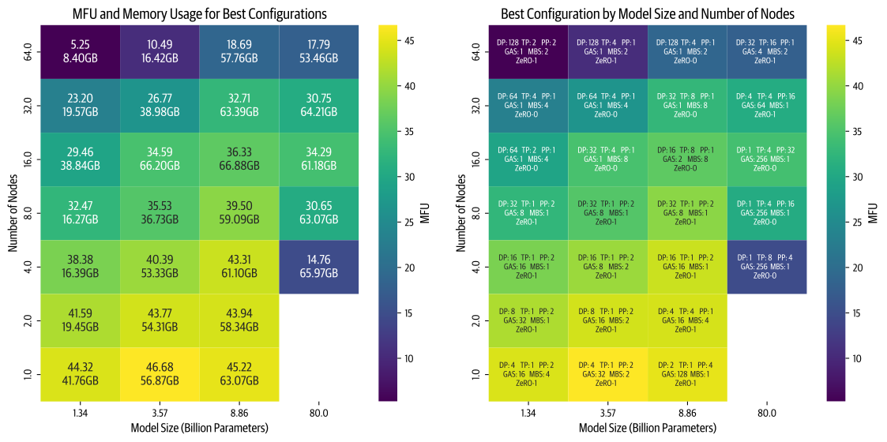

# 寻找最佳训练配置

现在，我们已经介绍了实际用于分布式训练更大模型的全部并行技术，以及它们如何、为何能够结合使用。
不过，总体问题仍然存在：应该选择哪些技术，又该如何决定具体组合？

上一节稍微提到了这一点，现在我们来更详细地逐步梳理一种可能的决策过程（请记住，考虑到计算集群的各种物理属性、网络带宽、每节点 GPU 数量、每张 GPU 的显存等，你始终需要运行一些实验，才能找到最终的最优配置）。

## 步骤 1：让一个训练步放入显存

首先，需要弄清楚如何将一个完整模型实例放到 GPU 上。
总体上有两种情况：

**1. GPU 充裕的情况 🤑**：有大量可用 GPU 时：

- 对于参数量小于 10B 的模型，可以使用一种并行技术，例如张量并行，或在 8 张 GPU 上使用 ZeRO-3/DP 并进行完全重计算。
- 对于参数量为 10B–100B、需要超过 8 张 GPU 的模型，有几种选择：
  - 将张量并行（TP=8）与流水线并行结合。
  - 将张量并行（TP=8）与数据并行（ZeRO-3）结合。
  - 只使用 ZeRO-3（即纯数据并行）。
- 在 512 张以上 GPU 的规模下，纯数据并行/ZeRO-3 会因通信成本而开始变得低效，此时将 DP 与张量并行或流水线并行结合可能更好。
- 在 1024 张以上 GPU 的规模下，一种推荐配置可能是将张量并行（TP=8）、数据并行（ZeRO-2）和流水线并行结合。

> 目前我们重点考虑放下单个实例；虽然可能使用 DP 中的 ZeRO 来达到这一目标，但这里只关注它配合 ZeRO-3 时带来的模型参数显存节省。

*特殊考虑：*

- 对于很长的序列，你可能需要加入跨节点上下文并行。
- 对于混合专家架构，使用跨节点专家并行会有优势。

**2. GPU 不足的情况 😭**：GPU 资源可能较少时：

- 可以启用完全激活重计算，用一些计算换取显存（训练会稍慢）。
- 可以增加梯度累积，在有限显存下处理更大的批次。

现在，第一个模型实例已经开始训练，我们需要确保批大小正确。

## 步骤 2：达到目标全局批大小

根据步骤 1 得到的微批次大小和 DP 配置，当前批大小可能过小或过大。
现在需要达到目标批大小。

要增大当前全局批大小：

- 可以扩大数据并行规模，或增加梯度累积步数。
- 对于长序列，可以利用上下文并行。

要减小当前全局批大小：

- 可以减少数据并行，更多采用其他并行策略。
- 对于长序列，可以减少上下文并行。

好了，现在模型已经按我们希望的模型大小和批大小总体配置运行，但这是否是最快的训练方式？
最后一步是优化吞吐量。

## 步骤 3：优化训练吞吐量

我们希望确保训练尽可能快地运行，使所有宝贵的 GPU 始终得到充分利用。
只要显存和通信不是瓶颈，就可以尝试以下做法：

- 扩大张量并行规模（利用快速的节点内带宽），直到并行度接近节点规模，从而减少其他并行形式。
- 在保持目标批大小的同时，增加使用 ZeRO-3 的数据并行规模。
- 当数据并行通信开始成为瓶颈时，转向使用流水线并行。
- 逐一尝试扩大不同并行方式的规模。
- 尝试不同的微批次大小（$mbs$），在最大全局批大小、模型大小、计算和通信之间寻求最优平衡。

## 对数千种配置进行基准测试

现在，我们已经介绍了逐步决策过程，接下来将这一搜索过程付诸实践。

在 [Nanotron](https://github.com/huggingface/nanotron) 仓库中，你可以找到若干脚本，用来运行前面讨论的所有实验，并对自己的模型和集群进行基准测试。

为了得到本书目前介绍的结果，我们确实亲自对**数千种分布式配置**进行了基准测试，覆盖这里讨论的全部模型规模，以及大量集群配置（具体来说，是 1–64 个节点，每节点 8 张 H100）。

> 我们想借此机会向同事们道歉，因为我们占用了大部分科研集群；作为回应，我们也原谅他们可能私下说出的任何威胁。

现在，我们退后一步，汇集并分析所有基准测试结果，看看在理论之外，能否通过真实数据发现不同配置之间的表现差异。

以下所有基准测试都采用 4,096 的序列长度和 1M token 的全局批大小。
我们收集了每种模型规模和集群规模下表现最好的配置，并绘制为以下热力图：

热力图展示不同模型规模和计算节点数量下的最优训练配置（每个节点有 8 张 GPU）。
对于每种组合，配置详情包括数据并行（DP）、张量并行（TP）、流水线并行（PP）、梯度累积步数（GAS）、微批次大小（MBS）和 ZeRO 优化阶段。
颜色深浅表示模型 FLOPs 利用率（MFU），颜色越亮，效率越高。

从这张总体可视化中，可以得出几项重要认识：

- 首先，随着节点数量增加（并行度提高），我们观察到效率下降。
  这一现象对较小模型尤其明显，因为它们的计算量与模型大小之比较低。
  虽然通常可以通过增大批大小来弥补模型较小的问题，但这里受 1M 全局批大小上限约束。
- 其次，较大模型带来了不同挑战。
  随着模型规模增大，显存需求显著增长。
  在节点较少时，这会造成两种情况：模型完全放不下，或者虽然放得下，但因为接近 GPU 显存极限而运行低效（例如在 4 个节点上训练 80B 参数模型）。
- 最后，基准测试表明，性能高度依赖实现质量。
  最初实现这两种并行策略时，张量并行优于流水线并行。
  优化 PP 代码之后，PP 成了更快的选择。
  现在，我们正在改善 TP 实现中的通信重叠，预计它将重新取得性能领先。

## 基准测试中的经验

本书的目标不仅是讨论理论与实现，也要提供实际数据点。
因此，计划很简单：为每个模型和若干种集群规模，运行所有可能的分布式配置。
即使排除不可能的配置之后，仍然需要运行数千次实验。

纸面上，这听起来很容易：我们可以轻松在集群上启动大批作业。
但刚启动前几批实验，麻烦就开始了：

- PyTorch 进程有时无法正确清理。
- Slurm 作业管理器会强制终止作业，导致节点故障。
- 本应几分钟完成的简单基准测试，会拖成数小时。
- 一些作业会无限期挂起。

要在有限时间内跑完所有实验，还需要额外的工程工作，最终我们在以下事情上花了大量时间：

- 尽可能缩短集群重启时间，并优化空闲时间。
- 分析详细的 NCCL 调试日志。
- 理解显存使用模式和 CUDA 显存分配器的行为。
- 改善多节点配置下的流水线并行性能。

这些挑战让我们深刻认识到分布式训练基础设施的复杂性。
理论上看似简单的事情，实践中往往需要仔细照顾许多相互作用的部分。

在现实中复现理论结果很有挑战，尤其是可获得的生产训练代码有限。
通过 [Nanotron](https://github.com/huggingface/nanotron) 和 [Picotron](https://github.com/huggingface/picotron) 等开源项目，我们希望让分布式训练技术更容易使用，也希望共同建设简单而高效的代码库，帮助研究者和实践者充分利用硬件资源。

---

至此，我们对 5D 并行分布式方法的深入探索结束了。

退后一步看，到目前为止，我们的讨论往往依赖一个关键假设：GPU 上的计算和通信能够高效重叠，而不影响计算吞吐量。
现实更为复杂。
使用 NCCL send/recv 等常见通信原语时，计算与通信资源之间存在隐性的争用，因为通信 kernel 通常会使用与计算相同的 GPU 流式多处理器（下一节将讨论）。
这会使通信与计算重叠时的吞吐量下降。
要真正优化分布式训练，我们需要进一步了解 GPU 架构本身。

> 此外，重叠计算与通信时的同步模式，未必始终最适合我们的并行策略。
> PyTorch 团队的[这篇博客文章](https://discuss.pytorch.org/t/distributed-w-torchtitan-introducing-async-tensor-parallelism-in-pytorch/209487)给出了一个例子。

是时候关灯，开启 CUDA 模式了！
